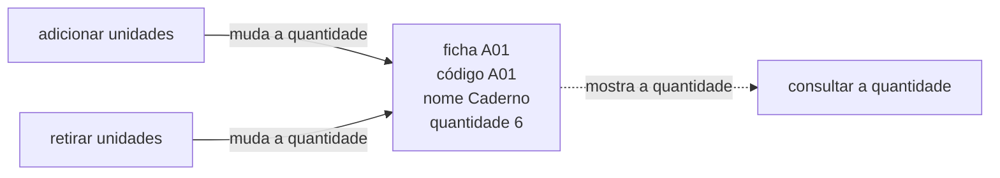
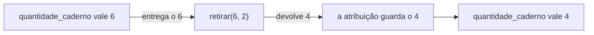
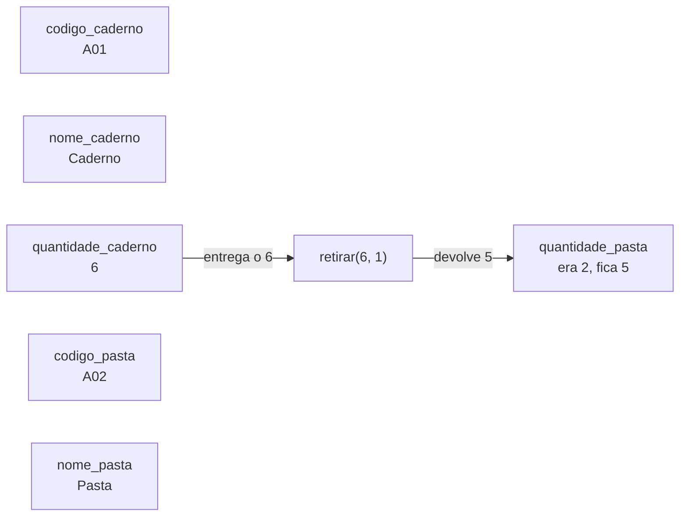
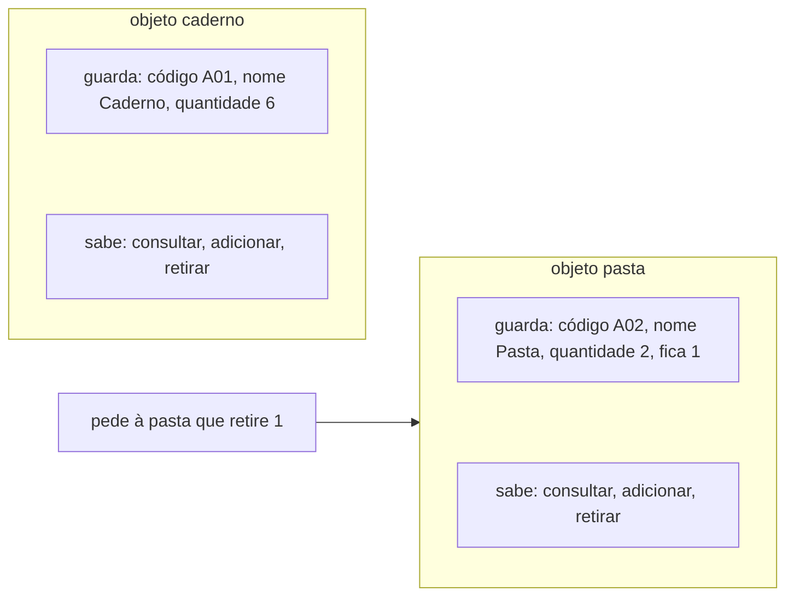

# Entidades, estado e ações

Neste guia vês que informação um programa guarda sobre os materiais de uma sala de aula, que operações se lhe podem pedir e que regras têm de cumprir. Depois comparas duas maneiras de organizar um programa, e vês em Python porque é que guardar cada material em variáveis separadas o torna frágil. No fim, segues os valores de um programa passo a passo, numa tabela.

Usa o Python do 10.º ano, sobretudo a atribuição com `=`, as funções com `return` e as condições com `if` e `and`. Para o rever, tens o [diagnóstico](../avaliacoes/diagnostico-inicial.md) e a [ficha de recuperação](exercicios/bridge-raciocinio.md), sem entrega. Para praticar: [laboratório](laboratorios/01-entidades-estado-acoes-laboratorio.md) e [ficha de exercícios](exercicios/01-entidades-estado-acoes-exercicios.md).

## Neste guia

1. [Parte 1: A informação e as operações de um artigo](#parte-1-a-informação-e-as-operações-de-um-artigo)
2. [Parte 2: Duas maneiras de organizar um programa](#parte-2-duas-maneiras-de-organizar-um-programa)
3. [Exemplo guiado: seguir os valores passo a passo](#exemplo-guiado-seguir-os-valores-passo-a-passo)

## Parte 1: A informação e as operações de um artigo

Imagina que és responsável pelos materiais de uma sala de aula. No armário há cadernos, pastas e canetas. Durante a semana, umas unidades saem do armário, porque são usadas, e outras entram, porque chegou material novo. Quando alguém pergunta "ainda temos pastas?", queres responder sem abrir o armário e contar tudo outra vez.

Para isso faz-se um inventário, isto é, um registo dos materiais, e mais tarde um programa que o mantém. Antes de escrever o programa, há duas escolhas a fazer: que informação se guarda sobre cada material, e que operações fazem sentido sobre essa informação.

### A informação que interessa guardar

A ficha de um material pode ter este aspeto:

| Informação | O que guardámos |
| --- | --- |
| Código | A01 |
| Nome | Caderno |
| Quantidade | 6 |

Cada linha serve para uma coisa diferente. O código identifica o material: nunca se repete, e por isso distingue-o de todos os outros, mesmo que haja nomes parecidos, como "Caderno" e "Caderno quadriculado". Na escola passa-se o mesmo contigo: pode haver dois alunos com o mesmo nome, mas não com o mesmo número.

O nome serve as pessoas. O código A01 não diz nada a quem abre o armário, e a palavra "Caderno" diz. A quantidade diz quantas unidades há neste momento, e é a informação que mais muda.

No inventário, chama-se **artigo** a cada tipo de material, como "Caderno" ou "Pasta", e cada artigo tem uma ficha, que é uma linha do registo. A ficha A01 é a do artigo "Caderno", de que há seis unidades. Não há seis fichas, uma por caderno: há uma ficha, com o número 6 lá dentro. Se chegarem mais quatro cadernos, não se criam fichas novas. Muda-se o 6 para 10.

Esta é uma escolha de **representação**: decidir o que um programa guarda sobre um problema, e o que deixa de fora. Para acompanhar cada portátil da escola, com o número de série e o nome de quem o requisitou, era precisa uma ficha por portátil. Com os cadernos não faz sentido, porque ninguém quer saber qual dos seis foi usado, só quantos restam.

### Entidade: aquilo que escolhemos representar

No inventário da sala, o programa precisa do código, do nome e da quantidade de cada artigo. A parede e o quadro também existem, mas nenhuma pergunta do inventário precisa deles. Chama-se **entidade** a cada coisa sobre a qual o programa precisa de guardar informação: o artigo é uma entidade, e a parede não. Existir não chega para entrar no programa.

Uma entidade também pode ser uma coisa em que não se toca, como uma reserva de sala, uma tarefa por fazer ou uma encomenda. Uma encomenda é um pedido de compra feito a uma loja. Na caixa que chega pega-se, mas na encomenda não, e mesmo assim ela tem informação própria: a data em que foi feita e o que se encomendou.

O que decide é a pergunta a que o programa tem de responder. Por isso, a mesma coisa pode ser entidade num problema e não ser noutro. Num programa para a biblioteca da escola, as entidades seriam os livros, os leitores e os empréstimos. As estantes só entravam se o programa tivesse de dizer em que estante está cada livro.

O inventário da sala tem duas entidades: os artigos e o próprio inventário, que guarda os artigos todos e não deixa haver dois com o mesmo código.

### Estado: como está a informação neste momento

A ficha A01 diz que há 6 cadernos, e depois de alguém retirar 2 passa a dizer 4. Chama-se **estado** ao conjunto dos valores de uma entidade num certo momento. O estado é como uma fotografia: mostra como as coisas estão agora, e daqui a cinco minutos pode ser outra.

| Informação | Antes de retirar | Depois de retirar 2 |
| --- | --- | --- |
| Código | A01 | A01 |
| Nome | Caderno | Caderno |
| Quantidade | 6 | 4 |

O estado mudou, mas o artigo continua a ser o A01, e não passou a ser outro material. A **identidade** é o que faz dele o mesmo artigo, mesmo quando o estado muda, e no inventário é o código que a mostra. No futebol é igual: o marcador está 1-0 ao intervalo e 2-1 no fim, e o jogo é o mesmo. O marcador mostra o estado do jogo.

### Comportamento: o que podemos pedir que aconteça

Guardar dados não chega, porque um inventário serve para ser consultado e atualizado. A um artigo faz sentido pedir três coisas: consultar a quantidade, adicionar unidades quando chega material e retirar unidades quando o material é usado. Cada uma destas ações é uma **operação**. O conjunto das operações que se podem pedir a uma entidade é o seu **comportamento**.

"Quantidade 6" descreve o estado, isto é, como as coisas estão. "Retirar 2" é um pedido: uma operação com o número de unidades, que pede que alguma coisa aconteça.

Consultar também é uma operação, mas não muda a quantidade, tal como ver as horas não muda as horas. Há operações que só leem o estado e operações que o mudam, e muitos erros vêm de confundir as duas.



A consulta só lê: a quantidade vai da ficha para quem pergunta, e a ficha fica igual. As outras duas operações mudam a quantidade.

As operações dependem da informação que se guarda. "Pintar o artigo de azul" não é uma operação do inventário, porque não se guardam cores. E, se uma operação precisa de uma informação que não está na ficha, falta alguma coisa na ficha.

### Uma operação tem de respeitar regras

Com 6 cadernos, podes retirar 2. Não podes retirar 9, porque não há unidades que cheguem: a ficha ficaria com -3 cadernos, um número que não corresponde a nada no armário. O programa deve recusar o pedido, e recusar é não mexer. A quantidade fica em 6.

Para saber quando aceitar e quando recusar, escrevem-se as regras que cada ficha tem de cumprir. O inventário tem três:

1. Cada código identifica um único artigo.
2. O nome do artigo está preenchido.
3. A quantidade é um número inteiro **não negativo**.

Inteiro quer dizer sem parte decimal: não há quatro cadernos e meio. Não negativo quer dizer zero ou mais: 0, 1, 2, 3 e assim por diante. Ter zero unidades é um estado válido. O material esgotou, mas continua no inventário.

Uma operação só é aceite se, depois dela, a ficha continuar a cumprir estas regras. Os pedidos têm ainda uma regra própria. O número de unidades de um pedido para adicionar ou para retirar tem de ser inteiro e **positivo**, isto é, 1 ou mais. Pedir para retirar 0 é recusado, porque não corresponde a nenhuma ação real e quase sempre é um engano de quem o fez.

As duas regras do zero não se contradizem, porque respondem a perguntas diferentes: "este estado é válido?" e "este pedido é válido?". Com 6 unidades:

| Pedido | O que decide | O que acontece |
| --- | --- | --- |
| Retirar 6 | 6 é positivo e não passa de 6 | Aceite: fica 0, que é um estado válido |
| Retirar 0 | 0 não é positivo | Recusado: fica 6 |
| Retirar 9 | 9 passa de 6, e a quantidade ficaria negativa | Recusado: fica 6 |

O zero da primeira linha é o do estado, e é válido. O da segunda é o do pedido, e não é.

## Parte 2: Duas maneiras de organizar um programa

Agora a ficha A01 passa para um programa em Python, escrito da maneira que já conheces. No fim, vês o que muda na outra maneira, ainda sem código.

Uma maneira de pensar e de organizar um programa chama-se um **paradigma de programação**. Um paradigma não é uma linguagem: em Python, por exemplo, pode escrever-se em mais do que um. É como arrumar um armário com os materiais numa prateleira e as ferramentas noutra, ou com cada material numa caixa, junto das ferramentas que servem para ele. As coisas são as mesmas, e muda a maneira de as arrumar.

### A maneira habitual nos primeiros programas: programação estruturada

Nos primeiros programas, os dados ficam em variáveis, e as operações são funções que recebem dados e devolvem resultados. O programa é uma sequência de passos, e as condições e os ciclos decidem que passos se executam. Esta maneira de organizar chama-se **programação estruturada**.

Este programa guarda assim a ficha A01 e faz dois pedidos ao caderno: retirar 2 e, a seguir, retirar 5. Para o experimentares, guarda-o num ficheiro `.py` e executa-o no editor das aulas, com o Python 3.10 ou mais recente.

```python
# inventario.py: o artigo A01 e uma função que retira unidades de uma quantidade.


def retirar(quantidade, unidades):
    """Devolve a quantidade que fica depois de um pedido de retirada.

    Se o pedido for possível, devolve a quantidade menos as unidades pedidas.
    Se não for possível, devolve a quantidade que recebeu, sem mudanças.
    """
    if unidades > 0 and unidades <= quantidade:
        return quantidade - unidades
    return quantidade


# O artigo A01 fica guardado em três variáveis separadas.
codigo_caderno = "A01"
nome_caderno = "Caderno"
quantidade_caderno = 6

quantidade_caderno = retirar(quantidade_caderno, 2)
print(nome_caderno, quantidade_caderno)

quantidade_caderno = retirar(quantidade_caderno, 5)
print(nome_caderno, quantidade_caderno)
```

O programa mostra:

```text
Caderno 4
Caderno 4
```

Leitura guiada: o programa tem duas partes. A primeira, do `def` ao último `return`, define a função `retirar`, e as linhas indentadas (mais afastadas da margem) por baixo do `def` pertencem-lhe. Definir a função não a executa: só a deixa pronta para ser usada. A segunda parte guarda o caderno em três variáveis e faz os dois pedidos, e é aí que a função corre.

O texto entre três aspas, logo a seguir ao `def`, é uma **docstring** (do inglês, texto de documentação). Explica a pessoas o que a função faz e o que devolve. O Python não a trata como uma instrução, mas alguns editores, como o VS Code, mostram-na quando passas o rato por cima do nome da função. Neste módulo, cada função leva uma docstring, porque obriga quem a escreve a dizer o que a função promete.

A linha do `if` junta as duas condições de um pedido de retirada: `unidades > 0` é a regra dos pedidos, e `unidades <= quantidade` garante que a quantidade não fica negativa. O `and` (em português, "e") exige as duas. Na primeira chamada, a função recebe 6 e 2, as duas condições são verdadeiras, e o primeiro `return` devolve 4. A função termina aí, sem chegar à última linha. Na segunda chamada, recebe 4 e 5, e a condição é falsa, porque 5 passa de 4. O Python salta o primeiro `return`, e o segundo devolve o 4 que recebeu. Por isso aparece `Caderno 4` duas vezes.

<details>
<summary>Para ires mais longe: o que a função retirar ainda não faz</summary>

A função tem duas limitações. Quem a chama não fica a saber se o pedido foi recusado, porque recebe só um número. E não verifica se o pedido é inteiro, por isso aceitaria retirar 1.5 unidades. O Python escreve os números com parte decimal com um ponto, `1.5`, onde em português se escreve 1,5. As duas limitações resolvem-se no guia [Encapsulamento e contratos](03-encapsulamento-contratos.md).

</details>

### A função devolve um valor, e a atribuição guarda-o

Na linha `quantidade_caderno = retirar(quantidade_caderno, 2)` acontecem duas coisas, e lê-se da direita para a esquerda. Primeiro, o Python chama a função com os valores 6 e 2, e a função devolve 4. Só depois a atribuição guarda esse 4 em `quantidade_caderno`. A função, sozinha, não muda a variável: recebe um número e devolve outro. Quem muda a variável é a atribuição.



A variável entrega o seu valor, 6, à função, e continua com ele. A função devolve 4, e só a atribuição o guarda na variável.

Se a linha fosse só `retirar(quantidade_caderno, 2)`, sem `quantidade_caderno =` à esquerda, que valor ficava na variável? Ficava 6. A função recebia 6 e 2 e devolvia 4, mas esse 4 não ia para lado nenhum e perdia-se. Não aparece nenhuma mensagem de erro, porque para o Python chamar uma função e não guardar o resultado é uma instrução como outra qualquer. O pedido era verificado e a conta era feita, mas a ficha não mudava.

### O problema das variáveis soltas

Agora o programa ganha o artigo A02, "Pasta", com 2 unidades, e tem um engano pequeno, do género que acontece a toda a gente.

```python
# inventario.py: o caderno e a pasta, cada um guardado em três variáveis soltas.


def retirar(quantidade, unidades):
    """Devolve a quantidade que fica depois de um pedido de retirada.

    Se o pedido for possível, devolve a quantidade menos as unidades pedidas.
    Se não for possível, devolve a quantidade que recebeu, sem mudanças.
    """
    if unidades > 0 and unidades <= quantidade:
        return quantidade - unidades
    return quantidade


codigo_caderno = "A01"
nome_caderno = "Caderno"
quantidade_caderno = 6

codigo_pasta = "A02"
nome_pasta = "Pasta"
quantidade_pasta = 2

# Queríamos retirar 1 pasta, mas escrevemos a variável do caderno no pedido.
quantidade_pasta = retirar(quantidade_caderno, 1)

print(nome_caderno, quantidade_caderno)
print(nome_pasta, quantidade_pasta)
```

A pasta tinha 2 unidades, e o pedido era para retirar 1. Com quantas fica? Segue os valores que a linha do pedido usa de facto, e não o que o comentário diz que se queria.

```text
Caderno 6
Pasta 5
```

A pasta ficou com 5, e não apareceu nenhuma mensagem de erro. O diagrama segue o engano:



A quantidade do caderno, 6, entrou na função, e o resultado, 6 - 1, foi parar à variável da pasta. Cada instrução fez o que estava escrito.

Para o Python, as seis variáveis são caixas soltas. A ligação entre `codigo_pasta`, `nome_pasta` e `quantidade_pasta` só existe nos nomes que lhes demos. O programa não sabe que as três descrevem a mesma pasta, nem que `quantidade_caderno` é de outro artigo. A função `retirar` também não sabe nada de artigos: recebe dois números e devolve um terceiro. Chamam-se **variáveis soltas** a estas variáveis, que guardam cada uma um pedaço de um artigo, sem nada no programa que as ligue às outras.

Com dois artigos já são seis variáveis, e com cinquenta seriam cento e cinquenta. Cada pedido teria de levar a variável certa, escrita à mão, e nada no programa ajudava a dar por uma troca.

### A outra maneira: programação orientada a objetos

Na **programação orientada a objetos**, os dados de um artigo e as operações sobre ele ficam juntos. O código, o nome e a quantidade do caderno ficam num **objeto**, e esse objeto sabe consultar, adicionar e retirar. Também se diz programação orientada por objetos, e abrevia-se POO. Em vez de "chama a função `retirar` com a quantidade do caderno", passa a dizer-se "pede ao caderno que retire 2".



Cada objeto junta os seus dados e as suas operações, e um pedido só mexe na quantidade do objeto a quem é feito. A pasta fica com 1, e o caderno continua com 6. Já não se pode entregar a quantidade de um artigo a outro, porque cada objeto só mexe na sua. Ainda se pode pedir ao artigo errado, mas lê-se logo: "pede ao caderno", quando se queria a pasta.

As ideias da Parte 1 têm um nome próprio em programação orientada a objetos:

| Ideia deste guia | Nome em programação orientada a objetos | Onde volta |
| --- | --- | --- |
| Entidade, como o artigo | Objeto | [Guia 02](02-objetos-classes-instancias.md) |
| Estado: código, nome e quantidade | Atributos do objeto, os valores que ele guarda | [Guia 02](02-objetos-classes-instancias.md) |
| Comportamento: consultar, adicionar, retirar | Métodos do objeto, as operações que ele sabe fazer | Guias [02](02-objetos-classes-instancias.md) e [03](03-encapsulamento-contratos.md) |
| Regras: quantidade inteira não negativa | Proteção do estado do objeto | [Guia 03](03-encapsulamento-contratos.md) |

A programação orientada a objetos não deita fora o que já sabes. As variáveis, as condições, os ciclos e as funções continuam, e muitas das funções passam a estar arrumadas junto dos dados a que dizem respeito. A programação estruturada também não está errada: para um cálculo pequeno, uma função solta é muitas vezes o mais simples. A POO ajuda quando há muitas entidades, cada uma com o seu estado e as suas regras, como num inventário.

## Exemplo guiado: seguir os valores passo a passo

O problema: o artigo A01 tem 6 unidades e recebe três pedidos, por esta ordem: consultar a quantidade, retirar 2 e retirar 5. Depois de cada pedido, queremos saber o que aconteceu e com quantas unidades ficou a ficha.

O raciocínio faz-se numa tabela, com uma linha por pedido. Em cada linha, verificam-se as regras antes de mexer na ficha.

| Passo | Pedido | O que acontece | Quantidade depois |
| --- | --- | --- | ---: |
| Início | Nenhum | A ficha indica 6 unidades | 6 |
| 1 | Consultar | Respondemos que existem 6; a ficha não muda | 6 |
| 2 | Retirar 2 | 2 é um inteiro positivo e não passa de 6; fazemos 6 - 2 | 4 |
| 3 | Retirar 5 | 5 é um inteiro positivo, mas só existem 4; o pedido é recusado | 4 |

A linha de início regista o ponto de partida, sem o qual não se saberia de onde parte o passo 1. No passo 1, a consulta não muda a ficha, e o 6 repetido diz isso mesmo: houve uma operação, e o estado ficou igual.

No passo 2, as regras verificam-se antes da conta: 2 é positivo e não passa de 6. Só depois se faz 6 - 2 e se escreve 4 na ficha.

No passo 3, o ponto de partida já não é 6, é 4, porque cada linha começa na quantidade deixada pela anterior. Como 5 é maior do que 4, o pedido é recusado, e a ficha fica com 4. Recusar não é pôr a ficha a zero nem apagá-la. É não mexer.

O resultado: a ficha acaba com 4 unidades, e só o último pedido foi recusado. Uma tabela assim chama-se um **traço**: regista o que acontece em cada passo de uma sequência de instruções, com o estado depois de cada um. Serve para perceber o que um programa faz e, sobretudo, para encontrar erros. Obriga a olhar para o estado antes e depois de cada instrução, e não só para o resultado final.

Para confirmar o traço, compara-o com o primeiro programa de [A maneira habitual nos primeiros programas: programação estruturada](#a-maneira-habitual-nos-primeiros-programas-programação-estruturada). O programa faz os pedidos dos passos 2 e 3 e mostra `Caderno 4` duas vezes, as quantidades da última coluna nesses passos. As 6 unidades do início estão na linha `quantidade_caderno = 6`, e a consulta do passo 1 não tem linha no programa.

## Erros frequentes

### Guardar na ficha o que nenhuma pergunta usa

A ficha tem informação de que o programa nunca precisa, como a cor de um caderno ou a das paredes da sala. Acontece porque, ao princípio, se quer representar tudo o que existe na situação. A ficha fica maior, e o programa mais difícil de escrever e de corrigir, sem responder a nenhuma pergunta nova. Para cada informação, pergunta a que pergunta do programa responde e que operação a usa. Se a resposta for "nenhuma", tira-a da ficha.

### Criar uma ficha nova quando a quantidade muda

Depois de um pedido, aparece no registo outra linha para o mesmo material, como "A01, Caderno, 4" por baixo de "A01, Caderno, 6". Acontece quando se confunde uma mudança de estado com uma coisa nova. Ao fim de um mês haveria dezenas de linhas para o mesmo caderno, e ninguém saberia qual estava certa. Muda o valor na ficha que já existe: o código continua a identificar o mesmo artigo, e só a quantidade muda.

### Começar cada linha do traço na quantidade inicial

No traço do exemplo guiado, o pedido de 5 aparece aceite, com a conta 6 - 5 e a quantidade 1. Acontece quando se volta à quantidade do início em cada linha, como se cada pedido fosse o primeiro. Antes do pedido de 5 já só há 4, porque cada linha parte da quantidade deixada pela de cima. Refaz o traço linha a linha, e começa cada uma no número com que a anterior acabou.

### `NameError: name 'retirar' is not defined`

Ao executar, aparece uma mensagem de erro que acaba nesta linha. Se copiares o primeiro programa só a partir do comentário do artigo A01, sem a função, o Python mostra:

```text
Traceback (most recent call last):
  File ".../inventario.py", line 6, in <module>
    quantidade_caderno = retirar(quantidade_caderno, 2)
                         ^^^^^^^
NameError: name 'retirar' is not defined
```

A primeira linha anuncia o rasto do erro (em inglês, *traceback*). A segunda diz o ficheiro e a linha onde o Python parou, e no lugar dos três pontos aparece a pasta do teu ficheiro. A terceira mostra essa linha. Nas versões recentes do Python, os `^` apontam o nome que ele não conhece. A última explica o erro: `NameError` quer dizer erro de nome, e o nome `retirar` não está definido.

Acontece quando se copia só uma parte do programa, sem a função, ou quando a função fica escrita depois das linhas que a usam. O Python executa o ficheiro de cima para baixo, e, quando chega à chamada, ainda não conhece a função. Copia o programa completo, com a função no início, antes de todas as chamadas.

## Palavras novas deste guia

- Artigo: cada tipo de material do inventário, com o código, o nome e a quantidade.
- Representação: a escolha do que um programa guarda sobre um problema, e do que deixa de fora.
- Entidade: uma coisa sobre a qual o programa precisa de guardar informação, como um artigo ou uma encomenda.
- Estado: o conjunto dos valores de uma entidade num certo momento, como uma fotografia.
- Identidade: o que faz de um artigo o mesmo artigo, mesmo quando o estado muda; no inventário, é o código que a mostra.
- Operação: uma ação que se pode pedir a uma entidade, como consultar, adicionar ou retirar.
- Comportamento: o conjunto das operações que se podem pedir a uma entidade.
- Não negativo: zero ou mais.
- Positivo: maior do que zero, isto é, 1 ou mais, num número inteiro.
- Paradigma de programação: uma maneira de pensar e de organizar um programa; não é uma linguagem.
- Programação estruturada: a maneira de organizar em que os dados ficam em variáveis e as operações são funções.
- Docstring (do inglês, texto de documentação): o texto entre três aspas, logo a seguir ao `def`, que explica a pessoas o que a função faz e o que devolve.
- Variáveis soltas: variáveis que guardam cada uma um pedaço de um artigo, sem nada no programa que as ligue às outras.
- Programação orientada a objetos (POO): a maneira de organizar em que os dados de cada entidade e as operações sobre eles ficam juntos, num objeto.
- Objeto: junta os dados de uma entidade e as operações sobre ela; o objeto caderno guarda o código, o nome e a quantidade, e sabe consultar, adicionar e retirar.
- Traço: a tabela que regista o que acontece em cada passo de uma sequência de instruções, com o estado depois de cada um.

## O que vem a seguir

No tema seguinte, [Objetos, classes e instâncias](02-objetos-classes-instancias.md), o Python passa a juntar os dados e as operações de cada artigo num objeto.


