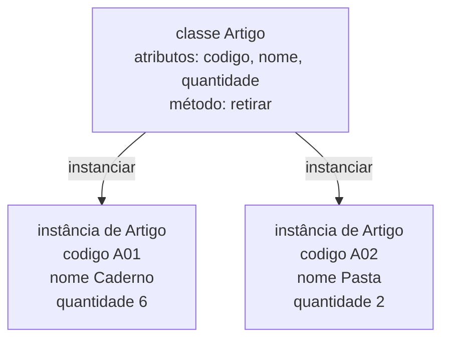
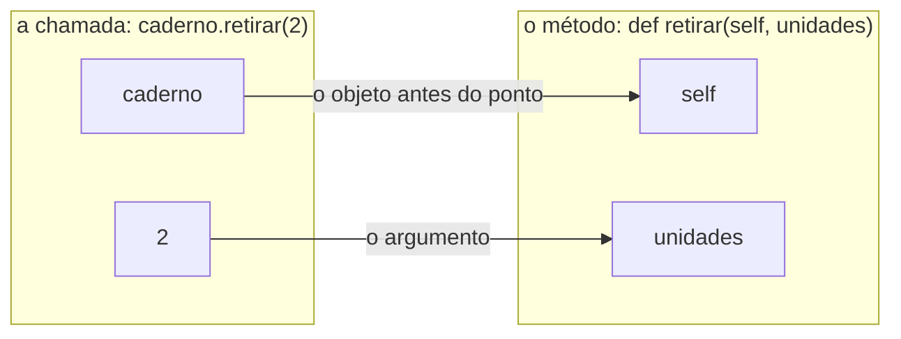
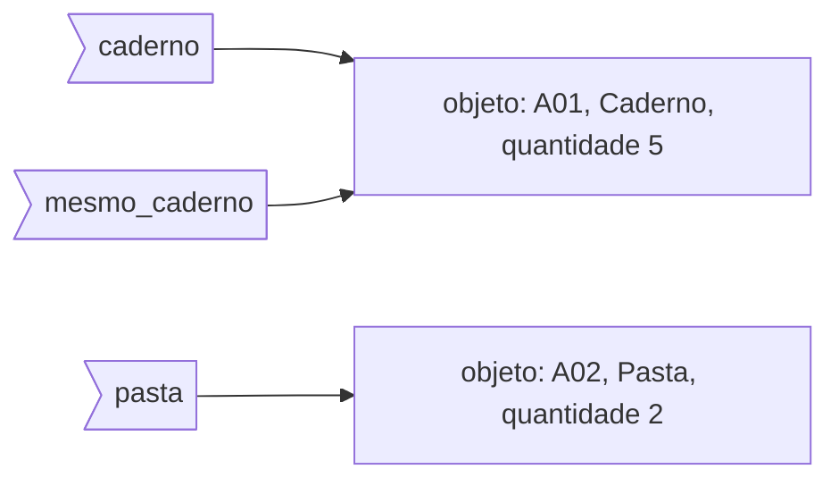

# Objetos, classes e instâncias

Neste guia, cada artigo do inventário passa a ser um objeto do Python, que guarda os seus dados e sabe fazer as suas operações. Vês como uma classe descreve todos os artigos de uma só vez, como se criam objetos a partir dela e como se lhes fazem pedidos.

Usa o que viste no guia anterior sobre o objeto, o estado de um artigo e o valor que uma função devolve. Rever: [A outra maneira: programação orientada a objetos](01-entidades-estado-acoes.md#a-outra-maneira-programação-orientada-a-objetos), [Estado: como está a informação neste momento](01-entidades-estado-acoes.md#estado-como-está-a-informação-neste-momento) e [A função devolve um valor, e a atribuição guarda-o](01-entidades-estado-acoes.md#a-função-devolve-um-valor-e-a-atribuição-guarda-o). Para praticar: [laboratório](laboratorios/02-objetos-classes-instancias-laboratorio.md) e [ficha de exercícios](exercicios/02-objetos-classes-instancias-exercicios.md).

## Neste guia

1. [Parte 1: Dois objetos e a classe que os descreve](#parte-1-dois-objetos-e-a-classe-que-os-descreve)
2. [Parte 2: A classe Artigo em Python](#parte-2-a-classe-artigo-em-python)
3. [Exemplo guiado: retirar duas unidades a um dos artigos](#exemplo-guiado-retirar-duas-unidades-a-um-dos-artigos)

## Parte 1: Dois objetos e a classe que os descreve

No guia anterior, o caderno e a pasta ficaram guardados em seis variáveis soltas, e um engano entregou a quantidade do caderno à pasta. Agora cada artigo passa a ser um objeto. Nesta parte, ainda sem código, vês o que cada objeto guarda, o que se lhe pode pedir e a descrição comum aos dois.

Os dois artigos da sala são estes:

| Código | Nome | Quantidade |
| --- | --- | ---: |
| A01 | Caderno | 6 |
| A02 | Pasta | 2 |

Cada artigo é um tipo de material, com a sua ficha. Há duas fichas e oito unidades ao todo: a ficha A01 tem o número 6 lá dentro, e não há uma ficha por caderno.

### Um objeto reúne dados e operações

No programa, cada ficha passa a ser um objeto. O objeto do caderno junta o código, o nome e a quantidade do caderno com as operações que se lhe podem pedir. O objeto da pasta faz o mesmo com os dados da pasta. Os dados respondem a perguntas, como "quantas unidades há?", e as operações respondem a pedidos, como "retira duas unidades".

Cada dado guardado num objeto é um **atributo**, com um nome e um valor. Os dois objetos têm os mesmos atributos, com valores diferentes:

| Atributo | No caderno | Na pasta |
| --- | --- | --- |
| `codigo` | `"A01"` | `"A02"` |
| `nome` | `"Caderno"` | `"Pasta"` |
| `quantidade` | `6` | `2` |

`"A01"` e `"Caderno"` levam aspas porque são texto. O `6` não leva, porque é um número, e só com números se fazem contas como 6 - 2.

O atributo e o valor são coisas diferentes. O atributo é o sítio onde se guarda uma informação, e o valor é o que lá está agora. Depois de o caderno perder duas unidades, o atributo continua a chamar-se `quantidade`, e o valor passa a ser 4.

O conjunto dos valores dos atributos de um objeto, num certo momento, é o estado desse objeto, tal como o estado de uma entidade no guia anterior. Código A01, nome Caderno e quantidade 6 é um estado do caderno. Com a quantidade 4, é o estado do mesmo objeto depois de perder duas unidades.

<details>
<summary>Para ires mais longe: atributo ou propriedade</summary>

Em muitos livros, e noutras linguagens de programação, aos atributos também se chama propriedades. Em Python, propriedade é outra coisa: um atributo em que cada leitura e cada escrita passam por um método. As propriedades aparecem no guia [Encapsulamento e contratos](03-encapsulamento-contratos.md).

</details>

### Método: uma operação que pertence ao objeto

Dizer só "retirar" não chega. É preciso dizer a que artigo e quantas unidades, como em "ao artigo A01, retira duas unidades". O caderno passa de 6 para 4 unidades, e a pasta, que não recebeu o pedido, continua com 2. Num pedido há sempre três coisas: quem o recebe, que operação se pede e com que valor.

A uma operação que pertence a um objeto chama-se **método**. Como uma função, um método tem um nome, pode receber valores, executa instruções e pode devolver um resultado. A diferença é que trabalha sobre os dados do objeto a que pertence: o pedido ao caderno muda a quantidade do caderno, e só essa.

Também como numa função, definir um método e chamá-lo são momentos diferentes. Definir é escrever as instruções que dizem como a operação se faz, uma só vez. Chamar é pedir que essas instruções se executem agora, sobre um objeto, e pode acontecer muitas vezes ou nenhuma. Guardar no telemóvel o número de um amigo também não quer dizer que já lhe ligaste.

Nem todos os métodos mudam dados. Um método que consulte a quantidade só lê o estado, como a operação de consultar do guia anterior.

### Classe: a descrição comum

Os dois artigos têm valores diferentes, mas a mesma organização: código, nome e quantidade. E a qualquer um deles se pode pedir que retire unidades, da mesma maneira: subtrai-se o pedido à quantidade.

Em vez de descrever esta organização outra vez para cada artigo, escreve-se uma descrição comum, uma só vez. Essa descrição é uma **classe**: diz que dados e que operações têm todos os objetos de um certo tipo. A classe `Artigo` diz três coisas:

- cada artigo tem um código, um nome e uma quantidade;
- cada artigo é criado com esses três valores;
- a cada artigo pode pedir-se que retire unidades.

A classe não é uma linha preenchida do inventário. Descreve como são os artigos, mas não é o A01 nem o A02. É como a receita de um bolo, que diz os ingredientes e os passos. Com a mesma receita fazem-se vários bolos, cada um no seu prato, e comer uma fatia de um não tira nada aos outros. A classe é a receita, e cada artigo é um bolo feito a partir dela, com o seu próprio estado.

Dizer que um objeto é do tipo `Artigo` quer dizer que foi feito a partir desta classe, e que por isso tem os dados e as operações de um artigo. "Artigo" não é o nome de um material: "Caderno" e "Pasta" são valores do atributo `nome` de dois artigos.

Um engano habitual é querer uma classe `Caderno` e outra classe `Pasta`, por serem materiais diferentes. Uma classe nova só se justifica quando os objetos precisam de dados ou de operações diferentes. Aqui, cadernos e pastas guardam a mesma informação e aceitam as mesmas operações, e só mudam os valores.

### Classe e instância

A classe escreve-se uma vez, e os artigos feitos a partir dela podem ser tantos quantos os do inventário. A cada objeto feito a partir de uma classe chama-se **instância** dessa classe: o caderno e a pasta são duas instâncias de `Artigo`. "Objeto" é a palavra geral, e "instância de `Artigo`" diz o mesmo, lembrando de que classe o objeto veio. Criar um objeto a partir de uma classe é **instanciar**.



A classe, em cima, não tem valores. Cada instância, em baixo, tem os seus: o 6 está guardado no caderno, e o 2 na pasta. As setas mostram de onde vem cada objeto, e não pedidos nem unidades a passar de um lado para o outro.

## Parte 2: A classe Artigo em Python

Agora a classe e os dois artigos passam para Python. Cada programa desta parte está completo: copia-o para um ficheiro `artigos.py` e executa-o no editor das aulas, com o Python 3.10 ou mais recente. Sempre que o executas, o programa volta a começar com os valores que tem escritos.

### Uma classe e dois objetos

Este programa escreve a classe `Artigo`, cria com ela o caderno e a pasta e mostra os atributos de cada um.

```python
# A classe Artigo e os dois artigos da sala: o primeiro programa do guia 02.

class Artigo:
    """Descreve um artigo do inventário: um material com código, nome e quantidade."""

    def __init__(self, codigo, nome, quantidade):
        """Prepara um artigo acabado de criar, guardando os três dados recebidos."""
        self.codigo = codigo
        self.nome = nome
        self.quantidade = quantidade


caderno = Artigo("A01", "Caderno", 6)
pasta = Artigo("A02", "Pasta", 2)

print(caderno.codigo, caderno.nome, caderno.quantidade)
print(pasta.codigo, pasta.nome, pasta.quantidade)
```

O programa mostra:

```text
A01 Caderno 6
A02 Pasta 2
```

Leitura guiada: começa pelas duas linhas que criam os artigos, `caderno = Artigo("A01", "Caderno", 6)` e `pasta = Artigo("A02", "Pasta", 2)`. Cada uma cria uma instância da classe com os valores que estão entre parênteses e dá-lhe um nome. A classe, em cima, só é usada quando uma destas linhas a chama. No fim, os dois `print` consultam os atributos: `caderno.nome` lê-se "o atributo `nome` do objeto `caderno`", e o ponto liga o objeto ao atributo.

A classe começa na linha `class Artigo:`. A palavra `class` diz ao Python que vem a descrição de um tipo de objeto, e `Artigo` é o nome da classe. Os dois pontos anunciam o que vem a seguir. Tudo o que está indentado por baixo pertence à classe, e a classe acaba quando a indentação volta à margem, na linha `caderno = ...`. Lá dentro estão a docstring da classe e o método `__init__`, que guarda os três valores recebidos no artigo novo, a que o método chama `self`.

Os nomes das classes escrevem-se com maiúscula inicial, e os das variáveis com minúsculas. O Python não obriga, mas toda a gente segue esta convenção, porque ajuda a ler: `Artigo` é a descrição, e `caderno` é um artigo concreto.

### Quando é que o construtor trabalha

O programa nunca escreve `__init__` nas linhas que criam os artigos. Escreve `Artigo(...)`, e é o Python que chama esse método, sozinho.

O método `__init__`, com dois sublinhados antes e dois depois de `init`, é o **construtor** da classe: o método que o Python executa sempre que se cria um objeto dela. O nome vem do inglês *initialize*, inicializar, que quer dizer dar os valores iniciais. O seu trabalho é preparar o objeto acabado de criar, dando valores iniciais aos atributos. Assim, nenhum artigo começa a existir sem código, sem nome e sem quantidade.

Na linha `caderno = Artigo("A01", "Caderno", 6)`, o Python faz quatro coisas, por esta ordem:

1. Cria um objeto novo da classe `Artigo`, ainda sem atributos.
2. Chama o construtor, com o objeto novo no primeiro parâmetro, `self`, e os três valores em `codigo`, `nome` e `quantidade`.
3. O construtor guarda os três valores em três atributos do objeto novo.
4. O objeto, já preparado, fica com o nome `caderno`.

O construtor tem quatro parâmetros, e a chamada só leva três valores. O que falta é o primeiro parâmetro, o **`self`**, que o Python preenche com o objeto novo. Em inglês, *self* quer dizer "o próprio". Dentro de um método, `self` é o objeto sobre o qual o método está a trabalhar, e no construtor é o objeto que está a ser criado. A classe é escrita uma vez para todos os artigos. Quem a escreve não sabe se o método vai trabalhar sobre o caderno, sobre a pasta ou sobre um artigo que ainda não existe. O `self` quer dizer "este artigo, seja ele qual for", e não se escreve na chamada `Artigo(...)`.

A linha `pasta = Artigo("A02", "Pasta", 2)` repete os quatro passos, com outro objeto novo. O construtor está definido uma vez e trabalha duas, uma por cada `Artigo(...)`, no momento em que essa linha se executa:

| Execução | Linha que a provoca | `self` | `codigo` | `nome` | `quantidade` |
| --- | --- | --- | --- | --- | --- |
| Primeira | `caderno = Artigo("A01", "Caderno", 6)` | O objeto novo que vai ficar com o nome `caderno` | `"A01"` | `"Caderno"` | `6` |
| Segunda | `pasta = Artigo("A02", "Pasta", 2)` | O objeto novo que vai ficar com o nome `pasta` | `"A02"` | `"Pasta"` | `2` |

### O que mostra um objeto inteiro

Até aqui, cada atributo foi pedido pelo nome, com o ponto. Se acrescentares `print(caderno)` no fim do primeiro programa, sem dizer que atributo queres, aparece uma terceira linha parecida com esta:

```text
<__main__.Artigo object at 0x104a01fd0>
```

A linha diz que é um objeto (em inglês, *object*) da classe `Artigo`. O `__main__` quer dizer que a classe foi definida no programa que mandaste executar. O número depois de `at`, escrito com algarismos e letras, é o sítio da memória onde o objeto ficou guardado. Não precisas de o saber ler, e em geral muda de uma execução para a outra. Com `print(pasta)` aparece outro número, porque são dois objetos, guardados em dois sítios. O Python não adivinha que atributos queres ver, e por isso pede-se cada um pelo nome.

### O `self.` decide o que fica no objeto

Na linha `self.codigo = codigo`, a palavra `codigo` aparece dos dois lados, e cada lado é uma coisa diferente:

- à direita, `codigo` é o parâmetro, o valor que chegou na chamada, como `"A01"`. Como o parâmetro de uma função, só existe enquanto o construtor se executa;
- à esquerda, `self.codigo` é o atributo `codigo` do objeto que está a ser criado. Fica guardado no objeto depois de o construtor acabar, e é por isso que mais tarde se pode escrever `caderno.codigo`.

A linha lê-se "guarda no atributo `codigo` deste objeto o valor que chegou no parâmetro `codigo`". Os dois nomes são iguais porque é prático e habitual, mas podiam ser diferentes. O que faz de `self.codigo` um atributo é o `self.` à frente.

Se faltar o `self.` na linha `self.nome = nome`, ela fica `nome = nome`. É uma atribuição válida, e o Python não se queixa dela. Mas guarda o valor numa variável do construtor, que desaparece quando ele acaba, e o objeto fica sem o atributo `nome`. O erro só aparece mais tarde, quando o programa pede `caderno.nome`.

<details>
<summary>Para ires mais longe: o nome `self`</summary>

O Python põe o objeto no primeiro parâmetro do método, seja qual for o nome dele. O nome `self` não é uma palavra da linguagem, como `def` e `class`, mas é o que toda a gente usa e espera ler, e por isso escreve-se sempre `self`.

</details>

### O método retirar em Python

Agora a classe ganha o método `retirar`, e o programa faz o pedido da Parte 1: ao artigo A01, retira duas unidades.

```python
# A classe Artigo com o método retirar: o segundo programa do guia 02.

class Artigo:
    """Descreve um artigo do inventário: um material com código, nome e quantidade."""

    def __init__(self, codigo, nome, quantidade):
        """Prepara um artigo acabado de criar, guardando os três dados recebidos."""
        self.codigo = codigo
        self.nome = nome
        self.quantidade = quantidade

    def retirar(self, unidades):
        """Retira unidades a este artigo e devolve a quantidade que fica.

        Esta primeira versão ainda não verifica se o pedido é possível.
        Nos programas deste guia só fazemos pedidos que sabemos serem válidos.
        """
        self.quantidade = self.quantidade - unidades
        return self.quantidade


caderno = Artigo("A01", "Caderno", 6)
pasta = Artigo("A02", "Pasta", 2)

print("Antes:", caderno.quantidade, pasta.quantidade)
restante = caderno.retirar(2)
print("Depois:", caderno.quantidade, pasta.quantidade)
print("Devolvido:", restante)
```

O programa mostra:

```text
Antes: 6 2
Depois: 4 2
Devolvido: 4
```

Leitura guiada: começa pela linha `restante = caderno.retirar(2)`, que é o pedido. Depois sobe ao método `retirar`, para veres o que esse pedido faz ao caderno, e acaba nos `print`, que mostram as quantidades antes e depois e o valor devolvido.

O método escreve-se dentro da classe, com a mesma indentação do construtor, e também tem o `self` como primeiro parâmetro. O segundo, `unidades`, é um parâmetro como os das funções: dentro do método, representa um valor que só se conhece no momento da chamada.

Na chamada `caderno.retirar(2)` estão as três coisas de um pedido: `caderno` é o objeto que o recebe, `retirar` é a operação, e `2` é o valor. Ao valor concreto que ocupa um parâmetro numa chamada chama-se **argumento**. O diagrama mostra para onde vai cada parte da chamada:



O objeto que vem antes do ponto vai para o `self`, e o argumento `2` vai para `unidades`. Por isso, o `self` não se escreve entre os parênteses da chamada.

Dentro do método, a linha `self.quantidade = self.quantidade - unidades` calcula primeiro o lado direito. Como o `self` é o caderno, `self.quantidade` vale 6, e 6 - 2 dá 4. Depois, esse 4 fica guardado no atributo `quantidade` do caderno. A quantidade da pasta nunca é lida nem escrita, porque o `self` nunca foi a pasta.

A linha `return self.quantidade` devolve o 4 a quem chamou o método, e a linha do pedido guarda-o em `restante`. Devolver não é mostrar: o `return` entrega o valor ao programa, e só o `print` o mostra no ecrã.

[No guia anterior](01-entidades-estado-acoes.md#a-função-devolve-um-valor-e-a-atribuição-guarda-o), a função `retirar` sem a atribuição deixava a variável com 6. Aqui, se a linha do pedido fosse só `caderno.retirar(2)`, sem `restante =`, com quantas unidades ficava o caderno? Ficava com 4. A mudança acontece dentro do método, na linha `self.quantidade = ...`, e não depende da atribuição. Perdia-se só o 4 devolvido. A última linha, que mostra `restante`, parava o programa com um `NameError`, porque esse nome já não existia, mas `Depois: 4 2` aparecia antes do erro.

Esta primeira versão do `retirar` não tem o `if` da função do guia anterior, e por isso ainda não verifica se o pedido é possível. Como diz a docstring, pedir 9 a um caderno com 6 deixava-o com -3.

<details>
<summary>Para ires mais longe: a forma longa da chamada</summary>

A chamada `caderno.retirar(2)` dá o mesmo que `Artigo.retirar(caderno, 2)`, que se lê "executa o método `retirar` da classe `Artigo`, com o `self` igual a `caderno` e `unidades` igual a 2". Escrita assim, a chamada mostra o objeto do `self` como primeiro valor entre parênteses. Nos programas usa-se sempre a forma curta, que é a que toda a gente espera ler.

</details>

### Cada instância é um objeto diferente

Cada `Artigo(...)` cria um objeto novo, com os seus próprios atributos. Mas há linhas que parecem criar um artigo e não criam. Este programa tem uma, e acaba com duas perguntas feitas com **`is`**, a palavra que pergunta se dois nomes apontam para o mesmo objeto. A resposta é `True` (verdadeiro) ou `False` (falso). Em inglês, *is* quer dizer "é": `caderno is pasta` pergunta se `caderno` é `pasta`.

```python
# Dois nomes para o mesmo artigo: o terceiro programa do guia 02.

class Artigo:
    """Descreve um artigo do inventário: um material com código, nome e quantidade."""

    def __init__(self, codigo, nome, quantidade):
        """Prepara um artigo acabado de criar, guardando os três dados recebidos."""
        self.codigo = codigo
        self.nome = nome
        self.quantidade = quantidade

    def retirar(self, unidades):
        """Retira unidades a este artigo e devolve a quantidade que fica.

        Esta primeira versão ainda não verifica se o pedido é possível.
        Nos programas deste guia só fazemos pedidos que sabemos serem válidos.
        """
        self.quantidade = self.quantidade - unidades
        return self.quantidade


caderno = Artigo("A01", "Caderno", 6)
pasta = Artigo("A02", "Pasta", 2)
mesmo_caderno = caderno

mesmo_caderno.retirar(1)

print("Caderno:", caderno.quantidade)
print("Pasta:", pasta.quantidade)
print(caderno is mesmo_caderno)
print(caderno is pasta)
```

O pedido é feito através do nome `mesmo_caderno`. Com quantas unidades fica o caderno? O programa mostra:

```text
Caderno: 5
Pasta: 2
True
False
```

Foi o caderno que perdeu a unidade. A linha `mesmo_caderno = caderno` não tem `Artigo(...)`, e por isso não cria nenhum artigo: dá um segundo nome ao objeto que já existia. No guia anterior, cada variável solta era como uma caixa com um número ou um texto lá dentro. Com objetos, essa imagem já não chega: o objeto é a caixa, e a variável é só um nome que aponta para ele, como uma etiqueta colada na caixa. Pedir através de `mesmo_caderno` é pedir à caixa do caderno, que é só uma, e por isso `caderno.quantidade` passou a 5.



Há três nomes e só dois objetos, porque o programa só tem duas chamadas a `Artigo(...)`. Os nomes `caderno` e `mesmo_caderno` apontam para o mesmo objeto, e o nome `pasta` aponta para o outro.

`caderno is mesmo_caderno` dá `True`, porque os dois nomes apontam para o mesmo objeto. `caderno is pasta` dá `False`, porque são dois objetos, criados por duas chamadas a `Artigo(...)`. O `is` pergunta pelo mesmo objeto, e não pelos mesmos valores. Um artigo novo criado com `Artigo("A01", "Caderno", 6)` teria os valores com que o caderno começou, mas seria outra instância, e o `is` daria `False`. Para o inventário, isso dava dois artigos com o código A01, contra a primeira regra do guia anterior, e o Python deixa fazê-lo sem aviso.

## Exemplo guiado: retirar duas unidades a um dos artigos

O problema: na sala há dois artigos, o A01 (Caderno, com 6 unidades) e o A02 (Pasta, com 2). Pede-se ao A01 que retire duas unidades. Com que quantidade fica cada artigo, e que valor devolve o pedido?

Resolve-se primeiro em papel, como no guia anterior, e depois confirma-se em Python.

### Em papel

1. Quem recebe o pedido: o artigo A01.
2. A quantidade que ele tem agora: 6.
3. A operação: 6 - 2 = 4.
4. O resultado guarda-se só na quantidade do A01.

| Momento | Quantidade de A01 | Quantidade de A02 |
| --- | ---: | ---: |
| Antes do pedido | 6 | 2 |
| Depois de retirar 2 a A01 | 4 | 2 |

O A01 continua a ser o mesmo artigo, com o mesmo código e o mesmo nome: mudou um valor do seu estado. O A02 ficou igual, porque o pedido não lhe foi feito. Serem instâncias da mesma classe não quer dizer partilharem a quantidade. A classe também não mudou. O pedido devolve a quantidade que fica no A01, que é 4.

### Em Python

Cada passo do papel corresponde a uma parte da chamada `caderno.retirar(2)`:

| Passo em papel | Onde acontece em Python |
| --- | --- |
| 1. Quem recebe o pedido | `caderno`, antes do ponto, que vai para o `self` |
| 2. A quantidade de agora | `self.quantidade`, lido no lado direito da atribuição |
| 3. A operação | `self.quantidade - unidades`, com `unidades` igual a 2 |
| 4. Guardar só no A01 | `self.quantidade = ...`, com o `self` a ser o caderno |

O valor devolvido é o do `return self.quantidade`, lido depois do passo 4.

Falta confirmar que o código e o nome do A01 ficaram iguais. Para isso, o programa de [O método retirar em Python](#o-método-retirar-em-python) ganha no fim duas linhas que mostram cada artigo inteiro, atributo a atributo:

```python
# Exemplo guiado do guia 02: retirar duas unidades ao artigo A01.

class Artigo:
    """Descreve um artigo do inventário: um material com código, nome e quantidade."""

    def __init__(self, codigo, nome, quantidade):
        """Prepara um artigo acabado de criar, guardando os três dados recebidos."""
        self.codigo = codigo
        self.nome = nome
        self.quantidade = quantidade

    def retirar(self, unidades):
        """Retira unidades a este artigo e devolve a quantidade que fica.

        Esta primeira versão ainda não verifica se o pedido é possível.
        Nos programas deste guia só fazemos pedidos que sabemos serem válidos.
        """
        self.quantidade = self.quantidade - unidades
        return self.quantidade


caderno = Artigo("A01", "Caderno", 6)
pasta = Artigo("A02", "Pasta", 2)

print("Antes:", caderno.quantidade, pasta.quantidade)
restante = caderno.retirar(2)
print("Depois:", caderno.quantidade, pasta.quantidade)
print("Devolvido:", restante)
print(caderno.codigo, caderno.nome, caderno.quantidade)
print(pasta.codigo, pasta.nome, pasta.quantidade)
```

O programa mostra:

```text
Antes: 6 2
Depois: 4 2
Devolvido: 4
A01 Caderno 4
A02 Pasta 2
```

Cada linha confirma o papel:

- `Antes: 6 2` e `Depois: 4 2` são as duas linhas da tabela. O A02 continua com 2, porque o `self` nunca foi a pasta.
- `Devolvido: 4` é o valor calculado no passo 3 e guardado no passo 4.
- `A01 Caderno 4` tem o código e o nome de antes: só a quantidade mudou, e o programa não criou nenhum artigo novo.
- `A02 Pasta 2` mostra a pasta tal como foi criada.

## Erros frequentes

Numa mensagem de erro, lê primeiro a última linha, que diz o tipo de erro e o que aconteceu. As linhas de cima mostram em que linha do programa o Python parou.

### `TypeError: Artigo() takes no arguments`

Ao executar o primeiro programa com o construtor escrito `_init_`, o Python mostra:

```text
Traceback (most recent call last):
  File ".../artigos.py", line 13, in <module>
    caderno = Artigo("A01", "Caderno", 6)
TypeError: Artigo() takes no arguments
```

No lugar dos três pontos aparece a pasta onde guardaste o `artigos.py`. O programa parou na linha que cria o primeiro artigo. A última linha diz que houve um `TypeError` ("erro de tipo"). É o erro de uma operação que recebe valores que não aceita: aqui, `Artigo()` recebeu três valores e não aceita nenhum. Acontece quando o nome do construtor está mal escrito, como `_init_`, com um só sublinhado de cada lado, ou `__innit__`. O Python só reconhece como construtor um método chamado exatamente `__init__`, e com outro nome a classe fica sem construtor que receba valores. Corrige o nome: dois sublinhados, `init` e mais dois sublinhados.

### `AttributeError: 'Artigo' object has no attribute 'retirar'`

No segundo programa, com a linha `def retirar(self, unidades):` encostada à margem, aparece a primeira linha da saída, `Antes: 6 2`, e depois a mensagem:

```text
Antes: 6 2
Traceback (most recent call last):
  File ".../artigos.py", line 26, in <module>
    restante = caderno.retirar(2)
               ^^^^^^^^^^^^^^^
AttributeError: 'Artigo' object has no attribute 'retirar'
```

Os `^` apontam a parte da linha onde o erro aconteceu; nas versões do Python anteriores à 3.11, não aparecem. A última linha diz que o objeto do tipo `Artigo` não tem nenhum atributo `retirar`. O `AttributeError` ("erro de atributo") aparece quando se pede a um objeto um atributo que ele não tem, e o Python chama atributos também aos métodos. Com o `def` encostado à margem, o `retirar` deixa de pertencer à classe: o Python aceita-o como uma função solta, e os objetos `Artigo` não o têm. Põe o `def` com quatro espaços, como o do construtor, e as linhas de dentro do método com oito.

### `NameError: name 'artigo' is not defined`

Se a linha que cria o caderno for `caderno = artigo("A01", "Caderno", 6)`, com minúscula, o Python mostra:

```text
Traceback (most recent call last):
  File ".../artigos.py", line 13, in <module>
    caderno = artigo("A01", "Caderno", 6)
              ^^^^^^
NameError: name 'artigo' is not defined. Did you mean: 'Artigo'?
```

O `NameError` ("erro de nome") diz que o Python não conhece o nome `artigo`, e o fim da mensagem, `Did you mean: 'Artigo'?`, quer dizer "querias dizer `Artigo`?". A classe foi escrita com maiúscula e a chamada com minúscula, e para o Python são dois nomes diferentes. Escreve o nome da classe sempre da mesma maneira, com maiúscula.

### `IndentationError: expected an indented block after function definition on line 6`

Se as linhas de dentro do construtor, com a docstring, ficarem com quatro espaços, a mesma indentação do `def`, o Python nem começa a executar o programa:

```text
  File ".../artigos.py", line 7
    """Prepara um artigo acabado de criar, guardando os três dados recebidos."""
    ^^^^^^^^^^^^^^^^^^^^^^^^^^^^^^^^^^^^^^^^^^^^^^^^^^^^^^^^^^^^^^^^^^^^^^^^^^^^
IndentationError: expected an indented block after function definition on line 6
```

É um erro de escrita, e por isso a mensagem não abre com `Traceback`. Em português, a última linha diz: esperava-se um bloco indentado a seguir à definição da função da linha 6. A linha 6 é a do `def __init__`, porque o Python chama função também a um método, e a 7 é a primeira que devia estar indentada. O Python decide pela indentação que linhas pertencem a um método, e aqui não encontrou nenhuma dentro do construtor. Põe o `def` com quatro espaços e todas as linhas de dentro do método com oito, incluindo a docstring.

Se só as três linhas que começam por `self.` ficarem com quatro espaços, a mensagem é outra, e engana: acaba em `NameError: name 'codigo' is not defined`. O construtor fica só com a docstring, e as três linhas passam a pertencer à classe, fora do método, onde o parâmetro `codigo` não existe. A correção é a mesma.

## Palavras novas deste guia

- Atributo: um dado guardado num objeto, com um nome e um valor; no caderno, o atributo `quantidade` tem o valor 6.
- Método: uma operação que pertence a um objeto e trabalha sobre os dados dele, como `retirar`.
- Classe: a descrição comum, escrita uma só vez, dos dados e das operações de todos os objetos de um certo tipo, como `Artigo`.
- Instância: um objeto feito a partir de uma classe; o caderno e a pasta são duas instâncias de `Artigo`.
- Instanciar: criar um objeto a partir de uma classe.
- Construtor: o método `__init__`, que o Python executa sempre que se cria um objeto, para dar valores iniciais aos atributos.
- `self`: dentro de um método, o objeto sobre o qual o método está a trabalhar; no construtor, o objeto que está a ser criado.
- Argumento: o valor concreto que ocupa um parâmetro numa chamada, como o `2` em `caderno.retirar(2)`.
- `is`: a palavra que pergunta se dois nomes apontam para o mesmo objeto, e dá `True` ou `False`.

## O que vem a seguir

No tema seguinte, [Encapsulamento e contratos](03-encapsulamento-contratos.md), o próprio artigo passa a recusar um pedido impossível, como retirar 9 unidades a um caderno com 6.


