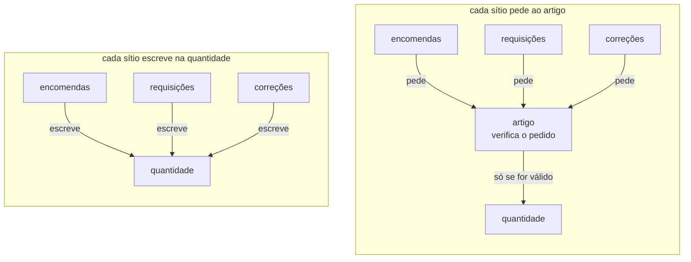
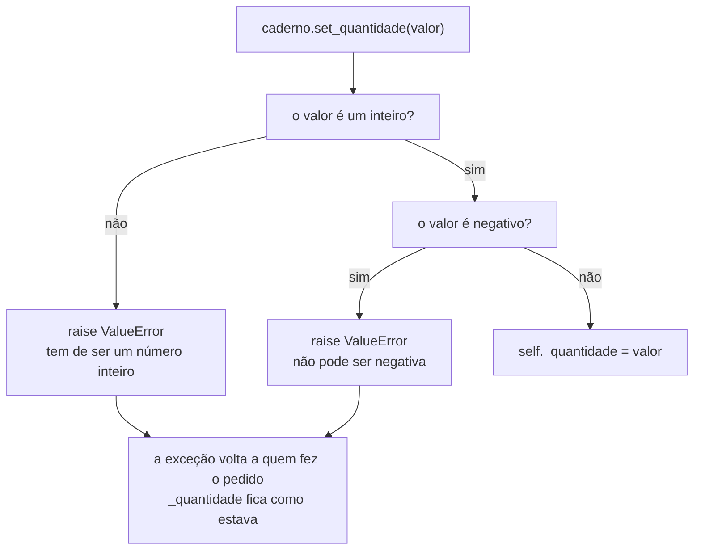
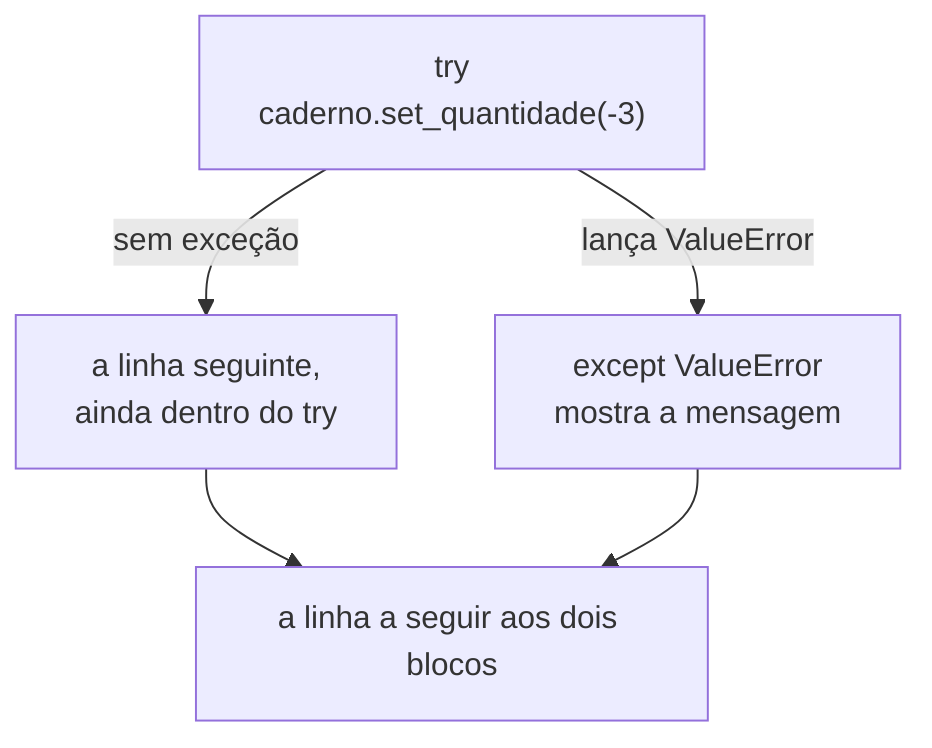
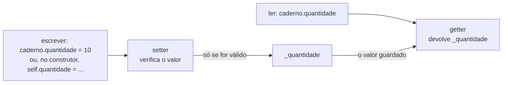
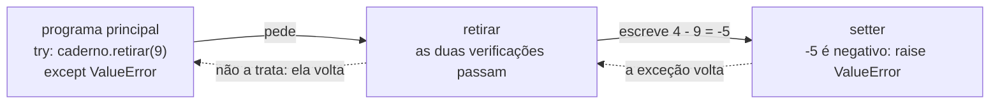

# Encapsulamento e contratos

Neste guia, o próprio artigo passa a recusar um pedido impossível, como retirar 9 unidades a um caderno com 6. Quando recusa, deixa a quantidade como estava. Vês as ferramentas do Python para isso, do método set à propriedade, e vês como se escreve o contrato das operações de adicionar e de retirar.

Usa a classe `Artigo` do guia anterior, as regras do inventário e a leitura de uma mensagem de erro. Rever: [O método retirar em Python](02-objetos-classes-instancias.md#o-método-retirar-em-python), [Quando é que o construtor trabalha](02-objetos-classes-instancias.md#quando-é-que-o-construtor-trabalha), [Uma operação tem de respeitar regras](01-entidades-estado-acoes.md#uma-operação-tem-de-respeitar-regras) e [Erros frequentes](02-objetos-classes-instancias.md#erros-frequentes). Para praticar: [laboratório](laboratorios/03-encapsulamento-contratos-laboratorio.md) e [ficha de exercícios](exercicios/03-encapsulamento-contratos-exercicios.md).

## Neste guia

1. [Parte 1: O artigo protege a sua quantidade](#parte-1-o-artigo-protege-a-sua-quantidade)
2. [Parte 2: Recusar um valor inválido](#parte-2-recusar-um-valor-inválido)
3. [Parte 3: A propriedade e os contratos](#parte-3-a-propriedade-e-os-contratos)
4. [Exemplo guiado: construir o método retirar](#exemplo-guiado-construir-o-método-retirar)

## Parte 1: O artigo protege a sua quantidade

Nesta parte vês o que corre mal quando nada protege a quantidade, e as ideias que o resolvem. Cada programa deste guia está completo: copia-o para um ficheiro `artigo.py` e executa-o no editor das aulas, com o Python 3.10 ou mais recente.

### Nada impede uma quantidade impossível

No guia anterior, o caderno com 6 unidades recebeu um pedido possível: retirar 2. Um programa a sério também recebe pedidos errados, como números a mais, números negativos, números com casas decimais e até texto. Este programa usa a classe do guia anterior e faz três coisas que não deviam ser possíveis. O Python vai aceitá-las?

```python
# A classe do guia 02 e três coisas que não deviam ser possíveis: o primeiro programa do guia 03.

class Artigo:
    """Descreve um artigo do inventário: um material com código, nome e quantidade."""

    def __init__(self, codigo, nome, quantidade):
        """Prepara um artigo acabado de criar, guardando os três dados recebidos."""
        self.codigo = codigo
        self.nome = nome
        self.quantidade = quantidade

    def retirar(self, unidades):
        """Retira unidades a este artigo e devolve a quantidade que fica (sem verificar)."""
        self.quantidade = self.quantidade - unidades
        return self.quantidade


caderno = Artigo("A01", "Caderno", 6)

caderno.retirar(9)
print("Depois de retirar 9:", caderno.quantidade)

caderno.quantidade = 2.5
print("Depois de escrever 2.5:", caderno.quantidade)

caderno.quantidade = "muitos"
print("Depois de escrever muitos:", caderno.quantidade)
```

O programa mostra:

```text
Depois de retirar 9: -3
Depois de escrever 2.5: 2.5
Depois de escrever muitos: muitos
```

Leitura guiada: depois da classe, cria-se o caderno com 6 unidades, e vêm três alterações, cada uma com o seu `print`. A primeira é um pedido ao método `retirar`. As outras duas escrevem diretamente no atributo, com `caderno.quantidade = ...`, sem passar por método nenhum.

O Python aceitou as três, sem uma queixa. A conta 6 - 9 = -3 está certa, mas não se podem ter menos três cadernos no armário. Dois cadernos e meio também não, e "muitos" nem é um número. O estado ficou errado por dois caminhos: um método que não verifica o pedido e a escrita direta no atributo, feita de fora da classe.

Há ainda um problema escondido. Com a linha `caderno.retirar(1)` acrescentada logo a seguir à última linha, o programa mostra as três linhas e depois para:

```text
Depois de retirar 9: -3
Depois de escrever 2.5: 2.5
Depois de escrever muitos: muitos
Traceback (most recent call last):
  File ".../artigo.py", line 28, in <module>
    caderno.retirar(1)
    ~~~~~~~~~~~~~~~^^^
  File ".../artigo.py", line 14, in retirar
    self.quantidade = self.quantidade - unidades
                      ~~~~~~~~~~~~~~~~^~~~~~~~~~
TypeError: unsupported operand type(s) for -: 'str' and 'int'
```

No lugar dos três pontos aparece a pasta do teu ficheiro. As linhas com `~` e `^` apontam a parte da instrução onde o erro aconteceu, e só aparecem a partir do Python 3.11. A última linha diz que houve um `TypeError`, um erro de tipo. Em português: a conta `-` não se faz entre um `str`, um texto, e um `int`, um número inteiro.

Por cima da última linha há duas linhas `File`, e não uma, como no guia anterior, e leem-se de baixo para cima. A de baixo diz onde o erro aconteceu: na linha 14, dentro do método `retirar`. A de cima diz que linha chamou esse método: a 28, no programa principal. O programa principal são as linhas que vêm depois da classe, a que o Python chama `<module>`.

O erro rebenta no pedido da linha 28, mas a causa está duas linhas acima, na linha 26, que guardou "muitos". Um estado errado raramente rebenta no sítio onde foi criado. Rebenta mais tarde, quando outra operação usa o valor como se fosse válido.

Guardar -3 é um **erro de lógica**: o programa continua a correr e dá um resultado errado, sem avisar ninguém. O `TypeError` é um **erro de execução**: para o programa a meio, com uma mensagem. O terceiro tipo é o erro de escrita, como o `IndentationError` do guia anterior, que o Python encontra antes de o programa começar. O erro de lógica é o mais difícil de apanhar, porque só se dá por ele quando alguém repara no valor errado.

Mostrar uma mensagem depois de guardar -3 também não resolvia nada, porque nessa altura a informação já está errada. A regra que este guia segue tem três partes: verificar primeiro, alterar só se estiver tudo bem e, quando o pedido é recusado, deixar os dados como estavam.

### As regras que devem continuar verdadeiras

No inventário, a quantidade é um número inteiro não negativo. Diz-se que um artigo está num **estado válido** quando todos os seus valores cumprem as regras do problema. Com 4 cadernos, o artigo está num estado válido; com -3, não está.

A regra da quantidade tem de ser verdadeira antes e depois de cada operação, durante toda a vida do artigo. A uma regra assim, que tem de continuar verdadeira enquanto o programa funciona, chama-se **invariante**. Aqui, a invariante é "a quantidade de um artigo é sempre um inteiro maior ou igual a zero". O nome vem de "não variar": os valores mudam, mas a regra continua cumprida.

Os pedidos têm regras próprias. Consultar só informa, sem mudar nada. Adicionar e retirar pedem um número inteiro positivo, e retirar não pode passar do que existe. Por isso há dois zeros diferentes. Com 6 unidades, retirar 6 é aceite e deixa 0, um estado válido, porque o material só esgotou. Retirar 0 é recusado, porque um pedido de zero unidades não é uma retirada. "O estado é válido?" e "o pedido é válido?" são perguntas diferentes.

### Quem deve proteger a quantidade

Num programa grande, a quantidade de um artigo muda em vários sítios: onde se registam as encomendas, onde se registam as requisições e onde se corrigem enganos de contagem. Se cada sítio escrever diretamente na quantidade, cada um tem de se lembrar das mesmas verificações. Basta um esquecer-se para o artigo ficar num estado inválido.

A outra maneira é cada sítio fazer o pedido ao artigo, e o artigo decidir se o pode cumprir. As verificações ficam escritas uma só vez, dentro da classe.



No primeiro quadro, os três sítios escrevem na quantidade, e cada um tem de saber as regras. No segundo, os três pedem ao artigo, e só o artigo escreve na quantidade, depois de verificar o pedido.

Esta organização é o **encapsulamento**: o objeto junta o estado e as operações e fica responsável por manter o estado válido. Juntar dados e métodos na mesma classe não chega. A classe do primeiro programa já os juntava, e mesmo assim deixou guardar -3. Só há encapsulamento quando os métodos controlam as alterações e fazem cumprir as regras.

A **ocultação de informação** completa a ideia. A maneira como a quantidade fica guardada dentro do objeto é assunto da classe. O código de fora não escreve nela diretamente: usa as operações da classe e confia que elas respeitam as regras.

É como a pessoa responsável pelo armário da sala. Podes pedir-lhe duas pastas ou perguntar quantas restam, mas não mudas o número na folha de registo dela. Como só ela escreve, e verifica cada pedido antes, o registo continua certo. E, se um dia a regra mudar, só a classe muda: o resto do programa continua a fazer os mesmos pedidos.

### Interface pública: aquilo que o objeto deixa usar

Chama-se **interface pública** de um objeto ao que ele deixa usar a quem está de fora: as operações e os dados. Aqui, "interface" não quer dizer um ecrã com botões. É a fronteira entre o objeto e o resto do programa: o que se lhe pode pedir no código. No fim deste guia, a interface pública de um artigo tem estas operações:

| Operação | O que recebe | O que responde | Muda a quantidade? |
| --- | --- | --- | --- |
| Consultar a quantidade | Nada | A quantidade atual | Não |
| Acertar a quantidade | O novo valor | Nada, ou uma recusa | Só se o valor for válido |
| Adicionar unidades | Quantas adicionar | Nada, ou uma recusa | Só se o pedido for válido |
| Retirar unidades | Quantas retirar | Nada, ou uma recusa | Só se o pedido for válido |

Acertar a quantidade serve, por exemplo, para corrigir o valor depois de se contar à mão o que está no armário. Quem usa estas operações precisa de saber o que cada uma faz e quando é recusada. Não precisa de saber onde, nem com que nome, a quantidade está guardada dentro do objeto.

## Parte 2: Recusar um valor inválido

Nesta parte, a classe aprende a recusar, uma ferramenta de cada vez, e cada programa resolve um problema que o anterior deixou.

### Um set que verifica, mas não obriga

Nas aulas, fizeste o get e o set logo com uma propriedade. Esta secção mostra-os primeiro como dois métodos normais, porque é isso que a propriedade faz por baixo.

Um método get devolve o valor de um atributo, e um método set muda-o. Em inglês, *get* quer dizer obter, e *set* quer dizer definir. Mudar a quantidade através de um set tem uma vantagem: o método pode verificar o valor antes de o guardar.

Para saber se o valor é um número inteiro, o set usa a função **`isinstance`**, do inglês *is instance*, "é instância de". `isinstance(valor, int)` pergunta "o valor é um `int`?" e responde `True` ou `False`. Dá `True` com 4, e dá `False` com 2.5 e também com o texto `"4"`. A condição `isinstance(valor, int) and valor >= 0` só é verdadeira quando o valor é inteiro e, além disso, maior ou igual a zero.

O programa seguinte tenta guardar -3 duas vezes: primeiro com um pedido ao set, depois com uma escrita direta no atributo. Qual das duas tentativas fica guardada?

```python
# Os métodos get e set, com um set que recusa com print: o segundo programa do guia 03.

class Artigo:
    """Artigo do inventário, com métodos get e set para a quantidade."""

    def __init__(self, codigo, nome, quantidade):
        """Guarda os dados iniciais do artigo."""
        self.codigo = codigo
        self.nome = nome
        self.quantidade = quantidade

    def get_quantidade(self):
        """Devolve a quantidade atual, sem a alterar."""
        return self.quantidade

    def set_quantidade(self, valor):
        """Muda a quantidade, mas só se o valor for um inteiro não negativo."""
        if isinstance(valor, int) and valor >= 0:
            self.quantidade = valor
        else:
            print("Valor recusado:", valor)


caderno = Artigo("A01", "Caderno", 6)

caderno.set_quantidade(-3)
print("Depois do set com -3:", caderno.get_quantidade())

caderno.quantidade = -3
print("Depois da escrita direta:", caderno.get_quantidade())
```

O programa mostra:

```text
Valor recusado: -3
Depois do set com -3: 6
Depois da escrita direta: -3
```

Leitura guiada: a classe tem o construtor do guia anterior e dois métodos novos. O `get_quantidade` devolve a quantidade e não faz mais nada. O `set_quantidade` tem um `if`: guarda o valor se ele passar na condição, e senão mostra uma mensagem e não guarda nada. Depois da classe vêm as duas tentativas.

Ficou guardada a segunda. O set recusou o -3, e a quantidade continuou 6, mas a escrita direta passou ao lado da verificação. É o primeiro problema do set: nada obriga a usá-lo, e o atributo continua aberto a quem quiser escrever nele.

O segundo problema está na maneira de recusar. O set mostra uma mensagem no ecrã, e o programa continua como se nada fosse. Uma pessoa a olhar para o ecrã vê a mensagem, mas o código que chamou `set_quantidade` não fica a saber da recusa, nem pode reagir a ela. O set não tem `return`, e por isso devolve o mesmo quando guarda e quando recusa.

<details>
<summary>Para ires mais longe: recusar devolvendo a mensagem</summary>

Há outra forma de recusar, sem exceções, que é a das [resoluções dos temas de treino](../projeto/temas-de-treino-resolucoes.md). O método devolve um texto vazio, `""`, quando aceita, e a mensagem da recusa quando recusa. Assim, o código que o chamou fica a saber da recusa, se olhar para o que o método devolveu. Se se esquecer de olhar, a recusa passa sem ninguém dar por ela. Nos guias deste módulo, a recusa faz-se com uma exceção, a de [Recusar a sério, com `raise`](#recusar-a-sério-com-raise), que o código que chamou não pode deixar passar sem dar por isso. As duas formas estão certas.

</details>

### O sublinhado: um atributo privado por convenção

Para o primeiro problema, o atributo onde a quantidade fica guardada passa a chamar-se `_quantidade`, com um sublinhado no início. Em Python, um nome que começa por sublinhado avisa que é interno da classe e que o código de fora não o deve usar. A um atributo destes chama-se **atributo privado por convenção**. Os métodos da classe usam-no à vontade, e quem está de fora usa os métodos.

"Convenção" quer dizer que é um acordo entre programadores, e não uma regra que o Python faça cumprir. Nada impede alguém de escrever `caderno._quantidade = -3` fora da classe, e o Python guarda o -3. O sublinhado funciona como a placa "Reservado a funcionários" numa porta destrancada: quem quer entra, mas sabe que está a desrespeitar uma regra. Mesmo assim, ajuda, porque uma linha dessas, fora da classe, salta à vista de quem lê o código.

<details>
<summary>Para ires mais longe: outras formas de esconder um atributo</summary>

Em Python, um nome com dois sublinhados no início, como `__quantidade`, torna o acesso de fora mais difícil, mas também não o impede. Outras linguagens fazem de outra maneira: o JavaScript tem campos privados que a própria linguagem não deixa usar fora da classe. O Python escolheu confiar nos programadores.

</details>

### Recusar a sério, com `raise`

Para o segundo problema, a recusa tem de chegar ao código que fez o pedido, de uma forma que ele não possa ignorar. Em Python, isso faz-se com uma exceção.

Provavelmente já viste uma. Com `int("abc")`, o Python não consegue fazer de "abc" um número inteiro, e o programa para com uma mensagem que acaba assim:

```text
ValueError: invalid literal for int() with base 10: 'abc'
```

Uma **exceção** é um sinal de que alguma coisa correu mal, que interrompe o funcionamento normal do programa. `ValueError` quer dizer erro de valor: é o tipo de exceção para um valor que não serve à operação pedida. Depois dos dois pontos vem a mensagem, que aqui diz que `'abc'` não é um inteiro válido.

Um método também pode lançar exceções, com a instrução **`raise`**. Em inglês, *raise* quer dizer levantar; em português diz-se lançar uma exceção. A linha `raise ValueError("A quantidade não pode ser negativa.")` cria uma exceção do tipo `ValueError`, com essa mensagem. Nos métodos deste guia, o `raise` acaba o método nessa linha, como o `return`, e as linhas de baixo não se executam. Mas não entrega um valor a quem chamou. A exceção volta para o código que chamou o método e, se ninguém a tratar até ao programa principal, o programa para e mostra a mensagem.

É isto que protege o estado. Com as verificações e o `raise` antes da linha que guarda, um valor recusado nunca chega a essa linha:



O valor passa por duas verificações, por esta ordem. Só chega à linha que guarda se passar as duas; se falhar uma, o `raise` manda a exceção para trás, e `_quantidade` não muda. Em Python, verificar primeiro e alterar depois escreve-se assim.

O programa seguinte tem as duas correções: o atributo `_quantidade` e o set que recusa com `raise`.

```python
# O atributo _quantidade e um set que recusa com raise: o terceiro programa do guia 03.

class Artigo:
    """Artigo do inventário; a quantidade fica num atributo interno, _quantidade."""

    def __init__(self, codigo, nome, quantidade):
        """Guarda os dados iniciais do artigo."""
        self.codigo = codigo
        self.nome = nome
        self._quantidade = quantidade

    def get_quantidade(self):
        """Devolve a quantidade atual, sem a alterar."""
        return self._quantidade

    def set_quantidade(self, valor):
        """Muda a quantidade; se o valor for inválido, lança ValueError e não muda nada."""
        if not isinstance(valor, int):
            raise ValueError("A quantidade tem de ser um número inteiro.")
        if valor < 0:
            raise ValueError("A quantidade não pode ser negativa.")
        self._quantidade = valor


caderno = Artigo("A01", "Caderno", 6)
caderno.set_quantidade(4)
print("Quantidade:", caderno.get_quantidade())
caderno.set_quantidade(-3)
print("Esta linha já não é executada.")
```

O programa mostra:

```text
Quantidade: 4
Traceback (most recent call last):
  File ".../artigo.py", line 28, in <module>
    caderno.set_quantidade(-3)
    ~~~~~~~~~~~~~~~~~~~~~~^^^^
  File ".../artigo.py", line 21, in set_quantidade
    raise ValueError("A quantidade não pode ser negativa.")
ValueError: A quantidade não pode ser negativa.
```

Leitura guiada: na classe, o construtor guarda a quantidade em `_quantidade`, e é daí que o get a lê. O set tem as duas verificações do diagrama, cada uma com o seu `raise`, e só no fim a linha que guarda. `if not isinstance(valor, int):` lê-se "se o valor não for inteiro", porque o `not` inverte a resposta do `isinstance`. Depois da classe, há dois pedidos ao set, com 4 e com -3.

A mensagem lê-se pela última linha, como no guia anterior: um `ValueError`, com a mensagem do nosso `raise`. As duas linhas `File` leem-se como no primeiro programa: o pedido saiu da linha 28, e a exceção nasceu na linha 21, a do `raise`, dentro de `set_quantidade`. O último `print` não se executou, porque o programa parou antes.

Cada verificação tem a sua mensagem, e por isso quem recebe a exceção sabe qual das regras falhou. A ordem também conta: primeiro o tipo, depois o valor. Com a ordem trocada e o valor `"muitos"`, a comparação `"muitos" < 0` faria o Python parar com `TypeError: '<' not supported between instances of 'str' and 'int'`. Em português, o `<` não se faz entre um texto e um inteiro. É uma mensagem que não diz nada a quem usa a classe. Com o tipo verificado primeiro, a comparação só se faz com um inteiro.

<details>
<summary>Para ires mais longe: o tipo de exceção de um valor que não é um número</summary>

Nos guias deste módulo, todos os valores inválidos são recusados com `ValueError`, também os que nem são números, para haver um só tipo de exceção a tratar. O Python tem outros tipos, como o `TypeError` do primeiro programa. Há programadores que recusam com `TypeError` um valor do tipo errado, como 2.5 ou `"muitos"`, e com `ValueError` só um valor do tipo certo que não serve, como -3.

</details>

### Tratar a recusa com `try` e `except`

Parar o programa a cada engano num número também não serve. Para o programa continuar depois de uma recusa, por exemplo para mostrar uma mensagem e seguir em frente, usam-se o **`try`** e o **`except`**. Em inglês, *try* quer dizer "tenta", e *except* quer dizer "exceto".

```python
# A recusa apanhada com try e except: o quarto programa do guia 03.

class Artigo:
    """Artigo do inventário; a quantidade fica num atributo interno, _quantidade."""

    def __init__(self, codigo, nome, quantidade):
        """Guarda os dados iniciais do artigo."""
        self.codigo = codigo
        self.nome = nome
        self._quantidade = quantidade

    def get_quantidade(self):
        """Devolve a quantidade atual, sem a alterar."""
        return self._quantidade

    def set_quantidade(self, valor):
        """Muda a quantidade; se o valor for inválido, lança ValueError e não muda nada."""
        if not isinstance(valor, int):
            raise ValueError("A quantidade tem de ser um número inteiro.")
        if valor < 0:
            raise ValueError("A quantidade não pode ser negativa.")
        self._quantidade = valor


caderno = Artigo("A01", "Caderno", 6)

try:
    caderno.set_quantidade(-3)
    print("Esta linha só é executada se o set aceitar o valor.")
except ValueError as erro:
    print("Pedido recusado:", erro)

print("Quantidade:", caderno.get_quantidade())
```

O programa mostra:

```text
Pedido recusado: A quantidade não pode ser negativa.
Quantidade: 6
```

Leitura guiada: a classe é a do programa anterior, e só mudam as linhas do fim. São um bloco `try`, com o pedido e uma linha que só interessa se o pedido for aceite, e um bloco `except`. Fora dos dois, a última linha mostra a quantidade.



O Python executa o bloco `try` linha a linha. Se uma linha lança um `ValueError`, o Python abandona o `try` nesse ponto, sem executar as linhas que faltam, e salta para o `except`. Se nenhuma lança, o `except` fica por executar. Nos dois casos, o programa continua na linha a seguir aos dois blocos. Aqui, o set recusou o -3, e por isso a frase "Esta linha só é executada..." não apareceu.

Em `except ValueError as erro`, o `as` quer dizer "como": o nome `erro` fica com a exceção apanhada, e o `print` mostra a mensagem dela. O `except` só apanha o tipo de exceção que diz. Com `except TypeError`, o `ValueError` do set passava ao lado, e o programa parava como se não houvesse `try`.

A última linha mostra que a recusa funcionou: a quantidade continua 6. Para confirmar uma recusa, a mensagem não chega: é preciso ver também que o estado ficou igual.

Repara na divisão de tarefas. A classe decide se o valor é válido e, se não for, lança a exceção. Quem usa a classe decide o que fazer com a recusa: mostrar uma mensagem, pedir outro valor ou outra coisa. A classe não mostra nada no ecrã, porque não sabe onde vai ser usada: numa página web, um `print` nem seria visto.

## Parte 3: A propriedade e os contratos

Nesta parte, a quantidade volta a escrever-se como no guia anterior, agora com a verificação por baixo, e o artigo ganha as operações de adicionar e de retirar.

### A propriedade `quantidade`

O get e o set obrigam a escrever `caderno.get_quantidade()` e `caderno.set_quantidade(4)`, em vez de `caderno.quantidade` e `caderno.quantidade = 4`. É mais comprido, e todo o código que já usava o atributo teria de mudar. O Python tem uma forma de juntar as duas coisas: por fora escreve-se como num atributo, e por dentro passa-se pelos métodos que verificam. É a forma do get e do set que usaste nas aulas.

Uma **propriedade** lê-se e escreve-se como um atributo, mas cada leitura e cada escrita passam por um método. Ao método da leitura chama-se getter, e ao da escrita, setter: são o get e o set da propriedade. Em inglês, *property* quer dizer propriedade.

```python
# A propriedade quantidade, com getter e setter: o quinto programa do guia 03.

class Artigo:
    """Artigo do inventário: código, nome e uma quantidade sempre válida.

    A quantidade é uma propriedade. Lê-se e escreve-se como um atributo
    normal (artigo.quantidade), mas cada escrita passa pelo setter, que
    recusa valores inválidos com ValueError.
    """

    def __init__(self, codigo, nome, quantidade):
        """Cria o artigo. A quantidade inicial passa pelo setter, como qualquer outra."""
        self.codigo = codigo
        self.nome = nome
        self.quantidade = quantidade

    @property
    def quantidade(self):
        """Getter: devolve a quantidade atual, sem a alterar."""
        return self._quantidade

    @quantidade.setter
    def quantidade(self, valor):
        """Setter: guarda o valor se for um inteiro não negativo; senão, lança ValueError."""
        if not isinstance(valor, int):
            raise ValueError("A quantidade tem de ser um número inteiro.")
        if valor < 0:
            raise ValueError("A quantidade não pode ser negativa.")
        self._quantidade = valor


caderno = Artigo("A01", "Caderno", 6)
print("Início:", caderno.quantidade)

caderno.quantidade = 10
print("Depois de acertar para 10:", caderno.quantidade)

try:
    caderno.quantidade = 2.5
except ValueError as erro:
    print("Recusado:", erro)
print("Depois da tentativa com 2.5:", caderno.quantidade)

try:
    caneta = Artigo("A03", "Caneta", -5)
except ValueError as erro:
    print("Artigo não criado:", erro)
```

O programa mostra:

```text
Início: 6
Depois de acertar para 10: 10
Recusado: A quantidade tem de ser um número inteiro.
Depois da tentativa com 2.5: 10
Artigo não criado: A quantidade não pode ser negativa.
```

Leitura guiada: na classe, começa pelos dois métodos chamados `quantidade`, cada um com uma linha começada por `@` por cima. O primeiro é o getter, e o segundo é o setter. Depois lê o construtor, que escreve `self.quantidade`, sem sublinhado. As linhas depois da classe usam `caderno.quantidade` como um atributo normal.

Uma linha que começa por `@`, mesmo antes de um `def`, é um **decorador**: muda a maneira como se usa o método que vem a seguir. Neste guia, basta saber o efeito destes dois.

O `@property`, antes do primeiro `def quantidade`, faz desse método o getter: quando o programa lê `caderno.quantidade`, sem parênteses, o Python executa-o. O `@quantidade.setter`, antes do segundo `def quantidade`, faz desse método o setter: quando o programa escreve `caderno.quantidade = 10`, o Python executa-o, e o 10 chega no parâmetro `valor`. O corpo do setter é o do set da Parte 2: as mesmas verificações, e só no fim a linha que guarda.



Ler a propriedade executa o getter, que devolve o que está em `_quantidade`. Escrever nela, de fora ou no construtor, executa o setter, que só guarda em `_quantidade` um valor válido.

Os dois métodos têm de ter o mesmo nome, `quantidade`, porque é esse nome que os liga à mesma propriedade. O `@property` vem primeiro, porque é ele que cria a propriedade, e o `@quantidade.setter` acrescenta-lhe o setter.

A propriedade e o atributo onde o valor fica têm de ter nomes diferentes, `quantidade` e `_quantidade`. Uma escrita em `self.quantidade` dentro do setter voltava a chamar o setter, sem fim. Em [Erros frequentes](#recursionerror-maximum-recursion-depth-exceeded) está a mensagem que isso dá.

Para quem usa a classe, nada mudou em relação ao guia anterior: lê `caderno.quantidade` e escreve `caderno.quantidade = 10`. A diferença é que cada escrita passa pelo setter, e o 2.5 foi recusado.

### O construtor também passa pelo setter

Na última linha que o programa anterior mostrou, a caneta com -5 unidades nem chegou a ser criada. Porquê, se o programa não escreve na quantidade da caneta?

Porque o construtor escreve `self.quantidade = quantidade`, sem sublinhado. É uma escrita na propriedade, e por isso o valor inicial passa pelo setter, como qualquer outro. Na linha `caneta = Artigo("A03", "Caneta", -5)`, o construtor chamou o setter, o setter lançou `ValueError`, e o construtor parou. A exceção interrompeu também a atribuição ao nome `caneta`, que não chegou a acontecer: o artigo inválido não ficou disponível para o resto do programa.

Se o construtor escrevesse `self._quantidade = quantidade`, com sublinhado, saltava o setter. A caneta nascia com -5 unidades, e a regra só começava a valer na primeira alteração. A invariante diz que a quantidade é sempre válida, e "sempre" inclui o momento em que o artigo nasce.

<details>
<summary>Para ires mais longe: quem cria o atributo `_quantidade`</summary>

O construtor não escreve `_quantidade` em lado nenhum. Quem cria esse atributo é o setter, na primeira vez que corre com um valor válido. Se o primeiro valor for inválido, o atributo nem chega a existir.

</details>

### Operações com contrato

A propriedade protege o estado. Faltam as operações que dão sentido ao inventário: adicionar e retirar unidades. Antes de escrever uma operação, escreve-se o que ela promete.

O **contrato** de uma operação diz quatro coisas: o que recebe, o que devolve, quando falha e o que acontece ao estado em cada caso. Serve a quem escreve o método, porque diz o que tem de programar, e a quem o usa, porque diz o que pode esperar sem ler o código. Neste módulo, o contrato escreve-se na docstring do método. O contrato de adicionar é este:

- recebe as unidades a adicionar, um número inteiro positivo;
- não devolve nada;
- falha, com `ValueError`, se as unidades não forem um inteiro ou não forem positivas, e nesse caso a quantidade fica como estava;
- quando não falha, a quantidade aumenta as unidades pedidas.

O programa seguinte acrescenta o método `adicionar` à classe da propriedade. A linha `resposta = caderno.adicionar(1)` guarda o que o método devolve: o que mostra a linha a seguir?

```python
# O método adicionar, com o contrato na docstring: o sexto programa do guia 03.

class Artigo:
    """Artigo do inventário: código, nome e uma quantidade sempre válida.

    A quantidade é uma propriedade. Lê-se e escreve-se como um atributo
    normal (artigo.quantidade), mas cada escrita passa pelo setter, que
    recusa valores inválidos com ValueError.
    """

    def __init__(self, codigo, nome, quantidade):
        """Cria o artigo. A quantidade inicial passa pelo setter, como qualquer outra."""
        self.codigo = codigo
        self.nome = nome
        self.quantidade = quantidade

    @property
    def quantidade(self):
        """Getter: devolve a quantidade atual, sem a alterar."""
        return self._quantidade

    @quantidade.setter
    def quantidade(self, valor):
        """Setter: guarda o valor se for um inteiro não negativo; senão, lança ValueError."""
        if not isinstance(valor, int):
            raise ValueError("A quantidade tem de ser um número inteiro.")
        if valor < 0:
            raise ValueError("A quantidade não pode ser negativa.")
        self._quantidade = valor

    def adicionar(self, unidades):
        """Acrescenta unidades ao artigo.

        Recebe: unidades, um número inteiro positivo (1 ou mais).
        Devolve: nada (None).
        Falha: lança ValueError se unidades não for um número inteiro ou
        não for positivo. Nesse caso, a quantidade fica como estava.
        """
        if not isinstance(unidades, int):
            raise ValueError("As unidades a adicionar têm de ser um número inteiro.")
        if unidades <= 0:
            raise ValueError("As unidades a adicionar têm de ser 1 ou mais.")
        self.quantidade = self.quantidade + unidades


caderno = Artigo("A01", "Caderno", 6)

caderno.adicionar(3)
print("Depois de adicionar 3:", caderno.quantidade)

try:
    caderno.adicionar(0)
except ValueError as erro:
    print("Recusado:", erro)
print("Depois da tentativa com 0:", caderno.quantidade)

resposta = caderno.adicionar(1)
print("O que adicionar devolveu:", resposta)
print("Quantidade final:", caderno.quantidade)
```

O programa mostra:

```text
Depois de adicionar 3: 9
Recusado: As unidades a adicionar têm de ser 1 ou mais.
Depois da tentativa com 0: 9
O que adicionar devolveu: None
Quantidade final: 10
```

Leitura guiada: na classe, só o `adicionar` é novo. Lê primeiro a docstring, que é o contrato, e depois as três linhas que o cumprem. Depois da classe há três pedidos: adicionar 3, adicionar 0 dentro de um `try` e adicionar 1, com o valor devolvido guardado em `resposta`.

A linha mostra `None`. Um método sem `return` devolve **`None`**, o valor do Python que quer dizer "nada"; em inglês, *none* quer dizer nenhum. No guia anterior, o `retirar` devolvia a quantidade que ficava. O `adicionar` não devolve nada, e quem quiser saber a quantidade consulta a propriedade. O nome de um método não diz o que ele devolve: di-lo o contrato, e é por isso que o contrato fica escrito.

O método verifica primeiro o pedido, pela ordem do setter: o tipo, depois o valor. Se uma verificação falha, o `raise` para o método antes da última linha, e a quantidade fica como estava. A última linha, `self.quantidade = self.quantidade + unidades`, lê a quantidade pelo getter e escreve o resultado pelo setter. Escreve na propriedade, e não em `_quantidade`, para a regra da quantidade ficar num só sítio, o setter.

A verificação `unidades <= 0` pode parecer a mais, porque o setter já protege a quantidade. Sem ela, `caderno.adicionar(-3)`, com 6 unidades, fazia 6 + (-3) = 3. O setter aceitava 3, que é uma quantidade válida, e um pedido para adicionar retirava três unidades sem ninguém dar por isso. O setter protege o estado, mas não sabe o que o pedido quer dizer. Quem o sabe é o método.

## Exemplo guiado: construir o método retirar

O problema: escrever o método `retirar`, a começar pelo contrato e com o que a classe já tem, e confirmar com um traço que ele cumpre o contrato.

### Passo 1: escrever o contrato

O contrato de retirar é este:

- recebe as unidades a retirar, um número inteiro positivo;
- não devolve nada;
- falha, com `ValueError`, em três casos: se as unidades não forem um inteiro, se não forem positivas ou se não houver unidades suficientes;
- em qualquer dos casos de falha, a quantidade fica como estava; quando não falha, a quantidade diminui as unidades pedidas.

### Passo 2: separar as regras do pedido da regra do estado

Das três razões para falhar, duas são sobre o pedido: as unidades têm de ser um inteiro e têm de ser positivas, seja qual for a quantidade que existe. A terceira é sobre o estado que o pedido deixaria. Com 4 unidades, retirar 9 deixava 4 - 9 = -5. Faltarem unidades é o mesmo que a quantidade nova ser negativa, e a classe já tem quem recuse uma quantidade negativa: o setter.

### Passo 3: verificar o pedido no próprio método

Deixar tudo ao setter não chega. Com 6 unidades, se o método fosse só a linha da subtração, estes três pedidos corriam mal:

- `retirar(-3)` fazia 6 - (-3) = 9, que o setter aceitava, e um pedido para retirar acrescentava três unidades;
- `retirar(0)` fazia 6 - 0 = 6, e um pedido que a regra recusa era aceite em silêncio;
- `retirar("2")` tentava subtrair um texto a um número, e o Python parava com um `TypeError`, e não com a nossa mensagem.

Nos três casos, o problema está no pedido, e só o método sabe o que um pedido de retirada quer dizer. Por isso, o método começa pelas duas verificações do pedido, pela ordem do setter e do `adicionar`: o tipo, depois o valor. São as primeiras linhas do método, e este excerto não corre sozinho:

```python partial
        if not isinstance(unidades, int):
            raise ValueError("As unidades a retirar têm de ser um número inteiro.")
        if unidades <= 0:
            raise ValueError("As unidades a retirar têm de ser 1 ou mais.")
```

### Passo 4: alterar através da propriedade

Depois das duas verificações, a alteração escreve na propriedade. É a última linha do método, e também não corre sozinha:

```python partial
self.quantidade = self.quantidade - unidades
```

Se houver unidades suficientes, o resultado é zero ou mais, o setter guarda-o, e o pedido fica cumprido. Se não houver, o resultado é negativo, e o setter lança `ValueError` antes da sua última linha, a que guarda. Como `_quantidade` não foi tocado, a quantidade fica como estava, como o contrato promete.

A decisão é não repetir no `retirar` a regra que já vive no setter. Com a mesma regra em dois sítios, era preciso lembrar-se de mudar os dois sempre que ela mudasse. Assim, o método ocupa-se só do que só ele sabe, o significado do pedido.

Quando faltam unidades, a mensagem que se lê é a do setter, "A quantidade não pode ser negativa.", porque a quantidade ficaria negativa. O caminho da exceção é este:



O pedido vai do programa principal ao `retirar`, e daí ao setter, que lança a exceção. A exceção volta pelo mesmo caminho: atravessa o `retirar`, que não a trata, e é apanhada pelo `except` do programa principal, de onde o pedido saiu.

### Passo 5: o método completo e o traço

O método completo, com o contrato na docstring, também não corre sozinho, porque pertence à classe. O programa completo está no passo 6.

```python partial
    def retirar(self, unidades):
        """Retira unidades ao artigo.

        Recebe: unidades, um número inteiro positivo (1 ou mais).
        Devolve: nada (None).
        Falha: lança ValueError se unidades não for um número inteiro, se
        não for positivo, ou se não houver unidades suficientes. Esta última
        regra é verificada pelo setter da quantidade, que recusa qualquer
        valor negativo. Em todos os casos de falha, a quantidade fica como
        estava.
        """
        if not isinstance(unidades, int):
            raise ValueError("As unidades a retirar têm de ser um número inteiro.")
        if unidades <= 0:
            raise ValueError("As unidades a retirar têm de ser 1 ou mais.")
        # A falta de unidades é recusada pelo setter: o resultado seria negativo.
        self.quantidade = self.quantidade - unidades
```

Antes de executar, faz-se o traço de quatro pedidos seguidos a um caderno com 6 unidades. Cada pedido parte da quantidade que o anterior deixou.

| Pedido | Verificações do método | O setter recebe | Resposta | Quantidade depois |
| --- | --- | --- | --- | ---: |
| `retirar(2)` | inteiro e positivo: passa | 6 - 2 = 4, que é válido | Aceite, sem erro | 4 |
| `retirar(9)` | inteiro e positivo: passa | 4 - 9 = -5, que é negativo | `ValueError` lançado pelo setter | 4 |
| `retirar(0)` | não é positivo: `ValueError` | Não chega a ser chamado | `ValueError` lançado pelo método | 4 |
| `retirar(-3)` | não é positivo: `ValueError` | Não chega a ser chamado | `ValueError` lançado pelo método | 4 |

### Passo 6: executar e comparar com o traço

Este é o programa completo, com a classe final deste guia. Os pedidos são os quatro do traço, e há ainda uma pasta, a que não se faz nenhum pedido.

```python
# A classe final do guia 03, com o método retirar do exemplo guiado.

class Artigo:
    """Artigo do inventário: código, nome e uma quantidade sempre válida.

    A quantidade é uma propriedade. Lê-se e escreve-se como um atributo
    normal (artigo.quantidade), mas cada escrita passa pelo setter, que
    recusa valores inválidos com ValueError.
    """

    def __init__(self, codigo, nome, quantidade):
        """Cria o artigo. A quantidade inicial passa pelo setter, como qualquer outra."""
        self.codigo = codigo
        self.nome = nome
        self.quantidade = quantidade

    @property
    def quantidade(self):
        """Getter: devolve a quantidade atual, sem a alterar."""
        return self._quantidade

    @quantidade.setter
    def quantidade(self, valor):
        """Setter: guarda o valor se for um inteiro não negativo; senão, lança ValueError."""
        if not isinstance(valor, int):
            raise ValueError("A quantidade tem de ser um número inteiro.")
        if valor < 0:
            raise ValueError("A quantidade não pode ser negativa.")
        self._quantidade = valor

    def adicionar(self, unidades):
        """Acrescenta unidades ao artigo.

        Recebe: unidades, um número inteiro positivo (1 ou mais).
        Devolve: nada (None).
        Falha: lança ValueError se unidades não for um número inteiro ou
        não for positivo. Nesse caso, a quantidade fica como estava.
        """
        if not isinstance(unidades, int):
            raise ValueError("As unidades a adicionar têm de ser um número inteiro.")
        if unidades <= 0:
            raise ValueError("As unidades a adicionar têm de ser 1 ou mais.")
        self.quantidade = self.quantidade + unidades

    def retirar(self, unidades):
        """Retira unidades ao artigo.

        Recebe: unidades, um número inteiro positivo (1 ou mais).
        Devolve: nada (None).
        Falha: lança ValueError se unidades não for um número inteiro, se
        não for positivo, ou se não houver unidades suficientes. Esta última
        regra é verificada pelo setter da quantidade, que recusa qualquer
        valor negativo. Em todos os casos de falha, a quantidade fica como
        estava.
        """
        if not isinstance(unidades, int):
            raise ValueError("As unidades a retirar têm de ser um número inteiro.")
        if unidades <= 0:
            raise ValueError("As unidades a retirar têm de ser 1 ou mais.")
        # A falta de unidades é recusada pelo setter: o resultado seria negativo.
        self.quantidade = self.quantidade - unidades


caderno = Artigo("A01", "Caderno", 6)
pasta = Artigo("A02", "Pasta", 2)

caderno.retirar(2)
print("Depois de retirar 2:", caderno.quantidade)

try:
    caderno.retirar(9)
except ValueError as erro:
    print("Retirar 9 recusado:", erro)

try:
    caderno.retirar(0)
except ValueError as erro:
    print("Retirar 0 recusado:", erro)

try:
    caderno.retirar(-3)
except ValueError as erro:
    print("Retirar -3 recusado:", erro)

print("Caderno no fim:", caderno.quantidade)
print("Pasta no fim:", pasta.quantidade)
```

O programa mostra:

```text
Depois de retirar 2: 4
Retirar 9 recusado: A quantidade não pode ser negativa.
Retirar 0 recusado: As unidades a retirar têm de ser 1 ou mais.
Retirar -3 recusado: As unidades a retirar têm de ser 1 ou mais.
Caderno no fim: 4
Pasta no fim: 2
```

Cada linha confirma o traço. O pedido de 2 foi aceite e deixou 4. Dos três recusados, o de 9 foi recusado pelo setter, com a mensagem da quantidade, e os de 0 e de -3 pelo próprio método, com a mensagem do pedido. Depois das três recusas, o caderno continua com 4, e a pasta, a que ninguém fez um pedido, continua com 2.

Em todas as operações, a ordem foi a mesma: verificar, alterar só se o pedido for válido, e responder. Verificar é o trabalho das condições do método e do setter. Alterar é a última linha do setter, a única que escreve em `_quantidade`. Responder é acabar sem erro, quando o pedido foi cumprido, ou lançar `ValueError`, quando foi recusado.

A interface pública do artigo ficou com a propriedade `quantidade`, para consultar e acertar, e com os métodos `adicionar` e `retirar`. O `codigo` e o `nome` ainda são atributos simples, sem proteção, e o `_quantidade` é interno e fica de fora.

## Erros frequentes

O programa de partida é o de [A propriedade `quantidade`](#a-propriedade-quantidade), e cada erro diz o que mudou nele. Em cada mensagem, começa pela última linha.

### `TypeError: 'int' object is not callable`

Com `caderno.quantidade()`, com parênteses, na linha que mostra o início, o Python mostra:

```text
Traceback (most recent call last):
  File ".../artigo.py", line 33, in <module>
    print("Início:", caderno.quantidade())
                     ~~~~~~~~~~~~~~~~~~^^
TypeError: 'int' object is not callable
```

Em português, a última linha diz que um objeto do tipo `int` não se pode chamar. Ao ler `caderno.quantidade`, o getter já correu e devolveu o número 6. Os parênteses pedem ao Python que chame esse número como se fosse um método, e um número não se chama. Acontece porque o getter se escreve com `def`, como um método, e apetece chamá-lo com parênteses, sobretudo a quem se habituou a `get_quantidade()`. Uma propriedade lê-se sem parênteses: `caderno.quantidade`.

### `AttributeError: 'function' object has no attribute 'setter'`

Sem a linha `@property`, o programa para antes de criar qualquer artigo:

```text
Traceback (most recent call last):
  File ".../artigo.py", line 3, in <module>
    class Artigo:
    ...<24 lines>...
            self._quantidade = valor
  File ".../artigo.py", line 21, in Artigo
    @quantidade.setter
     ^^^^^^^^^^^^^^^^^
AttributeError: 'function' object has no attribute 'setter'
```

A linha `...<24 lines>...` quer dizer que o Python não mostrou 24 linhas do meio da classe, e nem todas as versões a escrevem. O `AttributeError` é o erro de atributo do guia anterior, e a mensagem diz que um objeto do tipo função não tem nenhum atributo `setter`. O programa para logo a criar a classe, que é a primeira coisa que executa, na linha `@quantidade.setter`. Sem o `@property`, o primeiro `quantidade` é um método normal, uma função, e uma função não tem setter. Escreve `@property` na linha imediatamente antes do primeiro `def quantidade`.

### Valores inválidos aceites sem nenhuma recusa

Sem a linha `@quantidade.setter`, o programa não mostra nenhuma mensagem de erro, mas aceita o 2.5 e cria a caneta com -5, e por isso a última linha desaparece:

```text
Início: 6
Depois de acertar para 10: 10
Depois da tentativa com 2.5: 2.5
```

Sem essa linha, o segundo `def quantidade` é um método normal, que ocupa o lugar da propriedade. A escrita `self.quantidade = ...` passa a guardar o valor num atributo normal, sem passar por nenhuma verificação, e nada é recusado. Põe a linha `@quantidade.setter` mesmo por cima do segundo `def quantidade`.

### `NameError: name 'ValueErrror' is not defined`

Com `ValueErrror`, com três erres, no primeiro `raise` do setter, as duas primeiras linhas aparecem, e o programa só para na tentativa com 2.5:

```text
Início: 6
Depois de acertar para 10: 10
Traceback (most recent call last):
  File ".../artigo.py", line 39, in <module>
    caderno.quantidade = 2.5
    ^^^^^^^^^^^^^^^^^^
  File ".../artigo.py", line 26, in quantidade
    raise ValueErrror("A quantidade tem de ser um número inteiro.")
          ^^^^^^^^^^^
NameError: name 'ValueErrror' is not defined. Did you mean: 'ValueError'?
```

O `NameError` diz que o Python não conhece o nome `ValueErrror`, e `Did you mean: 'ValueError'?` quer dizer "querias dizer `ValueError`?". O `try` da tentativa não apanhou o erro, porque o `except` só apanha `ValueError`, e este é um `NameError`. O erro só aparece quando a linha do `raise` corre, isto é, quando um valor é recusado: enquanto só experimentares valores válidos, o programa parece certo. Escreve `ValueError`, com as duas maiúsculas, e experimenta sempre também um valor que deve ser recusado.

### `RecursionError: maximum recursion depth exceeded`

Com `self.quantidade = valor` na última linha do setter, sem o sublinhado, o programa para logo ao criar o caderno:

```text
Traceback (most recent call last):
  File ".../artigo.py", line 32, in <module>
    caderno = Artigo("A01", "Caderno", 6)
  File ".../artigo.py", line 15, in __init__
    self.quantidade = quantidade
    ^^^^^^^^^^^^^^^
  File ".../artigo.py", line 29, in quantidade
    self.quantidade = valor
    ^^^^^^^^^^^^^^^
  File ".../artigo.py", line 29, in quantidade
    self.quantidade = valor
    ^^^^^^^^^^^^^^^
  File ".../artigo.py", line 29, in quantidade
    self.quantidade = valor
    ^^^^^^^^^^^^^^^
  [Previous line repeated 995 more times]
RecursionError: maximum recursion depth exceeded
```

A linha `[Previous line repeated 995 more times]` quer dizer que a linha anterior se repetiu mais 995 vezes; o número pode mudar com a versão do Python. `RecursionError` quer dizer erro de recursão, e recursão é o nome que se dá a uma função que se chama a si própria. A mensagem diz que se passou o número máximo de chamadas destas. Em versões mais antigas do Python, a última linha pode acabar com mais umas palavras, como `while calling a Python object`.

A última linha do setter escreve na propriedade, e escrever na propriedade é executar o setter. Cada execução chega a essa linha e chama outra vez o setter, até o Python desistir. Guarda o valor em `self._quantidade`, com o sublinhado.

## Palavras novas deste guia

- Erro de lógica: um erro em que o programa continua a correr, mas dá um resultado errado, sem avisar ninguém.
- Erro de execução: um erro que para o programa a meio, com uma mensagem.
- Estado válido: um objeto está num estado válido quando todos os seus valores cumprem as regras do problema.
- Invariante: uma regra que tem de continuar verdadeira enquanto o programa funciona, antes e depois de cada operação.
- Encapsulamento: o objeto junta o estado e as operações e fica responsável por manter o estado válido.
- Ocultação de informação: a maneira como um valor fica guardado dentro do objeto é assunto da classe; o código de fora usa as operações.
- Interface pública: o que um objeto deixa usar a quem está de fora, as operações e os dados.
- `isinstance`: a função que pergunta se um valor é de um certo tipo, como em `isinstance(valor, int)`, e responde `True` ou `False`.
- Atributo privado por convenção: um atributo cujo nome começa por sublinhado, como `_quantidade`, que o código de fora não deve usar, embora o Python não o impeça.
- Exceção: um sinal de que alguma coisa correu mal, que interrompe o funcionamento normal do programa; o `ValueError`, erro de valor, é a exceção de um valor que não serve.
- `raise`: a instrução que lança uma exceção, como em `raise ValueError("...")`, e que para o método nessa linha.
- `try` e `except`: os dois blocos que tentam um pedido e dizem o que fazer se ele lançar uma exceção de um certo tipo.
- Propriedade: lê-se e escreve-se como um atributo, mas cada leitura passa por um método, o getter, e cada escrita por outro, o setter.
- Decorador: uma linha que começa por `@`, mesmo antes de um `def`, e muda a maneira como se usa o método, como `@property`.
- Contrato: diz o que uma operação recebe e devolve, quando falha e o que acontece ao estado em cada caso.
- `None`: o valor do Python que quer dizer "nada", e que devolve um método sem `return`.

## O que vem a seguir

No tema seguinte, [Composição e modelação](04-composicao-modelacao.md), um inventário junta vários artigos e passa-lhes os pedidos, e vês o que cabe a cada um fazer.


