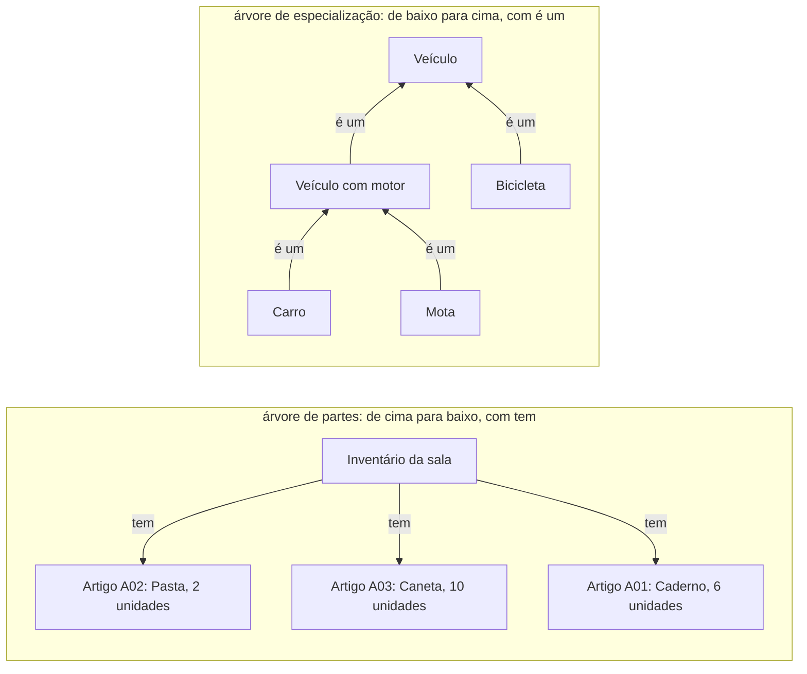
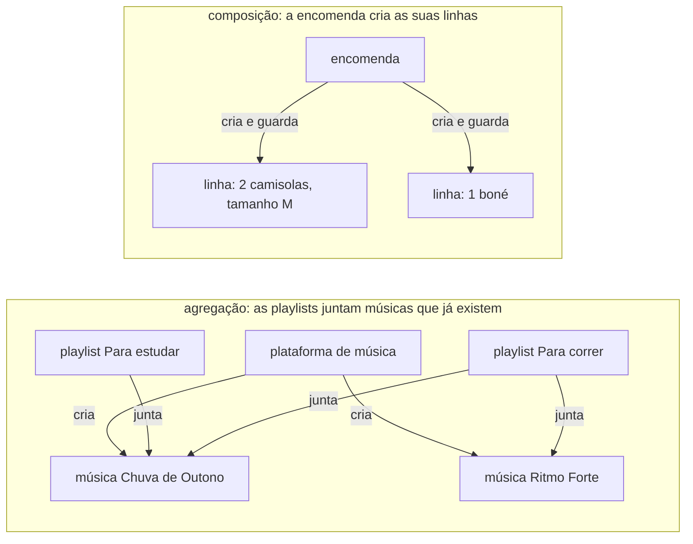
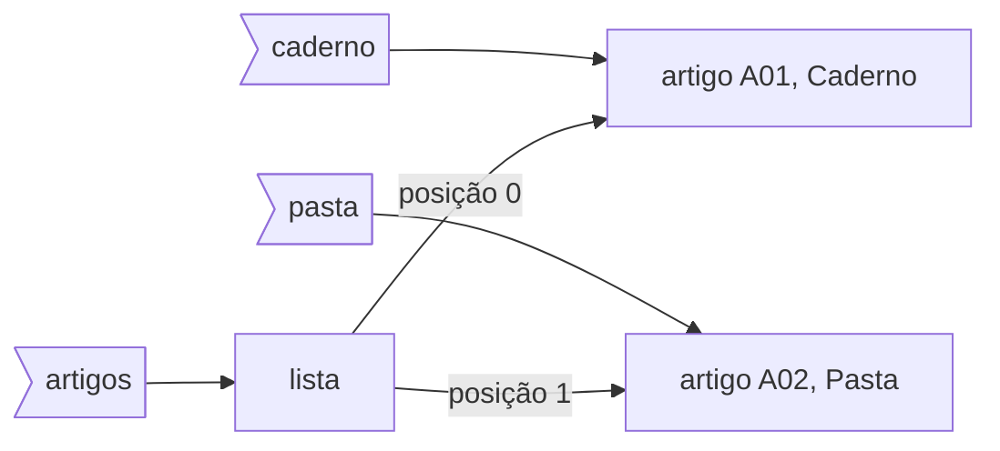
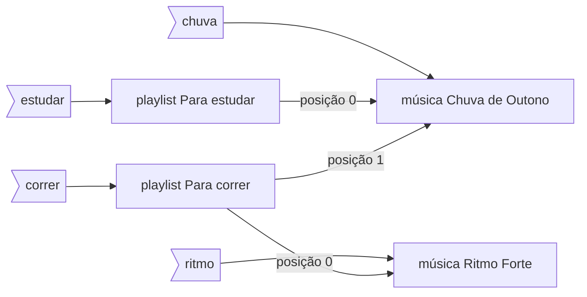
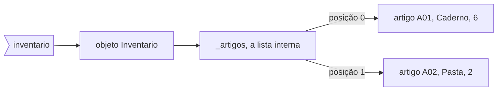
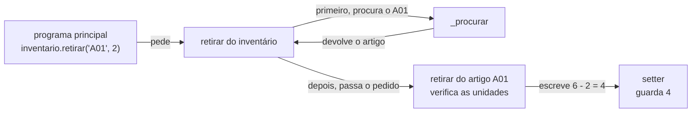
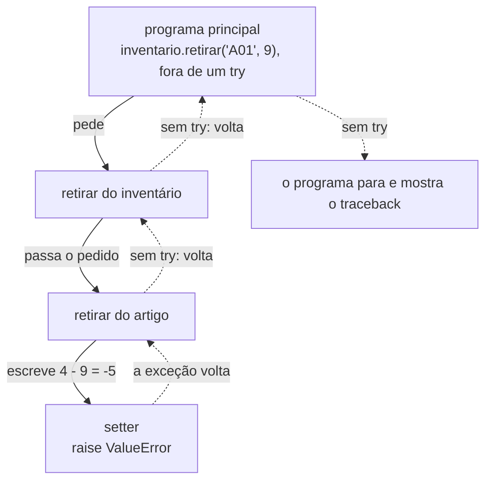

# Composição e modelação

Neste guia, os artigos passam a viver dentro de um inventário, que garante a regra que nenhum artigo garante sozinho: não há dois com o mesmo código. Vês como se decide a relação entre duas classes, como se descreve um programa por palavras antes do código e como o inventário passa os pedidos aos artigos, em Python.

Usa os nomes que apontam para o mesmo objeto, a descrição de uma classe, o `raise` e o `try` com o `except`. Rever: [Cada instância é um objeto diferente](02-objetos-classes-instancias.md#cada-instância-é-um-objeto-diferente), [Classe: a descrição comum](02-objetos-classes-instancias.md#classe-a-descrição-comum), [Recusar a sério, com `raise`](03-encapsulamento-contratos.md#recusar-a-sério-com-raise) e [Tratar a recusa com `try` e `except`](03-encapsulamento-contratos.md#tratar-a-recusa-com-try-e-except). Para praticar: [laboratório](laboratorios/04-composicao-modelacao-laboratorio.md) e [ficha de exercícios](exercicios/04-composicao-modelacao-exercicios.md).

## Neste guia

1. [Parte 1: Um objeto para juntar os artigos](#parte-1-um-objeto-para-juntar-os-artigos)
2. [Parte 2: As relações entre classes](#parte-2-as-relações-entre-classes)
3. [Parte 3: Objetos guardados numa lista](#parte-3-objetos-guardados-numa-lista)
4. [Parte 4: O inventário em Python](#parte-4-o-inventário-em-python)
5. [Exemplo guiado: oito pedidos ao inventário](#exemplo-guiado-oito-pedidos-ao-inventário)

## Parte 1: Um objeto para juntar os artigos

Nesta parte vês o que falta quando cada artigo vive sozinho, e que tarefas passam para um objeto novo, o inventário. Cada programa deste guia está completo: copia-o para um ficheiro `inventario.py` e executa-o no editor das aulas, com o Python 3.10 ou mais recente. A classe `Artigo` dos programas é a do fim do guia 03, com as docstrings mais curtas e as mesmas instruções.

### Artigos soltos: o que nenhum artigo consegue garantir

Este programa cria três artigos, cada um guardado na sua variável. Repara nos códigos e nas quantidades: o Python aceita os três?

```python
# Três artigos soltos, cada um no seu nome: o primeiro programa do guia 04.

class Artigo:
    """Artigo do inventário: código, nome e uma quantidade sempre válida.

    É a classe final do guia 03, com as docstrings encurtadas.
    """

    def __init__(self, codigo, nome, quantidade):
        """Cria o artigo. A quantidade inicial passa pelo setter."""
        self.codigo = codigo
        self.nome = nome
        self.quantidade = quantidade

    @property
    def quantidade(self):
        """Getter: devolve a quantidade atual, sem a alterar."""
        return self._quantidade

    @quantidade.setter
    def quantidade(self, valor):
        """Setter: guarda o valor se for um inteiro não negativo; senão, lança ValueError."""
        if not isinstance(valor, int):
            raise ValueError("A quantidade tem de ser um número inteiro.")
        if valor < 0:
            raise ValueError("A quantidade não pode ser negativa.")
        self._quantidade = valor

    def adicionar(self, unidades):
        """Acrescenta unidades (inteiro, 1 ou mais); senão, lança ValueError."""
        if not isinstance(unidades, int):
            raise ValueError("As unidades a adicionar têm de ser um número inteiro.")
        if unidades <= 0:
            raise ValueError("As unidades a adicionar têm de ser 1 ou mais.")
        self.quantidade = self.quantidade + unidades

    def retirar(self, unidades):
        """Retira unidades (inteiro, 1 ou mais, até ao que existe); senão, lança ValueError."""
        if not isinstance(unidades, int):
            raise ValueError("As unidades a retirar têm de ser um número inteiro.")
        if unidades <= 0:
            raise ValueError("As unidades a retirar têm de ser 1 ou mais.")
        # A falta de unidades é recusada pelo setter: o resultado seria negativo.
        self.quantidade = self.quantidade - unidades


caderno = Artigo("A01", "Caderno", 6)
pasta = Artigo("A02", "Pasta", 2)
cola = Artigo("A01", "Cola", 3)

print(caderno.codigo, caderno.nome, caderno.quantidade)
print(pasta.codigo, pasta.nome, pasta.quantidade)
print(cola.codigo, cola.nome, cola.quantidade)
```

O programa mostra:

```text
A01 Caderno 6
A02 Pasta 2
A01 Cola 3
```

Leitura guiada: a classe não precisa de ser lida outra vez. Interessam as três linhas que criam os artigos e os três `print`, que mostram o código, o nome e a quantidade de cada um.

O Python aceitou os três. As quantidades são válidas, e o setter verificou cada uma. Mas o caderno e a cola ficaram os dois com o código A01, contra [a primeira regra do inventário](01-entidades-estado-acoes.md#uma-operação-tem-de-respeitar-regras), e nada no programa deu por isso.

Uma verificação no construtor do `Artigo` não resolvia. Quando a cola está a ser criada, o construtor só conhece o que recebeu, `"A01"`, `"Cola"` e `3`, e o `self`, que é a própria cola. O caderno é outro objeto, guardado num nome do programa principal, e a classe, escrita uma vez para todos os artigos, não sabe que nomes o programa vai usar. Cada artigo só conhece os seus dados.

Outras perguntas ficam também sem dono. Quem lê o programa sabe que o artigo A02 está no nome `pasta`, mas o programa não sabe. Para dizer quantas unidades tem o A02, teria de comparar o código pedido com o de cada artigo, numa cadeia de condições como esta. É um excerto, que usa os três artigos do programa acima:

```python partial
codigo_pedido = "A02"
if codigo_pedido == caderno.codigo:
    print(caderno.quantidade)
elif codigo_pedido == pasta.codigo:
    print(pasta.quantidade)
elif codigo_pedido == cola.codigo:
    print(cola.quantidade)
```

Cada artigo novo pedia mais um nome e mais uma condição, escritos à mão. É [o problema das variáveis soltas](01-entidades-estado-acoes.md#o-problema-das-variáveis-soltas) do guia 01, um degrau acima. Lá andavam soltos o código, o nome e a quantidade, e a classe `Artigo` juntou-os num objeto. Agora andam soltos os próprios artigos. A solução segue o mesmo caminho: um objeto que guarda os artigos todos e responde às perguntas sobre o conjunto, o inventário.

### Quem sabe o quê: responsabilidades

Antes de escrever a classe do inventário, decide-se o que fica com ela e o que continua com cada artigo. Chama-se **responsabilidades** de uma classe ao que os seus objetos sabem e fazem. Há uma regra que resolve quase todos os casos: uma tarefa fica com quem tem a informação de que ela precisa.

| Pergunta ou tarefa | Que informação é precisa | Quem a tem | Fica a cargo de |
| --- | --- | --- | --- |
| Quantas unidades tem este artigo? | A quantidade desse artigo | O próprio artigo | `Artigo` |
| Posso retirar 2 unidades deste artigo? | A quantidade e as regras dos pedidos | O próprio artigo | `Artigo` |
| Que artigos existem? | A lista de todos os artigos | Quem guarda todos | `Inventario` |
| Já existe um artigo com o código A01? | Os códigos de todos os artigos | Quem guarda todos | `Inventario` |
| Qual é o artigo com o código A02? | Os códigos de todos os artigos | Quem guarda todos | `Inventario` |

O inventário não verifica se há unidades que cheguem, porque essa regra já está no artigo. Uma regra escrita em dois sítios acaba, mais cedo ou mais tarde, diferente num deles. O artigo também não verifica se o seu código é único: para isso teria de conhecer todos os outros.

Separar as tarefas não quer dizer que cada objeto trabalhe sozinho. Para retirar 2 unidades do artigo A01, o inventário encontra esse artigo, porque conhece todos, e passa-lhe o pedido. O artigo decide se o pode cumprir, porque conhece a sua quantidade e as regras dos pedidos.

## Parte 2: As relações entre classes

Nesta parte, sem código novo, vês como se decide a relação entre duas classes e como se escreve essa decisão por palavras.

### Duas perguntas sobre duas classes: "tem" e "é um"

Um inventário e um artigo estão relacionados, e um carro e um veículo também, mas de maneiras diferentes. Para saber qual é a relação, fazem-se duas perguntas: "uma tem a outra?" e "uma é um caso da outra?".

A relação **"tem"** liga um todo às suas partes, ou um objeto aos objetos que ele guarda e usa. Um inventário tem artigos, e uma encomenda feita numa loja na internet tem linhas, como "2 camisolas, tamanho M". A relação **"é um"** liga um tipo particular a um tipo mais geral. Um carro é um veículo, e uma bicicleta também. O que vale para qualquer veículo, como levar pessoas de um sítio para outro, vale também para um carro.

Para decidir, dizem-se as duas frases e fica-se com a verdadeira. "Um inventário tem artigos" é verdadeira, e "um inventário é um artigo" é falsa. "Um carro é um veículo" é verdadeira, e "um carro tem um motor" também, sem que o motor seja um carro.

Quando a frase "é um" parece quase certa, faz-se um teste. Se A é um B, tudo o que um B tem e faz tem de fazer sentido para um A. Aplicado a "um inventário é um artigo", o teste falha logo na quantidade. O inventário tem artigos com 6, 2 e 10 unidades, de materiais diferentes, e nenhum número é "a quantidade do inventário". Um artigo aceita o pedido "retirar 2 unidades", e retirar 2 unidades a um inventário, sem dizer a que artigo, não quer dizer nada.

O erro típico é ver o inventário como "um artigo maior, com muitos artigos lá dentro". Essa ideia mistura as duas relações. Guardar cadernos não faz de uma mochila um caderno.

Em Python, a relação "é um" escreve-se com a herança, o assunto do guia seguinte, e a relação "tem" com um objeto guardado dentro de outro, como neste guia. Antes de ligares duas classes, diz a frase.

### Duas árvores que se parecem e dizem coisas diferentes

Quando se pensa num programa antes de o escrever, desenham-se muitas vezes árvores. Há duas que se parecem no desenho e dizem coisas diferentes.

Na **árvore de especialização**, cada ramo liga um tipo geral a um tipo mais particular, e lê-se de baixo para cima, com "é um". Na **árvore de partes**, cada ramo liga um todo a uma parte sua, e lê-se de cima para baixo, com "tem".



Na árvore de especialização, um carro é um veículo com motor, e um veículo com motor é um veículo. Um carro concreto é as três coisas ao mesmo tempo, e nenhum veículo contém carros. Na árvore de partes, o inventário da sala tem três artigos, e nenhum artigo é um tipo de inventário. Na primeira, as caixas são tipos; na segunda, são objetos concretos, com valores.

Como os dois desenhos se parecem, olhar não chega. Lê cada ligação com as duas frases e fica com a verdadeira. "Uma mota é um veículo com motor" é verdadeira. "O artigo A02 é um inventário" é falsa, e "o inventário tem o artigo A02" é verdadeira.

Uma árvore de especialização também não obriga a uma classe por cada caixa da árvore. No guia 02, [cadernos e pastas ficaram na mesma classe](02-objetos-classes-instancias.md#classe-a-descrição-comum), porque guardam os mesmos dados e aceitam as mesmas operações.

### Dois graus de "tem": composição e agregação

A relação "tem" não é sempre igual. Numa encomenda, a linha "2 camisolas, tamanho M" não diz nada sozinha: de que encomenda, para quem? É a encomenda que cria as suas linhas, à medida que se acrescentam produtos. Uma linha nunca passa para outra encomenda, e se a encomenda for apagada, as linhas vão com ela.

Numa playlist, a lista de músicas que alguém escolhe numa aplicação de música, é diferente. As músicas já existiam na plataforma antes de alguém as pôr na playlist. A mesma música pode estar na playlist "Para estudar" e na "Para correr", e apagar uma das playlists não apaga as músicas.

Há **composição** quando a parte só faz sentido dentro do todo: nasce com ele ou é criada por ele, pertence só a ele e desaparece com ele. Há **agregação** quando o todo junta partes que existem por si: foram criadas fora dele, podem estar em vários todos e continuam quando ele desaparece.



Na composição, a encomenda cria as linhas, e só ela as guarda. Na agregação, a plataforma cria as músicas, e as playlists juntam-nas sem as criar: a mesma música está nas duas.

Para decidir, fazem-se quatro perguntas. As duas primeiras decidem, e as outras duas confirmam. Se as duas primeiras derem respostas diferentes, decide a primeira, porque uma composição é, antes de tudo, uma parte que só faz sentido dentro do todo.

| Pergunta | Composição | Agregação |
| --- | --- | --- |
| 1. A parte faz sentido sem o todo? | Não | Sim |
| 2. Quem cria a parte? | O próprio todo, ou nasce com ele | Alguém fora do todo, e o todo recebe-a já criada |
| 3. A parte pode estar em dois todos ao mesmo tempo? | Não | Pode |
| 4. Se o todo desaparecer, o que acontece à parte? | Desaparece com ele | Continua a existir |

Há dois enganos comuns. O primeiro é pensar que, na agregação, a parte é menos importante. As músicas são o mais importante de uma playlist: a diferença está na força da ligação, e não na importância. O segundo é pensar que qualquer lista de objetos é uma composição. Uma lista diz que o todo guarda várias partes, mas não diz se elas têm vida própria.

<details>
<summary>Para ires mais longe: a palavra composição com dois sentidos</summary>

Em programação, também se chama composição de objetos, num sentido mais largo, a construir um objeto a partir de outros objetos, que ele guarda e usa. Nesse sentido, composição é qualquer relação "tem", e é assim que o nome deste tema usa a palavra. Neste guia, composição tem sempre o sentido estreito, o contrário da agregação.

</details>

### O nosso inventário: composição

As perguntas aplicam-se agora ao inventário e aos artigos. A primeira é se um artigo faz sentido sem o inventário. No guia 01, [cada artigo tem uma ficha, que é uma linha do registo](01-entidades-estado-acoes.md#a-informação-que-interessa-guardar), e no guia 02 cada ficha passou a ser um objeto. O objeto `Artigo` do programa é essa ficha. "Caderno, 6 unidades", sem se saber de que inventário, é como a linha "2 camisolas" sem a encomenda: nem diz em que sala estão os cadernos. A resposta é não.

A segunda é quem cria o artigo, e aqui a escolha é nossa, porque somos nós que escrevemos o programa. Escolhemos o inventário. Ele vai ter um método `registar`, que recebe o código, o nome e a quantidade de um artigo novo. Só cria o artigo depois de confirmar que o código está livre, porque só ele conhece todos os códigos.

As duas perguntas que confirmam vão no mesmo sentido. Um artigo não está em dois inventários: as 6 unidades de A01 são as desta sala, e o inventário de outra sala tem os seus artigos. E se o inventário for apagado, as fichas do seu registo vão com ele. A relação entre `Inventario` e `Artigo` é uma composição.

Podes objetar que os cadernos continuam no armário se alguém apagar o inventário. Continuam, mas o que o programa guarda é a ficha do artigo, e não o material:

| O material | A ficha do artigo, no programa |
| --- | --- |
| Os seis cadernos que estão na prateleira | A linha do registo sobre esse material: o código A01, o nome Caderno e 6 unidades |
| Existe com programa ou sem ele | Existe dentro do inventário |
| Se o inventário for apagado, fica no armário | Se o inventário for apagado, desaparece com ele |

As quatro perguntas falam da informação, a coluna da direita. É como a camisola de uma loja, que existe antes e depois de qualquer encomenda, e a linha "2 camisolas", que só existe dentro de uma.

<details>
<summary>Para ires mais longe: outra escolha possível</summary>

Se os artigos fossem criados fora do inventário e lhe chegassem já feitos, a pergunta 2 apontava para a agregação. E num catálogo de materiais partilhado por várias salas, um artigo podia fazer sentido sem nenhum inventário, e a relação seria uma agregação. A decisão responde-se sempre a pensar no problema concreto, e tem de bater certo com o código.

</details>

### O inventário descrito por palavras

Decididas as classes, as tarefas e a relação, estas decisões escrevem-se antes do código. Uma frase discute-se com um colega ou com o professor sem ler um programa linha a linha, e mudar uma frase custa menos do que mudar um programa.

No guia 02, a classe `Artigo` descreveu-se em três partes: o que cada objeto guarda, com que valores se cria e o que se lhe pode pedir. A classe do fim do guia 03 descreve-se assim:

- Cada artigo guarda o seu código, o seu nome e a sua quantidade, que é sempre um número inteiro não negativo.
- Um artigo cria-se com estes três valores: o código, o nome e a quantidade inicial.
- A um artigo pode pedir-se que adicione unidades, com `adicionar(unidades)`, ou que as retire, com `retirar(unidades)`.

A descrição fala da quantidade, e não do `_quantidade`, porque mostra o que quem usa a classe vê e pode pedir, [a interface pública do guia 03](03-encapsulamento-contratos.md#interface-pública-aquilo-que-o-objeto-deixa-usar). Não escreve o `self`, que todos os métodos têm. E não leva valores: "cada artigo tem 6 unidades" estaria errado, porque o 6 é do caderno, e não de todos os artigos. O estado de um objeto concreto diz-se à parte: o artigo A01 chama-se Caderno e tem 6 unidades.

O inventário descreve-se com as mesmas três partes:

- Cada inventário guarda os seus artigos, sem nunca ter dois com o mesmo código.
- Um inventário cria-se vazio, sem receber nenhum valor.
- A um inventário pode pedir-se que registe um artigo novo, com `registar(codigo, nome, quantidade)`, que diga a quantidade de um artigo, com `quantidade_de(codigo)`, ou que retire unidades a um artigo, com `retirar(codigo, unidades)`.

A descrição diz que o inventário guarda os seus artigos, e não diz como. No programa, vão ficar numa lista, mas isso é uma decisão do código, como o `_quantidade` do artigo. O que entra é a regra que dá razão de ser ao inventário: o código único.

Falta a relação. Descreve-se com a frase "tem", o grau e as razões que o justificam:

- Um inventário tem artigos, numa relação de composição.
- Cada artigo só faz sentido dentro do seu inventário, porque a sua ficha é uma linha do registo.
- O inventário cria cada artigo, quando se lhe pede que o registe.
- Um artigo pertence a um só inventário e desaparece com ele.

A segunda frase responde à pergunta 1, a terceira à pergunta 2, e a quarta às perguntas 3 e 4. Quem discordar da decisão sabe que pergunta discutir.

Juntas, as três descrições formam o **modelo** do inventário: a descrição por palavras das classes de um programa, do que cada uma guarda e faz, e das relações entre elas. Modelar é escrever o modelo antes do código, e é a outra palavra do nome deste tema.

## Parte 3: Objetos guardados numa lista

Nesta parte vês em Python objetos guardados dentro de uma lista: primeiro os artigos, depois as músicas de uma playlist.

### Uma lista guarda os objetos, e não cópias

O inventário vai guardar os artigos numa lista, como as listas de números e de textos do 10.º ano. Uma lista escreve-se entre parênteses retos, e `[]` é a lista vazia. `len(lista)` dá o número de elementos, do inglês *length*, comprimento. `lista.append(valor)` junta um elemento no fim: *append* quer dizer acrescentar, e é um método das listas, que se chama com o ponto, como os das tuas classes.

O ciclo `for artigo in artigos:` lê-se "para cada artigo na lista artigos" e repete o bloco de baixo uma vez por cada elemento. `artigos[0]` é o elemento da primeira posição, porque as posições começam em 0.

O que é novo é a lista guardar objetos. Este programa junta o caderno e a pasta numa lista e retira 2 unidades através dela. A quinta linha que o programa mostra lê o caderno pelo nome `caderno`: que quantidade mostra?

```python
# Uma lista de artigos e o ciclo for: o segundo programa do guia 04.

class Artigo:
    """Artigo do inventário: código, nome e uma quantidade sempre válida.

    É a classe final do guia 03, com as docstrings encurtadas.
    """

    def __init__(self, codigo, nome, quantidade):
        """Cria o artigo. A quantidade inicial passa pelo setter."""
        self.codigo = codigo
        self.nome = nome
        self.quantidade = quantidade

    @property
    def quantidade(self):
        """Getter: devolve a quantidade atual, sem a alterar."""
        return self._quantidade

    @quantidade.setter
    def quantidade(self, valor):
        """Setter: guarda o valor se for um inteiro não negativo; senão, lança ValueError."""
        if not isinstance(valor, int):
            raise ValueError("A quantidade tem de ser um número inteiro.")
        if valor < 0:
            raise ValueError("A quantidade não pode ser negativa.")
        self._quantidade = valor

    def adicionar(self, unidades):
        """Acrescenta unidades (inteiro, 1 ou mais); senão, lança ValueError."""
        if not isinstance(unidades, int):
            raise ValueError("As unidades a adicionar têm de ser um número inteiro.")
        if unidades <= 0:
            raise ValueError("As unidades a adicionar têm de ser 1 ou mais.")
        self.quantidade = self.quantidade + unidades

    def retirar(self, unidades):
        """Retira unidades (inteiro, 1 ou mais, até ao que existe); senão, lança ValueError."""
        if not isinstance(unidades, int):
            raise ValueError("As unidades a retirar têm de ser um número inteiro.")
        if unidades <= 0:
            raise ValueError("As unidades a retirar têm de ser 1 ou mais.")
        # A falta de unidades é recusada pelo setter: o resultado seria negativo.
        self.quantidade = self.quantidade - unidades


caderno = Artigo("A01", "Caderno", 6)
pasta = Artigo("A02", "Pasta", 2)

artigos = []
print("Artigos na lista:", len(artigos))

artigos.append(caderno)
artigos.append(pasta)
print("Artigos na lista:", len(artigos))

for artigo in artigos:
    print(artigo.codigo, artigo.nome, artigo.quantidade)

artigos[0].retirar(2)
print("Quantidade de caderno:", caderno.quantidade)
print(artigos[0] is caderno)
```

O programa mostra:

```text
Artigos na lista: 0
Artigos na lista: 2
A01 Caderno 6
A02 Pasta 2
Quantidade de caderno: 4
True
```

Leitura guiada: depois da classe, o programa cria os dois artigos e uma lista vazia, junta-lhe os artigos com `append` e mostra-os com o `for`. No fim, retira 2 unidades através de `artigos[0]` e lê o caderno pelo seu nome.

A quinta linha da saída mostra 4. A retirada feita através da lista chegou ao objeto para onde aponta o nome `caderno`. A última linha, com o `is` do guia 02, confirma que `artigos[0]` e `caderno` são o mesmo objeto.



Há dois artigos e dois caminhos para cada um: o nome e a posição na lista. A lista não tem cópias dos artigos. Aponta para os mesmos objetos que os nomes, como as etiquetas do guia 02, e o que muda por um caminho vê-se pelo outro. O nome do `for` também aponta, em cada volta, para um dos objetos da lista, e não para uma cópia.

### Agregação em Python: a playlist e as músicas

Numa agregação, o todo recebe partes que já existem. A playlist é o caso mais simples: guarda numa lista músicas criadas fora dela. Este programa põe a mesma música nas duas playlists e depois muda-lhe o título uma só vez. O que mostram as duas últimas linhas?

```python
# Uma playlist que agrega músicas: o terceiro programa do guia 04.

class Musica:
    """Uma música, identificada pelo título."""

    def __init__(self, titulo):
        """Guarda o título da música."""
        self.titulo = titulo


class Playlist:
    """Uma lista de músicas escolhidas por alguém.

    A playlist agrega músicas que já existem: não as cria, recebe-as.
    A mesma música pode estar em várias playlists ao mesmo tempo.
    """

    def __init__(self, nome):
        """Cria uma playlist vazia, com um nome."""
        self.nome = nome
        self._musicas = []

    def acrescentar(self, musica):
        """Junta à playlist uma música que já existe, criada fora dela."""
        self._musicas.append(musica)

    def titulos(self):
        """Devolve uma lista com os títulos das músicas, pela ordem da playlist."""
        resultado = []
        for musica in self._musicas:
            resultado.append(musica.titulo)
        return resultado


chuva = Musica("Chuva de Outono")
ritmo = Musica("Ritmo Forte")

estudar = Playlist("Para estudar")
correr = Playlist("Para correr")

estudar.acrescentar(chuva)
correr.acrescentar(ritmo)
correr.acrescentar(chuva)

print(estudar.nome, estudar.titulos())
print(correr.nome, correr.titulos())

chuva.titulo = "Chuva de Outono (acústica)"

print(estudar.nome, estudar.titulos())
print(correr.nome, correr.titulos())
```

O programa mostra:

```text
Para estudar ['Chuva de Outono']
Para correr ['Ritmo Forte', 'Chuva de Outono']
Para estudar ['Chuva de Outono (acústica)']
Para correr ['Ritmo Forte', 'Chuva de Outono (acústica)']
```

Quando o `print` recebe uma lista, mostra-a entre parênteses retos, com os elementos separados por vírgulas e os textos entre plicas.

Leitura guiada: começa pelas duas classes. A `Musica` só guarda um título. A `Playlist` guarda um nome e uma lista interna, `_musicas`, que começa vazia, e tem dois métodos: `acrescentar`, que junta uma música, e `titulos`, que devolve os títulos. O programa principal cria duas músicas e duas playlists, faz três `acrescentar` e mostra as playlists antes e depois de mudar um título.

O título novo aparece nas duas playlists. As músicas foram criadas no programa principal, com `Musica(...)`, antes de haver playlists, e o `acrescentar` não cria nada: recebe uma música que já existe e junta-a à lista. Em lado nenhum da classe `Playlist` aparece `Musica(...)`.



Há quatro nomes, duas playlists e duas músicas. As listas das duas playlists apontam para a mesma Chuva de Outono, que não foi copiada, e por isso basta mudar o título uma vez.

São as respostas da agregação. A música é criada fora da playlist e pode estar em duas ao mesmo tempo. E continua a existir, pelo nome `chuva`, mesmo que o programa deixe de usar uma das playlists.

### O acumulador do método `titulos`

O método `titulos` tem de devolver uma lista com um título por música, e a playlist pode ter qualquer número de músicas. Prepara, antes do ciclo, uma lista vazia, e junta-lhe em cada volta o título de uma música. Só no fim, com todos os títulos lá dentro, a devolve. É este excerto do programa anterior:

```python partial
    def titulos(self):
        """Devolve uma lista com os títulos das músicas, pela ordem da playlist."""
        resultado = []
        for musica in self._musicas:
            resultado.append(musica.titulo)
        return resultado
```

Na primeira chamada para a playlist "Para correr", os valores mudam assim:

| Momento | `musica` aponta para | `resultado` |
| --- | --- | --- |
| Antes do ciclo | nenhuma | `[]` |
| Volta 1 | Ritmo Forte | `['Ritmo Forte']` |
| Volta 2 | Chuva de Outono | `['Ritmo Forte', 'Chuva de Outono']` |
| Depois do ciclo | ainda a Chuva de Outono, mas já não se usa | o `return` devolve a lista com os dois títulos |

A uma variável assim, preparada antes do ciclo, que junta em cada volta uma parte do resultado, chama-se **acumulador**. Um acumulador só funciona com três cuidados:

- o valor com que começa é o resultado certo para um ciclo sem voltas: uma playlist sem músicas dá uma lista vazia;
- a linha que o prepara fica fora do ciclo, porque, dentro, a lista voltava a ficar vazia em cada volta e no fim só teria o último título;
- o `return` fica depois do ciclo, encostado ao `for`, porque, dentro, o método acabava na primeira volta, com um título só.

## Parte 4: O inventário em Python

Nesta parte, o modelo da Parte 2 passa a código: a classe `Inventario`, um método de cada vez, ao lado da classe `Artigo`.

### Uma lista para guardar os artigos

O inventário tem de guardar todos os artigos, sejam dois ou cinquenta, sem um nome do programa para cada um. Guarda-os numa lista, que é um atributo dele e nasce vazia no construtor. Este excerto é o início da classe e não corre sozinho (no programa completo, a docstring da classe é mais longa):

```python partial
class Inventario:
    """Inventário que cria, guarda e controla os seus artigos."""

    def __init__(self):
        """Cria um inventário vazio, ainda sem artigos."""
        self._artigos = []
```

O construtor só tem o `self`, e por isso um inventário cria-se com `Inventario()`, sem argumentos. Cada inventário recebe a sua lista, porque o construtor corre uma vez por cada inventário criado, e cada vez cria uma lista nova.

O nome da lista começa por sublinhado, como [o `_quantidade` do guia 03](03-encapsulamento-contratos.md#o-sublinhado-um-atributo-privado-por-convenção): é interna. Se o código de fora fizesse `inventario._artigos.append(...)`, punha lá um artigo sem passar pela verificação do código único. Quem quer registar um artigo pede-o ao inventário.



Depois de registar dois artigos, com o método da secção seguinte, o programa principal só precisa de um nome, `inventario`. Os artigos estão na lista interna, e só se chega a eles através do inventário.

### O inventário cria os artigos e encontra-os pelo código

Só o inventário conhece todos os artigos, e por isso há duas tarefas que só ele pode fazer. Uma é encontrar um artigo pelo código, e a outra é registar um artigo novo sem repetir um código. Quase todos os pedidos começam pela primeira, e por isso a procura fica num método próprio, `_procurar`. O sublinhado diz que também este método é interno. Numa composição, o inventário não entrega os seus artigos a quem está de fora, e quem quer alguma coisa de um artigo pede-a ao inventário. Este excerto pertence à classe:

```python partial
    def _procurar(self, codigo):
        """Método interno: devolve o artigo com este código.

        Falha: lança ValueError se não houver nenhum artigo com este código.
        """
        for artigo in self._artigos:
            if artigo.codigo == codigo:
                return artigo
        raise ValueError("Não existe nenhum artigo com o código " + codigo + ".")
```

O ciclo compara o código de cada artigo com o código procurado. O `return` está dentro do ciclo, e acaba o método mal encontra o artigo certo: as voltas que faltavam já não se fazem. No `titulos`, o `return` dentro do ciclo era um erro, porque o resultado só ficava pronto no fim. Aqui é o que se quer, porque a procura acaba quando encontra o artigo. O `raise` está depois do ciclo, encostado ao `for`, e só se chega a ele quando nenhuma volta encontrou o código. A mensagem junta textos com `+`, e com `"A07"` fica "Não existe nenhum artigo com o código A07.".

Numa lista com o A01 e o A02, por esta ordem, duas procuras correm assim:

| Procura | Volta | `artigo` aponta para | `artigo.codigo == codigo` | O que acontece |
| --- | --- | --- | --- | --- |
| `_procurar("A02")` | 1 | o artigo A01 | `"A01" == "A02"`: `False` | Segue para a volta seguinte |
| `_procurar("A02")` | 2 | o artigo A02 | `"A02" == "A02"`: `True` | O `return` devolve o A02, e o método acaba |
| `_procurar("A07")` | 1 | o artigo A01 | `False` | Segue |
| `_procurar("A07")` | 2 | o artigo A02 | `False` | Segue, e a lista acabou |
| `_procurar("A07")` | depois do ciclo | ainda o artigo A02; o ciclo acabou | não se aplica | `raise ValueError` |

Registar é a outra tarefa. Também é um excerto da classe:

```python partial
    def registar(self, codigo, nome, quantidade):
        """Cria um artigo novo e guarda-o no inventário.

        Recebe: o código, o nome e a quantidade inicial do artigo.
        Devolve: nada (None).
        Falha: lança ValueError se já existir um artigo com este código, ou
        se a quantidade inicial for inválida (quem a recusa é o setter do
        artigo). Em qualquer falha, o inventário fica como estava.
        """
        for artigo in self._artigos:
            if artigo.codigo == codigo:
                raise ValueError("Já existe um artigo com o código " + codigo + ".")
        novo = Artigo(codigo, nome, quantidade)
        self._artigos.append(novo)
```

O método faz três coisas, por esta ordem. Primeiro percorre os artigos e lança `ValueError` se algum já tiver o código pedido. É o ciclo de `_procurar` com a decisão ao contrário, porque aqui encontrar o código é a falha. A seguir, cria o artigo com `Artigo(codigo, nome, quantidade)`. Por fim, junta-o à lista.

A composição vê-se na linha `novo = Artigo(codigo, nome, quantidade)`: é o todo que chama o construtor da parte, dentro de um método seu. O `registar` não verifica a quantidade. Quem a verifica é o setter do artigo, que o construtor do artigo chama, como no guia 03.

Esta ordem cumpre o contrato da docstring, que promete deixar tudo como estava quando recusa. É a regra do guia 03: verificar primeiro, alterar depois. Com um código repetido, o método para no primeiro `raise`, antes de criar o artigo. Com uma quantidade inválida, para na linha que cria o artigo, antes do `append`. Nos dois casos, a lista não muda.

<details>
<summary>Para ires mais longe: porque é que o `registar` não usa o `_procurar`</summary>

O `registar` também procura um código, mas não chama o `_procurar`. Se o chamasse, o caso bom, um código ainda livre, chegava sob a forma de um `ValueError`, que o `registar` tinha de apanhar com `try` e `except`. Com a falha e o sucesso trocados, o método ficava mais difícil de ler.

</details>

### O inventário passa os pedidos aos artigos

Falta consultar a quantidade e retirar unidades a partir do código. As regras das unidades já estão no artigo: têm de ser um inteiro, têm de ser 1 ou mais e não podem passar do que existe. O inventário não as repete. Chama-se **encaminhamento** a esta forma de colaborar: o objeto que recebe o pedido encontra o objeto que o sabe cumprir e passa-lho. Os dois métodos são um excerto da classe:

```python partial
    def quantidade_de(self, codigo):
        """Devolve a quantidade do artigo com este código, sem a alterar.

        Falha: lança ValueError se não houver nenhum artigo com este código.
        """
        artigo = self._procurar(codigo)
        return artigo.quantidade

    def retirar(self, codigo, unidades):
        """Encaminha um pedido de retirada para o artigo com este código.

        Recebe: o código do artigo e as unidades a retirar.
        Devolve: nada (None).
        Falha: lança ValueError se não houver nenhum artigo com este código,
        ou se o próprio artigo recusar o pedido, pelas regras do seu método
        retirar. Em qualquer falha, nenhuma quantidade muda.
        """
        artigo = self._procurar(codigo)
        artigo.retirar(unidades)
```

Os dois começam por `self._procurar(codigo)`, e é a primeira vez que um método chama outro método do mesmo objeto. De fora, pede-se alguma coisa ao inventário com `inventario.registar(...)`. De dentro, o inventário pede a si próprio com `self._procurar(...)`, porque o `self` é ele. Sem o `self.`, o Python não encontra o método, e a mensagem que isso dá está em [Erros frequentes](#nameerror-name-_procurar-is-not-defined).

Se o código não existir, o `_procurar` lança `ValueError`, e o método para nessa linha. Se existir, o nome `artigo` aponta para o próprio artigo guardado na lista, e a segunda linha faz-lhe o pedido. O `quantidade_de` lê a propriedade, e o `retirar` chama o `retirar` do artigo, com as mesmas unidades.



O inventário trata do que só ele sabe fazer: encontrar o artigo pelo código. Depois passa o pedido, e as verificações das unidades e da quantidade ficam com o artigo. Não há nenhum `unidades <= 0` na classe `Inventario`, e se a regra mudar, muda-se só no artigo.

Há agora dois métodos chamados `retirar`, de classes diferentes. `inventario.retirar("A01", 2)` recebe o código e as unidades, e `artigo.retirar(2)` só recebe as unidades, porque o artigo já sabe quem é. Para saberes qual dos dois corre, olha para o objeto antes do ponto.

<details>
<summary>Para ires mais longe: passar um pedido sem exceções</summary>

Nas [resoluções dos temas de treino](../projeto/temas-de-treino-resolucoes.md#coleção-de-jogos), os pedidos passam-se da mesma maneira, mas a recusa não se faz com uma exceção. O método do jogo devolve um texto vazio, `""`, quando aceita, e a mensagem da recusa quando recusa. O método da coleção encontra o jogo e devolve o que ele respondeu, com `return jogo.somar_horas(horas_da_sessao)`, ou a mensagem de que o código não existe. O caminho do pedido é o mesmo, mas cada método tem de devolver a resposta à mão, com um `return`. Com a exceção, a recusa volta sozinha, como em [O caminho de uma recusa](#o-caminho-de-uma-recusa). As duas formas estão certas.

</details>

### O caminho de uma recusa

Com o A01 em 4 unidades, no pedido `inventario.retirar("A01", 9)` quem recusa é o setter, no fim do caminho, porque 4 - 9 dá -5. A recusa tem de voltar ao programa principal, que fez o pedido.

Quando um método chama outro, fica parado à espera dele, e se o segundo chamar um terceiro, ficam dois à espera. Chama-se **cadeia de chamadas** aos métodos parados assim, cada um à espera do que chamou, do programa principal até ao método que o Python está a executar.

Uma exceção sobe pela cadeia, do método onde nasceu para o método que o chamou, até encontrar um `try` com o `except` do seu tipo. Cada método que ela atravessa sem um `try` que a apanhe é abandonado na linha onde estava. Se não houver nenhum `try`, o programa para e mostra o traceback.

Neste programa, o pedido de 9 está fora de qualquer `try`. Até ao erro, passa por cinco sítios: o programa principal, o `retirar` do inventário, o `_procurar`, o `retirar` do artigo e o setter. Quantos aparecem no traceback?

```python
# O caminho de uma recusa: o quarto programa do guia 04.

class Artigo:
    """Artigo do inventário: código, nome e uma quantidade sempre válida.

    É a classe final do guia 03, com as docstrings encurtadas.
    """

    def __init__(self, codigo, nome, quantidade):
        """Cria o artigo. A quantidade inicial passa pelo setter."""
        self.codigo = codigo
        self.nome = nome
        self.quantidade = quantidade

    @property
    def quantidade(self):
        """Getter: devolve a quantidade atual, sem a alterar."""
        return self._quantidade

    @quantidade.setter
    def quantidade(self, valor):
        """Setter: guarda o valor se for um inteiro não negativo; senão, lança ValueError."""
        if not isinstance(valor, int):
            raise ValueError("A quantidade tem de ser um número inteiro.")
        if valor < 0:
            raise ValueError("A quantidade não pode ser negativa.")
        self._quantidade = valor

    def adicionar(self, unidades):
        """Acrescenta unidades (inteiro, 1 ou mais); senão, lança ValueError."""
        if not isinstance(unidades, int):
            raise ValueError("As unidades a adicionar têm de ser um número inteiro.")
        if unidades <= 0:
            raise ValueError("As unidades a adicionar têm de ser 1 ou mais.")
        self.quantidade = self.quantidade + unidades

    def retirar(self, unidades):
        """Retira unidades (inteiro, 1 ou mais, até ao que existe); senão, lança ValueError."""
        if not isinstance(unidades, int):
            raise ValueError("As unidades a retirar têm de ser um número inteiro.")
        if unidades <= 0:
            raise ValueError("As unidades a retirar têm de ser 1 ou mais.")
        # A falta de unidades é recusada pelo setter: o resultado seria negativo.
        self.quantidade = self.quantidade - unidades


class Inventario:
    """Inventário que cria, guarda e controla os seus artigos.

    O inventário é o dono dos artigos: cria-os em registar e guarda-os numa
    lista interna, _artigos, que o código de fora não usa. Garante a regra
    que nenhum artigo consegue garantir sozinho: não há dois artigos com o
    mesmo código. Os pedidos sobre um artigo são encaminhados para esse
    artigo, que continua a proteger a sua própria quantidade.
    """

    def __init__(self):
        """Cria um inventário vazio, ainda sem artigos."""
        self._artigos = []

    def _procurar(self, codigo):
        """Método interno: devolve o artigo com este código.

        Falha: lança ValueError se não houver nenhum artigo com este código.
        """
        for artigo in self._artigos:
            if artigo.codigo == codigo:
                return artigo
        raise ValueError("Não existe nenhum artigo com o código " + codigo + ".")

    def registar(self, codigo, nome, quantidade):
        """Cria um artigo novo e guarda-o no inventário.

        Recebe: o código, o nome e a quantidade inicial do artigo.
        Devolve: nada (None).
        Falha: lança ValueError se já existir um artigo com este código, ou
        se a quantidade inicial for inválida (quem a recusa é o setter do
        artigo). Em qualquer falha, o inventário fica como estava.
        """
        for artigo in self._artigos:
            if artigo.codigo == codigo:
                raise ValueError("Já existe um artigo com o código " + codigo + ".")
        novo = Artigo(codigo, nome, quantidade)
        self._artigos.append(novo)

    def quantidade_de(self, codigo):
        """Devolve a quantidade do artigo com este código, sem a alterar.

        Falha: lança ValueError se não houver nenhum artigo com este código.
        """
        artigo = self._procurar(codigo)
        return artigo.quantidade

    def retirar(self, codigo, unidades):
        """Encaminha um pedido de retirada para o artigo com este código.

        Recebe: o código do artigo e as unidades a retirar.
        Devolve: nada (None).
        Falha: lança ValueError se não houver nenhum artigo com este código,
        ou se o próprio artigo recusar o pedido, pelas regras do seu método
        retirar. Em qualquer falha, nenhuma quantidade muda.
        """
        artigo = self._procurar(codigo)
        artigo.retirar(unidades)


inventario = Inventario()
inventario.registar("A01", "Caderno", 6)
inventario.registar("A02", "Pasta", 2)

inventario.retirar("A01", 2)
print("A01 depois de retirar 2:", inventario.quantidade_de("A01"))

inventario.retirar("A01", 9)
print("A01 depois de retirar 9:", inventario.quantidade_de("A01"))
```

O programa mostra:

```text
A01 depois de retirar 2: 4
Traceback (most recent call last):
  File ".../inventario.py", line 114, in <module>
    inventario.retirar("A01", 9)
    ~~~~~~~~~~~~~~~~~~^^^^^^^^^^
  File ".../inventario.py", line 104, in retirar
    artigo.retirar(unidades)
    ~~~~~~~~~~~~~~^^^^^^^^^^
  File ".../inventario.py", line 44, in retirar
    self.quantidade = self.quantidade - unidades
    ^^^^^^^^^^^^^^^
  File ".../inventario.py", line 26, in quantidade
    raise ValueError("A quantidade não pode ser negativa.")
ValueError: A quantidade não pode ser negativa.
```

Leitura guiada: é a primeira vez que a classe `Inventario` aparece inteira, com os métodos das três secções anteriores. Depois das duas classes, o programa principal regista dois artigos, retira 2 unidades ao A01 e mostra a quantidade, e só no fim faz o pedido de 9.

Aparecem quatro, e o `_procurar` não é um deles. A mensagem lê-se de baixo para cima, como no guia 03. A exceção nasceu no `raise` do setter, na linha 26, que o Python mostra como `in quantidade`, porque o setter é o segundo `def quantidade` da classe. O setter foi chamado pela linha 44, no `retirar` do artigo, quando escreve o resultado na propriedade. Esse `retirar` foi chamado pelo `retirar` do inventário, na linha 104, e este pela linha 114 do programa principal.

Os dois `retirar` distinguem-se pelo código mostrado por baixo de cada linha `File`. O `_procurar` não aparece porque já tinha acabado: encontrou o A01, devolveu-o com o `return` e saiu. O traceback mostra o sítio onde a exceção nasceu e os métodos que estavam parados à espera dele, e é por esses que a exceção sobe. O último `print` não correu, porque o programa parou antes.



O pedido desce pelas setas cheias até ao setter, que lança a exceção. A exceção sobe pelo mesmo caminho, pelas setas tracejadas. Nenhum dos sítios tem um `try` que a apanhe, e o programa para e mostra o traceback.

O inventário não tem um `try` de propósito. É a divisão de tarefas do guia 03: o artigo decide se o pedido é válido, e o programa principal decide o que fazer com a recusa. O inventário não sabe se as mensagens aparecem num terminal, numa página ou num ficheiro, e por isso deixa a exceção passar. Se a apanhasse e não fizesse nada, a recusa perdia-se, e quem fez o pedido julgava-o cumprido.

### Da descrição ao código, e do código à descrição

Cada parte de um modelo tem um sítio no código. A tabela lê-se nos dois sentidos. Da esquerda para a direita, escreve-se o programa a partir do modelo. Da direita para a esquerda, descobre-se o modelo de um programa que já existe.

| Na descrição por palavras | No código Python |
| --- | --- |
| A classe `Inventario` | `class Inventario:` |
| O que cada objeto guarda | Os atributos que o construtor cria, ou as propriedades |
| Com que valores se cria um objeto | Os parâmetros do construtor, depois do `self` |
| O que se lhe pode pedir, como `retirar(codigo, unidades)` | Os métodos, como `def retirar(self, codigo, unidades):` |
| "Um inventário tem artigos" | Uma lista interna, criada vazia no construtor |
| A relação é uma composição | O todo cria as partes dentro de um método seu e não as entrega a quem está de fora |
| A relação é uma agregação | O todo tem um método que recebe partes já criadas |

O Python não tem uma palavra para a composição nem para a agregação. O `Inventario` e a `Playlist` usam os dois uma lista e um `append`, e à primeira vista parecem iguais. A diferença está nas decisões tomadas ao escrever o código:

| Pergunta | `Inventario` e `Artigo`: composição | `Playlist` e `Musica`: agregação |
| --- | --- | --- |
| Quem chama o construtor da parte? | O inventário, dentro do `registar` | O programa principal, fora da playlist |
| O que recebe o método que junta a parte? | Os dados: o código, o nome e a quantidade | Uma música já criada |
| A parte pode estar em dois todos? | Não: cada `registar` cria um artigo novo, que só este inventário guarda | Sim: a mesma música está nas duas playlists |
| O todo entrega as partes a quem as pede? | Não: o `_procurar` é interno, e pede-se ao inventário | Não é preciso: quem tem o nome da música já a tem |
| O programa principal tem um nome para a parte? | Não: fala com o inventário, pelos códigos | Sim: `chuva` e `ritmo` |

A última linha é a pergunta 4 no código. Se o programa deixar de usar o inventário, perde o caminho para os artigos; se deixar de usar uma playlist, as músicas continuam, pelos seus nomes.

Para modelares a tua aplicação, segue a ordem deste guia. Primeiro, as frases "tem" e "é um" e as responsabilidades; depois, a descrição de cada classe e da relação; só no fim, o código.

## Exemplo guiado: oito pedidos ao inventário

O problema: um inventário acabado de criar recebe estes oito pedidos, por esta ordem. Para cada um, queremos saber quem responde, se é aceite ou recusado e como fica o inventário. No fim, o programa confirma.

1. `registar("A01", "Caderno", 6)`
2. `registar("A02", "Pasta", 2)`
3. `registar("A01", "Cola", 3)`
4. `registar("A03", "Caneta", -5)`
5. `quantidade_de("A03")`
6. `retirar("A01", 2)`
7. `retirar("A01", 9)`
8. `retirar("A07", 1)`

### Passo 1: o que promete cada operação

O raciocínio parte do contrato de cada operação, escrito nas docstrings da Parte 4:

| Operação | Recebe | Devolve | Falha, com `ValueError`, quando |
| --- | --- | --- | --- |
| `registar(codigo, nome, quantidade)` | Os dados de um artigo novo | Nada | Já existe um artigo com esse código, ou a quantidade inicial é inválida |
| `quantidade_de(codigo)` | Um código | A quantidade do artigo com esse código | Não existe nenhum artigo com esse código |
| `retirar(codigo, unidades)` | Um código e as unidades a retirar | Nada | Não existe nenhum artigo com esse código, ou o artigo recusa o pedido |

Em todas as falhas, nenhum artigo é criado e nenhuma quantidade muda. O raciocínio faz-se num traço, como no guia 01, com uma linha por pedido, e cada pedido parte do estado que o anterior deixou. A coluna "Quem responde" segue a regra de [Quem sabe o quê](#quem-sabe-o-quê-responsabilidades): o código fica com o inventário, e as unidades com o artigo.

### Passo 2: os quatro registos

Nos dois registos recusados, a lista não muda, mas por razões diferentes. O terceiro é recusado antes de a cola ser criada, e o quarto já dentro do construtor da caneta, antes do `append`.

| Pedido | Quem responde | Resposta | Artigos no inventário depois |
| --- | --- | --- | --- |
| `registar("A01", "Caderno", 6)` | O inventário: código livre; o setter do artigo: 6 é válido | Aceite | A01 com 6 |
| `registar("A02", "Pasta", 2)` | O inventário e o setter do artigo | Aceite | A01 com 6, A02 com 2 |
| `registar("A01", "Cola", 3)` | O inventário: o A01 já existe | `ValueError`, antes de criar o artigo | A01 com 6, A02 com 2 |
| `registar("A03", "Caneta", -5)` | O inventário: código livre; o setter do artigo: -5 é negativo | `ValueError`, ao criar o artigo, antes do `append` | A01 com 6, A02 com 2 |

No programa principal, os pedidos que, pelo traço, vão ser recusados ficam cada um no seu `try`, e o `except` mostra a mensagem de quem recusou. Os quatro registos escrevem-se assim, num excerto que só corre a seguir às classes:

```python partial
inventario = Inventario()
inventario.registar("A01", "Caderno", 6)
inventario.registar("A02", "Pasta", 2)

try:
    inventario.registar("A01", "Cola", 3)
except ValueError as erro:
    print("Registo de A01 recusado:", erro)

try:
    inventario.registar("A03", "Caneta", -5)
except ValueError as erro:
    print("Registo de A03 recusado:", erro)
```

### Passo 3: a consulta e as três retiradas

A consulta do A03, logo a seguir aos registos, prova que a caneta recusada não ficou na lista.

| Pedido | Quem responde | Resposta | Artigos no inventário depois |
| --- | --- | --- | --- |
| `quantidade_de("A03")` | O `_procurar` do inventário: o A03 não existe | `ValueError` | A01 com 6, A02 com 2 |
| `retirar("A01", 2)` | O inventário encontra o A01, e o artigo aceita | Aceite | A01 com 4, A02 com 2 |
| `retirar("A01", 9)` | O inventário encontra o A01; o setter do artigo: 4 - 9 = -5 | `ValueError` | A01 com 4, A02 com 2 |
| `retirar("A07", 1)` | O `_procurar` do inventário: o A07 não existe | `ValueError` | A01 com 4, A02 com 2 |

No programa, a seguir aos registos, vêm a consulta, as retiradas e duas consultas no fim, para confirmar as quantidades. Também é um excerto:

```python partial
try:
    print(inventario.quantidade_de("A03"))
except ValueError as erro:
    print("Consulta de A03 recusada:", erro)

inventario.retirar("A01", 2)
print("A01 depois de retirar 2:", inventario.quantidade_de("A01"))

try:
    inventario.retirar("A01", 9)
except ValueError as erro:
    print("Retirar 9 de A01 recusado:", erro)

try:
    inventario.retirar("A07", 1)
except ValueError as erro:
    print("Retirar de A07 recusado:", erro)

print("A01 no fim:", inventario.quantidade_de("A01"))
print("A02 no fim:", inventario.quantidade_de("A02"))
```

### Passo 4: o programa completo e a comparação com o traço

O programa completo junta as duas classes e os dois excertos:

```python
# O inventário que cria e guarda os seus artigos: o programa do exemplo guiado do guia 04.

class Artigo:
    """Artigo do inventário: código, nome e uma quantidade sempre válida.

    É a classe final do guia 03, com as docstrings encurtadas.
    """

    def __init__(self, codigo, nome, quantidade):
        """Cria o artigo. A quantidade inicial passa pelo setter."""
        self.codigo = codigo
        self.nome = nome
        self.quantidade = quantidade

    @property
    def quantidade(self):
        """Getter: devolve a quantidade atual, sem a alterar."""
        return self._quantidade

    @quantidade.setter
    def quantidade(self, valor):
        """Setter: guarda o valor se for um inteiro não negativo; senão, lança ValueError."""
        if not isinstance(valor, int):
            raise ValueError("A quantidade tem de ser um número inteiro.")
        if valor < 0:
            raise ValueError("A quantidade não pode ser negativa.")
        self._quantidade = valor

    def adicionar(self, unidades):
        """Acrescenta unidades (inteiro, 1 ou mais); senão, lança ValueError."""
        if not isinstance(unidades, int):
            raise ValueError("As unidades a adicionar têm de ser um número inteiro.")
        if unidades <= 0:
            raise ValueError("As unidades a adicionar têm de ser 1 ou mais.")
        self.quantidade = self.quantidade + unidades

    def retirar(self, unidades):
        """Retira unidades (inteiro, 1 ou mais, até ao que existe); senão, lança ValueError."""
        if not isinstance(unidades, int):
            raise ValueError("As unidades a retirar têm de ser um número inteiro.")
        if unidades <= 0:
            raise ValueError("As unidades a retirar têm de ser 1 ou mais.")
        # A falta de unidades é recusada pelo setter: o resultado seria negativo.
        self.quantidade = self.quantidade - unidades


class Inventario:
    """Inventário que cria, guarda e controla os seus artigos.

    O inventário é o dono dos artigos: cria-os em registar e guarda-os numa
    lista interna, _artigos, que o código de fora não usa. Garante a regra
    que nenhum artigo consegue garantir sozinho: não há dois artigos com o
    mesmo código. Os pedidos sobre um artigo são encaminhados para esse
    artigo, que continua a proteger a sua própria quantidade.
    """

    def __init__(self):
        """Cria um inventário vazio, ainda sem artigos."""
        self._artigos = []

    def _procurar(self, codigo):
        """Método interno: devolve o artigo com este código.

        Falha: lança ValueError se não houver nenhum artigo com este código.
        """
        for artigo in self._artigos:
            if artigo.codigo == codigo:
                return artigo
        raise ValueError("Não existe nenhum artigo com o código " + codigo + ".")

    def registar(self, codigo, nome, quantidade):
        """Cria um artigo novo e guarda-o no inventário.

        Recebe: o código, o nome e a quantidade inicial do artigo.
        Devolve: nada (None).
        Falha: lança ValueError se já existir um artigo com este código, ou
        se a quantidade inicial for inválida (quem a recusa é o setter do
        artigo). Em qualquer falha, o inventário fica como estava.
        """
        for artigo in self._artigos:
            if artigo.codigo == codigo:
                raise ValueError("Já existe um artigo com o código " + codigo + ".")
        novo = Artigo(codigo, nome, quantidade)
        self._artigos.append(novo)

    def quantidade_de(self, codigo):
        """Devolve a quantidade do artigo com este código, sem a alterar.

        Falha: lança ValueError se não houver nenhum artigo com este código.
        """
        artigo = self._procurar(codigo)
        return artigo.quantidade

    def retirar(self, codigo, unidades):
        """Encaminha um pedido de retirada para o artigo com este código.

        Recebe: o código do artigo e as unidades a retirar.
        Devolve: nada (None).
        Falha: lança ValueError se não houver nenhum artigo com este código,
        ou se o próprio artigo recusar o pedido, pelas regras do seu método
        retirar. Em qualquer falha, nenhuma quantidade muda.
        """
        artigo = self._procurar(codigo)
        artigo.retirar(unidades)


inventario = Inventario()
inventario.registar("A01", "Caderno", 6)
inventario.registar("A02", "Pasta", 2)

try:
    inventario.registar("A01", "Cola", 3)
except ValueError as erro:
    print("Registo de A01 recusado:", erro)

try:
    inventario.registar("A03", "Caneta", -5)
except ValueError as erro:
    print("Registo de A03 recusado:", erro)

try:
    print(inventario.quantidade_de("A03"))
except ValueError as erro:
    print("Consulta de A03 recusada:", erro)

inventario.retirar("A01", 2)
print("A01 depois de retirar 2:", inventario.quantidade_de("A01"))

try:
    inventario.retirar("A01", 9)
except ValueError as erro:
    print("Retirar 9 de A01 recusado:", erro)

try:
    inventario.retirar("A07", 1)
except ValueError as erro:
    print("Retirar de A07 recusado:", erro)

print("A01 no fim:", inventario.quantidade_de("A01"))
print("A02 no fim:", inventario.quantidade_de("A02"))
```

O programa mostra:

```text
Registo de A01 recusado: Já existe um artigo com o código A01.
Registo de A03 recusado: A quantidade não pode ser negativa.
Consulta de A03 recusada: Não existe nenhum artigo com o código A03.
A01 depois de retirar 2: 4
Retirar 9 de A01 recusado: A quantidade não pode ser negativa.
Retirar de A07 recusado: Não existe nenhum artigo com o código A07.
A01 no fim: 4
A02 no fim: 2
```

Cada linha confirma o traço. Os registos aceites não mostram nada, porque um método que cumpre o pedido acaba em silêncio. As recusas aparecem pela ordem dos passos 2 e 3, e a mensagem de cada uma diz quem recusou. As que começam por "Já existe" e "Não existe" vêm do inventário, e "A quantidade não pode ser negativa." vem do setter do artigo. No fim, depois de cinco recusas, o A01 tem 4 e o A02 tem 2, como na última coluna do traço.

No programa principal, em lado nenhum aparece `Artigo(...)` nem um nome como `caderno`. Os artigos nascem dentro do inventário, e o programa fala sempre com ele, pelos códigos: é a composição do modelo, escrita em Python.

## Erros frequentes

O programa de partida é o do exemplo guiado, menos no último erro, e cada erro diz o que mudou nele. Em cada mensagem, lê primeiro a última linha e depois as linhas `File`, de baixo para cima.

### `ValueError: Não existe nenhum artigo com o código A02.`

Com o `raise` de `_procurar` quatro espaços mais à direita, dentro do `for`, o programa mostra as linhas do exemplo guiado até `A01 no fim: 4`, e depois para:

```text
Traceback (most recent call last):
  File ".../inventario.py", line 140, in <module>
    print("A02 no fim:", inventario.quantidade_de("A02"))
                         ~~~~~~~~~~~~~~~~~~~~~~~~^^^^^^^
  File ".../inventario.py", line 91, in quantidade_de
    artigo = self._procurar(codigo)
  File ".../inventario.py", line 69, in _procurar
    raise ValueError("Não existe nenhum artigo com o código " + codigo + ".")
ValueError: Não existe nenhum artigo com o código A02.
```

De baixo para cima: a exceção nasceu no `raise` do `_procurar`, chamado pelo `quantidade_de`, chamado pela última linha do programa. Mas a pasta A02 foi registada no início. Com o `raise` dentro do ciclo, a primeira volta que não encontra o código lança logo a exceção, e só o primeiro artigo da lista chega a ser encontrado. As recusas do A03 e do A07 pareciam certas, porque esses códigos não existem mesmo.

O `raise` fica depois do ciclo, encostado ao `for`, como em [O inventário cria os artigos e encontra-os pelo código](#o-inventário-cria-os-artigos-e-encontra-os-pelo-código). Para confirmares, segue `_procurar("A02")` volta a volta, com a tabela dessa secção.

### `NameError: name '_procurar' is not defined`

Com `artigo = _procurar(codigo)`, sem o `self.`, no `retirar` do inventário, o programa mostra as três primeiras linhas e depois para:

```text
Traceback (most recent call last):
  File ".../inventario.py", line 126, in <module>
    inventario.retirar("A01", 2)
    ~~~~~~~~~~~~~~~~~~^^^^^^^^^^
  File ".../inventario.py", line 103, in retirar
    artigo = _procurar(codigo)
             ^^^^^^^^^
NameError: name '_procurar' is not defined. Did you mean: 'self._procurar'?
```

A última linha diz que o Python não conhece o nome `_procurar`, e as versões recentes acrescentam a pergunta "querias dizer `self._procurar`?". Sem o `self.`, o Python procura uma função solta com esse nome, escrita fora das classes, e não a encontra. Dentro de um método, os outros métodos do mesmo objeto alcançam-se através do `self`. Escreve `self._procurar(codigo)`.

### `AttributeError: 'Inventario' object has no attribute '_artigos'`

Com `self._artigo = []`, sem o s, no construtor, o programa para no primeiro registo, sem mostrar nenhuma linha:

```text
Traceback (most recent call last):
  File ".../inventario.py", line 108, in <module>
    inventario.registar("A01", "Caderno", 6)
    ~~~~~~~~~~~~~~~~~~~^^^^^^^^^^^^^^^^^^^^^
  File ".../inventario.py", line 80, in registar
    for artigo in self._artigos:
                  ^^^^^^^^^^^^^
AttributeError: 'Inventario' object has no attribute '_artigos'. Did you mean: '_artigo'?
```

Em português, o objeto `Inventario` não tem o atributo `_artigos`, e a sugestão aponta o nome que ele tem, `_artigo`. O construtor criou a lista com um nome, e o `registar` procura-a com outro. Para o Python são dois nomes diferentes, e o segundo nunca recebeu um valor. Procura as linhas com `_artigo` e escreve o mesmo nome em todas.

### `TypeError: can only concatenate str (not "int") to str`

Com `inventario.quantidade_de(7)` no lugar de `inventario.quantidade_de("A03")`, o programa mostra as duas primeiras linhas e para, apesar do `try`:

```text
Traceback (most recent call last):
  File ".../inventario.py", line 122, in <module>
    print(inventario.quantidade_de(7))
          ~~~~~~~~~~~~~~~~~~~~~~~~^^^
  File ".../inventario.py", line 91, in quantidade_de
    artigo = self._procurar(codigo)
  File ".../inventario.py", line 69, in _procurar
    raise ValueError("Não existe nenhum artigo com o código " + codigo + ".")
                     ~~~~~~~~~~~~~~~~~~~~~~~~~~~~~~~~~~~~~~~~~^~~~~~~~
TypeError: can only concatenate str (not "int") to str
```

A última linha diz que só se junta texto a texto, e não um inteiro: `str` é o texto, e `int` o número inteiro. As linhas `File` mostram onde: na linha do `raise` do `_procurar`, que junta a mensagem com `+`. Nenhum artigo tem o código 7, e o `_procurar` chega ao `raise`, mas juntar o 7 ao texto falha antes de o `ValueError` ser lançado. Como o `except` só apanha `ValueError`, o `TypeError` passa por ele. Neste inventário, os códigos são textos, entre aspas, como `"A07"`.

### `TypeError: 'Artigo' object is not subscriptable`

No programa de [Uma lista guarda os objetos, e não cópias](#uma-lista-guarda-os-objetos-e-não-cópias), escreve-se `for artigos in artigos:`, com `artigos` também no `print` de dentro. O ciclo ainda mostra os dois artigos, e o programa para logo a seguir:

```text
Traceback (most recent call last):
  File ".../inventario.py", line 60, in <module>
    artigos[0].retirar(2)
    ~~~~~~~^^^
TypeError: 'Artigo' object is not subscriptable
```

Em português, um objeto `Artigo` não aceita uma posição entre parênteses retos, como `[0]`. Em cada volta, o nome do ciclo passa a apontar para um elemento da lista. Com o mesmo nome da lista, no fim do ciclo `artigos` aponta para o último artigo, a pasta, e o programa perdeu o nome que chegava à lista. Dá ao ciclo outro nome, de preferência o singular da lista: `for artigo in artigos:`.

## Palavras novas deste guia

- Responsabilidades de uma classe: o que os seus objetos sabem e fazem.
- Relação "tem": liga um todo às suas partes, ou um objeto aos objetos que ele guarda e usa.
- Relação "é um": liga um tipo particular a um tipo mais geral, como um carro a um veículo.
- Árvore de especialização: cada ramo liga um tipo geral a um tipo mais particular; lê-se de baixo para cima, com "é um".
- Árvore de partes: cada ramo liga um todo a uma parte sua; lê-se de cima para baixo, com "tem".
- Composição: a relação "tem" em que a parte só faz sentido dentro do todo: nasce com ele ou é criada por ele, pertence só a ele e desaparece com ele.
- Agregação: a relação "tem" em que o todo junta partes que existem por si.
- Modelo: a descrição por palavras das classes de um programa, do que cada uma guarda e faz, e das relações entre elas.
- Acumulador: uma variável preparada antes de um ciclo, que junta em cada volta uma parte do resultado.
- Encaminhamento: o objeto que recebe um pedido encontra o objeto que o sabe cumprir e passa-lho.
- Cadeia de chamadas: os métodos parados, cada um à espera do que chamou, do programa principal até ao método que o Python está a executar.

## O que vem a seguir

No tema seguinte, [Herança e polimorfismo](05-heranca-polimorfismo.md), a relação "é um" passa a código, com a herança.


