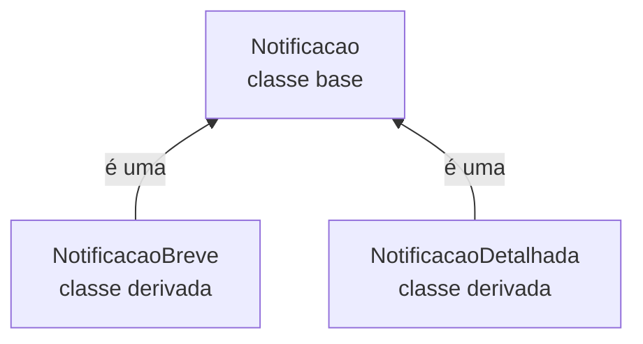
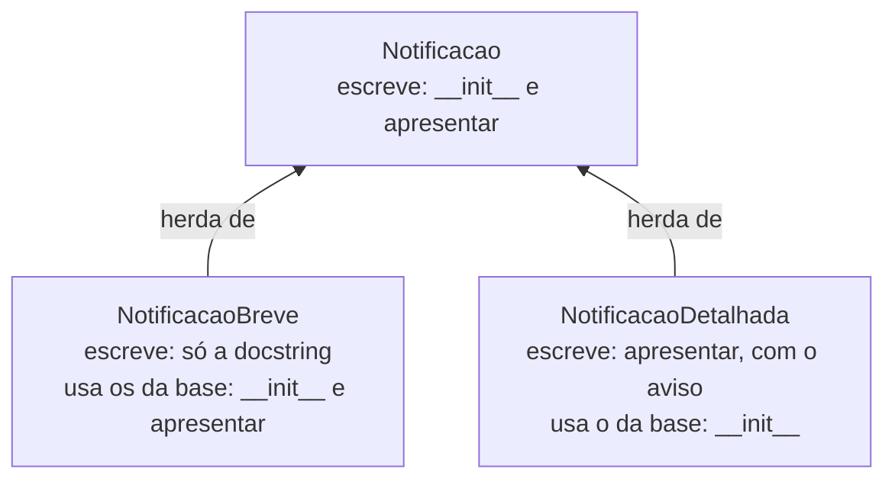
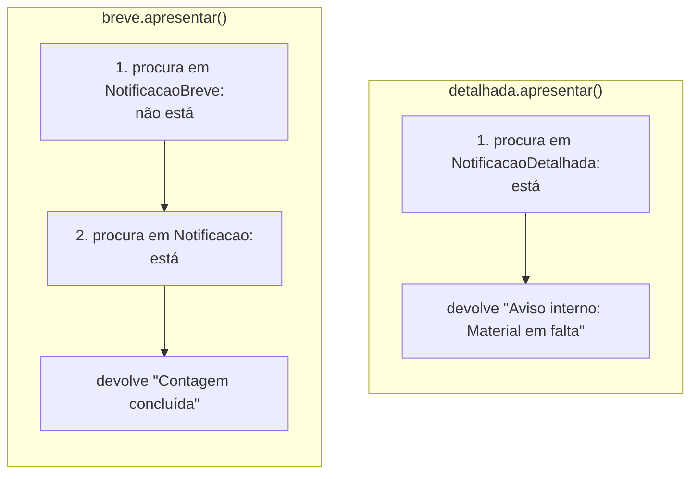
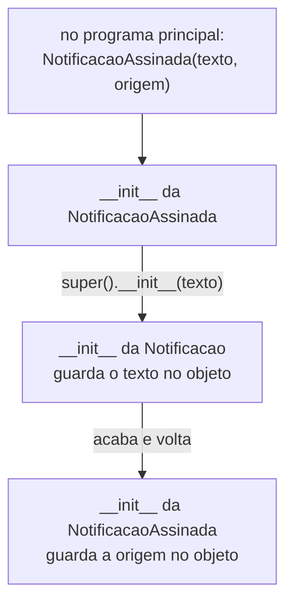
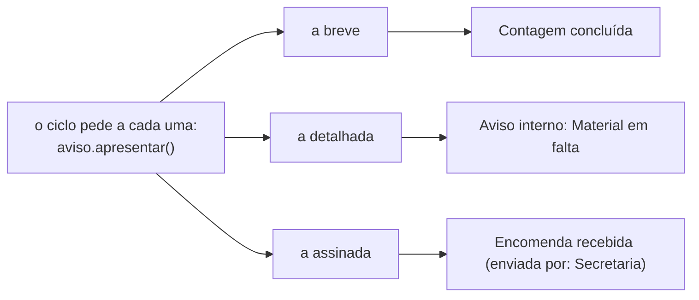
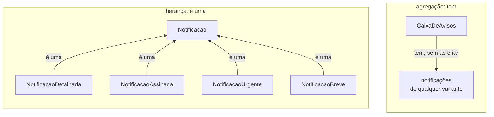

# Herança e polimorfismo

Neste guia, uma classe nova nasce de outra que já existe: o que é comum escreve-se uma vez, numa classe geral, e cada variante escreve só o que muda. Vês como isto se faz em Python e o que acontece quando se faz o mesmo pedido a objetos de classes diferentes. Vês também como se escreve, por palavras, o contrato de uma classe abstrata.

Usa a relação "é um", a árvore de especialização, o construtor e o contrato de uma operação. Rever: [Duas perguntas sobre duas classes: "tem" e "é um"](04-composicao-modelacao.md#duas-perguntas-sobre-duas-classes-tem-e-é-um), [Duas árvores que se parecem e dizem coisas diferentes](04-composicao-modelacao.md#duas-árvores-que-se-parecem-e-dizem-coisas-diferentes), [Quando é que o construtor trabalha](02-objetos-classes-instancias.md#quando-é-que-o-construtor-trabalha) e [Operações com contrato](03-encapsulamento-contratos.md#operações-com-contrato). Para praticar: [laboratório](laboratorios/05-heranca-polimorfismo-laboratorio.md) e [ficha de exercícios](exercicios/05-heranca-polimorfismo-exercicios.md).

## Neste guia

1. [Parte 1: Uma classe feita a partir de outra](#parte-1-uma-classe-feita-a-partir-de-outra)
2. [Parte 2: O mesmo pedido a objetos diferentes](#parte-2-o-mesmo-pedido-a-objetos-diferentes)
3. [Parte 3: A classe abstrata e o seu contrato](#parte-3-a-classe-abstrata-e-o-seu-contrato)
4. [Parte 4: Herança ou composição](#parte-4-herança-ou-composição)
5. [Exemplo guiado: uma caixa de avisos](#exemplo-guiado-uma-caixa-de-avisos)

## Parte 1: Uma classe feita a partir de outra

Os programas deste guia usam um exemplo à parte, o das notificações, porque o inventário não precisa de herança: nenhuma das suas classes é um caso particular de outra. Uma notificação é uma mensagem pronta a apresentar a alguém, como "Contagem concluída", e os programas só preparam esse texto e o mostram no ecrã. Cada programa está completo: copia-o para um ficheiro `notificacoes.py` e executa-o no editor das aulas, com o Python 3.10 ou mais recente.

### Duas classes quase iguais

Há notificações que se apresentam de maneiras diferentes. A breve mostra só o texto, e a detalhada mostra-o com "Aviso interno: " antes. Este programa escreve uma classe para cada uma, só com o que já sabes de classes:

```python
# Duas notificações escritas sem herança: o primeiro programa do guia 05.

class NotificacaoBreve:
    """Notificação que apresenta só o texto."""

    def __init__(self, texto):
        """Guarda o texto da notificação."""
        self.texto = texto

    def apresentar(self):
        """Devolve o texto tal como está guardado."""
        return self.texto


class NotificacaoDetalhada:
    """Notificação que apresenta o texto com um aviso antes."""

    def __init__(self, texto):
        """Guarda o texto da notificação."""
        self.texto = texto

    def apresentar(self):
        """Devolve o texto com "Aviso interno: " antes."""
        return "Aviso interno: " + self.texto


breve = NotificacaoBreve("Contagem concluída")
detalhada = NotificacaoDetalhada("Contagem concluída")

print(breve.apresentar())
print(detalhada.apresentar())
```

O programa mostra:

```text
Contagem concluída
Aviso interno: Contagem concluída
```

As duas notificações têm o mesmo texto, e cada uma apresenta-o à sua maneira. O programa funciona, mas as duas classes repetem quase tudo. Os construtores são iguais, letra a letra, e os dois métodos chamam-se `apresentar`. A única diferença está na linha do `return`.

A repetição tem dois custos. O primeiro é a regra escrita em dois sítios. Se um dia o texto de uma notificação não puder ficar vazio, a verificação tem de entrar nos dois construtores, e no de cada variante nova. Basta esquecer um para o programa ficar incoerente.

O segundo é que nada no programa diz que as duas classes descrevem notificações. Para o Python, são duas classes sem relação nenhuma, que por acaso têm um método com o mesmo nome. Não há uma classe a que se possa perguntar, com o `isinstance` do guia 03, se um objeto é uma notificação. E quem escrever uma terceira variante tem de adivinhar, a partir das outras duas, o que ela deve ter.

O que as duas classes têm em comum é geral: todas as notificações têm um texto e sabem apresentar-se. O que as distingue é particular: a maneira de cada uma se apresentar.

### Especialização: do geral para o particular

"Uma notificação breve é uma notificação" é uma frase verdadeira, e "uma notificação detalhada é uma notificação" também. É a relação "é um" do guia 04, entre um tipo particular e um tipo mais geral. O teste do guia 04 confirma-a: o que uma notificação tem e faz, um texto e saber apresentar-se, faz sentido para a breve e para a detalhada. Entre classes, esta relação chama-se também especialização: a classe particular conserva tudo o que a geral descreve e acrescenta ou concretiza alguma coisa.

A árvore de especialização das notificações põe a classe geral em cima e as particulares em baixo:



Lê-se de baixo para cima, com "é uma": a `NotificacaoBreve` é uma `Notificacao`, e a `NotificacaoDetalhada` também. A classe geral, em cima, chama-se **classe base**. As particulares, em baixo, chamam-se **classes derivadas**, porque se definem a partir da base. Também se diz superclasse e subclasse, e a uma árvore de classes assim chama-se também hierarquia. Os nomes estão escritos como nomes de classes do Python, sem espaços nem acentos, porque vão ser isso mesmo.

### Uma classe derivada que herda tudo

Para não repetir o que é comum, a classe base escreve-se uma vez, e cada variante escreve-se a partir dela. A **herança** é o mecanismo que define uma classe a partir de outra. A classe derivada herda da base todos os métodos, incluindo o construtor: tem-nos sem os escrever. Escreve-se com o nome da classe base entre parênteses, a seguir ao nome da classe derivada:

```python partial
class NotificacaoBreve(Notificacao):
```

A linha, sozinha, não corre, e lê-se "a classe `NotificacaoBreve`, que é uma `Notificacao`". O programa seguinte reescreve o primeiro com herança. A `NotificacaoBreve` não tem construtor: o Python vai aceitar `NotificacaoBreve("Contagem concluída")` e dar-lhe um texto?

```python
# A classe base Notificacao e duas classes derivadas: o segundo programa do guia 05.

class Notificacao:
    """Uma mensagem preparada para ser apresentada a alguém."""

    def __init__(self, texto):
        """Guarda o texto da notificação."""
        self.texto = texto

    def apresentar(self):
        """Devolve o texto da notificação, pronto a mostrar."""
        return self.texto


class NotificacaoBreve(Notificacao):
    """Notificação que apresenta só o texto: faz tudo como a classe base."""


class NotificacaoDetalhada(Notificacao):
    """Notificação que apresenta o texto com um aviso antes."""

    def apresentar(self):
        """Devolve o texto com "Aviso interno: " antes."""
        return "Aviso interno: " + self.texto


breve = NotificacaoBreve("Contagem concluída")
detalhada = NotificacaoDetalhada("Material em falta")

print(breve.texto)
print(detalhada.texto)
print(breve.apresentar())
print(detalhada.apresentar())

print(isinstance(breve, NotificacaoBreve))
print(isinstance(breve, Notificacao))
print(isinstance(breve, NotificacaoDetalhada))
```

O programa mostra:

```text
Contagem concluída
Material em falta
Contagem concluída
Aviso interno: Material em falta
True
True
False
```

Aceita, e as duas notificações têm o seu texto, sem nenhuma classe derivada escrever um construtor. A `NotificacaoBreve` só tem a docstring, porque o corpo de uma classe não pode ficar vazio, e a docstring conta como conteúdo. A `NotificacaoDetalhada` escreve só o método `apresentar`, com o aviso antes do texto. O construtor, as duas herdam-no da base.

Na linha `breve = NotificacaoBreve("Contagem concluída")`, o Python procura o `__init__` na classe `NotificacaoBreve`, não o encontra e executa o da `Notificacao`. Como em [Quando é que o construtor trabalha](02-objetos-classes-instancias.md#quando-é-que-o-construtor-trabalha), o `self` é o objeto novo, e é nele que fica o texto. A breve também não escreve `apresentar`, e por isso `breve.apresentar()` executa o da base.



O desenho mostra o que cada classe escreve e o que usa da base.

No guia 03, o `isinstance` perguntava se um valor era um `int`; aqui pergunta se um objeto é de uma classe. As três perguntas do programa dizem de que classes é a breve. É uma `NotificacaoBreve`, a classe de onde foi criada, e é também uma `Notificacao`. O Python sabe que um objeto de uma classe derivada é, ao mesmo tempo, um objeto da classe base: é a relação "é um", escrita em código. Mas a breve não é uma `NotificacaoDetalhada`. As duas classes derivadas são irmãs: são as duas notificações, e nenhuma é a outra.

Os dois custos do primeiro programa desapareceram: o construtor está escrito uma só vez, e o `isinstance` já reconhece uma notificação.

O erro típico é pensar que herdar é partilhar valores. As duas notificações do programa têm textos diferentes, como dois artigos da mesma classe têm quantidades diferentes. A herança é uma relação entre classes, e diz que a descrição da derivada inclui a da base. Os valores continuam a ser de cada objeto.

### Uma variante que redefine um método

A `NotificacaoDetalhada` recebeu da base um método `apresentar`, mas escreveu o seu, com o mesmo nome. Diz-se que uma classe derivada **redefine** um método quando escreve um método com o mesmo nome de um da base.

Para saber que `apresentar` se executa em cada chamada, segue-se a **regra de procura**. Quando se chama um método sobre um objeto, o Python procura-o primeiro na classe do objeto e, se não o encontrar lá, na classe base. Se também não estiver na base, procura na base da base, e assim por diante, até o encontrar. Se não o encontrar em nenhuma, o programa para com o [`AttributeError` do guia 02](02-objetos-classes-instancias.md#attributeerror-artigo-object-has-no-attribute-retirar). Aplicada ao programa da secção anterior:

| Chamada | Classe do objeto | Essa classe escreve o método? | Onde o Python o encontra | Resultado |
| --- | --- | --- | --- | --- |
| `NotificacaoDetalhada("Material em falta")`, o construtor | `NotificacaoDetalhada` | Não | Na classe base, `Notificacao` | O objeto fica com o texto |
| `breve.apresentar()` | `NotificacaoBreve` | Não | Na classe base, `Notificacao` | `Contagem concluída` |
| `detalhada.apresentar()` | `NotificacaoDetalhada` | Sim | Na própria classe | `Aviso interno: Material em falta` |



A procura da breve sobe até à classe base. A da detalhada acaba logo na classe do objeto.

Redefinir não apaga o método da base. O `apresentar` da `Notificacao` continua lá, e a breve continua a usá-lo. A versão da detalhada só tapa a da base para os objetos da detalhada.

Quando `breve.apresentar()` executa o método escrito na `Notificacao`, o `self` é a breve, o objeto que está antes do ponto, como em [O método retirar em Python](02-objetos-classes-instancias.md#o-método-retirar-em-python). O método foi escrito na base, mas trabalha sobre o objeto que recebeu o pedido, e por isso `self.texto` é o texto da breve.

### Uma variante com um dado novo e o `super()`

Uma variante também pode precisar de guardar mais um dado. A notificação assinada diz, no fim, quem a enviou, como em "Encomenda recebida (enviada por: Secretaria)". Além do texto, guarda a origem, e por isso o seu construtor recebe dois valores:

```python
# Uma classe derivada com um dado novo e super(): o terceiro programa do guia 05.

class Notificacao:
    """Uma mensagem preparada para ser apresentada a alguém."""

    def __init__(self, texto):
        """Guarda o texto da notificação."""
        self.texto = texto

    def apresentar(self):
        """Devolve o texto da notificação, pronto a mostrar."""
        return self.texto


class NotificacaoAssinada(Notificacao):
    """Notificação que diz, no fim, quem a enviou."""

    def __init__(self, texto, origem):
        """Guarda o texto, através do construtor da classe base, e a origem."""
        super().__init__(texto)
        self.origem = origem

    def apresentar(self):
        """Devolve o texto seguido da origem, entre parênteses."""
        return self.texto + " (enviada por: " + self.origem + ")"


assinada = NotificacaoAssinada("Encomenda recebida", "Secretaria")

print(assinada.texto)
print(assinada.origem)
print(assinada.apresentar())
```

O programa mostra:

```text
Encomenda recebida
Secretaria
Encomenda recebida (enviada por: Secretaria)
```

A `NotificacaoAssinada` escreve o seu construtor, porque tem uma coisa a mais para fazer na criação: guardar a origem. Pela regra de procura, é este construtor que o Python executa, e o da base deixa de ser executado por si. Mas o da base sabe guardar o texto, e a primeira linha do construtor novo aproveita-o.

O **`super()`** dá acesso aos métodos da classe base, para o mesmo objeto. O nome vem de superclasse, o outro nome da classe base. A linha `super().__init__(texto)` lê-se "executa o construtor da classe base, com este texto, sobre este objeto". Depois dela, o objeto já tem o atributo `texto`, guardado como a base o guarda, e a linha seguinte guarda a origem.



A criação passa pelos dois construtores. O da assinada pede ao da base que guarde o texto, e só depois guarda a origem.

Para criar a notificação, continua a escrever-se o nome da classe, `NotificacaoAssinada("Encomenda recebida", "Secretaria")`, e não `__init__`, como no guia 02. O `super().__init__(texto)` está dentro de um construtor, e serve para ele pedir ao da base que faça a sua parte. Uma classe derivada só escreve o seu `__init__` quando tem alguma coisa a mais para fazer na criação. A breve e a detalhada não têm, e herdam o da base.

Escrever `self.texto = texto` no construtor da assinada também funcionava, hoje. Mas, se o construtor da base passar a recusar um texto vazio, as assinadas saltam essa regra, porque nunca passam por ele. Com o `super().__init__(texto)`, uma regra da base vale também para as derivadas, e fica escrita num só sítio.

O erro típico é esquecer a linha do `super()`. Sem ela, o programa para logo na criação da assinada, ou só mais tarde?

O construtor da assinada é executado, guarda a origem e acaba. O da base nunca é executado, e o objeto fica sem o atributo `texto`, mas nada se queixa na criação. O programa para na primeira linha que usa o texto, `print(assinada.texto)`:

```text
Traceback (most recent call last):
  File ".../notificacoes.py", line 29, in <module>
    print(assinada.texto)
          ^^^^^^^^^^^^^^
AttributeError: 'NotificacaoAssinada' object has no attribute 'texto'
```

Onde estão os três pontos, aparece a pasta onde guardaste o ficheiro. De baixo para cima: a última linha diz que o objeto `NotificacaoAssinada` não tem o atributo `texto`. A linha `File` diz onde se deu por isso: na linha 29, no programa principal. É outra vez o `AttributeError`, e aparece longe da causa, como em [Nada impede uma quantidade impossível](03-encapsulamento-contratos.md#nada-impede-uma-quantidade-impossível): a mensagem aponta o `print`, e o engano está no construtor. Por isso, quando uma classe derivada escreve o seu construtor, a primeira linha dele é, quase sempre, `super().__init__(...)`, com os valores de que o da base precisa. Se a classe base não tiver construtor, nem escrito nem herdado, não há nada para aproveitar, e essa linha não faz falta.

<details>
<summary>Para ires mais longe: o `super()` noutros métodos</summary>

O `super()` não serve só para o construtor: dá acesso a qualquer método da classe base, para o mesmo objeto. O `apresentar` da assinada podia aproveitar o da base, que devolve o texto, e acrescentar-lhe a origem:

```python partial
    def apresentar(self):
        """Devolve o texto seguido da origem, entre parênteses."""
        return super().apresentar() + " (enviada por: " + self.origem + ")"
```

O resultado é o mesmo. As variantes das [resoluções dos temas de treino](../projeto/temas-de-treino-resolucoes.md#coleção-de-jogos) fazem assim com o `super().descricao()`: aproveitam a descrição da base e juntam-lhe o seu dado. Escrever tudo outra vez na variante também está certo, mas repete código.

</details>

## Parte 2: O mesmo pedido a objetos diferentes

Nesta parte, as três variantes juntam-se numa lista e recebem todas o mesmo pedido. Vês o que isso permite e a promessa que todas têm de cumprir.

### O mesmo pedido a todas as variantes

Com três variantes derivadas da mesma base, pode guardar-se uma notificação de cada numa lista e pedir a todas, num ciclo, que se apresentem. O ciclo deste programa tem uma só linha de trabalho, igual nas três voltas. Em cada volta, que `apresentar` encontra o Python?

```python
# Três variantes numa lista e o mesmo pedido a todas: o quarto programa do guia 05.

class Notificacao:
    """Uma mensagem preparada para ser apresentada a alguém."""

    def __init__(self, texto):
        """Guarda o texto da notificação."""
        self.texto = texto

    def apresentar(self):
        """Devolve o texto da notificação, pronto a mostrar."""
        return self.texto


class NotificacaoBreve(Notificacao):
    """Notificação que apresenta só o texto: faz tudo como a classe base."""


class NotificacaoDetalhada(Notificacao):
    """Notificação que apresenta o texto com um aviso antes."""

    def apresentar(self):
        """Devolve o texto com "Aviso interno: " antes."""
        return "Aviso interno: " + self.texto


class NotificacaoAssinada(Notificacao):
    """Notificação que diz, no fim, quem a enviou."""

    def __init__(self, texto, origem):
        """Guarda o texto, através do construtor da classe base, e a origem."""
        super().__init__(texto)
        self.origem = origem

    def apresentar(self):
        """Devolve o texto seguido da origem, entre parênteses."""
        return self.texto + " (enviada por: " + self.origem + ")"


avisos = [
    NotificacaoBreve("Contagem concluída"),
    NotificacaoDetalhada("Material em falta"),
    NotificacaoAssinada("Encomenda recebida", "Secretaria"),
]

for aviso in avisos:
    print(aviso.apresentar())
```

O programa mostra:

```text
Contagem concluída
Aviso interno: Material em falta
Encomenda recebida (enviada por: Secretaria)
```

As quatro classes são as dos programas anteriores, juntas no mesmo ficheiro. A lista escreve-se de uma maneira nova: os três objetos são criados dentro dos parênteses retos, um por linha, separados por vírgulas. É o mesmo que criar a lista vazia e fazer três `append`. A vírgula depois do último é opcional, e escreve-se para que um elemento novo, numa linha nova, não obrigue a mexer na de cima.

Em cada volta, o nome `aviso` aponta para um objeto de outra classe, e o Python encontra, pela regra de procura, o `apresentar` dessa classe:

| Volta | `aviso` aponta para um objeto da classe | `apresentar` usado | Resultado |
| --- | --- | --- | --- |
| 1 | `NotificacaoBreve` | O da base, `Notificacao` | `Contagem concluída` |
| 2 | `NotificacaoDetalhada` | O de `NotificacaoDetalhada` | `Aviso interno: Material em falta` |
| 3 | `NotificacaoAssinada` | O de `NotificacaoAssinada` | `Encomenda recebida (enviada por: Secretaria)` |

Chama-se **polimorfismo** a isto: o mesmo pedido, feito da mesma maneira, serve para objetos de classes diferentes, e cada objeto responde à sua maneira. O nome vem do grego e quer dizer "muitas formas". O ciclo não sabe de que variante é cada notificação, nem precisa de saber: só conta com que cada uma saiba apresentar-se.



O mesmo pedido chega às três notificações, e cada uma devolve a resposta da sua classe.

Sem polimorfismo, o ciclo teria de decidir, ele próprio, como se apresenta cada variante. Este excerto depende das classes e da lista do programa acima:

```python partial
for aviso in avisos:
    if isinstance(aviso, NotificacaoDetalhada):
        print("Aviso interno: " + aviso.texto)
    elif isinstance(aviso, NotificacaoAssinada):
        print(aviso.texto + " (enviada por: " + aviso.origem + ")")
    else:
        print(aviso.texto)
```

Mostra o mesmo, mas tem três problemas:

1. A maneira de apresentar cada variante saiu da classe e foi parar ao ciclo. Mas quem sabe como se apresenta uma assinada é a `NotificacaoAssinada`, pela regra de [Quem sabe o quê: responsabilidades](04-composicao-modelacao.md#quem-sabe-o-quê-responsabilidades).
2. Cada variante nova obriga a mudar este ciclo, e todos os outros sítios do programa que apresentem notificações.
3. Uma variante que ninguém acrescentou à cadeia cai no `else` e sai como breve, sem nenhum erro a avisar.

<details>
<summary>Para ires mais longe: o polimorfismo sem herança</summary>

Quando executa `aviso.apresentar()`, o Python não pergunta se o objeto é uma `Notificacao`: procura um método com esse nome, pela regra de procura. Por isso, este ciclo também funcionava com as duas classes soltas de [Duas classes quase iguais](#duas-classes-quase-iguais), desde que cada uma tivesse o seu `apresentar`. A herança não faz falta para o ciclo funcionar. Acrescenta o que se viu em [Uma classe derivada que herda tudo](#uma-classe-derivada-que-herda-tudo): o código comum escrito uma vez e o tipo comum. Dá também um sítio para escrever o que todas as variantes prometem.

</details>

### O contrato comum

O polimorfismo só dá o resultado certo se todas as variantes cumprirem a mesma promessa, e ter um método com o nome certo não chega. O ciclo da secção anterior conta com que o `apresentar` se possa chamar sem argumentos, devolva um texto e não mude a notificação. Como em [Operações com contrato](03-encapsulamento-contratos.md#operações-com-contrato), escreve-se o contrato. O `apresentar`:

- não recebe nada, além do `self`;
- devolve um texto pronto a mostrar;
- não altera a notificação;
- não mostra nada no ecrã.

Não tem casos de falha: qualquer notificação se sabe apresentar. A última promessa divide as tarefas. A notificação prepara o texto, e quem o pediu decide se o mostra no terminal, numa página na internet ou noutro sítio qualquer.

O programa seguinte tem uma variante com o nome certo que não cumpre o contrato. Quantas linhas aparecem, e o que diz cada uma?

```python
# Uma variante que não cumpre o contrato: o quinto programa do guia 05.

class Notificacao:
    """Uma mensagem preparada para ser apresentada a alguém."""

    def __init__(self, texto):
        """Guarda o texto da notificação."""
        self.texto = texto

    def apresentar(self):
        """Devolve o texto da notificação, pronto a mostrar."""
        return self.texto


class NotificacaoBreve(Notificacao):
    """Notificação que apresenta só o texto: faz tudo como a classe base."""


class NotificacaoMalFeita(Notificacao):
    """Variante que não cumpre o contrato: mostra o texto em vez de o devolver."""

    def apresentar(self):
        """Mostra o texto no ecrã (e por isso não devolve nada)."""
        print("AVISO: " + self.texto)


avisos = [
    NotificacaoBreve("Contagem concluída"),
    NotificacaoMalFeita("Material em falta"),
]

for aviso in avisos:
    print(aviso.apresentar())
```

O programa mostra:

```text
Contagem concluída
AVISO: Material em falta
None
```

A primeira linha está certa. A segunda foi escrita pelo `print` do próprio método da `NotificacaoMalFeita`. A terceira é o `print` do ciclo a mostrar o que esse método devolveu: como não tem `return`, devolveu `None`, o "nada" do Python. O ciclo fez a todas o mesmo pedido, e foi a variante que não cumpriu o que prometia. Numa página na internet, o `print` do método não apareceria em lado nenhum, e a página mostraria "None".

A ideia por trás do contrato tem nome: **princípio da substituição**. Um objeto de uma classe derivada tem de poder ser usado em qualquer sítio onde se espera um objeto da classe base, sem surpresas para quem o usa. É o teste "é um" aplicado ao comportamento, e não só aos dados.

A `NotificacaoMalFeita` herda da base, e para o Python é uma `Notificacao`: `isinstance(aviso, Notificacao)` dá `True` com ela. O `isinstance` não verifica o contrato, e cumpri-lo é trabalho de quem escreve cada variante.

## Parte 3: A classe abstrata e o seu contrato

Nesta parte, a ideia de notificação passa a ser uma classe abstrata, com o contrato escrito por palavras e na docstring da classe base. No fim, uma variante nova escreve-se a partir desse contrato.

### Abstrair é escolher o essencial

No guia 01, decidiu-se [a informação que interessa guardar](01-entidades-estado-acoes.md#a-informação-que-interessa-guardar) sobre cada material: o código, o nome e a quantidade, e não uma ficha por caderno. Essa escolha de representação é uma **abstração**: ficar com o que é essencial para o problema e deixar de fora o resto. Abstrai-se nos dados e também no que os objetos sabem fazer.

Na ideia de notificação, o essencial é que todas têm um texto e sabem apresentar-se. A maneira de se apresentarem não é essencial à ideia: é um pormenor de cada variante, e cada variante trata do seu.

### O contrato de uma classe abstrata

A classe `Notificacao` dos programas anteriores deixa criar `Notificacao("Contagem concluída")`, e essa notificação apresenta-se só com o texto, como a breve. Mas uma notificação geral, que não é de nenhuma variante, não tem uma maneira própria de se apresentar. A maneira breve só foi parar à base por ser a mais simples de escrever. E quem escreve uma variante nova tem de saber o que ela promete, sem o adivinhar a partir das outras.

Uma **classe abstrata** descreve o que é comum a um grupo de classes, mas não serve para criar objetos: os objetos criam-se das classes derivadas. Um **método abstrato** é um método de uma classe abstrata que tem o nome e o contrato, mas não tem instruções. Diz que todas as variantes sabem fazer aquilo, sem dizer como, e cada classe derivada escreve o seu.

Na ideia de notificação, a `Notificacao` é uma classe abstrata, e o `apresentar` é um método abstrato. É uma decisão do modelo, como as de [O inventário descrito por palavras](04-composicao-modelacao.md#o-inventário-descrito-por-palavras), e escreve-se por palavras, antes do código, no papel ou num comentário. Pode ficar assim, organizado pela indentação:

```text
Classe abstrata Notificacao
    Todas têm: um texto, guardado quando a notificação é criada
    Todas sabem: apresentar()   (abstrato: cada variante escreve como)
        não recebe nada
        devolve um texto pronto a mostrar
        não altera a notificação e não mostra nada no ecrã
```

Não há uma forma única de o escrever. O que conta é que se perceba o que todas as variantes têm e o que cada uma tem de completar, com o contrato do método abstrato por inteiro.

Abstrata não quer dizer vazia. A primeira linha do contrato diz o que todas as notificações têm, e isso é igual em todas: um texto, guardado na criação. A classe está incompleta de propósito, porque há uma parte, a maneira de se apresentar, que só as derivadas completam.

### O contrato na docstring da classe base

No modelo, a `Notificacao` é abstrata. Nos programas deste guia, continua a ser uma **classe concreta**, uma classe de onde se podem criar objetos, como todas as que escreveste até aqui. O seu `apresentar` devolve o texto da maneira breve, e por isso a `NotificacaoBreve` não escreve o seu: herda o da base. Redefinem-no só as variantes que se apresentam de outra maneira.

O que passa do modelo para o código é o contrato. Fica nas docstrings da classe base e do seu `apresentar`, onde quem escreve uma variante nova o vai procurar. Como a docstring do `adicionar` de [Operações com contrato](03-encapsulamento-contratos.md#operações-com-contrato), estas têm várias linhas. A primeira diz, numa frase, o que a classe ou o método é, e o resto vem depois de uma linha em branco. As três aspas que as fecham ficam numa linha sozinhas.

O programa seguinte tem a base com o contrato, a detalhada e uma variante que se esqueceu de escrever o seu `apresentar`. A docstring dela diz que devia apresentar o texto entre parênteses retos. O que mostra a terceira linha?

```python
# A classe base com o contrato na docstring: o sexto programa do guia 05.

class Notificacao:
    """Uma mensagem preparada para ser apresentada a alguém.

    No modelo, é uma classe abstrata: os objetos criam-se das variantes.
    Todas as notificações guardam um texto e sabem apresentar-se. Uma
    variante que se apresente de outra maneira redefine apresentar().
    """

    def __init__(self, texto):
        """Guarda o texto da notificação."""
        self.texto = texto

    def apresentar(self):
        """Devolve o texto da notificação, pronto a mostrar.

        Contrato: não recebe nada além do self, devolve um texto pronto a
        mostrar e não altera a notificação. Não mostra nada no ecrã.
        """
        return self.texto


class NotificacaoDetalhada(Notificacao):
    """Notificação que apresenta o texto com um aviso antes."""

    def apresentar(self):
        """Devolve o texto com "Aviso interno: " antes."""
        return "Aviso interno: " + self.texto


class NotificacaoEsquecida(Notificacao):
    """Notificação que devia apresentar o texto entre parênteses retos."""


geral = Notificacao("Contagem concluída")
detalhada = NotificacaoDetalhada("Material em falta")
esquecida = NotificacaoEsquecida("A02 esgotou")

print(geral.apresentar())
print(detalhada.apresentar())
print(esquecida.apresentar())
```

O programa mostra:

```text
Contagem concluída
Aviso interno: Material em falta
A02 esgotou
```

A primeira linha vem da notificação geral. A docstring da base diz que os objetos se criam das variantes, mas o Python criou-a sem se queixar. Não lê as docstrings para decidir o que se pode criar. A terceira linha é a da `NotificacaoEsquecida`. A docstring dela promete o texto entre parênteses retos, mas a classe não escreve o `apresentar`, e o Python usou o da base, pela regra de procura. Saiu da maneira breve, sem nenhum aviso.

A docstring explica o contrato a quem escreve uma variante, mas não obriga ninguém a cumpri-lo. Quem dá pelo esquecimento é quem prevê o resultado antes de executar. Quem leu a docstring da esquecida esperava `[A02 esgotou]` na terceira linha, e viu `A02 esgotou`.

### Uma variante nova, sem mudar o ciclo

O responsável do armário da sala quer que os avisos de material esgotado chamem a atenção, com "URGENTE: " antes do texto e o texto todo em maiúsculas. "Uma notificação urgente é uma notificação" é verdadeira, e por isso a classe nova herda da `Notificacao`. Não guarda dados novos, e por isso não escreve construtor nem precisa do `super()`. Apresenta-se de outra maneira, e por isso redefine o `apresentar`, como pede o contrato da base.

Para pôr um texto em maiúsculas, os textos do Python têm o método **`upper`**, do inglês, "de cima", como as letras maiúsculas. `"A02 esgotou".upper()` devolve `"A02 ESGOTOU"`, um texto novo, e o original fica como estava: nenhum método dos textos muda o texto sobre o qual é chamado. É isso que deixa cumprir a promessa de não alterar a notificação:

```python partial
class NotificacaoUrgente(Notificacao):
    """Notificação que pede atenção imediata: o texto aparece em maiúsculas."""

    def apresentar(self):
        """Devolve "URGENTE: " seguido do texto em maiúsculas, sem alterar o texto guardado."""
        return "URGENTE: " + self.texto.upper()
```

O `self.texto.upper()` lê-se da esquerda para a direita: o texto desta notificação e, a partir dele, um texto novo, em maiúsculas. O programa de [O mesmo pedido a todas as variantes](#o-mesmo-pedido-a-todas-as-variantes) fica assim, com a classe nova depois das outras variantes e um objeto dela na lista. A classe base é a da secção anterior, com o contrato na docstring:

```python
# Uma variante nova, sem mudar o ciclo: o sétimo programa do guia 05.

class Notificacao:
    """Uma mensagem preparada para ser apresentada a alguém.

    No modelo, é uma classe abstrata: os objetos criam-se das variantes.
    Todas as notificações guardam um texto e sabem apresentar-se. Uma
    variante que se apresente de outra maneira redefine apresentar().
    """

    def __init__(self, texto):
        """Guarda o texto da notificação."""
        self.texto = texto

    def apresentar(self):
        """Devolve o texto da notificação, pronto a mostrar.

        Contrato: não recebe nada além do self, devolve um texto pronto a
        mostrar e não altera a notificação. Não mostra nada no ecrã.
        """
        return self.texto


class NotificacaoBreve(Notificacao):
    """Notificação que apresenta só o texto: faz tudo como a classe base."""


class NotificacaoDetalhada(Notificacao):
    """Notificação que apresenta o texto com um aviso antes."""

    def apresentar(self):
        """Devolve o texto com "Aviso interno: " antes."""
        return "Aviso interno: " + self.texto


class NotificacaoAssinada(Notificacao):
    """Notificação que diz, no fim, quem a enviou."""

    def __init__(self, texto, origem):
        """Guarda o texto, através do construtor da classe base, e a origem."""
        super().__init__(texto)
        self.origem = origem

    def apresentar(self):
        """Devolve o texto seguido da origem, entre parênteses."""
        return self.texto + " (enviada por: " + self.origem + ")"


class NotificacaoUrgente(Notificacao):
    """Notificação que pede atenção imediata: o texto aparece em maiúsculas."""

    def apresentar(self):
        """Devolve "URGENTE: " seguido do texto em maiúsculas, sem alterar o texto guardado."""
        return "URGENTE: " + self.texto.upper()


avisos = [
    NotificacaoBreve("Contagem concluída"),
    NotificacaoDetalhada("Material em falta"),
    NotificacaoAssinada("Encomenda recebida", "Secretaria"),
    NotificacaoUrgente("A02 esgotou"),
]

for aviso in avisos:
    print(aviso.apresentar())

print("Texto guardado na urgente:", avisos[3].texto)
```

O programa mostra:

```text
Contagem concluída
Aviso interno: Material em falta
Encomenda recebida (enviada por: Secretaria)
URGENTE: A02 ESGOTOU
Texto guardado na urgente: A02 esgotou
```

A quarta volta encontra o `apresentar` da própria `NotificacaoUrgente`. A última linha confirma o contrato: o texto guardado continua como estava, porque o `upper` devolveu um texto novo e o atributo não foi tocado. `avisos[3]` é o quarto elemento da lista, porque as posições começam em 0.

O ciclo `for` é, letra a letra, o de [O mesmo pedido a todas as variantes](#o-mesmo-pedido-a-todas-as-variantes). Para juntar uma maneira nova de apresentar notificações, escreveu-se uma classe nova e pôs-se um objeto dela na lista, sem mudar uma linha do código que as apresenta. É o segundo problema da cadeia de `isinstance`, que o polimorfismo resolve.

O erro típico é mudar o atributo dentro do método, com `self.texto = self.texto.upper()` e depois `return "URGENTE: " + self.texto`. As quatro primeiras linhas ficam iguais, e a última passa a `Texto guardado na urgente: A02 ESGOTOU`. O atributo passou a apontar para o texto em maiúsculas, e o contrato diz que o `apresentar` não altera a notificação. Nenhuma mensagem de erro avisa: só a última linha mostra o problema.

## Parte 4: Herança ou composição

Nesta parte decides quando uma classe deve herdar de outra, e quando deve antes guardar outros objetos.

### Duas maneiras de reaproveitar

Há duas maneiras de construir uma classe a partir de outras. A herança diz "é um": a classe derivada é um caso particular da base e recebe tudo o que ela descreve. A outra diz "tem": o objeto guarda outros objetos e usa-os no seu trabalho, como o inventário guarda os artigos. A esta segunda maneira chama-se composição de objetos, no sentido largo: qualquer relação "tem", seja ela uma composição ou uma agregação, os [dois graus do guia 04](04-composicao-modelacao.md#dois-graus-de-tem-composição-e-agregação). É neste sentido que o título desta parte usa a palavra.

A decisão começa pela frase. Só há herança se "A é um B" for verdadeira e se um A puder cumprir tudo o que um B promete, como pede o [princípio da substituição](#o-contrato-comum). Na dúvida, a composição é quase sempre a escolha mais segura. Um objeto que guarda outro pode trocá-lo mais tarde por outro diferente, e não fica obrigado a receber atributos e métodos que não fazem sentido para ele.

### Heranças sem sentido

Estes três exemplos parecem razoáveis à primeira vista, e estão todos errados:

- `class Inventario(Artigo):`. A frase "um inventário é um artigo" é falsa, como mostra o teste do [guia 04](04-composicao-modelacao.md#duas-perguntas-sobre-duas-classes-tem-e-é-um). Com esta herança, o inventário receberia a propriedade `quantidade` e os métodos `adicionar(unidades)` e `retirar(unidades)`. Não fazem sentido para um conjunto de artigos: retirar 2 unidades de quê?
- `class Inventario(Notificacao):`, com a ideia de que o inventário também podia dar avisos. O inventário usaria notificações, mas não é uma. Teria um atributo `texto` e um método `apresentar`, e ninguém saberia dizer que texto é esse. A relação certa é "o inventário tem uma caixa de avisos", onde guarda as notificações.
- `class Caderno(Artigo):` e `class Pasta(Artigo):`. A frase "um caderno é um artigo" até é verdadeira. Mas, como em [Classe: a descrição comum](02-objetos-classes-instancias.md#classe-a-descrição-comum), estas classes não fazem falta: cadernos e pastas guardam os mesmos dados e aceitam as mesmas operações. Uma classe derivada só se justifica quando acrescenta ou muda alguma coisa.

E a `NotificacaoBreve`, que também só tem a docstring? "Breve" é uma maneira de se apresentar, um comportamento, e no contrato abstrato é uma variante como as outras. Só não escreve nada porque, nos programas deste guia, a base já se apresenta dessa maneira. Um caderno e uma pasta não se comportam de maneira diferente: só têm valores diferentes.

O inventário deste módulo não usa herança nenhuma, e está bem assim. Um programa não fica melhor por usar herança, mas por cada relação ser a certa.

## Exemplo guiado: uma caixa de avisos

O responsável do armário quer juntar numa caixa os avisos que vão chegando, de qualquer variante. Quando a abre, quer ver os textos de todos, já apresentados, pela ordem em que chegaram. As notificações são as do programa de [Uma variante nova, sem mudar o ciclo](#uma-variante-nova-sem-mudar-o-ciclo), e falta escrever a classe da caixa.

### Passo 1: a relação entre a caixa e as notificações

Primeiro, a frase. "Uma caixa de avisos é uma notificação" é falsa: a caixa não tem um texto seu, e pedir-lhe que se apresente como uma notificação não quer dizer nada. "Uma caixa de avisos tem notificações" é verdadeira. Por isso, a classe `CaixaDeAvisos` não herda de nenhuma outra: guarda as notificações numa lista.

Falta o grau do "tem". Uma notificação faz sentido sem caixa nenhuma, e as notificações são criadas fora da caixa, no programa principal, e chegam-lhe já feitas. Pelas perguntas de [Dois graus de "tem": composição e agregação](04-composicao-modelacao.md#dois-graus-de-tem-composição-e-agregação), é uma agregação, como a playlist do guia 04.

### Passo 2: o programa descrito por palavras

Antes do código, o programa descreve-se como em [O inventário descrito por palavras](04-composicao-modelacao.md#o-inventário-descrito-por-palavras): cada classe em três partes, e depois as relações. A notificação descreve-se assim:

- Cada notificação guarda o seu texto.
- Uma notificação cria-se com o texto, mas só através de uma variante, porque no modelo é uma classe abstrata.
- A uma notificação pode pedir-se que se apresente, com `apresentar()`, e cada variante decide como.

Uma classe derivada descreve-se da mesma maneira, e diz o que tem de diferente da base. A assinada descreve-se assim:

- Cada notificação assinada guarda tudo o que uma notificação guarda, e mais a origem.
- Uma notificação assinada cria-se com o texto e a origem.
- A uma notificação assinada pode pedir-se que se apresente, como a qualquer notificação, e ela mostra a origem no fim.

A breve, a detalhada e a urgente guardam só o texto e criam-se só com ele. O que têm de diferente é a maneira de se apresentarem. A breve mostra só o texto, a detalhada põe o aviso antes, e a urgente põe "URGENTE: " antes do texto em maiúsculas.

A caixa descreve-se com as mesmas três partes:

- Cada caixa guarda as notificações que recebe, pela ordem em que chegam.
- Uma caixa cria-se vazia.
- A uma caixa pode pedir-se que receba uma notificação, com `receber(notificacao)`, e que devolva a apresentação de cada uma, com `textos()`.

Faltam as relações. Uma relação "é um" descreve-se com a frase, e uma relação "tem" com a frase, o grau e as razões que o justificam:

- A breve, a detalhada, a assinada e a urgente são notificações.
- Uma caixa de avisos tem notificações, numa relação de agregação.
- Cada notificação faz sentido sem caixa nenhuma.
- A caixa recebe as notificações já criadas, no programa principal.

A descrição da caixa fala de notificações, e não de cada variante. A caixa só conta com o contrato do `apresentar`, e não precisa de saber de que variante é cada notificação que recebe.

### Passo 3: o construtor e o método receber

A caixa começa com uma lista vazia, num atributo com o [sublinhado do guia 03](03-encapsulamento-contratos.md#o-sublinhado-um-atributo-privado-por-convenção), porque é interna. Quem usa a caixa entrega-lhe as notificações com `receber`, e não mexe na lista. É este o começo da classe, num excerto do programa do passo 5:

```python partial
class CaixaDeAvisos:
    """Reúne notificações já criadas e devolve as suas apresentações.

    Agrega notificações de qualquer variante. Só precisa de saber que todas
    cumprem o contrato de apresentar; não sabe, nem precisa de saber, de que
    variante é cada uma.
    """

    def __init__(self):
        """Cria uma caixa vazia."""
        self._avisos = []

    def receber(self, notificacao):
        """Junta à caixa uma notificação criada fora dela."""
        self._avisos.append(notificacao)
```

O `receber` não cria nenhuma notificação: junta à lista uma que já existe. Em lado nenhum da classe aparece `NotificacaoBreve(...)` nem outra criação, e é isso que mostra, no código, que é uma agregação.

### Passo 4: o método textos

O método `textos` devolve uma lista com a apresentação de cada notificação, pela ordem em que chegaram. Usa um acumulador, como o de [O acumulador do método `titulos`](04-composicao-modelacao.md#o-acumulador-do-método-titulos). É o resto da classe, noutro excerto:

```python partial
    def textos(self):
        """Devolve uma lista com a apresentação de cada notificação, pela ordem de chegada."""
        resultado = []
        for aviso in self._avisos:
            resultado.append(aviso.apresentar())
        return resultado
```

A linha `resultado.append(aviso.apresentar())` é a mesma para todas as notificações, e é o polimorfismo de [O mesmo pedido a todas as variantes](#o-mesmo-pedido-a-todas-as-variantes). Cada notificação responde com o seu `apresentar`, que o Python encontra pela regra de procura. A caixa não conhece a `NotificacaoBreve`, nem a `NotificacaoUrgente`, nem nenhuma outra variante.

### Passo 5: o programa completo e o resultado

O programa junta as notificações, a caixa e um programa principal que entrega três avisos à caixa e mostra os textos que ela devolve:

```python
# Exemplo guiado do guia 05: a caixa de avisos, com herança e agregação.

class Notificacao:
    """Uma mensagem preparada para ser apresentada a alguém.

    No modelo, é uma classe abstrata: os objetos criam-se das variantes.
    Todas as notificações guardam um texto e sabem apresentar-se. Uma
    variante que se apresente de outra maneira redefine apresentar().
    """

    def __init__(self, texto):
        """Guarda o texto da notificação."""
        self.texto = texto

    def apresentar(self):
        """Devolve o texto da notificação, pronto a mostrar.

        Contrato: não recebe nada além do self, devolve um texto pronto a
        mostrar e não altera a notificação. Não mostra nada no ecrã.
        """
        return self.texto


class NotificacaoBreve(Notificacao):
    """Notificação que apresenta só o texto: faz tudo como a classe base."""


class NotificacaoDetalhada(Notificacao):
    """Notificação que apresenta o texto com um aviso antes."""

    def apresentar(self):
        """Devolve o texto com "Aviso interno: " antes."""
        return "Aviso interno: " + self.texto


class NotificacaoAssinada(Notificacao):
    """Notificação que diz, no fim, quem a enviou."""

    def __init__(self, texto, origem):
        """Guarda o texto, através do construtor da classe base, e a origem."""
        super().__init__(texto)
        self.origem = origem

    def apresentar(self):
        """Devolve o texto seguido da origem, entre parênteses."""
        return self.texto + " (enviada por: " + self.origem + ")"


class NotificacaoUrgente(Notificacao):
    """Notificação que pede atenção imediata: o texto aparece em maiúsculas."""

    def apresentar(self):
        """Devolve "URGENTE: " seguido do texto em maiúsculas, sem alterar o texto guardado."""
        return "URGENTE: " + self.texto.upper()


class CaixaDeAvisos:
    """Reúne notificações já criadas e devolve as suas apresentações.

    Agrega notificações de qualquer variante. Só precisa de saber que todas
    cumprem o contrato de apresentar; não sabe, nem precisa de saber, de que
    variante é cada uma.
    """

    def __init__(self):
        """Cria uma caixa vazia."""
        self._avisos = []

    def receber(self, notificacao):
        """Junta à caixa uma notificação criada fora dela."""
        self._avisos.append(notificacao)

    def textos(self):
        """Devolve uma lista com a apresentação de cada notificação, pela ordem de chegada."""
        resultado = []
        for aviso in self._avisos:
            resultado.append(aviso.apresentar())
        return resultado


caixa = CaixaDeAvisos()
caixa.receber(NotificacaoBreve("Contagem concluída"))
caixa.receber(NotificacaoUrgente("A02 esgotou"))
caixa.receber(NotificacaoAssinada("Encomenda recebida", "Secretaria"))

for linha in caixa.textos():
    print(linha)
```

O programa mostra:

```text
Contagem concluída
URGENTE: A02 ESGOTOU
Encomenda recebida (enviada por: Secretaria)
```

Para confirmar, segue as três linhas `caixa.receber(...)`, por ordem. A primeira entrega uma breve, que se apresenta com o `apresentar` da base; a segunda, uma urgente, com o seu; a terceira, uma assinada, com a origem no fim. As três linhas da saída vêm pela mesma ordem, cada uma à maneira da sua variante.



À esquerda, cada variante é uma notificação. À direita, a caixa tem notificações, que recebe já criadas, de qualquer variante. Como a caixa não conhece as variantes, uma variante que se escreva amanhã também cabe nela, sem mudar uma linha da `CaixaDeAvisos`.

## Erros frequentes

Estes erros aparecem a quem escreve as primeiras classes derivadas. Cada um parte de um programa do guia e diz o que mudou nele. Numa mensagem, a última linha diz o que aconteceu, e as linhas `File`, lidas de baixo para cima, dizem onde.

### `NameError: name 'Notificacao' is not defined`

No quarto programa, o de [O mesmo pedido a todas as variantes](#o-mesmo-pedido-a-todas-as-variantes), com a classe `Notificacao` escrita depois das três variantes, o programa para logo no princípio:

```text
Traceback (most recent call last):
  File ".../notificacoes.py", line 3, in <module>
    class NotificacaoBreve(Notificacao):
                           ^^^^^^^^^^^
NameError: name 'Notificacao' is not defined
```

A última linha diz que o nome `Notificacao` não está definido, e a linha `File` aponta a linha 3, a da primeira classe derivada. O Python lê o ficheiro de cima para baixo. Quando chega a `class NotificacaoBreve(Notificacao):`, tem de conhecer já a classe entre parênteses. Acontece o mesmo quando o nome entre parênteses tem uma letra trocada, como `Notificaçao`. Aí, as versões recentes do Python mostram a última linha com uma sugestão no fim: `NameError: name 'Notificaçao' is not defined. Did you mean: 'Notificacao'?`, "querias dizer `Notificacao`?". Escreve a classe base antes das que herdam dela, e confirma que o nome entre parênteses é exatamente o seu.

### `IndentationError: expected an indented block after class definition on line 15`

No segundo programa, o de [Uma classe derivada que herda tudo](#uma-classe-derivada-que-herda-tudo), com a linha da docstring da `NotificacaoBreve` apagada, o programa nem começa:

```text
  File ".../notificacoes.py", line 18
    class NotificacaoDetalhada(Notificacao):
    ^^^^^
IndentationError: expected an indented block after class definition on line 15
```

A mensagem não abre com `Traceback`, porque é um erro de escrita: o Python recusou o ficheiro antes de o executar. Em português, a última linha diz que se esperava um bloco indentado a seguir à definição de classe da linha 15. A linha 15 é a da `NotificacaoBreve`, que ficou sem nada por baixo, e a linha `File` aponta a 18, onde o Python deu pela falta. Uma classe derivada que não acrescenta nada leva, pelo menos, a docstring, indentada quatro espaços.

### `TypeError: NotificacaoAssinada.__init__() missing 1 required positional argument: 'origem'`

No quarto programa, com `NotificacaoAssinada("Encomenda recebida"),` na lista, sem a origem:

```text
Traceback (most recent call last):
  File ".../notificacoes.py", line 43, in <module>
    NotificacaoAssinada("Encomenda recebida"),
    ~~~~~~~~~~~~~~~~~~~^^^^^^^^^^^^^^^^^^^^^^
TypeError: NotificacaoAssinada.__init__() missing 1 required positional argument: 'origem'
```

Em português, a última linha diz que falta ao construtor da `NotificacaoAssinada` um argumento obrigatório, a `origem`. A classe derivada escreveu o seu construtor, que pede dois valores, mesmo que o da base só peça um. Vê quantos valores o construtor da classe recebe, sem contar o `self`, e passa-os todos, pela mesma ordem.

### `TypeError: Notificacao.__init__() missing 1 required positional argument: 'texto'`

No quarto programa, com `super().__init__()`, sem o texto, no construtor da assinada:

```text
Traceback (most recent call last):
  File ".../notificacoes.py", line 43, in <module>
    NotificacaoAssinada("Encomenda recebida", "Secretaria"),
    ~~~~~~~~~~~~~~~~~~~^^^^^^^^^^^^^^^^^^^^^^^^^^^^^^^^^^^^
  File ".../notificacoes.py", line 32, in __init__
    super().__init__()
    ~~~~~~~~~~~~~~~~^^
TypeError: Notificacao.__init__() missing 1 required positional argument: 'texto'
```

A última linha fala do construtor da `Notificacao`, e não do da assinada: quem se queixa da falta do `texto` é o construtor da base. De baixo para cima, as linhas `File` mostram a linha 32, o `super().__init__()` dentro do construtor da assinada, e a linha 43, a criação da assinada, na lista. O construtor da base também precisa dos seus valores, e quem lhos dá é a classe derivada, nessa chamada. Escreve `super().__init__(texto)`.

### Uma variante apresenta-se como a base, sem nenhum erro

No quarto programa, com `def apresenta(self):`, sem o r, na `NotificacaoDetalhada`, não aparece nenhuma mensagem, e a segunda linha passa a `Material em falta`, sem o aviso antes. Para o Python, `apresenta` é um método novo, que ninguém chama. Quando o ciclo pede `apresentar`, a regra de procura não o encontra na detalhada e usa o da base. O mesmo acontece quando o `def` fica encostado à margem, fora da classe. No guia 02, o `def` encostado dava `AttributeError`, porque a classe não tinha outro `retirar`; aqui a base tem um `apresentar`, e a regra de procura usa-o, sem erro. Confirma, letra a letra, que o método tem o nome do da base e que o `def` está indentado dentro da classe. O Python não avisa, e quem dá por este erro é a previsão feita antes de executar.

## Palavras novas deste guia

- Classe base: a classe geral, em cima na árvore de especialização; também se diz superclasse.
- Classe derivada: uma classe particular, que se define a partir da base; também se diz subclasse.
- Herança: o mecanismo que define uma classe a partir de outra; a classe derivada herda da base todos os métodos, incluindo o construtor.
- Redefinir um método: a classe derivada escreve um método com o mesmo nome de um método da base.
- Regra de procura: o Python procura um método primeiro na classe do objeto, depois na base, depois na base da base, até o encontrar, ou até não haver mais bases.
- `super()`: dá acesso aos métodos da classe base, para o mesmo objeto, como em `super().__init__(texto)`.
- Polimorfismo: o mesmo pedido, feito da mesma maneira, serve para objetos de classes diferentes, e cada objeto responde à sua maneira.
- Princípio da substituição: um objeto de uma classe derivada tem de poder ser usado onde se espera um objeto da base, sem surpresas para quem o usa.
- Abstração: ficar com o que é essencial para o problema e deixar de fora o resto.
- Classe abstrata: descreve o que é comum a um grupo de classes, mas não serve para criar objetos; os objetos criam-se das derivadas.
- Método abstrato: um método de uma classe abstrata com o nome e o contrato, mas sem instruções; cada classe derivada escreve o seu.
- Classe concreta: uma classe de onde se podem criar objetos.
- `upper`: o método dos textos que devolve um texto novo, todo em maiúsculas, e deixa o original como estava.

## O que vem a seguir

No tema seguinte, [Síntese](06-sintese.md), voltas ao inventário, sem herança, e juntas o que aprendeste sobre objetos, contratos e composição.


