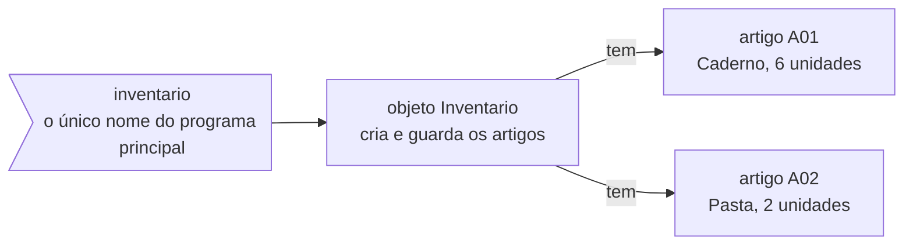
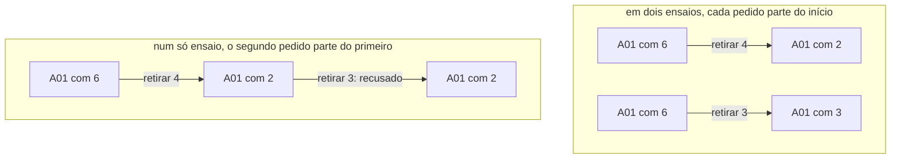
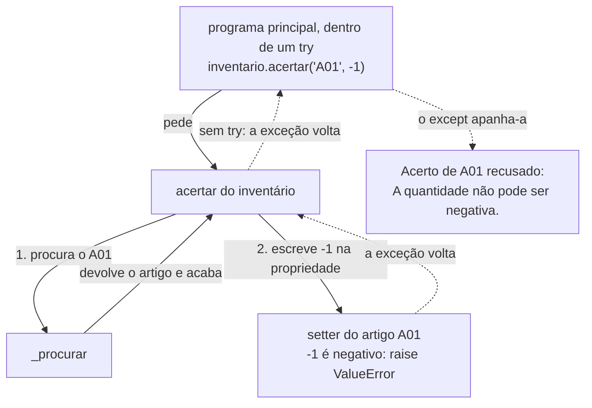

# Síntese

Neste guia, as ideias do módulo juntam-se num só programa: o inventário do guia 04, com uma operação por completar. Lês o programa por zonas, descreves o seu modelo por palavras e completas a operação, do plano ao método, com os casos que a confirmam e a explicação da correção.

Usa o inventário que passa os pedidos aos artigos, o modelo descrito por palavras e a recusa com `raise`, apanhada com `try` e `except`. Rever: [O inventário passa os pedidos aos artigos](04-composicao-modelacao.md#o-inventário-passa-os-pedidos-aos-artigos), [O inventário descrito por palavras](04-composicao-modelacao.md#o-inventário-descrito-por-palavras), [Recusar a sério, com `raise`](03-encapsulamento-contratos.md#recusar-a-sério-com-raise) e [Tratar a recusa com `try` e `except`](03-encapsulamento-contratos.md#tratar-a-recusa-com-try-e-except). Para praticar: [laboratório](laboratorios/06-sintese-laboratorio.md) e [ficha de exercícios](exercicios/06-sintese-exercicios.md).

## Neste guia

1. [Parte 1: Ler e descrever o programa](#parte-1-ler-e-descrever-o-programa)
2. [Parte 2: Uma operação, do plano à correção](#parte-2-uma-operação-do-plano-à-correção)
3. [Exemplo guiado: completar o método `acertar`](#exemplo-guiado-completar-o-método-acertar)

## Parte 1: Ler e descrever o programa

Nesta parte lês o programa do guia, descobres o que ele faz mal e descreves por palavras como estão organizados os seus dados. O programa corre sozinho: copia-o para um ficheiro `inventario.py` e executa-o inteiro no editor das aulas, com o Python 3.10 ou mais recente.

### Um programa lê-se por zonas

Este programa tem mais de cem linhas: duas classes e, no fim, as linhas que as usam. Quem o lê de cima para baixo, linha a linha, perde-se antes de saber o que ele faz. Um programa assim lê-se por zonas, e começa-se pelo fim:

1. O programa principal, as linhas encostadas à margem depois das classes, a partir de `inventario = Inventario()`. São elas que dizem o que o programa faz: cria um inventário, regista dois artigos, pede para acertar a quantidade de A02 para 5 e mostra as duas quantidades.
2. Os métodos que o programa principal chama: `registar`, `acertar` e `quantidade_de`, todos da classe `Inventario`. O programa principal nunca fala com um artigo. Fala com o inventário, pelos códigos.
3. A classe `Artigo`, para ver o que acontece quando o inventário passa um pedido a um artigo.

```python
# O programa de partida do guia 06: o inventário, com o método acertar por escrever.

class Artigo:
    """Artigo do inventário: código, nome e uma quantidade sempre válida.

    É a classe final do guia 03, com as docstrings encurtadas.
    """

    def __init__(self, codigo, nome, quantidade):
        """Cria o artigo. A quantidade inicial passa pelo setter."""
        self.codigo = codigo
        self.nome = nome
        self.quantidade = quantidade

    @property
    def quantidade(self):
        """Getter: devolve a quantidade atual, sem a alterar."""
        return self._quantidade

    @quantidade.setter
    def quantidade(self, valor):
        """Setter: guarda o valor se for um inteiro não negativo; senão, lança ValueError."""
        if not isinstance(valor, int):
            raise ValueError("A quantidade tem de ser um número inteiro.")
        if valor < 0:
            raise ValueError("A quantidade não pode ser negativa.")
        self._quantidade = valor

    def adicionar(self, unidades):
        """Acrescenta unidades (inteiro, 1 ou mais); senão, lança ValueError."""
        if not isinstance(unidades, int):
            raise ValueError("As unidades a adicionar têm de ser um número inteiro.")
        if unidades <= 0:
            raise ValueError("As unidades a adicionar têm de ser 1 ou mais.")
        self.quantidade = self.quantidade + unidades

    def retirar(self, unidades):
        """Retira unidades (inteiro, 1 ou mais, até ao que existe); senão, lança ValueError."""
        if not isinstance(unidades, int):
            raise ValueError("As unidades a retirar têm de ser um número inteiro.")
        if unidades <= 0:
            raise ValueError("As unidades a retirar têm de ser 1 ou mais.")
        # A falta de unidades é recusada pelo setter: o resultado seria negativo.
        self.quantidade = self.quantidade - unidades


class Inventario:
    """Inventário que cria, guarda e controla os seus artigos.

    O inventário é o dono dos artigos: cria-os em registar e guarda-os numa
    lista interna, _artigos, que o código de fora não usa. Garante a regra
    que nenhum artigo consegue garantir sozinho: não há dois artigos com o
    mesmo código. Os pedidos sobre um artigo são encaminhados para esse
    artigo, que continua a proteger a sua própria quantidade.
    """

    def __init__(self):
        """Cria um inventário vazio, ainda sem artigos."""
        self._artigos = []

    def _procurar(self, codigo):
        """Método interno: devolve o artigo com este código.

        Falha: lança ValueError se não houver nenhum artigo com este código.
        """
        for artigo in self._artigos:
            if artigo.codigo == codigo:
                return artigo
        raise ValueError("Não existe nenhum artigo com o código " + codigo + ".")

    def registar(self, codigo, nome, quantidade):
        """Cria um artigo novo e guarda-o no inventário.

        Falha: lança ValueError se já existir um artigo com este código, ou
        se a quantidade inicial for inválida. Em qualquer falha, o
        inventário fica como estava.
        """
        for artigo in self._artigos:
            if artigo.codigo == codigo:
                raise ValueError("Já existe um artigo com o código " + codigo + ".")
        novo = Artigo(codigo, nome, quantidade)
        self._artigos.append(novo)

    def quantidade_de(self, codigo):
        """Devolve a quantidade do artigo com este código, sem a alterar.

        Falha: lança ValueError se não houver nenhum artigo com este código.
        """
        artigo = self._procurar(codigo)
        return artigo.quantidade

    def retirar(self, codigo, unidades):
        """Encaminha um pedido de retirada para o artigo com este código.

        Falha: lança ValueError se não houver nenhum artigo com este código,
        ou se o próprio artigo recusar o pedido. Em qualquer falha, nenhuma
        quantidade muda.
        """
        artigo = self._procurar(codigo)
        artigo.retirar(unidades)

    def acertar(self, codigo, nova_quantidade):
        """Acerta a quantidade do artigo com este código, depois de uma contagem.

        Ainda por escrever: o exemplo guiado deste guia completa este método.
        """
        pass


inventario = Inventario()
inventario.registar("A01", "Caderno", 6)
inventario.registar("A02", "Pasta", 2)

inventario.acertar("A02", 5)
print("A01:", inventario.quantidade_de("A01"))
print("A02:", inventario.quantidade_de("A02"))
```

A classe `Artigo` é a do fim do guia 03, e a `Inventario` é a do guia 04, com as docstrings mais curtas e um método a mais. Esse método, o `acertar`, deve acertar a quantidade de um artigo depois de uma contagem, e ainda está por escrever.

Em cada parte do programa há uma ideia do módulo. Se uma linha te parecer estranha, a tabela diz onde a podes rever:

| No programa | A ideia | Rever |
| --- | --- | --- |
| `class Artigo:` e os artigos criados no `registar` | A classe e as instâncias: uma descrição comum, e os objetos feitos a partir dela, cada um com o seu estado | [Classe e instância](02-objetos-classes-instancias.md#classe-e-instância) |
| `self`, em cada método | O objeto que recebeu o pedido, o que está antes do ponto | [O método retirar em Python](02-objetos-classes-instancias.md#o-método-retirar-em-python) |
| O `@property` e os dois `def quantidade` | O encapsulamento: cada escrita na quantidade passa pelo setter, que a verifica e só depois a guarda | [Quem deve proteger a quantidade](03-encapsulamento-contratos.md#quem-deve-proteger-a-quantidade) e [A propriedade `quantidade`](03-encapsulamento-contratos.md#a-propriedade-quantidade) |
| `self.quantidade = quantidade`, no construtor | A quantidade inicial também passa pelo setter | [O construtor também passa pelo setter](03-encapsulamento-contratos.md#o-construtor-também-passa-pelo-setter) |
| O sublinhado em `_quantidade`, `_artigos` e `_procurar` | Um nome interno, que o código de fora não usa | [O sublinhado: um atributo privado por convenção](03-encapsulamento-contratos.md#o-sublinhado-um-atributo-privado-por-convenção) |
| As linhas com `raise ValueError(...)` | A recusa, que deixa os dados como estavam | [Recusar a sério, com `raise`](03-encapsulamento-contratos.md#recusar-a-sério-com-raise) |
| `novo = Artigo(codigo, nome, quantidade)`, no `registar` | A composição: o inventário cria os seus artigos e não repete um código | [O inventário cria os artigos e encontra-os pelo código](04-composicao-modelacao.md#o-inventário-cria-os-artigos-e-encontra-os-pelo-código) |
| O `_procurar` | O inventário encontra um artigo pelo código, ou recusa um código que não existe | [O inventário cria os artigos e encontra-os pelo código](04-composicao-modelacao.md#o-inventário-cria-os-artigos-e-encontra-os-pelo-código) |
| O `retirar` do inventário | O encaminhamento: o inventário encontra o artigo e passa-lhe o pedido, sem verificar as unidades | [O inventário passa os pedidos aos artigos](04-composicao-modelacao.md#o-inventário-passa-os-pedidos-aos-artigos) |

### Um programa que corre e não faz o que devia

O `acertar` ainda está por escrever. Ao executar o programa, aparece uma mensagem de erro, ou ele corre até ao fim? O programa mostra:

```text
A01: 6
A02: 2
```

Corre até ao fim, sem nenhuma mensagem de erro. Mas o programa principal pediu para acertar a quantidade de A02 para 5, e a última linha mostra `A02: 2`. O pedido não teve efeito nenhum.

A razão está no `acertar`. Por baixo da docstring, o método só tem a instrução **`pass`** (em inglês, "passa"), que não faz nada. Está ali para marcar, à vista, o sítio onde o código do método vai entrar. Quando o programa principal chama `inventario.acertar("A02", 5)`, o Python executa o método, encontra o `pass` e regressa, sem mexer em nenhum artigo.

É um erro de lógica, um dos três tipos de erro do guia 03, em [Nada impede uma quantidade impossível](03-encapsulamento-contratos.md#nada-impede-uma-quantidade-impossível). O programa corre do princípio ao fim e faz uma coisa diferente da que o problema pede, e o Python não avisa de nada. Só dás pelo erro se souberes antes o que o programa devia mostrar e o comparares com o que mostrou. Quem não sabe que A02 devia ficar com 5 lê a linha `A02: 2` como se estivesse certa.

Um método que não faz nada também não lança nenhuma exceção. Se o acerto estivesse dentro de um `try`, com um `print("Acerto aceite")` logo a seguir, o programa escrevia essa frase, e a pasta continuava com 2. Um pedido cumprido acaba da mesma maneira, em silêncio. Por isso, nem o silêncio nem um "aceite" distinguem um pedido cumprido de um que não fez nada. A prova é o estado depois do pedido, e é por isso que o programa principal mostra as duas quantidades.

<details>
<summary>Para ires mais longe: o `pass` e a docstring</summary>

Neste método, o `pass` podia sair, e o programa mostrava o mesmo, porque a docstring já conta como a instrução que um `def` precisa de ter por baixo. O `pass` faz falta num `def` ainda sem docstring nem código: sem nada por baixo, o Python recusa o ficheiro com o [`IndentationError` do guia 02](02-objetos-classes-instancias.md#indentationerror-expected-an-indented-block-after-function-definition-on-line-6).

</details>

### O modelo antes do código

Antes de mudar um programa, é preciso saber como estão organizados os seus dados: que classes há, que objetos, o que guarda cada um e quem faz o quê. O código diz tudo isto, mas espalhado por mais de cem linhas. Por isso, antes de mexer no código, descreve-se o modelo do programa, como em [O inventário descrito por palavras](04-composicao-modelacao.md#o-inventário-descrito-por-palavras). Aqui faz-se o caminho ao contrário do guia 04, do código para a descrição. É como ler da direita para a esquerda a tabela de [Da descrição ao código, e do código à descrição](04-composicao-modelacao.md#da-descrição-ao-código-e-do-código-à-descrição).

A descrição do artigo é a do [guia 04](04-composicao-modelacao.md#o-inventário-descrito-por-palavras), sem mudar nada. A do inventário ganha um pedido, o `acertar`:

- Cada inventário guarda os seus artigos, e não deixa haver dois com o mesmo código.
- Um inventário cria-se vazio, sem receber nenhum valor.
- A um inventário pode pedir-se que registe um artigo novo, com `registar(codigo, nome, quantidade)`, que diga quanto tem um artigo, com `quantidade_de(codigo)`, ou que retire unidades a um artigo, com `retirar(codigo, unidades)`. Pode pedir-se-lhe também que acerte a quantidade de um artigo depois de uma contagem, com `acertar(codigo, nova_quantidade)`.

O `acertar` entra na descrição, apesar de só ter o `pass`. O modelo diz o que se pode pedir ao inventário, e a docstring já o promete: é o código que ainda não cumpre a promessa. No artigo não muda nada, porque acertar é escrever na quantidade, que já está na descrição, com a sua regra. Ficam de fora, como no guia 04, a lista `_artigos` e o `_procurar`, que são internos. Também não entram valores, porque a descrição de uma classe vale para todos os objetos dela.

A relação entre as duas classes também é a do guia 04: o inventário tem artigos, numa composição. Justifica-se com as duas perguntas de [Dois graus de "tem": composição e agregação](04-composicao-modelacao.md#dois-graus-de-tem-composição-e-agregação), a começar pela que decide. O artigo não faz sentido sem o inventário, porque é uma linha do seu registo, e é o inventário que o cria, na linha `novo = Artigo(codigo, nome, quantidade)`, dentro do `registar`. A lista sozinha não decide nada: a playlist do guia 04 também guarda uma lista, e é uma agregação.

O `acertar` não muda a relação: muda uma quantidade, e não quem cria os artigos nem quem os guarda. Nenhuma das duas classes é um caso particular da outra, por isso o programa não tem herança, como explica [Heranças sem sentido](05-heranca-polimorfismo.md#heranças-sem-sentido).

Para dizer como estão os artigos concretos, descreve-se o estado de cada um, numa frase, com os valores. Depois dos dois registos, é este:

- O artigo de código A01 chama-se Caderno e tem 6 unidades.
- O artigo de código A02 chama-se Pasta e tem 2 unidades.



O programa tem duas classes e três objetos: o inventário e os dois artigos. A quantidade 6 não quer dizer seis objetos. O objeto do artigo A01 é a ficha do caderno no registo, que guarda o número 6, como em [O nosso inventário: composição](04-composicao-modelacao.md#o-nosso-inventário-composição).

O programa principal só tem o nome `inventario`, e é através dele que chega aos artigos. Por isso, cada artigo identifica-se pelo código. No guia 02, o caderno estava no nome `caderno`. O nome `artigo`, dentro dos métodos do inventário, também não identifica nenhum. É um nome local, uma etiqueta que, em cada chamada, se cola ao artigo que o `_procurar` encontrou, como em [Cada instância é um objeto diferente](02-objetos-classes-instancias.md#cada-instância-é-um-objeto-diferente).

## Parte 2: Uma operação, do plano à correção

Nesta parte, a retirada que o programa já tem serve de exemplo às quatro etapas de completar uma operação: o plano, os métodos, os casos e a explicação da correção. É a retirada dos guias 03 e 04, repartida pelas duas classes.

### O plano da retirada

Uma operação que passa por duas classes tem passos em sítios diferentes. Antes de a escrever, decide-se quem faz cada passo e por que ordem, e confirma-se que uma recusa deixa tudo como estava.

O **plano** de um método é a lista dos seus passos, pela ordem em que acontecem, com o que já mudou se o pedido for recusado em cada um. Escreve-se por palavras, antes do código.

A ordem dos passos segue duas regras que já conheces. Cada passo fica com quem tem a informação de que precisa, como em [Quem sabe o quê: responsabilidades](04-composicao-modelacao.md#quem-sabe-o-quê-responsabilidades). E os passos que podem recusar vêm todos antes de qualquer alteração, que é o "verificar primeiro, alterar depois" do guia 03.

A retirada tem uma parte em cada classe, e por isso tem dois planos. Este é o do `retirar` do inventário:

| Passo do `retirar` do inventário | O que já mudou, se o pedido for recusado aqui |
| --- | --- |
| Encontrar o artigo com este código | Nada: o `_procurar` recusa um código que não existe, e nenhum artigo chega a ser contactado |
| Passar o pedido ao artigo, com as mesmas unidades | Nada no inventário: se houver recusa, é do artigo |

E este é o do `retirar` do artigo:

| Passo do `retirar` do artigo | O que já mudou, se o pedido for recusado aqui |
| --- | --- |
| Verificar se as unidades são um número inteiro | Nada |
| Verificar se as unidades são 1 ou mais | Nada |
| Escrever a nova quantidade pela propriedade; o setter recusa-a se ficar negativa | Nada: o setter recusa antes de guardar |

A coluna da direita diz "nada" em todas as linhas, e é isso que o contrato da retirada promete: em qualquer recusa, nenhuma quantidade muda. O plano do inventário não tem nenhum passo sobre as unidades, porque essas regras são do artigo.

### Os dois métodos, e a sequência do programa

Com o plano feito, falta passá-lo para Python e prever o que mostra um programa que faz vários pedidos seguidos.

Cada passo do plano dá uma ou duas linhas de código. No programa deste guia, a retirada já está escrita, e cada linha tem o seu passo:

| Passo do plano | No código |
| --- | --- |
| Encontrar o artigo com este código | `artigo = self._procurar(codigo)`, no `retirar` do inventário |
| Passar o pedido ao artigo | `artigo.retirar(unidades)`, logo a seguir |
| Verificar se as unidades são um número inteiro | O primeiro `if` do `retirar` do artigo, com o seu `raise` |
| Verificar se as unidades são 1 ou mais | O segundo `if`, com o seu `raise` |
| Escrever a nova quantidade pela propriedade | `self.quantidade = self.quantidade - unidades` |

Há dois métodos `retirar`, um em cada classe, e o objeto antes do ponto diz qual corre. O do inventário chama o `_procurar` com `self.`, porque é um método do mesmo objeto. E não tem nenhum `try`: se o artigo recusar, a recusa sobe até quem fez o pedido, como em [O caminho de uma recusa](04-composicao-modelacao.md#o-caminho-de-uma-recusa).

Um programa principal faz os pedidos um a seguir ao outro, e cada pedido encontra o estado que o anterior deixou. Por isso, antes de executar, prevê-se a sequência num traço, uma linha por pedido, como no [exemplo guiado do guia 01](01-entidades-estado-acoes.md#exemplo-guiado-seguir-os-valores-passo-a-passo). Retirar 3 de um caderno com 6 é aceite. E se antes se tiverem retirado 4?

| Pedido | Quem responde | Resposta | A01 depois | A02 depois |
| --- | --- | --- | ---: | ---: |
| `retirar("A01", 4)` | O artigo aceita: 6 - 4 = 2 | Aceite | 2 | 2 |
| `retirar("A01", 3)` | O setter recusa: 2 - 3 = -1 | `ValueError` | 2 | 2 |

Depois dos 4, o pedido de 3 já é recusado, porque encontra só 2 unidades. Cada linha do traço começa onde a anterior acabou. A coluna de A02 mostra que o outro artigo não foi tocado.

### Outros casos, cada um num ensaio

Os pedidos de um programa principal experimentam só alguns casos. Um engano num caso que ninguém experimenta fica escondido, e o programa parece certo.

Um **ensaio** é uma execução do programa feita para experimentar um caso, a partir dos valores iniciais. Cada execução começa do zero, com os valores escritos no programa, e por isso cada ensaio parte do estado inicial, e não do que outro ensaio deixou.



No mesmo ensaio, o pedido de 3 chega a um caderno com 2 e é recusado. Num ensaio só para ele, chega a um caderno com 6 e é aceite. Os dois servem: um ensaio com vários pedidos mostra como eles se encadeiam, e um ensaio para cada pedido mostra cada caso sozinho.

Para escolher os casos, lê-se o contrato da operação: um caso para o pedido aceite, um para cada razão de recusa e o caso no limite entre aceite e recusado. A retirada tem seis: um pedido aceite, um código que não existe, unidades que não são inteiras, unidades menores do que 1, unidades a mais e todas as unidades. O último é o do limite: é aceite e deixa o artigo com 0. Em cada ensaio, mostra-se o estado de todos os artigos, antes e depois do pedido. Um pedido a A02 não pode mudar A01, e só o confirmas se olhares para os dois.

Este excerto é um ensaio. Fica no lugar das linhas do programa de partida que vêm depois das duas classes:

```python partial
inventario = Inventario()
inventario.registar("A01", "Caderno", 6)
inventario.registar("A02", "Pasta", 2)

print("Antes: A01 com", inventario.quantidade_de("A01"), "e A02 com", inventario.quantidade_de("A02"))
try:
    inventario.retirar("A02", 3)
    print("Pedido aceite")
except ValueError as erro:
    print("Pedido recusado:", erro)
print("Depois: A01 com", inventario.quantidade_de("A01"), "e A02 com", inventario.quantidade_de("A02"))
```

O ensaio mostra:

```text
Antes: A01 com 6 e A02 com 2
Pedido recusado: A quantidade não pode ser negativa.
Depois: A01 com 6 e A02 com 2
```

O setter recusou o pedido, porque 2 - 3 dá -1, e as duas linhas do estado são iguais. A recusa não mudou a pasta, e o pedido à pasta não tocou no caderno. Para os outros casos, troca-se só a linha do pedido e executa-se outra vez o programa inteiro.

### Explicar a correção

Depois de se corrigir um erro, "agora já funciona" não diz o que estava mal nem mostra que ficou resolvido.

Uma correção explica-se em quatro frases, cada uma com valores ou com uma instrução concreta:

1. o que esperavas, tirado do problema, e não do código que falhou;
2. o que o programa mostrou;
3. a instrução que explica a diferença, e porquê;
4. o que o programa mostra depois da alteração, com os valores.

No [passo 3 do exemplo guiado do guia 03](03-encapsulamento-contratos.md#passo-3-verificar-o-pedido-no-próprio-método), viste que um `retirar` só com a linha da subtração aceitaria retirar -3. Para o repetires, apaga as duas verificações do `retirar` do artigo no programa deste guia e faz o pedido `inventario.retirar("A01", -3)`. A correção são as duas verificações do pedido, e explica-se assim:

1. Esperava que o pedido `inventario.retirar("A01", -3)`, com o caderno em 6 unidades, fosse recusado e a quantidade ficasse em 6.
2. Observei que o pedido foi aceite e que a quantidade passou a 9.
3. A instrução que explica a diferença é a linha da subtração, que não verifica o pedido: 6 - (-3) dá 9, e o setter aceita o 9, porque não é negativo.
4. Depois das duas verificações, confirmei que o pedido é recusado, com "As unidades a retirar têm de ser 1 ou mais.", e que a quantidade fica em 6.

Cada frase tem números ou uma linha do código, e quem a lê pode repetir o caso e confirmar. Uma frase como "o método estava mal e agora está bem" não deixa confirmar nada.

## Exemplo guiado: completar o método `acertar`

O problema: o `acertar` do programa de partida só tem o `pass`. Falta escrevê-lo, confirmar que cumpre o que promete e explicar a correção, pelas etapas da Parte 2.

### Passo 1: perceber o que o método tem de fazer

De vez em quando, alguém conta à mão o material do armário. Imagina que, ao contar as pastas, encontra 5, e o programa diz que há 2: alguém arrumou três pastas e esqueceu-se de as registar. Acertar a quantidade é escrever no artigo o valor contado, para o programa voltar a dizer a verdade.

Podia usar-se o `adicionar`, com 3 unidades, mas acertar é melhor, por duas razões. Quem conta sabe o total, 5, e não a diferença, e uma conta feita à mão é mais uma ocasião de engano. E a contagem pode dar menos do que o registado, se alguém levou material sem o registar, e aí seria preciso retirar. Acertar serve para os dois casos.

No artigo, acertar a quantidade já faz parte da [interface pública do guia 03](03-encapsulamento-contratos.md#interface-pública-aquilo-que-o-objeto-deixa-usar): escreve-se na propriedade, como em `artigo.quantidade = 5`. Falta fazê-lo através do inventário, a partir do código, porque o programa principal só conhece os artigos pelos códigos.

### Passo 2: escrever o contrato

Como em [Operações com contrato](03-encapsulamento-contratos.md#operações-com-contrato), escreve-se primeiro o que o método promete. O `acertar` recebe o código de um artigo e a quantidade contada, e não devolve nada. Falha, com `ValueError`, em dois casos: se não houver nenhum artigo com esse código, ou se a quantidade contada for inválida. Em qualquer falha, nenhuma quantidade muda. Quando não falha, a quantidade do artigo passa a ser exatamente o valor contado.

### Passo 3: o plano do método

Como em [O plano da retirada](#o-plano-da-retirada), cada passo fica com quem tem a informação de que precisa, e cada recusa do contrato fica num passo:

| Passo do `acertar` | Quem o faz | O que já mudou, se o pedido for recusado aqui |
| --- | --- | --- |
| Encontrar o artigo com este código | O `_procurar` do inventário, que conhece todos os códigos e recusa um código que não existe | Nada: nenhum artigo foi contactado |
| Escrever o valor contado na propriedade `quantidade` do artigo | O setter do artigo, que verifica o valor, recusa um valor inválido e só depois guarda | Nada: o setter recusa antes de guardar |

O plano mostra também o que o `acertar` não deve fazer: verificar se o valor é um inteiro, ou se é negativo. Essa regra já vive no setter, e escrever na propriedade é chamar o setter. Se também estivesse escrita no inventário, a regra ficava em dois sítios, e um dia podia mudar num e ficar esquecida no outro.

### Passo 4: escrever o método

O método completo, com o contrato na docstring, é um excerto da classe `Inventario`. Fica no lugar do `acertar` do programa de partida, o que tinha o `pass`:

```python partial
    def acertar(self, codigo, nova_quantidade):
        """Acerta a quantidade do artigo com este código, depois de uma contagem.

        Recebe: o código do artigo e a quantidade contada.
        Devolve: nada (None).
        Falha: lança ValueError se não houver nenhum artigo com este código,
        ou se a quantidade contada for inválida (quem a recusa é o setter
        do artigo). Em qualquer falha, nenhuma quantidade muda.
        """
        artigo = self._procurar(codigo)
        artigo.quantidade = nova_quantidade
```

As duas linhas leem-se pela ordem em que o Python as executa.

A primeira, `artigo = self._procurar(codigo)`, é igual à primeira linha do `quantidade_de` e do `retirar`. Se o código não existir, o `_procurar` lança `ValueError`, e o `acertar` para nessa linha, sem chegar à segunda. Se existir, o nome `artigo` aponta para o próprio artigo guardado na lista.

A segunda, `artigo.quantidade = nova_quantidade`, escreve na propriedade desse artigo, e por isso chama o setter, com o valor da direita no parâmetro `valor`. O setter faz as suas duas verificações e só depois guarda o valor em `_quantidade`. Se o valor for inválido, o setter lança `ValueError` antes de o guardar, e a quantidade fica como estava.

Repara que a linha não escreve em `artigo._quantidade`. O inventário é código de fora da classe `Artigo`, e o código de fora usa a interface pública do artigo, que é a propriedade. Escrever no atributo interno passava ao lado do setter, e um acerto para -1 era aceite em silêncio.

<details>
<summary>Para ires mais longe: corrigir sem exceções</summary>

Nas [resoluções dos temas de treino](../projeto/temas-de-treino-resolucoes.md#cartas-colecionáveis), o pedido parecido com o `acertar` é o `corrigir_raridade` das cartas colecionáveis. Como no passo 3, a coleção não repete a regra: encontra a carta pelo código e devolve o que ela responder. A carta verifica a raridade com `raridade_valida`, o mesmo método que usa numa carta nova. Muda a forma da recusa, que lá volta num texto devolvido com `return`, e aqui numa exceção. As duas formas estão certas.

</details>

### Passo 5: prever antes de executar

Antes de executar, faz-se o traço de quatro pedidos seguidos, a partir de A01 com 6 e A02 com 2, como em [Os dois métodos, e a sequência do programa](#os-dois-métodos-e-a-sequência-do-programa). Os quatro pedidos saem do contrato do passo 2: um acerto aceite, um com um valor inválido e um com um código que não existe. No fim, uma retirada mostra o efeito do acerto. A coluna "Quem responde" diz que parte do programa aceitou ou recusou o pedido. Faz o traço de cabeça, para os quatro pedidos da primeira coluna, antes de leres o resto da tabela.

| Pedido | Quem responde | Resposta | A01 depois | A02 depois |
| --- | --- | --- | ---: | ---: |
| `acertar("A02", 5)` | `_procurar` encontra A02; o setter recebe 5, que é válido | Aceite | 6 | 5 |
| `acertar("A01", -1)` | `_procurar` encontra A01; o setter recebe -1, que é negativo | `ValueError` lançado pelo setter | 6 | 5 |
| `acertar("A09", 3)` | `_procurar` não encontra A09 | `ValueError` lançado pelo inventário | 6 | 5 |
| `retirar("A02", 4)` | `_procurar` encontra A02; o artigo aceita, 5 - 4 = 1 | Aceite | 6 | 1 |

A última linha mostra porque é que o acerto importa. A retirada de 4 pastas só é aceite porque o programa passou a saber que havia 5. Com as 2 do registo, era recusada.

### Passo 6: executar e comparar com o traço

Este é o programa completo, com o `acertar` do passo 4 no lugar do que tinha o `pass`. O programa principal faz os quatro pedidos do traço, pela mesma ordem, e os dois que o traço recusa estão cada um no seu `try`:

```python
# O inventário com o método acertar: o programa do exemplo guiado do guia 06.

class Artigo:
    """Artigo do inventário: código, nome e uma quantidade sempre válida.

    É a classe final do guia 03, com as docstrings encurtadas.
    """

    def __init__(self, codigo, nome, quantidade):
        """Cria o artigo. A quantidade inicial passa pelo setter."""
        self.codigo = codigo
        self.nome = nome
        self.quantidade = quantidade

    @property
    def quantidade(self):
        """Getter: devolve a quantidade atual, sem a alterar."""
        return self._quantidade

    @quantidade.setter
    def quantidade(self, valor):
        """Setter: guarda o valor se for um inteiro não negativo; senão, lança ValueError."""
        if not isinstance(valor, int):
            raise ValueError("A quantidade tem de ser um número inteiro.")
        if valor < 0:
            raise ValueError("A quantidade não pode ser negativa.")
        self._quantidade = valor

    def adicionar(self, unidades):
        """Acrescenta unidades (inteiro, 1 ou mais); senão, lança ValueError."""
        if not isinstance(unidades, int):
            raise ValueError("As unidades a adicionar têm de ser um número inteiro.")
        if unidades <= 0:
            raise ValueError("As unidades a adicionar têm de ser 1 ou mais.")
        self.quantidade = self.quantidade + unidades

    def retirar(self, unidades):
        """Retira unidades (inteiro, 1 ou mais, até ao que existe); senão, lança ValueError."""
        if not isinstance(unidades, int):
            raise ValueError("As unidades a retirar têm de ser um número inteiro.")
        if unidades <= 0:
            raise ValueError("As unidades a retirar têm de ser 1 ou mais.")
        # A falta de unidades é recusada pelo setter: o resultado seria negativo.
        self.quantidade = self.quantidade - unidades


class Inventario:
    """Inventário que cria, guarda e controla os seus artigos.

    O inventário é o dono dos artigos: cria-os em registar e guarda-os numa
    lista interna, _artigos, que o código de fora não usa. Garante a regra
    que nenhum artigo consegue garantir sozinho: não há dois artigos com o
    mesmo código. Os pedidos sobre um artigo são encaminhados para esse
    artigo, que continua a proteger a sua própria quantidade.
    """

    def __init__(self):
        """Cria um inventário vazio, ainda sem artigos."""
        self._artigos = []

    def _procurar(self, codigo):
        """Método interno: devolve o artigo com este código.

        Falha: lança ValueError se não houver nenhum artigo com este código.
        """
        for artigo in self._artigos:
            if artigo.codigo == codigo:
                return artigo
        raise ValueError("Não existe nenhum artigo com o código " + codigo + ".")

    def registar(self, codigo, nome, quantidade):
        """Cria um artigo novo e guarda-o no inventário.

        Falha: lança ValueError se já existir um artigo com este código, ou
        se a quantidade inicial for inválida. Em qualquer falha, o
        inventário fica como estava.
        """
        for artigo in self._artigos:
            if artigo.codigo == codigo:
                raise ValueError("Já existe um artigo com o código " + codigo + ".")
        novo = Artigo(codigo, nome, quantidade)
        self._artigos.append(novo)

    def quantidade_de(self, codigo):
        """Devolve a quantidade do artigo com este código, sem a alterar.

        Falha: lança ValueError se não houver nenhum artigo com este código.
        """
        artigo = self._procurar(codigo)
        return artigo.quantidade

    def retirar(self, codigo, unidades):
        """Encaminha um pedido de retirada para o artigo com este código.

        Falha: lança ValueError se não houver nenhum artigo com este código,
        ou se o próprio artigo recusar o pedido. Em qualquer falha, nenhuma
        quantidade muda.
        """
        artigo = self._procurar(codigo)
        artigo.retirar(unidades)

    def acertar(self, codigo, nova_quantidade):
        """Acerta a quantidade do artigo com este código, depois de uma contagem.

        Recebe: o código do artigo e a quantidade contada.
        Devolve: nada (None).
        Falha: lança ValueError se não houver nenhum artigo com este código,
        ou se a quantidade contada for inválida (quem a recusa é o setter
        do artigo). Em qualquer falha, nenhuma quantidade muda.
        """
        artigo = self._procurar(codigo)
        artigo.quantidade = nova_quantidade


inventario = Inventario()
inventario.registar("A01", "Caderno", 6)
inventario.registar("A02", "Pasta", 2)

inventario.acertar("A02", 5)
print("A02 depois de acertar para 5:", inventario.quantidade_de("A02"))

try:
    inventario.acertar("A01", -1)
except ValueError as erro:
    print("Acerto de A01 recusado:", erro)

try:
    inventario.acertar("A09", 3)
except ValueError as erro:
    print("Acerto de A09 recusado:", erro)

inventario.retirar("A02", 4)
print("A02 depois de retirar 4:", inventario.quantidade_de("A02"))

print("A01 no fim:", inventario.quantidade_de("A01"))
print("A02 no fim:", inventario.quantidade_de("A02"))
```

O programa mostra:

```text
A02 depois de acertar para 5: 5
Acerto de A01 recusado: A quantidade não pode ser negativa.
Acerto de A09 recusado: Não existe nenhum artigo com o código A09.
A02 depois de retirar 4: 1
A01 no fim: 6
A02 no fim: 1
```

Cada linha confirma o traço. O acerto de A02 foi aceite, e a quantidade passou a 5. As duas recusas aparecem pela ordem do traço, e cada mensagem diz quem recusou. "A quantidade não pode ser negativa." vem do setter do artigo, e "Não existe nenhum artigo com o código A09." vem do inventário. A retirada de 4 pastas deixou 1. Nas duas últimas linhas, A01, que só recebeu um pedido recusado, continua com 6.

Como o acerto aceite não mostra nada, a linha a seguir mostra a quantidade, como prova. No programa de partida, a mesma consulta mostrou `A02: 2`, e foi assim que se deu pelo erro.

### Passo 7: seguir o caminho de uma recusa

Falta seguir o pedido `inventario.acertar("A01", -1)` até à linha que o recusa, como em [O caminho de uma recusa](04-composicao-modelacao.md#o-caminho-de-uma-recusa), no guia 04.



O pedido segue pelas setas cheias. O `acertar` chama primeiro o `_procurar`, que encontra o A01, devolve-o e acaba. Depois escreve -1 na propriedade, e o setter lança a exceção. A exceção sobe pelas setas tracejadas: o `acertar` é abandonado na segunda linha, e o `except` do programa principal apanha-a e mostra a mensagem.

Quando a exceção nasce, o `_procurar` já tinha acabado, e por isso ela não passa por ele. A cadeia de chamadas é também mais curta do que a da retirada do guia 04. Entre o inventário e o setter não há nenhum método do artigo, porque a escrita na propriedade chama o setter diretamente.

### Passo 8: explicar a correção

A correção do programa de partida explica-se em quatro frases com valores, como em [Explicar a correção](#explicar-a-correção):

1. Esperava que, depois do pedido `acertar("A02", 5)`, a pasta ficasse com 5 unidades.
2. Observei, no programa de partida, a linha `A02: 2`, sem nenhuma mensagem de erro.
3. A instrução que explica a diferença é o `pass`, a única linha do `acertar` por baixo da docstring, que não faz nada.
4. Depois de escrever o método, confirmei no passo 6 que a pasta passa a 5, e que o acerto de A01 para -1 é recusado sem mudar os 6.

## Erros frequentes

Estes erros aparecem a quem escreve um método novo num programa que já existe. Quando há mensagem, começa pela última linha, que diz o que aconteceu, e sobe pelas linhas `File`, que dizem onde. O `self.` esquecido antes do `_procurar` dá o `NameError` dos [erros frequentes do guia 04](04-composicao-modelacao.md#nameerror-name-_procurar-is-not-defined).

### O acerto continua sem efeito depois de escreveres o método

Com o método do passo 4 colado antes do antigo, sem apagar o que tinha o `pass`, o programa de partida continua a mostrar `A02: 2`, sem nenhuma mensagem. Quando uma classe tem dois `def` com o mesmo nome, o Python fica só com o último, e aqui o último é o antigo, que não faz nada. É outro erro de lógica. Apaga o método antigo, do `def acertar` até ao `pass`, e confirma que no ficheiro só há uma linha a começar por `def acertar`.

### `AttributeError: 'Inventario' object has no attribute 'acertar'`

Com o método do passo 4 colado depois da classe, com o `def` encostado à margem, e o antigo apagado, o programa para logo no acerto:

```text
Traceback (most recent call last):
  File ".../inventario.py", line 120, in <module>
    inventario.acertar("A02", 5)
    ^^^^^^^^^^^^^^^^^^
AttributeError: 'Inventario' object has no attribute 'acertar'
```

De baixo para cima: a última linha diz que o objeto `Inventario` não tem o atributo `acertar`. A linha `File` diz onde se deu por isso: na linha 120, a do programa principal que pede o acerto. Com o `def` encostado à margem, o método ficou fora da classe, como uma função solta, e o inventário ficou sem ele. É o erro do `retirar` encostado à margem, nos [erros frequentes do guia 02](02-objetos-classes-instancias.md#attributeerror-artigo-object-has-no-attribute-retirar). Põe o `def` com quatro espaços, como os outros métodos, e as linhas de dentro com oito, como no passo 4.

## Palavras novas deste guia

- `pass` (do inglês, "passa"): uma instrução que não faz nada e que marca, à vista, o sítio onde o código de um método vai entrar.
- Plano de um método: a lista dos passos do método, pela ordem em que acontecem, com o que já mudou se o pedido for recusado em cada um.
- Ensaio: uma execução do programa feita para experimentar um caso, a partir dos valores iniciais.

## O que vem a seguir

No módulo seguinte, o M11, começas o JavaScript, com [A primeira página com JavaScript](../02-javascript-orientado-a-objetos/01-primeira-pagina-com-javascript.md).


