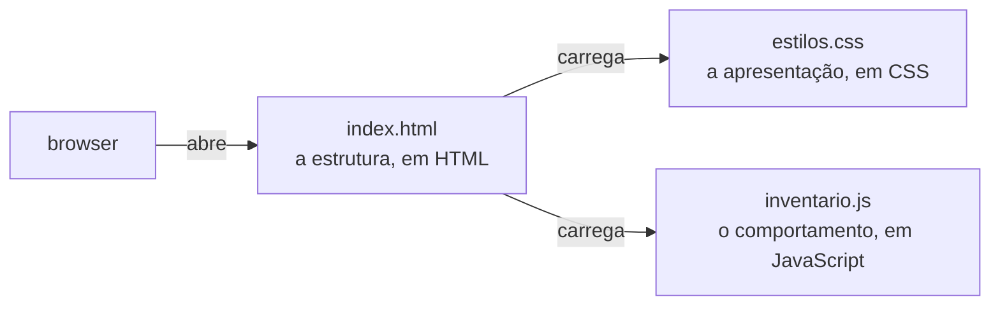
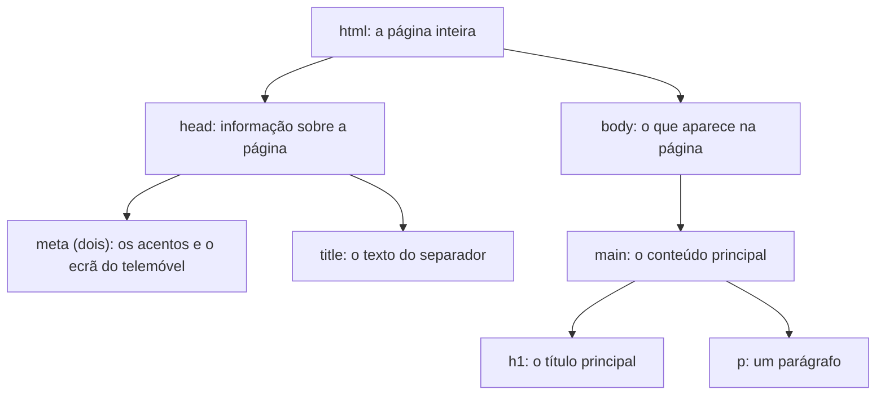
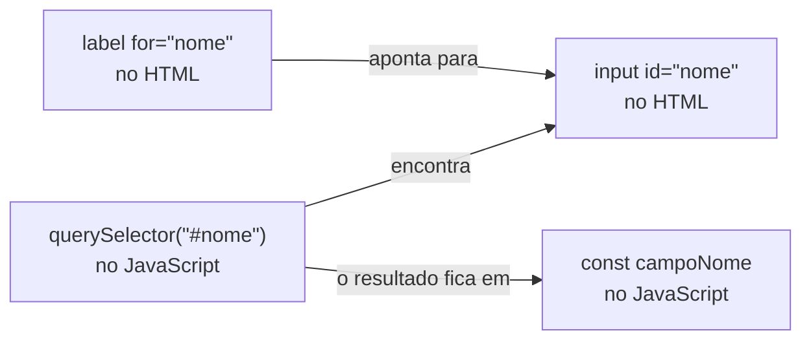
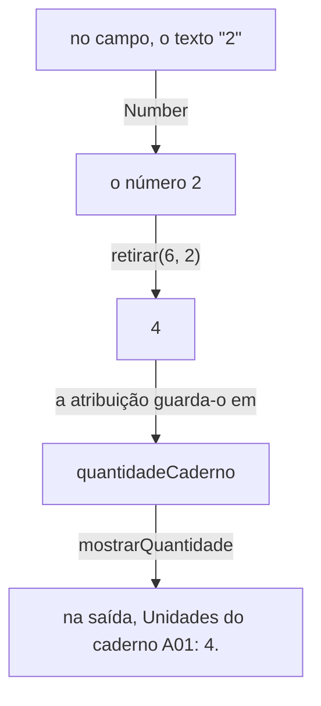

# A primeira página com JavaScript

Neste guia fazes a tua primeira página web, com um campo para escrever, um botão e um sítio para o resultado, e dás-lhe um aspeto legível. Depois escreves o teu primeiro JavaScript, a partir do que já sabes de Python, e pões o botão a chamar uma função tua.

Vais usar o Python do 10.º ano e três coisas do M10: a função `retirar`, os dois pedidos ao caderno A01 e os três tipos de erro. Rever: [A maneira habitual nos primeiros programas: programação estruturada](../01-programacao-orientada-objetos/01-entidades-estado-acoes.md#a-maneira-habitual-nos-primeiros-programas-programação-estruturada), [Exemplo guiado: seguir os valores passo a passo](../01-programacao-orientada-objetos/01-entidades-estado-acoes.md#exemplo-guiado-seguir-os-valores-passo-a-passo) e [Nada impede uma quantidade impossível](../01-programacao-orientada-objetos/03-encapsulamento-contratos.md#nada-impede-uma-quantidade-impossível). Para praticar: [laboratório](laboratorios/01-primeira-pagina-com-javascript-laboratorio.md) e [ficha de exercícios](exercicios/01-primeira-pagina-com-javascript-exercicios.md).

## Neste guia

1. [Parte 1: A página, em HTML e CSS](#parte-1-a-página-em-html-e-css)
2. [Parte 2: O JavaScript, a partir do Python](#parte-2-o-javascript-a-partir-do-python)
3. [Parte 3: A página responde ao clique](#parte-3-a-página-responde-ao-clique)
4. [Exemplo guiado: retirar unidades do caderno na página](#exemplo-guiado-retirar-unidades-do-caderno-na-página)

## Parte 1: A página, em HTML e CSS

### Uma página divide o trabalho por três ficheiros

Nos teus programas de Python, a mesma linguagem guardava os dados, fazia as contas e mostrava o resultado com o `print`. Uma página web divide esse trabalho por três ficheiros, cada um escrito numa linguagem própria. A página deste tema é o inventário da sala, com o caderno A01, e fica numa pasta assim:

```text
primeira-pagina/
├── index.html
├── estilos.css
└── inventario.js
```

O **HTML** diz o que a página tem: um título, um parágrafo, um campo, um botão. O **CSS** diz como a página se apresenta: a letra, as cores, os espaços. O JavaScript, a linguagem que vais aprender neste módulo, diz o que a página faz quando alguém a usa. Assim, a estrutura, a apresentação e o comportamento ficam em ficheiros separados.



O browser abre o `index.html`, e a página diz-lhe que carregue os outros dois ficheiros. O browser junta os três e mostra o resultado.

### O editor escreve a página, e o browser mostra-a

No M10, o programa corria no editor, e o resultado aparecia lá. Uma página precisa de dois programas. O editor, o VS Code, serve para escrever e guardar os ficheiros, e não mostra a página como ela fica. O browser, como o Chrome, o Edge ou o Firefox, lê os ficheiros, mostra a página e corre o JavaScript dela.

Para abrir a página, faz duplo clique no `index.html`, na janela de ficheiros do computador: o Explorador de Ficheiros, no Windows, ou o Finder, no macOS. No VS Code, o duplo clique abre o ficheiro para o editares, e não no browser. Para chegares à janela de ficheiros, carrega com o botão direito no nome do ficheiro, no VS Code. Escolhe `Reveal in File Explorer` (à letra, mostrar no Explorador de Ficheiros) ou, no macOS, `Reveal in Finder`.

Com a página aberta, o endereço da página começa por `file:///`, seguido do caminho do ficheiro. Se a barra de endereço mostrar só o caminho, clica nela para veres o endereço todo. A palavra `file` (em inglês, ficheiro) quer dizer que o browser mostra um ficheiro deste computador. A página não foi para a internet, e mais ninguém a vê.

A página aberta não muda sozinha quando mudas um ficheiro. Cada alteração passa por três passos: mudar o ficheiro no editor, guardá-lo e recarregar a página no browser. Guarda-se com Ctrl+S (Cmd+S no macOS), e recarrega-se com F5 ou Ctrl+R (Cmd+R no macOS). No VS Code, o separador de um ficheiro por guardar tem uma bola no lugar da cruz.

### Os nomes e os caminhos dos ficheiros

Os nomes dos ficheiros escrevem-se em minúsculas, sem espaços nem acentos, para não darem problemas em nenhum computador. A extensão, a parte depois do ponto, diz que tipo de ficheiro é: `.html`, `.css` ou `.js`. Cria os ficheiros no VS Code, que mostra sempre o nome completo. A janela de ficheiros do Windows pode esconder a extensão, e um ficheiro que parece `index.html` pode chamar-se, na verdade, `index.html.txt`.

O `index.html` vai dizer ao browser onde estão os outros dois ficheiros, com um **caminho relativo**: um caminho que parte da pasta onde está a página. O caminho `estilos.css`, sozinho, quer dizer "o ficheiro `estilos.css` que está na mesma pasta". Se esse ficheiro estivesse numa pasta `css`, ao lado da página, o caminho seria `css/estilos.css`. O nome no caminho tem de ser igual ao nome do ficheiro, letra a letra.

### A estrutura da página em HTML

Num ficheiro de texto simples, tudo é texto igual, e o browser não sabe o que é um título e o que é um parágrafo. O HTML marca cada parte com o que ela é.

Uma parte marcada é um **elemento**. Escreve-se com uma **etiqueta** de abertura, o conteúdo e uma etiqueta de fecho. A etiqueta de abertura é o nome do elemento entre `<` e `>`, como `<h1>`, e a de fecho tem uma barra antes do nome, como `</h1>`. Em inglês, a etiqueta diz-se *tag*. Esta é a página mais pequena do inventário:

```html
<!doctype html>
<html lang="pt-PT">
  <head>
    <meta charset="utf-8">
    <meta name="viewport" content="width=device-width, initial-scale=1">
    <title>Inventário da sala</title>
  </head>
  <body>
    <main>
      <h1>Inventário da sala</h1>
      <p>O caderno A01 começa com 6 unidades. Escreve quantas queres retirar e carrega em Retirar.</p>
    </main>
  </body>
</html>
```

No browser, o separador mostra "Inventário da sala". Dentro da página aparece o mesmo texto como título, em letra grande e grossa, e por baixo o parágrafo. O que está no `head` não aparece na página.

Lê-se a página de fora para dentro, porque cada elemento pode ter outros lá dentro. O diagrama mostra o que está dentro de quê:



O `html` contém tudo e divide-se em duas partes: o `head` (cabeça), com informação sobre a página, e o `body` (corpo), com o que se vê. Dentro do `body`, o `main` marca o conteúdo principal, com o título `h1` e o parágrafo `p`. O `h` vem de *heading* (título), e há `h2` para os subtítulos, `h3` e assim por diante.

O resto escreve-se sempre igual. A primeira linha, `<!doctype html>`, diz que a página usa o HTML atual. O `lang="pt-PT"` diz a língua da página, e os programas que leem a página a quem vê mal usam-no para acertar na pronúncia. O `meta` com `charset="utf-8"` faz os acentos aparecerem bem, e o do `viewport` faz um telemóvel mostrar a página à largura do ecrã. Os `meta` não têm etiqueta de fecho.

Há duas diferenças em relação ao Python. Os espaços no início das linhas servem só para as pessoas verem o que está dentro de quê, e o browser ignora-os. E o browser não para num erro de HTML, como o Python parava num erro de escrita. Sem o `</h1>`, por exemplo, o parágrafo passa a fazer parte do título e aparece em letra grande e grossa, e não aparece mensagem nenhuma.

### Os controlos da página

A página tem de perguntar quantas unidades se retiram e de mostrar o que fica. O HTML tem elementos próprios para isso. O campo e o botão são **controlos**, as partes da página com que a pessoa interage. Este excerto entra no `main`, por baixo do parágrafo:

```html
<p>
  <label for="unidades">Unidades a retirar</label>
  <input id="unidades" type="text">
</p>
<p>
  <button id="botao-retirar" type="button">Retirar</button>
</p>
<p>
  <output id="resultado"></output>
</p>
```

| Elemento | Em português | Para que serve |
| --- | --- | --- |
| `label` | rótulo | Diz o que se escreve no campo |
| `input` | campo | É a caixa onde se escreve; não tem etiqueta de fecho |
| `button` | botão | Faz uma ação na página |
| `output` | saída | Mostra um resultado; começa vazia |

O rótulo com o campo, o botão e a saída ficam cada um dentro de um `p`, para aparecerem em linhas separadas. Sem os `p`, aparecia tudo seguido, na mesma linha.

As palavras dentro de uma etiqueta de abertura, como `id="unidades"`, são **atributos**: informação extra sobre o elemento, na forma `nome="valor"`. O `lang` da página também é um atributo. Não é o atributo das classes do M10: aqui é uma informação escrita no HTML.

O `id` (de identificador) dá ao elemento um nome único na página, e é por ele que o JavaScript vai encontrar cada elemento. Nesta disciplina, escreve-se em minúsculas, com hífen entre as palavras. O `for` do rótulo (em inglês, para; não é o ciclo `for`) liga-o ao campo: o valor do `for` é o `id` do campo. Por isso, clicar no texto do rótulo põe o cursor no campo.

O `type="text"` diz que o campo aceita qualquer texto. Há campos próprios para números, mas cada browser trata-os à sua maneira. Com um campo de texto, todos se comportam igual, e o JavaScript converte o texto em número. O `type="button"` diz que o botão só faz o que o JavaScript mandar.

Carregar no botão ainda não faz nada, porque ninguém disse à página o que fazer com ele.

<details>
<summary>Para ires mais longe: o formulário</summary>

O HTML tem um elemento que junta vários campos para os enviar de uma vez, o `form` (formulário). Quando se carrega no botão de um formulário, o browser envia-o e recarrega a página. O que estava escrito desaparece, e o JavaScript volta a correr desde o início. A página deste tema tem um só campo e não envia nada, por isso não usa formulário. O `type="button"` garante que o botão nunca envia nada, mesmo que um dia fique dentro de um formulário.

</details>

### A página também se usa sem rato e sem ver o ecrã

Há pessoas que não veem bem o ecrã e pessoas que não usam o rato, por escolha ou por necessidade. Os controlos da página têm de servir a todas.

Quem não vê bem usa um **leitor de ecrã**, um programa que lê a página em voz alta. Quando a pessoa chega ao campo, o leitor de ecrã diz o texto do rótulo, se o `for` estiver ligado ao `id`. Sem essa ligação, ouve só "campo de texto" e não sabe o que escrever. O `output` também ajuda: em muitos browsers, o leitor de ecrã diz o texto da saída quando ele muda.

Quem não usa o rato anda pela página com o teclado. O controlo que recebe as teclas, num dado momento, tem o **foco**. A tecla Tab passa o foco ao controlo seguinte, e Shift+Tab volta ao anterior. Com o foco no campo, o que escreves entra lá. Com o foco no botão, Enter ou a barra de espaço carregam nele. O `input` e o `button` já fazem isto sem trabalho nenhum teu. É uma razão para usar cada elemento pela sua função: um botão a sério, e não um parágrafo com aspeto de botão.

Um erro frequente é pôr a explicação dentro do campo, com o atributo `placeholder` (à letra, marcador de lugar), em vez de um rótulo. O texto do `placeholder` desaparece quando se começa a escrever, e quem se distrai deixa de saber o que o campo pede. O rótulo fica sempre à vista.

### A apresentação com uma folha de CSS

Só com HTML, a página tem o aspeto que o browser escolhe. O texto fica encostado à margem da janela, e o botão é cinzento. O campo e o botão têm uma letra mais pequena do que a do resto.

O CSS escreve-se num ficheiro à parte, a **folha de estilos**. A página liga-a no `head`, a seguir ao `title`, com o elemento `link`, que não tem etiqueta de fecho:

```html
<link rel="stylesheet" href="estilos.css">
```

Esta linha não mostra nada. O `rel` (de relação) diz de que tipo é o ficheiro ligado, uma folha de estilos (`stylesheet`). O `href` (de referência) é o caminho relativo até ela.

A folha é feita de regras. Cada regra começa por um **seletor**, que escolhe os elementos, e diz entre chavetas o que muda neles, uma propriedade por linha, na forma `propriedade: valor;`. Esta propriedade do CSS não é a do `@property` do M10. A folha tem três regras:

```css
/* estilos.css: a apresentação da página do inventário. */

body {
  font-family: system-ui, sans-serif;
  line-height: 1.5;
  color: #1f1f1f;
  background-color: #ffffff;
  margin: 2rem;
}

input,
button {
  font: inherit;
  padding: 0.5rem;
}

button {
  color: #ffffff;
  background-color: #1f4e8c;
}
```

Com a folha ligada, a página passa a ter a letra do sistema, mais espaço entre as linhas e uma margem à volta. O campo e o botão ficam com a letra do resto da página e com espaço por dentro, e o botão fica azul-escuro, com letras brancas.

O seletor `body` escolhe o corpo da página, e `input, button`, com a vírgula, escolhe os dois elementos. A primeira linha da folha é um comentário de CSS, entre `/*` e `*/`, que o browser ignora. Cada propriedade faz isto:

| Propriedade | O que muda | Nesta folha |
| --- | --- | --- |
| `font-family` | O tipo de letra | `system-ui`, a letra do sistema, ou `sans-serif`, se essa faltar |
| `line-height` | A altura de cada linha | `1.5`, uma vez e meia a letra |
| `color` | A cor do texto | `#1f1f1f`, quase preto, e `#ffffff`, branco, no botão |
| `background-color` | A cor do fundo | `#ffffff`, branco, e `#1f4e8c`, azul-escuro, no botão |
| `margin` | O espaço por fora do elemento | `2rem`, cerca de 32 píxeis |
| `font: inherit` | A letra do campo e do botão | A do elemento que os contém (`inherit` quer dizer herdar) |
| `padding` | O espaço por dentro, entre o texto e a borda | `0.5rem` |

Uma cor escreve-se com um `#` seguido de três pares de símbolos: um para o vermelho, um para o verde e um para o azul. Cada par vai de `00`, nada dessa cor, a `ff`, o máximo. O `rem` vale o tamanho da letra normal do browser, quase sempre 16 píxeis. Se a pessoa aumentar a letra nas definições do browser, o `rem` cresce, e a margem acompanha.

<details>
<summary>Para ires mais longe: as cores em hexadecimal</summary>

Cada par de símbolos de uma cor é um número escrito em hexadecimal. O hexadecimal escreve os números com dezasseis algarismos: de 0 a 9 e de `a` a `f`. O `a` vale 10, e o `f` vale 15. O par `ff` vale 255, o máximo de cada cor. Por isso, `#ffffff` tem o máximo das três cores e dá o branco, e `#000000` não tem nenhuma e dá o preto. O `#1f4e8c` tem pouco vermelho (`1f`), um pouco mais de verde (`4e`) e mais azul (`8c`), e dá o azul-escuro do botão.

</details>

### O inspetor mostra as regras de cada elemento

Quando uma regra não faz o que esperavas, o browser mostra que regras se aplicam a cada elemento. Carrega com o botão direito num elemento e escolhe `Inspecionar` (num browser em inglês, `Inspect`). Abre-se o inspetor, numa parte do browser feita para quem constrói páginas, as **ferramentas do programador** (em inglês, *DevTools*). Também se abrem com F12 no Windows, ou com Cmd+Option+I no macOS. De um lado fica o HTML da página, e do outro as regras de CSS do elemento escolhido.

No botão, aparece a regra `button`, com o texto branco. Mais abaixo, na parte das propriedades herdadas do `body` (num browser em inglês, `Inherited from body`), a cor quase preta aparece riscada. O `body` passa a sua cor aos elementos que estão dentro dele, como o `h1` e o `p`, e a isto chama-se **herança**. É a herança do CSS, que não tem nada que ver com a das classes do M10. O botão também está dentro do `body`, mas a regra `button` escolhe-o diretamente, e um valor dado diretamente ganha ao valor herdado.

É também por isso que a folha precisa do `font: inherit`. O browser dá ao campo e ao botão uma letra própria, mais pequena, e essa letra, dada diretamente, ganhava à letra herdada da página.

Uma propriedade mal escrita, como `colr`, também aparece riscada, com um sinal de aviso. Como no HTML, o browser não mostra mensagem nenhuma por causa de um erro no CSS: ignora a propriedade e continua.

### As cores escolhem-se pelo contraste

Um texto cinzento-claro num fundo branco lê-se mal ao sol, com o brilho baixo ou com a vista cansada. Por isso, as cores escolhem-se também pelo **contraste**, a diferença de luminosidade entre a cor do texto e a do fundo. Mede-se de 1 para 1, quando as duas cores são iguais, a 21 para 1, o preto no branco. As regras de acessibilidade pedem pelo menos 4,5 para 1 no texto de tamanho normal.

| Texto | Fundo | Contraste | Chega aos 4,5 para 1? |
| --- | --- | ---: | --- |
| `#1f1f1f`, quase preto | `#ffffff`, branco | 16,5 para 1 | Sim |
| `#ffffff`, branco | `#1f4e8c`, azul-escuro | 8,3 para 1 | Sim |
| `#777777`, cinzento médio | `#ffffff`, branco | 4,48 para 1 | Não, por pouco |
| `#999999`, cinzento-claro | `#ffffff`, branco | 2,85 para 1 | Não |

A terceira linha mostra que o olho engana: o cinzento médio parece legível e fica abaixo do mínimo. O contraste mede-se numa calculadora, como a de "Para saber mais". No Chrome e no Edge, o inspetor também o mostra, quando se clica no quadrado da cor, ao lado do `color`.

<details>
<summary>Para ires mais longe: a cor não chega sozinha</summary>

Quem não distingue bem as cores perde tudo o que só a cor diz. Por isso, numa página, uma mensagem de erro não fica só vermelha: tem também um texto que diz o que está mal.

</details>

### O foco tem de se ver

Quem usa o teclado precisa de ver onde está o foco. O browser desenha uma linha à volta do controlo com o foco, o **contorno**, mas o contorno do browser pode ser fino ou perder-se em certas cores. Esta regra entra na mesma folha e troca-o por um mais grosso, com cor própria:

```css
input:focus-visible,
button:focus-visible {
  outline: 3px solid #b35c00;
  outline-offset: 2px;
}
```

O `:focus-visible`, colado ao nome do elemento, escolhe-o só quando tem o foco e o browser mostraria o contorno. É o que acontece quando se chega lá com o Tab. O `outline` (contorno) é uma linha contínua (`solid`) de 3 píxeis, num laranja-escuro com 4,7 para 1 de contraste com o branco. O `outline-offset` afasta-o 2 píxeis da borda. Com o Tab, o campo e o botão ficam rodeados por uma linha laranja grossa. No campo, o contorno aparece também quando clicas nele, porque o browser sabe que vais escrever lá.

Nunca apagues o contorno com `outline: none` sem pores outro no lugar. Quem usa o teclado deixa de saber onde está.

## Parte 2: O JavaScript, a partir do Python

### O script e a consola do browser

A página tem estrutura e apresentação, mas ainda não faz nada. O comportamento vem do JavaScript, a linguagem que os browsers sabem correr. Não substitui o Python: é outra ferramenta, feita para trabalhar dentro das páginas. A página carrega-o com o elemento `script`, no `head`, a seguir ao `link`:

```html
<script src="inventario.js" defer></script>
```

O `src` (de *source*, origem) é o caminho do ficheiro, como o `href` do `link`. O `script` leva sempre etiqueta de fecho, mesmo vazio. O `defer` (em inglês, adiar) não leva valor e manda o browser correr o script só depois de ler o HTML todo. Sem ele, o script do `head` corria antes de o browser chegar ao `body`, e não encontrava o campo nem o botão.

Um primeiro `inventario.js` pode ser só isto:

```js
// inventario.js: o comportamento da página do inventário.

console.log("O script está a correr.");
console.log(6 - 2);
```

Onde aparecem estas duas linhas? Na página, não aparece nada de novo. O `console.log` escreve na **consola**, a parte das ferramentas do programador onde aparecem as mensagens do script e os erros:

```text
O script está a correr.
4
```

O F12 (Cmd+Option+I no macOS) abre as ferramentas do programador. Escolhe lá o separador `Console`, que num browser em português pode ser `Consola`. O `console.log` faz o que o `print` fazia, mas escreve num sítio que quem usa a página normalmente não vê: serve a quem programa. O comentário começa por `//`, como o `#` do Python, e cada instrução acaba com um ponto e vírgula.

Na linha de baixo da consola também se escreve JavaScript. Com `6 - 2` e Enter, aparece `4`. Com `console.log("olá")`, a consola mostra `olá` e, na linha de baixo, `undefined`. A consola mostra o valor de cada instrução, e o `console.log` não devolve nada. Em JavaScript, a falta de valor é o `undefined`, que faz o papel do `None`.

Quando escreves na consola só um texto, como `"Caderno"`, ela mostra-o entre plicas, `'Caderno'`, ou entre aspas, conforme o browser. As plicas não fazem parte do texto, e o `console.log` mostra-o sem elas.

A consola conhece as funções do script e as variáveis que estão fora das funções. Depois de a página carregar, podes chamar uma função tua, com os valores que quiseres, e ver o que devolve. Escreve à mão o que pões na consola: na primeira vez, o Chrome e o Edge não deixam colar código, por segurança.

Este JavaScript corre no browser, com a página aberta, porque é com a página que trabalha. No editor, onde corrias os ficheiros de Python, não há página nenhuma, e um script que usa a página dá erro.

<details>
<summary>Para ires mais longe: o JavaScript fora do browser</summary>

O JavaScript também corre fora do browser, num programa chamado Node. No Node não há páginas, mas há ficheiros, e é para isso que o vais usar mais tarde.

</details>

### Do Python ao JavaScript, a função `retirar`

A regra de um pedido de retirada já está pensada e testada em Python. Para a usar na página, escreve-se em JavaScript, com a mesma lógica. Esta é a função do M10:

```python
def retirar(quantidade, unidades):
    """Devolve a quantidade que fica depois de um pedido de retirada.

    Se o pedido for possível, devolve a quantidade menos as unidades pedidas.
    Se não for possível, devolve a quantidade que recebeu, sem mudanças.
    """
    if unidades > 0 and unidades <= quantidade:
        return quantidade - unidades
    return quantidade
```

Em JavaScript, fica assim:

```js
/**
 * Devolve a quantidade que fica depois de um pedido de retirada.
 * Se o pedido for possível, devolve a quantidade menos as unidades pedidas.
 * Se não for possível, devolve a quantidade que recebeu, sem mudanças.
 * @param {number} quantidade as unidades que existem
 * @param {number} unidades as unidades que se querem retirar
 * @returns {number} a quantidade que fica depois do pedido
 */
function retirar(quantidade, unidades) {
  if (unidades > 0 && unidades <= quantidade) {
    return quantidade - unidades;
  }
  return quantidade;
}
```

| Python | JavaScript | O que mudou |
| --- | --- | --- |
| `def retirar(quantidade, unidades):` | `function retirar(quantidade, unidades) {` | `function` em vez de `def`; chaveta em vez de dois pontos |
| A docstring, dentro da função | O JSDoc, entre `/**` e `*/`, antes da função | O sítio, e o tipo de cada parâmetro |
| `if unidades > 0 and unidades <= quantidade:` | `if (unidades > 0 && unidades <= quantidade) {` | Parênteses na condição; `&&` em vez de `and`; chaveta |
| `return quantidade - unidades` | `return quantidade - unidades;` | O ponto e vírgula, e a chaveta que fecha o `if` |
| `return quantidade` | `return quantidade;` | O ponto e vírgula, e a chaveta que fecha a função |

Em JavaScript, são as chavetas, `{` e `}`, que marcam onde um bloco começa e acaba, e não a indentação. A indentação continua, para as pessoas verem os blocos, e nesta disciplina leva dois espaços por nível. O VS Code marca a chaveta que corresponde àquela onde está o cursor. Os nomes da função e dos parâmetros ficaram iguais, e a lógica também: só mudou a escrita.

O JSDoc faz o papel da docstring. A primeira parte diz o que a função faz. Cada `@param` diz o tipo entre chavetas, o nome e o significado de um parâmetro, e o `@returns` diz o que a função devolve. O `number` é o tipo dos números em JavaScript. O VS Code mostra este texto quando passas o rato pelo nome da função, e nesta disciplina todas as funções levam JSDoc.

Com esta função no `inventario.js` da página, a consola dá `4` para `retirar(6, 2)` e `4` para `retirar(4, 5)`, como em Python. Uma diferença engana quem vem do Python. Com `retirar(6)`, sem as unidades, o Python recusava a chamada com um `TypeError`. O JavaScript aceita: o parâmetro em falta fica com `undefined`, a condição dá `false`, e a função devolve `6`, sem mensagem nenhuma. O argumento esquecido não dá erro, e o engano passa despercebido.

### `const` para o que não muda, `let` para o que muda

Em Python, uma variável nascia na primeira atribuição. Em JavaScript, uma variável nova anuncia-se com uma palavra antes do nome, e a isto chama-se **declarar** a variável. O `const` (de constante) declara um nome que fica sempre com o mesmo valor, e o `let` (em inglês, deixa) declara um nome que pode receber outro.

```js
const codigo = "A01";
let quantidade = 6;

quantidade = quantidade - 2;
console.log(codigo, quantidade);
```

A consola mostra `A01 4`, com os dois valores separados por um espaço, como o `print`. O código do artigo nunca muda, e por isso é `const`. A quantidade muda, e por isso é `let`. A linha `quantidade = quantidade - 2;` já não leva `let`, porque a variável se declara uma só vez.

Um `const` não aceita outro valor: `codigo = "A02";` para o script com um erro de execução. Assim, quem lê o código sabe que aquele nome vale o mesmo em todo o lado. Nesta disciplina usa-se o `const` sempre que se pode, e o `let` só quando o nome recebe mesmo outro valor.

Sem nenhuma das duas palavras, `quantidade = 6` também funciona numa variável nova, e o browser não avisa. Mas assim um nome mal escrito passa a ser uma variável nova, e o engano fica escondido. Declara sempre as variáveis novas.

### O resto do Python, escrito em JavaScript

O resto do Python que já sabes muda pouco em JavaScript. Esta tabela serve de consulta:

| O que fazes | Python | JavaScript |
| --- | --- | --- |
| Mostrar um valor | `print(total)` | `console.log(total);` |
| Escrever um comentário | `# texto` | `// texto` |
| Criar uma variável | `quantidade = 6` | `let quantidade = 6;` ou `const codigo = "A01";` |
| Dar um nome com várias palavras | `quantidade_caderno` | `quantidadeCaderno` |
| Escrever os valores lógicos | `True`, `False` | `true`, `false` |
| Escrever "sem valor" | `None` | `undefined` |
| Juntar mais uma condição | `elif x < 0:` | `} else if (x < 0) {` |
| Escrever o caso contrário | `else:` | `} else {` |
| Repetir enquanto | `while x >= 2:` | `while (x >= 2) {` |
| Escrever uma lista | `[2, 5, 1]` | `[2, 5, 1]`, a que se chama array |
| Saber o tamanho de uma lista | `len(pedidos)` | `pedidos.length` |
| Saber o tipo de um valor | `type(x)` | `typeof x` |

Os números são todos do tipo `number`, com ou sem parte decimal: não há `int` e `float` separados. Os textos são do tipo `string`, sempre com aspas duplas nesta disciplina. O `typeof "6"` dá `string`, e não `number`: com aspas, é um texto, mesmo sendo só um algarismo. Os valores lógicos são do tipo `boolean`. O primeiro valor de um array também está na posição 0, e o `.length` quer dizer comprimento.

Nos nomes com várias palavras, a convenção do JavaScript junta as palavras e começa cada nova com maiúscula. Chama-se *camelCase*, porque as maiúsculas no meio lembram as bossas de um camelo. Os nomes continuam em português e sem acentos, e as maiúsculas contam: `quantidade` e `Quantidade` são nomes diferentes.

### Os operadores que enganam quem vem do Python

A maior parte dos operadores escreve-se igual nas duas linguagens: `+`, `-`, `*`, `/`, `%`, `**`, `<`, `>`, `<=` e `>=`. Estes mudam:

| Python | JavaScript | Exemplo | Resultado |
| --- | --- | --- | --- |
| `//` | Não existe: `//` abre um comentário | `7 // 2` | `7`, na consola |
| `==` | `===` | `6 === 6` | `true` |
| `!=` | `!==` | `6 !== 2` | `true` |
| `and` | `&&` | `true && false` | `false` |
| `or` | `\|\|` | `true \|\| false` | `true` |
| `not` | `!` | `!true` | `false` |

Na consola, `7 // 2` dá `7`, sem erro: o JavaScript lê o `7` e trata o resto da linha como um comentário. Dentro de um `console.log(7 // 2);`, o comentário apaga também o parêntese que fecha, e aparece `Uncaught SyntaxError: missing ) after argument list`. A barra vertical do `||`, no teclado português do Windows, escreve-se com Shift e a tecla à esquerda do 1.

O JavaScript tem duas igualdades. O `==` converte os valores para o mesmo tipo antes de comparar, e `"7" == 7` dá `true`. O `===` compara sem converter, e `"7" === 7` dá `false`, porque um texto nunca é igual a um número. A conversão do `==` esconde enganos, e por isso usamos sempre o `===` e o `!==`.

O `+` também engana. Entre dois textos, junta-os, como em Python. Entre um texto e um número, o Python recusava com um `TypeError`, e o JavaScript converte o número em texto e junta os dois. O que mostram estas três linhas?

```js
console.log("Caderno: " + 6 + " unidades");
console.log("2" + 3);
console.log("Caderno: " + 6 + 1);
```

```text
Caderno: 6 unidades
23
Caderno: 61
```

A segunda linha dá `23`, e não `5`, porque o `"2"` é um texto. Na terceira, os `+` fazem-se da esquerda para a direita: primeiro `"Caderno: "` com `6` dá o texto `"Caderno: 6"`, e depois esse texto com `1` dá `"Caderno: 61"`. Para somar primeiro, usa parênteses: `"Caderno: " + (6 + 1)` dá `"Caderno: 7"`. Quando um resultado tem algarismos colados, como `23` em vez de `5`, desconfia de um texto no meio da conta.

### Os ciclos `for` do JavaScript

O `while` só ganha os parênteses na condição e as chavetas no corpo, como o `if`. O `for` muda mais, e tem duas formas.

Em Python, `for i in range(1, 4):` repetia com o `i` a valer 1, 2 e 3. Em JavaScript, o mesmo ciclo escreve-se assim:

```js
for (let i = 1; i <= 3; i++) {
  console.log("Volta " + i);
}
```

```text
Volta 1
Volta 2
Volta 3
```

Os parênteses do `for` têm três partes, separadas por `;`. O `let i = 1` corre uma vez, no início. O `i <= 3` é a condição, que se verifica antes de cada volta. O `i++` corre no fim de cada volta e soma 1 ao `i`, como `i = i + 1`. O contador é `let`, porque muda. Passo a passo:

| Momento | `i` | `i <= 3` | O que aparece |
| --- | ---: | --- | --- |
| Início: `let i = 1` | 1 | `true` | `Volta 1` |
| Depois do primeiro `i++` | 2 | `true` | `Volta 2` |
| Depois do segundo `i++` | 3 | `true` | `Volta 3` |
| Depois do terceiro `i++` | 4 | `false` | Nada: o ciclo acaba |

O `i` chega a 4, mas com 4 a condição é falsa e a volta não se faz. É o 4 do `range(1, 4)`, que marca onde parar e não entra.

Para percorrer os valores de uma lista, um a um, usa-se o `for...of` (`of` quer dizer de), que é o `for pedido in pedidos:` do Python. Este programa conta os pedidos maiores do que 3 unidades:

```js
const pedidos = [2, 5, 1];
let grandes = 0;

for (const pedido of pedidos) {
  if (pedido > 3) {
    grandes = grandes + 1;
  }
}

console.log("Pedidos: " + pedidos.length);
console.log("Maiores do que 3: " + grandes);
```

A consola mostra `Pedidos: 3` e `Maiores do que 3: 1`. Em cada volta, o `pedido` recebe o valor seguinte do array, 2, 5 e 1, e só o 5 passa do 3. O `pedido` pode ser `const`, porque cada volta tem um `pedido` novo, que não muda dentro dela. O `pedidos` também é `const`, porque o nome aponta sempre para o mesmo array.

Com `in` em vez de `of`, como em Python, o ciclo dá as posições, `0`, `1` e `2`, e não os valores. O `for...in` existe em JavaScript, mas faz outra coisa: para os valores, escreve sempre `of`.

### Os comentários dizem porquê

O JavaScript tem três formas de comentário. O `//` vai até ao fim da linha, e o `/*` e o `*/` ficam à volta de várias linhas. O `/**` abre o JSDoc de uma função. Um comentário diz o que o código não diz sozinho. Compara estes dois excertos, que não são programas completos:

```js partial
// Soma 1 ao i.
i++;
```

```js partial
// A quantidade muda a cada pedido aceite, por isso é let e não const.
let quantidadeCaderno = 6;
```

O primeiro comentário repete por palavras o que o `i++` já diz. O segundo explica uma escolha, e é esse que te faz falta quando voltares ao código daqui a uma semana.

## Parte 3: A página responde ao clique

### O script encontra os elementos da página

Até aqui, o JavaScript escrevia na consola. Para a página reagir a um clique, o script tem primeiro de encontrar os elementos com que vai trabalhar. Esta página pequena mostra o nome de um artigo que alguém escreve. Fica numa pasta só dela, como `mostrar-nome`, para não escrever por cima do inventário. O `index.html`:

```html
<!doctype html>
<html lang="pt-PT">
  <head>
    <meta charset="utf-8">
    <meta name="viewport" content="width=device-width, initial-scale=1">
    <title>Mostrar o nome</title>
    <script src="mostrar.js" defer></script>
  </head>
  <body>
    <main>
      <h1>Mostrar o nome</h1>
      <p>
        <label for="nome">Nome do artigo</label>
        <input id="nome" type="text">
      </p>
      <p>
        <button id="mostrar" type="button">Mostrar</button>
      </p>
      <p>
        <output id="resultado"></output>
      </p>
    </main>
  </body>
</html>
```

E o `mostrar.js`, na mesma pasta:

```js
// mostrar.js: mostra na página o nome que se escreveu no campo.

const campoNome = document.querySelector("#nome");
const botaoMostrar = document.querySelector("#mostrar");
const saida = document.querySelector("#resultado");

/**
 * Trata o clique no botão Mostrar: copia o texto do campo para a saída.
 * Não devolve nada: muda o texto da saída da página.
 */
function aoCarregarEmMostrar() {
  saida.textContent = "Escreveste: " + campoNome.value;
}

botaoMostrar.addEventListener("click", aoCarregarEmMostrar);
```

Com `Pasta` no campo, um clique em "Mostrar" põe na saída `Escreveste: Pasta`.

As três primeiras instruções encontram os elementos. O **`document`** é a página, tal como o browser a guarda enquanto a mostra. É um objeto, como o caderno do M10, e o `querySelector` é um método dele. O `document.querySelector("#nome")` procura na página o primeiro elemento que corresponde ao seletor entre aspas, e o `#` quer dizer "o elemento com este `id`". Cada elemento fica guardado num `const`, porque o campo, o botão e a saída são sempre os mesmos.

Se nenhum elemento tiver aquele `id`, o `querySelector` devolve `null`. É outro valor de "nada", ao lado do `undefined`: quer dizer "nenhum objeto", e o `querySelector` usa-o para dizer que procurou e não encontrou.



O `for` do rótulo e o `querySelector` chegam ao mesmo campo pelo seu `id`. O `id` é o nome do elemento no HTML, com hífen entre as palavras. O `const` é o nome no JavaScript, em camelCase, e não tem de ser igual ao `id`: o `const saida` guarda o elemento com `id="resultado"`.

### O botão chama a função

Com os elementos encontrados, falta dizer ao browser o que fazer quando alguém carrega no botão. É o trabalho da última linha do `mostrar.js`. Um **evento** é uma coisa que acontece na página, como um clique. O `addEventListener` (à letra, acrescenta quem ouve o evento) diz ao browser: quando houver um `"click"` neste botão, chama esta função. A função não corre ali. O script acaba, e o browser fica à espera dos cliques. O `"click"` acontece também quando se carrega no botão com Enter ou com a barra de espaço. Por isso, a página funciona com o teclado sem mais nenhuma linha.

O nome da função vai sem parênteses no `addEventListener`. Com parênteses, `aoCarregarEmMostrar()` chamava a função logo ali, uma vez, quando a página abre. O browser recebia o que ela devolveu, `undefined`, em vez da função. Sem eles, dás a função ao browser, para ele a chamar em cada clique. É a diferença entre ligares agora a alguém e deixares-lhe o teu número para te ligar quando precisar.

### O que se escreve no campo entra como texto

Dentro da função, `campoNome.value` é o texto que está no campo nesse momento, e lê-se como o `caderno.quantidade` do M10. O `value` (valor) de um campo é sempre um texto, uma `string`, mesmo quando lá se escreve um número. Do outro lado, `saida.textContent = ...` muda o texto da saída. O `textContent` (conteúdo de texto) é o texto que está dentro de um elemento, e um valor novo substitui o que lá estava.

O que aparece na saída se escreveres `<b>Pasta</b>` no campo e carregares em "Mostrar"? O `<b>` é a etiqueta do HTML para o negrito.

Aparece `Escreveste: <b>Pasta</b>`, com os sinais `<` e `>` à vista, e nada fica em negrito. Com o `textContent`, o texto entra sempre como texto simples, e o browser não o lê como HTML. Assim, o que alguém escreve num campo nunca passa a ser HTML da página. Ninguém consegue meter lá, a partir de um campo, uma imagem ou um botão falso. Existe outra forma de escrever num elemento, o `innerHTML`, que lê o texto como HTML. Por isso, nunca se usa com o que a pessoa escreveu.

### O `Number` converte o texto num número

No inventário, o campo traz as unidades a retirar, mas o `value` é sempre texto. Antes das contas, converte-se o texto em número com o `Number`. O `>`, o `<=` e o `-` convertem o texto sozinhos, mas o `+` junta-o em vez de somar, como no `"2" + 3`. Com o `Number`, a conta usa sempre um número, e a conversão fica à vista no código. Faz o trabalho do `int` e do `float` do Python ao mesmo tempo, porque aceita também números com parte decimal. O que dão estas cinco conversões?

```js
console.log(Number("2"), Number("2.5"), Number(""), Number("abc"), Number("2,5"));
```

A consola mostra `2 2.5 0 NaN NaN`. O texto vazio dá `0`, e por isso um campo por preencher vale zero. O `"abc"` dá **`NaN`**, de *Not a Number* (em inglês, não é um número), um valor do tipo `number` que quer dizer "isto não era um número". O `"2,5"` também dá `NaN`, porque a parte decimal escreve-se com ponto. Onde o `int("abc")` do Python parava o programa com um erro, o `Number` dá `NaN`, e o programa continua.

Qualquer comparação com `NaN`, feita com `<`, `>`, `<=`, `>=` ou `===`, dá `false`. Tanto `NaN > 0` como `NaN <= 6` dão `false`. Por isso, na `retirar`, um pedido `NaN` falha a condição e é recusado, sem mensagem nenhuma.

### Quando a página não faz o que devia

Quando a página não faz o que esperavas, não mudes linhas ao acaso até funcionar. Segue a rotina de sempre, com a consola aberta:

1. Observar e reproduzir o erro: o que fizeste, o que esperavas ver, tirado do enunciado e não do código, e o que viste. Vê também que tipo de erro é.
2. Formular uma hipótese, numa frase que os valores podem confirmar ou desmentir. Por exemplo: "o `querySelector` não encontrou o botão, porque o `id` está escrito de outra maneira".
3. Verificar a hipótese no caso mais curto que ainda mostra o erro. Na consola, o nome de uma variável que está fora das funções, seguido de Enter, mostra o valor dela. Para uma variável de dentro de uma função, que a consola não conhece, acrescenta um `console.log`. Cuidado com os nomes iguais a um `id`: com `unidades`, a consola mostra o campo da página, e não uma variável.
4. Corrigir a causa, uma de cada vez, e não o sítio onde o erro se vê.
5. Voltar a testar tudo: recarregar a página e repetir todos os casos, também os que já funcionavam.

O caso, a hipótese e o que mudaste ficam num comentário no fim do ficheiro do script. No fim, e não no meio, para as linhas do código não mudarem de número enquanto investigas.

No browser, cada tipo de erro vê-se de maneira diferente:

| Tipo de erro | O que se vê na consola | O que corre do script |
| --- | --- | --- |
| De escrita | Uma mensagem com `SyntaxError` (erro de sintaxe), logo ao abrir a página | Nenhuma linha |
| De execução | Uma mensagem com `TypeError` (erro de tipo) ou `ReferenceError` (erro de referência), apontada a uma linha | Para nessa linha, no script ou na função do clique; o que correu antes fica feito |
| De lógica | Nenhuma mensagem | Tudo, com o resultado errado |

À direita de cada mensagem aparecem o ficheiro e a linha onde o browser deu pelo erro, como `inventario.js:46`. É uma pista, e não a resposta: a causa pode estar numa linha anterior. As mensagens deste guia são as do Chrome e do Edge, que escrevem igual. O Firefox usa outras palavras, mas mostra-as no mesmo sítio, com o ficheiro e a linha.

## Exemplo guiado: retirar unidades do caderno na página

O problema: a página do inventário mostra o caderno A01, que começa com 6 unidades. A pessoa escreve quantas unidades quer retirar e carrega em "Retirar". Um pedido positivo e não maior do que o que existe é aceite, e qualquer outro é recusado, sem mexer na quantidade. Depois de cada pedido, a página mostra o que fica. Os resultados têm de ser os do programa de Python: com 6 unidades, retirar 2 deixa 4, e a seguir um pedido de 5 deixa as 4.

### Passo 1: a página

A página tem o título, uma frase a dizer o que fazer, o campo com o rótulo, o botão e a saída. No `head`, carrega a folha de estilos e o script. O `index.html` completo:

```html
<!doctype html>
<html lang="pt-PT">
  <head>
    <meta charset="utf-8">
    <meta name="viewport" content="width=device-width, initial-scale=1">
    <title>Inventário da sala</title>
    <link rel="stylesheet" href="estilos.css">
    <script src="inventario.js" defer></script>
  </head>
  <body>
    <main>
      <h1>Inventário da sala</h1>
      <p>O caderno A01 começa com 6 unidades. Escreve quantas queres retirar e carrega em Retirar.</p>
      <p>
        <label for="unidades">Unidades a retirar</label>
        <input id="unidades" type="text">
      </p>
      <p>
        <button id="botao-retirar" type="button">Retirar</button>
      </p>
      <p>
        <output id="resultado"></output>
      </p>
    </main>
  </body>
</html>
```

A folha `estilos.css` junta as três regras de [A apresentação com uma folha de CSS](#a-apresentação-com-uma-folha-de-css) e a de [O foco tem de se ver](#o-foco-tem-de-se-ver). Os três `id` desta página, `unidades`, `botao-retirar` e `resultado`, são os nomes que o script vai procurar.

### Passo 2: testar a regra na consola

A regra é a função `retirar`, já traduzida em [Do Python ao JavaScript, a função `retirar`](#do-python-ao-javascript-a-função-retirar). Antes de a ligar à página, confirma-se que dá os mesmos resultados que em Python. Para isso, o `inventario.js` começa só com a função. Depois de guardar e recarregar a página, cada chamada escreve-se na consola:

| Chamada na consola | O que se espera, pelas regras | O que a consola mostra |
| --- | --- | ---: |
| `retirar(6, 2)` | Pedido possível: ficam 4 | `4` |
| `retirar(4, 5)` | Pedido maior do que o que existe: fica tudo igual | `4` |
| `retirar(4, 4)` | Pedido igual ao que existe: é possível, e fica 0 | `0` |
| `retirar(6, 0)` | Pedido de zero: não é positivo, fica tudo igual | `6` |

Os dois primeiros casos são os do M10 e dão o mesmo. Os outros dois testam as fronteiras da condição: o `<=` deixa retirar tudo o que existe, e o `> 0` recusa o zero. Só com os quatro certos é que a função passa para a página.

### Passo 3: o estado do caderno e os elementos

A quantidade do caderno tem de durar de um clique para o seguinte. Por isso fica numa variável fora das funções, que não se perde quando uma função acaba:

```js partial
// A quantidade muda a cada pedido aceite, por isso é let e não const.
let quantidadeCaderno = 6;
```

Os três elementos encontram-se como na página `mostrar-nome`, e cada um fica num `const`, porque aponta sempre para o mesmo elemento:

```js partial
const campoUnidades = document.querySelector("#unidades");
const botaoRetirar = document.querySelector("#botao-retirar");
const saida = document.querySelector("#resultado");
```

### Passo 4: mostrar, tratar o clique e ligar

A quantidade mostra-se em dois momentos, ao abrir a página e depois de cada pedido. Por isso fica numa função, `mostrarQuantidade`, chamada nos dois sítios. O clique é tratado por outra função, `aoCarregarEmRetirar`, que lê o campo e o converte em número, pede a retirada e mostra o resultado. No fim, liga-se o botão e mostra-se a quantidade inicial. O `inventario.js` completo:

```js
// inventario.js: o comportamento da página do inventário.
// Guarda a quantidade do caderno A01 e retira unidades quando se carrega no botão.

/**
 * Devolve a quantidade que fica depois de um pedido de retirada.
 * Se o pedido for possível, devolve a quantidade menos as unidades pedidas.
 * Se não for possível, devolve a quantidade que recebeu, sem mudanças.
 * @param {number} quantidade as unidades que existem
 * @param {number} unidades as unidades que se querem retirar
 * @returns {number} a quantidade que fica depois do pedido
 */
function retirar(quantidade, unidades) {
  if (unidades > 0 && unidades <= quantidade) {
    return quantidade - unidades;
  }
  return quantidade;
}

// A quantidade muda a cada pedido aceite, por isso é let e não const.
let quantidadeCaderno = 6;

const campoUnidades = document.querySelector("#unidades");
const botaoRetirar = document.querySelector("#botao-retirar");
const saida = document.querySelector("#resultado");

/**
 * Mostra na saída da página a quantidade atual do caderno.
 * Não devolve nada: muda o texto do elemento de saída.
 */
function mostrarQuantidade() {
  saida.textContent = "Unidades do caderno A01: " + quantidadeCaderno + ".";
}

/**
 * Trata o clique no botão Retirar: lê o campo, faz o pedido e mostra o resultado.
 * Não devolve nada: muda a quantidade do caderno e o texto da saída.
 */
function aoCarregarEmRetirar() {
  // O campo dá sempre texto, como "2", e a retirar espera um número: o Number converte-o no número 2.
  const unidades = Number(campoUnidades.value);
  quantidadeCaderno = retirar(quantidadeCaderno, unidades);
  mostrarQuantidade();
}

// Sem parênteses: o browser chama a função em cada clique, e não agora.
botaoRetirar.addEventListener("click", aoCarregarEmRetirar);

// A saída começa vazia no HTML; esta chamada mostra a quantidade inicial.
mostrarQuantidade();
```

Depois de ler o HTML, o browser corre o script assim:

1. Lê as três funções, sem as correr.
2. Cria a `quantidadeCaderno`, com 6, e os três `const` dos elementos.
3. Liga o botão à função `aoCarregarEmRetirar`.
4. Chama `mostrarQuantidade`, e a saída passa a mostrar `Unidades do caderno A01: 6.`
5. Chega ao fim, mas a página continua aberta, e cada clique faz o browser chamar `aoCarregarEmRetirar`.

Dentro do clique, `quantidadeCaderno = retirar(quantidadeCaderno, unidades);` faz o que `quantidade_caderno = retirar(quantidade_caderno, 2)` fazia em Python. Lê-se da direita para a esquerda: a função calcula o que fica, e a atribuição guarda-o na variável. Sem o `quantidadeCaderno =`, o resultado perdia-se, e o caderno ficava sempre com 6.



O diagrama segue um pedido de 2, com o caderno nas 6 unidades. O `Number` passa o texto `"2"` do campo a número, a `retirar` devolve 4, a atribuição guarda-o na `quantidadeCaderno`, e a `mostrarQuantidade` escreve-o na saída.

### Passo 5: testar a página com os mesmos casos

Com os três ficheiros na mesma pasta, abre-se a página e faz-se esta sequência de pedidos, sem recarregar entre eles:

| Pedido | Escreves no campo | O que se espera | A saída mostra |
| --- | --- | --- | --- |
| Ao abrir a página | nada | O caderno com 6 | `Unidades do caderno A01: 6.` |
| 1 | `2` | Aceite: ficam 4 | `Unidades do caderno A01: 4.` |
| 2 | `5` | Recusado: ficam 4 | `Unidades do caderno A01: 4.` |
| 3 | `4` | Aceite: fica 0 | `Unidades do caderno A01: 0.` |
| 4 | `1` | Recusado: fica 0 | `Unidades do caderno A01: 0.` |

Os pedidos 1 e 2 dão o mesmo que o programa de Python, e por isso a tradução está certa. Os pedidos 3 e 4 confirmam as fronteiras na página.

Falta experimentar o que alguém pode escrever por engano. Recarregar a página põe o caderno outra vez com 6 unidades. O script volta a correr desde a primeira linha, como quando executavas outra vez um programa de Python. Depois de recarregar:

| Pedido | Escreves no campo | `Number` dá | A saída mostra |
| --- | --- | --- | --- |
| 1 | `abc` | `NaN` | `Unidades do caderno A01: 6.` |
| 2 | nada | `0` | `Unidades do caderno A01: 6.` |
| 3 | `-1` | `-1` | `Unidades do caderno A01: 6.` |
| 4 | `2,5` | `NaN` | `Unidades do caderno A01: 6.` |
| 5 | `2.5` | `2.5` | `Unidades do caderno A01: 3.5.` |

Os quatro primeiros pedidos são recusados, e a quantidade fica igual. O `abc` e o `2,5` dão `NaN`, e as duas comparações da condição dão `false`. O campo vazio dá 0, e o `-1` também não é positivo.

O quinto pedido mostra o que a página ainda não protege. O `2.5` é positivo e não passa de 6, por isso a condição aceita-o, e o caderno fica com 3.5 unidades, uma quantidade impossível. O programa de Python do M10 tinha a mesma falha, porque a função não verifica se o pedido é inteiro. E quem faz um pedido recusado não sabe que foi recusado, porque a página mostra sempre a mesma frase. As duas falhas resolvem-se quando o artigo passar a ser uma classe que protege a quantidade, como fizeste em Python.

## Erros frequentes

### A página não muda depois de mudares um ficheiro

Mudaste o HTML, o CSS ou o JavaScript, e o browser continua a mostrar a página antiga. O ficheiro ficou por guardar, ou a página por recarregar. Guarda no VS Code até a bola do separador dar lugar à cruz, e recarrega a página com F5 ou Ctrl+R (Cmd+R no macOS).

### A página abre no editor, ou aparece como texto

O duplo clique abre o código em vez da página. Pode ser o duplo clique dado dentro do VS Code, que abre o ficheiro para o editares. Pode ser também um ficheiro que se chama, na verdade, `index.html.txt`, e que o computador trata como texto. Abre a página pela janela de ficheiros do computador e, se o nome acabar em `.txt`, muda-o no VS Code para `index.html`.

### `Failed to load resource: net::ERR_FILE_NOT_FOUND`

A página aparece sem estilos, ou o script não corre, e a consola mostra esta mensagem com o caminho do ficheiro que o browser procurou. Quer dizer que o carregamento falhou porque o ficheiro não foi encontrado. O caminho do `href` ou do `src` não corresponde ao nome do ficheiro, como `estilo.css` em vez de `estilos.css`, ou o ficheiro está noutra pasta. Compara os dois nomes letra a letra, e confirma que os três ficheiros estão na mesma pasta.

### `Uncaught SyntaxError: Unexpected identifier 'unidades'`

Logo ao abrir a página, a consola mostra esta mensagem, e nada do script corre, nem a quantidade inicial. O `Uncaught` (à letra, não apanhado) aparece à frente das mensagens de erro do script, e o resto quer dizer erro de sintaxe, com um nome inesperado. É um erro de escrita, muitas vezes um hábito do Python, como `if unidades > 0 and unidades <= quantidade:`. O browser leu o `if`, esperava um parêntese e encontrou o nome que aparece entre plicas. Vai à linha indicada e escreve a condição em JavaScript, com os parênteses, o `&&` e a chaveta.

### `Uncaught SyntaxError: Unexpected end of input`

A mensagem aparece ao abrir a página e aponta para a última linha do ficheiro: o ficheiro acabou antes do que o browser esperava. Falta fechar uma chaveta ou um parêntese, e a falta está antes da linha indicada. Põe o cursor ao lado de cada `{` e vê, na marca do VS Code, qual é a `}` que lhe corresponde.

### `Uncaught TypeError: Cannot read properties of null (reading 'addEventListener')`

A quantidade inicial não aparece e o botão não responde. A mensagem quer dizer que não se consegue ler o `addEventListener` de `null`. É um erro de execução: o `querySelector` não encontrou o elemento e devolveu `null`, e o script só parou mais abaixo, na linha que usa esse `null`. A causa costuma ser um `id` escrito de outra maneira, como `#botao-retira` no script e `id="botao-retirar"` no HTML. Escreve na consola o nome do `const`, como `botaoRetirar`. Se aparecer `null`, compara o seletor com o `id`, letra a letra.

### `Uncaught TypeError: Assignment to constant variable.`

A página abre bem, mas um clique no botão mostra esta mensagem, e a quantidade não muda. Quer dizer atribuição a uma variável constante: a variável da quantidade foi declarada com `const`, e a função do clique tenta dar-lhe outro valor. Declara-a com `let`, porque muda a cada pedido aceite.

### `Uncaught ReferenceError: quantidade is not defined`

A mensagem aponta para uma linha e quer dizer que o nome `quantidade` não existe. Está mal escrito, como `quantidade` em vez de `quantidadeCaderno`, ou nunca foi declarado. Compara-o com o nome da declaração, letra a letra, também nas maiúsculas: com `quantidadecaderno`, a mensagem seria `quantidadecaderno is not defined`. É o `NameError` do Python, com outro nome.

### O botão não faz nada, e a consola não mostra erros

A quantidade inicial aparece, mas os cliques não mudam nada, e a consola está limpa. É um erro de lógica, e quase sempre a função foi dada com parênteses: `addEventListener("click", aoCarregarEmRetirar())`. Tira os parênteses e escreve só o nome da função.

### `ReferenceError: document is not defined`

Tentaste correr o `inventario.js` no editor, como um ficheiro de Python, e apareceu esta mensagem, ou o editor perguntou que programa usar. Fora do browser não há página, e por isso o `document` não existe. Abre o `index.html` no browser, que carrega o script com a página.

## Palavras novas deste guia

- HTML: a linguagem que diz o que a página tem, a estrutura.
- CSS: a linguagem que diz como a página se apresenta.
- JavaScript: a linguagem que diz o que a página faz quando alguém a usa, e que os browsers sabem correr.
- Caminho relativo: o caminho de um ficheiro a partir da pasta da página, como `estilos.css` ou `css/estilos.css`.
- Elemento: uma parte da página marcada com o que ela é, como um título ou um parágrafo.
- Etiqueta (*tag*): a marca que abre ou fecha um elemento, como `<p>` e `</p>`.
- Controlo: uma parte da página com que a pessoa interage, como o campo ou o botão.
- Atributo: a informação extra que vai na etiqueta de abertura, na forma `nome="valor"`, como `id="unidades"`.
- `id`: o atributo que dá a um elemento um nome único na página, por onde o `for` do rótulo e o JavaScript o encontram.
- Leitor de ecrã: um programa que lê a página em voz alta, para quem não vê bem o ecrã.
- Foco: o controlo que recebe as teclas num dado momento; a tecla Tab passa-o ao seguinte.
- Folha de estilos: o ficheiro de CSS, que a página liga com o `link`.
- Seletor: o início de uma regra de CSS, que escolhe os elementos, como `body` ou `input, button`.
- Ferramentas do programador (*DevTools*): a parte do browser para quem constrói páginas, com o inspetor e a consola.
- Herança, no CSS: um elemento recebe uma propriedade do elemento que o contém, como a cor do texto do `body`.
- Contraste: a diferença de luminosidade entre o texto e o fundo, de 1 para 1 a 21 para 1.
- Contorno: a linha que o browser desenha à volta do controlo com o foco, o `outline`.
- Consola: a parte das ferramentas do programador onde aparecem os `console.log` e as mensagens de erro.
- Declarar: anunciar uma variável nova, com `const`, se o nome não recebe outro valor, ou com `let`, se recebe.
- `document`: a página, tal como o browser a guarda enquanto a mostra.
- `querySelector`: procura na página o primeiro elemento que corresponde a um seletor, como `"#unidades"`, ou devolve `null`.
- `null`: o valor que quer dizer "nenhum objeto", que o `querySelector` devolve quando não encontra o elemento.
- Evento: uma coisa que acontece na página, como um clique.
- `addEventListener`: pede ao browser que chame uma função sempre que um evento acontece num elemento.
- `value`: o texto que está escrito num campo, sempre uma `string`.
- `textContent`: o texto dentro de um elemento, que se escreve sempre como texto simples, e nunca como HTML.
- `NaN`: o valor que o `Number` dá quando o texto não é um número. Com ele, o `<`, o `>`, o `<=`, o `>=` e o `===` dão sempre `false`.

## O que vem a seguir

No tema seguinte, Do objeto literal à classe, o caderno deixa as variáveis soltas e passa a ser um objeto, como no M10, agora com as classes do JavaScript.

## Para saber mais

- [HTML, na MDN](https://developer.mozilla.org/en-US/docs/Web/HTML): a referência de todos os elementos e atributos do HTML, com exemplos, em inglês.
- [CSS, na MDN](https://developer.mozilla.org/en-US/docs/Web/CSS): a referência das propriedades e dos seletores do CSS, em inglês.
- [Guia de JavaScript, na MDN](https://developer.mozilla.org/en-US/docs/Web/JavaScript/Guide): as variáveis, as condições, os ciclos e as funções do JavaScript explicados com mais pormenor, em inglês.
- [Calculadora de contraste da WebAIM](https://webaim.org/resources/contrastchecker/): escreves duas cores em hexadecimal e vês o contraste entre elas e se chega aos mínimos.


