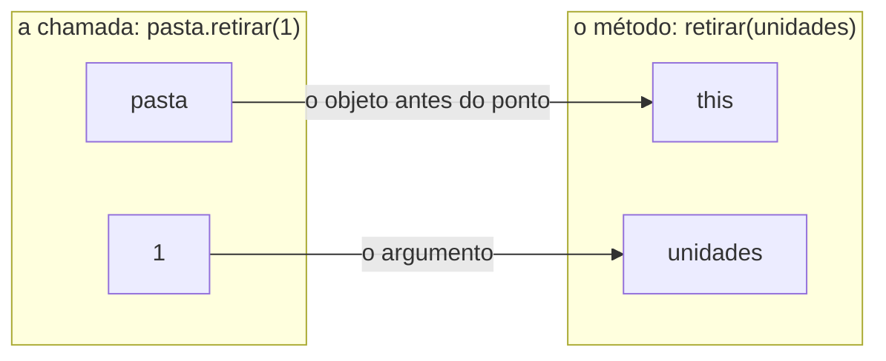
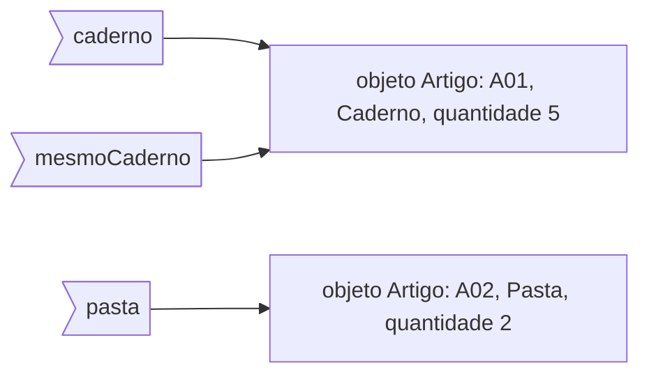

# Do objeto literal à classe

Neste guia, o caderno deixa a variável solta e passa a ser um objeto do JavaScript. Primeiro escreve-se diretamente no código, e depois faz-se a partir de uma classe, como no M10. Vês o que muda do Python para o JavaScript na classe, no construtor e no `this`, e o que acontece quando um método se separa do seu objeto.

Vais usar as classes do M10 e a página do tema anterior. Rever: [Classe e instância](../01-programacao-orientada-objetos/02-objetos-classes-instancias.md#classe-e-instância), [O método retirar em Python](../01-programacao-orientada-objetos/02-objetos-classes-instancias.md#o-método-retirar-em-python), [Cada instância é um objeto diferente](../01-programacao-orientada-objetos/02-objetos-classes-instancias.md#cada-instância-é-um-objeto-diferente) e [Passo 4: mostrar, tratar o clique e ligar](01-primeira-pagina-com-javascript.md#passo-4-mostrar-tratar-o-clique-e-ligar). Para praticar: [laboratório](laboratorios/02-do-objeto-literal-a-classe-laboratorio.md) e [ficha de exercícios](exercicios/02-do-objeto-literal-a-classe-exercicios.md).

## Neste guia

1. [Parte 1: O objeto literal](#parte-1-o-objeto-literal)
2. [Parte 2: A classe Artigo em JavaScript](#parte-2-a-classe-artigo-em-javascript)
3. [Exemplo guiado: o caderno e a pasta na mesma página](#exemplo-guiado-o-caderno-e-a-pasta-na-mesma-página)

## Parte 1: O objeto literal

No tema anterior, a quantidade do caderno ficou numa variável solta, `quantidadeCaderno`, e o código e o nome só apareciam no texto da página. No guia 01 do M10 viste o problema das variáveis soltas, e a resposta foi juntar os dados de cada artigo num objeto.

Para experimentares os exemplos desta parte e da seguinte, usa uma página de treino, como a da ficha do tema anterior. Cada programa vai para o script dela, e o que ele mostra aparece na consola. Um excerto que continua um programa vai por baixo dele.

### Um objeto literal junta os dados do artigo

Para guardar o caderno em variáveis soltas, eram precisas três: `codigoCaderno`, `nomeCaderno` e `quantidadeCaderno`. Nada no código diz que as três pertencem ao mesmo artigo, e a pasta traria outras três.

Em JavaScript, um objeto pode escrever-se diretamente no código, entre chavetas, com os dados lá dentro. Chama-se **objeto literal**, porque se escreve tal como fica, à letra, como se escreve o número `6` ou o texto `"A01"`:

```js
const caderno = {
  codigo: "A01",
  nome: "Caderno",
  quantidade: 6
};
```

Cada dado do objeto é uma **propriedade**, com um nome, dois pontos e o valor. As vírgulas separam as propriedades, e a última não leva vírgula. Propriedade é o nome que o JavaScript dá ao atributo do M10. Não tem nada que ver com o `@property` do Python, nem com as propriedades do CSS, que se separavam com ponto e vírgula.

Uma propriedade lê-se e muda-se com o ponto, como os atributos em Python. O `caderno` está declarado com `const`, e a segunda linha destas muda-lhe a quantidade. Dá erro?

```js partial
console.log(caderno.nome, caderno.quantidade);
caderno.quantidade = caderno.quantidade - 2;
console.log(caderno.quantidade);
```

```text
Caderno 6
4
```

Não dá erro. O `const` garante que o nome `caderno` aponta sempre para o mesmo objeto, e não que o objeto fica igual. É a etiqueta colada na caixa, do M10: a etiqueta não muda de caixa, mas o que está lá dentro pode mudar. O que dá erro é dar outro valor ao próprio nome, como `caderno = 4;`, com a mensagem `Assignment to constant variable.` do tema anterior.

Na consola, o nome `caderno` mostra o objeto inteiro: `{codigo: 'A01', nome: 'Caderno', quantidade: 4}`. Uma propriedade que o objeto não tem, como `caderno.preco`, dá `undefined`, sem mensagem nenhuma.

### O método do objeto e o `this`

A função `retirar` do tema anterior fica fora do objeto. Cada chamada tem de lhe dar a quantidade e de guardar o resultado, com `caderno.quantidade = retirar(caderno.quantidade, unidades);`. Sem a atribuição, o resultado perdia-se. No M10, a operação passou a ser um método do objeto, que muda os dados do próprio objeto.

Num objeto literal, um método escreve-se dentro do objeto, ao lado das propriedades, como uma função sem a palavra `function`:

```js
const caderno = {
  codigo: "A01",
  nome: "Caderno",
  quantidade: 6,

  /**
   * Retira unidades a este artigo, se o pedido for possível, e devolve a quantidade que fica.
   * Um pedido impossível deixa a quantidade como estava.
   * @param {number} unidades as unidades que se querem retirar
   * @returns {number} a quantidade que fica depois do pedido
   */
  retirar(unidades) {
    if (unidades > 0 && unidades <= this.quantidade) {
      this.quantidade = this.quantidade - unidades;
    }
    return this.quantidade;
  }
};

console.log(caderno.retirar(2));
console.log(caderno.retirar(5));
console.log(caderno.quantidade);
```

A consola mostra `4`, `4` e `4`. O pedido de 2 é aceite, o de 5 é recusado, e a quantidade ficou guardada no objeto.

Dentro de um método, o **`this`** (em inglês, este) é o objeto que recebeu o pedido: o que está antes do ponto, na chamada. Em `caderno.retirar(2)`, o `this` é o caderno, e `this.quantidade` é a quantidade do caderno. Faz o papel do `self` do Python, com uma diferença: o `self` escrevia-se como primeiro parâmetro, e o `this` não se escreve. Existe sozinho em todos os métodos.

| Python, no M10 | JavaScript |
| --- | --- |
| `def retirar(self, unidades):` | `retirar(unidades) {` |
| `self.quantidade` | `this.quantidade` |
| `caderno.retirar(2)` | `caderno.retirar(2);` |

A condição é a da função do tema anterior, com `this.quantidade` no lugar do parâmetro `quantidade`. Já não é preciso guardar o resultado numa variável, porque o método muda a quantidade dentro do objeto. O `return` só a devolve a quem quiser usar o valor. A vírgula depois do `6` é obrigatória: o método fica ao lado das propriedades, e tudo o que está dentro do objeto se separa por vírgulas.

### Dois literais repetem tudo

A pasta A02 pode ser outro objeto literal. Para isso, copia-se o caderno inteiro, com o método, e mudam-se os valores. Nesta cópia, alguém escreveu `quantidde`, sem o "a":

```js
const pasta = {
  codigo: "A02",
  nome: "Pasta",
  quantidde: 2,

  retirar(unidades) {
    if (unidades > 0 && unidades <= this.quantidade) {
      this.quantidade = this.quantidade - unidades;
    }
    return this.quantidade;
  }
};

console.log(pasta.retirar(1));
```

A pasta tem 2 unidades, e o pedido é de 1. O que mostra a consola?

Mostra `undefined`, sem mensagem de erro. O JavaScript aceitou a propriedade `quantidde`, porque nada diz que propriedades um artigo tem de ter. Dentro do método, `this.quantidade` não existe e vale `undefined`. A comparação `1 <= undefined` dá `false`, o pedido é recusado, e o `return` devolve o `undefined`.

O engano veio da cópia. Cada literal escreve-se por inteiro, propriedade a propriedade, e nada garante que todos os artigos tenham as mesmas propriedades. O método também ficou escrito duas vezes. Uma mudança na regra tem de se fazer em todos os objetos, e com cinquenta artigos isso são cinquenta cópias. No M10, a resposta a este problema foi a classe: a descrição comum, escrita uma só vez.

## Parte 2: A classe Artigo em JavaScript

A classe `Artigo` do M10 passa para JavaScript. As ideias são as mesmas: a classe descreve todos os artigos uma vez, e cada artigo é uma instância, com os seus próprios valores. Muda a maneira de escrever.

### A classe, o `constructor` e o `new`

Esta é a classe `Artigo`, com o método `retirar` da Parte 1, e os dois artigos da sala, criados a partir dela:

```js
/**
 * Um artigo do inventário da sala: um material com código, nome e quantidade.
 */
class Artigo {
  /**
   * Cria um artigo com os três dados que recebe.
   * @param {string} codigo o código do artigo, como "A01"
   * @param {string} nome o nome do artigo, como "Caderno"
   * @param {number} quantidade as unidades que existem
   */
  constructor(codigo, nome, quantidade) {
    this.codigo = codigo;
    this.nome = nome;
    this.quantidade = quantidade;
  }

  /**
   * Retira unidades a este artigo, se o pedido for possível, e devolve a quantidade que fica.
   * Um pedido impossível deixa a quantidade como estava.
   * @param {number} unidades as unidades que se querem retirar
   * @returns {number} a quantidade que fica depois do pedido
   */
  retirar(unidades) {
    if (unidades > 0 && unidades <= this.quantidade) {
      this.quantidade = this.quantidade - unidades;
    }
    return this.quantidade;
  }
}

const caderno = new Artigo("A01", "Caderno", 6);
const pasta = new Artigo("A02", "Pasta", 2);

console.log(caderno.nome, caderno.quantidade);
console.log(pasta.nome, pasta.quantidade);
```

```text
Caderno 6
Pasta 2
```

Leitura guiada: começa pelas duas linhas com **`new`** (em inglês, novo). A linha `const caderno = new Artigo("A01", "Caderno", 6);` corre assim:

1. O `new` cria um objeto novo da classe `Artigo`, ainda sem propriedades.
2. O `new` chama o **`constructor`** da classe, com esse objeto no `this` e os três valores nos parâmetros.
3. O `constructor` guarda cada valor numa propriedade do objeto, com `this.codigo = codigo` e as duas linhas seguintes.
4. O objeto pronto fica com o nome `caderno`.

O `constructor` é o método que prepara cada objeto novo: é o `__init__` do Python, com o nome do JavaScript. No fim do programa, os dois `console.log` leem as propriedades de cada artigo.

| Python, no M10 | JavaScript |
| --- | --- |
| `class Artigo:` | `class Artigo {` |
| `def __init__(self, codigo, nome, quantidade):` | `constructor(codigo, nome, quantidade) {` |
| `self.codigo = codigo` | `this.codigo = codigo;` |
| `def retirar(self, unidades):` | `retirar(unidades) {` |
| `caderno = Artigo("A01", "Caderno", 6)` | `const caderno = new Artigo("A01", "Caderno", 6);` |

O corpo da classe fica entre chavetas. Os métodos escrevem-se como no objeto literal, sem `def` nem `function`, mas sem vírgulas entre eles. O construtor chama-se sempre `constructor`, em inglês, porque é o nome que o JavaScript procura. A classe escreve-se antes das linhas que a usam, como em Python: só existe a partir da linha onde está escrita.

O JSDoc da classe diz o que é um artigo. O do `constructor` diz com que valores se cria, e o de cada método diz o que ele faz e devolve. Juntos, são o contrato da classe: o que se pode pedir a um artigo e o que ele devolve, sem ler o código dos métodos. O VS Code mostra-o quando passas o rato por `Artigo` ou por `retirar`.

### Um objeto literal ou uma classe

Um objeto literal e uma instância são ambos objetos. Leem-se com o ponto, e os métodos dos dois usam o `this`. A consola mostra a diferença:

| Na consola | O que mostra |
| --- | --- |
| O caderno literal da Parte 1, acabado de criar | `{codigo: 'A01', nome: 'Caderno', quantidade: 6, retirar: ƒ}` |
| O caderno feito com `new Artigo` | `Artigo {codigo: 'A01', nome: 'Caderno', quantidade: 6}` |

O `ƒ` quer dizer função. O nome da classe, antes das chavetas, diz de onde veio a instância. No literal, o método `retirar` está dentro do próprio objeto, e cada cópia leva o seu. Na instância, o método não aparece, porque está na classe, escrito uma vez para todos os artigos.

Um objeto literal serve para um objeto só, escrito por inteiro no código, como as definições de uma página. Uma classe serve quando há vários objetos com os mesmos dados e as mesmas operações, como os artigos de um inventário. A descrição fica num só sítio, e cada `new` faz mais um objeto com essa forma.

### O mesmo método serve os dois artigos

O método `retirar` está escrito uma só vez, na classe. Quando se faz um pedido, como sabe ele que quantidade deve mudar? Com a classe e os dois artigos de cima, acabados de criar:

```js partial
caderno.retirar(2);
pasta.retirar(1);
console.log(caderno.quantidade, pasta.quantidade);
```

A consola mostra `4 1`. Em cada chamada, o `this` é o objeto que está antes do ponto, e por isso o mesmo método muda um artigo de cada vez:

| Chamada | O `this` é | `this.quantidade` antes | `this.quantidade` depois |
| --- | --- | ---: | ---: |
| `caderno.retirar(2)` | o caderno | 6 | 4 |
| `pasta.retirar(1)` | a pasta | 2 | 1 |

O diagrama mostra para onde vai cada parte da segunda chamada:



O objeto que vem antes do ponto passa a ser o `this`, e o argumento `1` vai para o parâmetro `unidades`.

### Cada instância é um objeto diferente

Cada `new` cria um objeto novo. Uma atribuição sem `new` não cria nenhum: dá outro nome a um objeto que já existe. Este excerto vai a seguir ao programa de [A classe, o `constructor` e o `new`](#a-classe-o-constructor-e-o-new), com o caderno e a pasta acabados de criar, com 6 e 2 unidades:

```js partial
const mesmoCaderno = caderno;
mesmoCaderno.retirar(1);

console.log(caderno.quantidade);
console.log(caderno === mesmoCaderno);
console.log(caderno === pasta);
```

```text
5
true
false
```

O pedido foi feito pelo nome `mesmoCaderno`, mas foi o caderno que perdeu a unidade, porque os dois nomes apontam para o mesmo objeto. Entre dois objetos, o `===` pergunta se são o mesmo objeto, como o `is` do Python, e não se têm os mesmos valores. Por isso, `new Artigo("A01", "Caderno", 5) === caderno` dá `false`: tem os mesmos valores, mas é outro objeto.



Há três nomes e só dois objetos, porque o programa só tem dois `new`. Os nomes `caderno` e `mesmoCaderno` apontam para o mesmo objeto, e o nome `pasta` aponta para o outro.

### O método separado do objeto perde o `this`

No tema anterior, o `addEventListener` recebia o nome de uma função, sem parênteses. Com objetos, apetece dar logo o método ao botão do caderno, como em `botaoCaderno.addEventListener("click", caderno.retirar);`, em que `botaoCaderno` é o botão, encontrado com o `querySelector`. A página abre sem erros, mas o botão não retira nada, e a consola não mostra mensagem nenhuma. Para perceber porquê, separa-se o método do objeto na consola:

```js partial
const retirarSolto = caderno.retirar;
retirarSolto(2);
```

```text
Uncaught TypeError: Cannot read properties of undefined (reading 'quantidade')
```

A mensagem quer dizer que não se conseguem ler propriedades de `undefined`, e que a propriedade que se queria ler era a `quantidade`. O `caderno.retirar`, sem parênteses, dá o método, mas não leva o caderno com ele. Na chamada `retirarSolto(2)` não há nada antes do ponto, e o `this` fica `undefined`. A linha do `if` tenta ler `this.quantidade`, e o método para ali. O `this` decide-se no momento da chamada, pelo que está antes do ponto, e não no sítio onde o método foi escrito.

Com o botão, é o browser que chama o método, quando há um clique. Dá-lhe como `this` o próprio botão e, no lugar das unidades, um objeto com a informação do clique, que não é um número. A condição falha logo na primeira parte, e nada muda. Mesmo com o `this` certo, o método não lia o campo. Por isso o botão recebe uma função tua, como no tema anterior: lê o campo e chama `caderno.retirar(unidades)`, com o caderno antes do ponto.

<details>
<summary>Para ires mais longe: o método solto de um objeto literal</summary>

Num objeto literal, o método solto não dá erro. Com o caderno literal da Parte 1, `retirarSolto(2)` devolve `undefined`, sem mensagem. Num script normal, o `this` de uma chamada sem nada antes do ponto é a janela do browser, e a janela não tem quantidade. Numa classe, o `this` fica `undefined`, e o erro aparece logo, na linha que o usa. É mais uma razão para usar classes: o engano não passa despercebido.

</details>

## Exemplo guiado: o caderno e a pasta na mesma página

O problema: a página do inventário passa a ter dois artigos, o caderno A01, com 6 unidades, e a pasta A02, com 2. Tem um campo para as unidades e dois botões, "Retirar do caderno" e "Retirar da pasta". Cada artigo tem a sua saída, com o código, o nome e a quantidade, como `A01 Caderno, quantidade: 6`. A regra de um pedido é a de sempre, e o pedido feito a um artigo nunca muda o outro.

### Passo 1: a página

A página do tema anterior ganha um segundo botão e uma segunda saída. Cada botão e cada saída tem um `id` com o nome do seu artigo. O `index.html` completo:

```html
<!doctype html>
<html lang="pt-PT">
  <head>
    <meta charset="utf-8">
    <meta name="viewport" content="width=device-width, initial-scale=1">
    <title>Inventário da sala</title>
    <link rel="stylesheet" href="estilos.css">
    <script src="inventario.js" defer></script>
  </head>
  <body>
    <main>
      <h1>Inventário da sala</h1>
      <p>O caderno A01 começa com 6 unidades, e a pasta A02 com 2. Escreve quantas unidades queres retirar e carrega no botão do artigo.</p>
      <p>
        <label for="unidades">Unidades a retirar</label>
        <input id="unidades" type="text">
      </p>
      <p>
        <button id="botao-caderno" type="button">Retirar do caderno</button>
        <button id="botao-pasta" type="button">Retirar da pasta</button>
      </p>
      <p>
        <output id="saida-caderno"></output>
      </p>
      <p>
        <output id="saida-pasta"></output>
      </p>
    </main>
  </body>
</html>
```

A folha `estilos.css` é a do tema anterior, sem mudanças. Os dois botões ficam lado a lado, no mesmo parágrafo, e cada saída fica no seu, numa linha. O `inventario.js`, que a página carrega, escreve-se nos passos seguintes.

### Passo 2: a classe, com um método para se descrever

A página mostra cada artigo da mesma maneira. A frase escreve-se num sítio só, num método novo da classe, `descrever`, que devolve o texto do artigo que recebe o pedido. O `inventario.js` começa pela classe e pelos dois artigos:

```js
// inventario.js: o comportamento da página do inventário.
// Cada artigo é um objeto da classe Artigo, e cada botão retira unidades a um deles.

/**
 * Um artigo do inventário da sala: um material com código, nome e quantidade.
 */
class Artigo {
  /**
   * Cria um artigo com os três dados que recebe.
   * @param {string} codigo o código do artigo, como "A01"
   * @param {string} nome o nome do artigo, como "Caderno"
   * @param {number} quantidade as unidades que existem
   */
  constructor(codigo, nome, quantidade) {
    this.codigo = codigo;
    this.nome = nome;
    this.quantidade = quantidade;
  }

  /**
   * Retira unidades a este artigo, se o pedido for possível, e devolve a quantidade que fica.
   * Um pedido impossível deixa a quantidade como estava.
   * @param {number} unidades as unidades que se querem retirar
   * @returns {number} a quantidade que fica depois do pedido
   */
  retirar(unidades) {
    if (unidades > 0 && unidades <= this.quantidade) {
      this.quantidade = this.quantidade - unidades;
    }
    return this.quantidade;
  }

  /**
   * Devolve o texto que descreve este artigo, com o código, o nome e a quantidade.
   * @returns {string} o texto do artigo, como "A01 Caderno, quantidade: 6"
   */
  descrever() {
    return this.codigo + " " + this.nome + ", quantidade: " + this.quantidade;
  }
}

// O new cria um objeto novo da classe e chama o constructor com estes três valores.
const caderno = new Artigo("A01", "Caderno", 6);
const pasta = new Artigo("A02", "Pasta", 2);
```

Antes de ligar a classe à página, testa-se na consola, com a página do passo 1 aberta. Cada linha da tabela escreve-se pela ordem, sem recarregar:

| Na consola | O que se espera, pelas regras | O que a consola mostra |
| --- | --- | --- |
| `caderno.descrever()` | O caderno com 6 | `'A01 Caderno, quantidade: 6'` |
| `pasta.retirar(1)` | Pedido possível: fica 1 | `1` |
| `pasta.retirar(5)` | Pedido maior do que o que existe: fica 1 | `1` |
| `caderno.descrever()` | O caderno não recebeu nenhum pedido | `'A01 Caderno, quantidade: 6'` |
| `pasta.descrever()` | A pasta com 1 | `'A02 Pasta, quantidade: 1'` |

Os pedidos à pasta não mexeram no caderno. Recarregar a página volta a criar os dois artigos, com 6 e 2 unidades.

### Passo 3: os elementos e o que a página mostra

Por baixo dos dois artigos, o script encontra os cinco elementos da página, como no tema anterior:

```js partial
const campoUnidades = document.querySelector("#unidades");
const botaoCaderno = document.querySelector("#botao-caderno");
const botaoPasta = document.querySelector("#botao-pasta");
const saidaCaderno = document.querySelector("#saida-caderno");
const saidaPasta = document.querySelector("#saida-pasta");
```

A página mostra os dois artigos ao abrir e depois de cada pedido. Por isso, essa parte fica numa função, `mostrarArtigos`, que pede a cada artigo a sua descrição:

```js partial
/**
 * Mostra na página a descrição dos dois artigos, cada uma na sua saída.
 * Não devolve nada: muda o texto das duas saídas.
 */
function mostrarArtigos() {
  saidaCaderno.textContent = caderno.descrever();
  saidaPasta.textContent = pasta.descrever();
}
```

### Passo 4: os cliques

Cada botão tem a sua função. A do caderno lê o campo, converte o texto em número, pede ao caderno que retire essas unidades e mostra os artigos. A da pasta faz o mesmo, com a pasta antes do ponto. O `inventario.js` completo:

```js
// inventario.js: o comportamento da página do inventário.
// Cada artigo é um objeto da classe Artigo, e cada botão retira unidades a um deles.

/**
 * Um artigo do inventário da sala: um material com código, nome e quantidade.
 */
class Artigo {
  /**
   * Cria um artigo com os três dados que recebe.
   * @param {string} codigo o código do artigo, como "A01"
   * @param {string} nome o nome do artigo, como "Caderno"
   * @param {number} quantidade as unidades que existem
   */
  constructor(codigo, nome, quantidade) {
    this.codigo = codigo;
    this.nome = nome;
    this.quantidade = quantidade;
  }

  /**
   * Retira unidades a este artigo, se o pedido for possível, e devolve a quantidade que fica.
   * Um pedido impossível deixa a quantidade como estava.
   * @param {number} unidades as unidades que se querem retirar
   * @returns {number} a quantidade que fica depois do pedido
   */
  retirar(unidades) {
    if (unidades > 0 && unidades <= this.quantidade) {
      this.quantidade = this.quantidade - unidades;
    }
    return this.quantidade;
  }

  /**
   * Devolve o texto que descreve este artigo, com o código, o nome e a quantidade.
   * @returns {string} o texto do artigo, como "A01 Caderno, quantidade: 6"
   */
  descrever() {
    return this.codigo + " " + this.nome + ", quantidade: " + this.quantidade;
  }
}

// O new cria um objeto novo da classe e chama o constructor com estes três valores.
const caderno = new Artigo("A01", "Caderno", 6);
const pasta = new Artigo("A02", "Pasta", 2);

const campoUnidades = document.querySelector("#unidades");
const botaoCaderno = document.querySelector("#botao-caderno");
const botaoPasta = document.querySelector("#botao-pasta");
const saidaCaderno = document.querySelector("#saida-caderno");
const saidaPasta = document.querySelector("#saida-pasta");

/**
 * Mostra na página a descrição dos dois artigos, cada uma na sua saída.
 * Não devolve nada: muda o texto das duas saídas.
 */
function mostrarArtigos() {
  saidaCaderno.textContent = caderno.descrever();
  saidaPasta.textContent = pasta.descrever();
}

/**
 * Trata o clique no botão do caderno: retira ao caderno as unidades escritas no campo.
 * Não devolve nada: muda a quantidade do caderno e o texto das saídas.
 */
function aoCarregarNoCaderno() {
  const unidades = Number(campoUnidades.value);
  // O caderno está antes do ponto, por isso é o this do método: só a quantidade dele muda.
  caderno.retirar(unidades);
  mostrarArtigos();
}

/**
 * Trata o clique no botão da pasta: retira à pasta as unidades escritas no campo.
 * Não devolve nada: muda a quantidade da pasta e o texto das saídas.
 */
function aoCarregarNaPasta() {
  const unidades = Number(campoUnidades.value);
  pasta.retirar(unidades);
  mostrarArtigos();
}

// Cada botão recebe uma função que lê o campo e faz o pedido, e não o método: assim o this é o artigo.
botaoCaderno.addEventListener("click", aoCarregarNoCaderno);
botaoPasta.addEventListener("click", aoCarregarNaPasta);

// As saídas começam vazias no HTML; esta chamada mostra os dois artigos ao abrir.
mostrarArtigos();
```

Depois de ler o HTML, o browser corre o script de cima para baixo. Guarda a classe e cria os dois artigos, encontra os elementos e lê as três funções, sem as correr. Liga cada botão à sua função e chama `mostrarArtigos`, que escreve as duas descrições. Depois fica à espera dos cliques.

As duas funções dos cliques já não têm uma atribuição como `quantidadeCaderno = retirar(quantidadeCaderno, unidades);`. O método muda a quantidade dentro do artigo, e a `mostrarArtigos` lê-a de lá.

### Passo 5: testar a página

Abre-se a página e faz-se esta sequência, sem recarregar entre os pedidos:

| Pedido | Escreves no campo | Carregas em | O que se espera | A saída do caderno | A saída da pasta |
| --- | --- | --- | --- | --- | --- |
| Ao abrir | nada | nada | Os dois artigos como começam | `A01 Caderno, quantidade: 6` | `A02 Pasta, quantidade: 2` |
| 1 | `2` | Retirar do caderno | Aceite: o caderno fica com 4 | `A01 Caderno, quantidade: 4` | `A02 Pasta, quantidade: 2` |
| 2 | `2` | Retirar da pasta | Aceite: a pasta fica com 0 | `A01 Caderno, quantidade: 4` | `A02 Pasta, quantidade: 0` |
| 3 | `1` | Retirar da pasta | Recusado: a pasta fica com 0 | `A01 Caderno, quantidade: 4` | `A02 Pasta, quantidade: 0` |
| 4 | `5` | Retirar do caderno | Recusado: o caderno fica com 4 | `A01 Caderno, quantidade: 4` | `A02 Pasta, quantidade: 0` |
| 5 | `4` | Retirar do caderno | Aceite: o caderno fica com 0 | `A01 Caderno, quantidade: 0` | `A02 Pasta, quantidade: 0` |

Em cada pedido, só a saída do artigo do botão pode mudar. Os pedidos 3 e 4 confirmam que a regra continua igual, agora dentro da classe.

A classe ainda não protege a quantidade. Com a página acabada de abrir, um pedido de `2.5` ao caderno é aceite, e o caderno fica com 3.5 unidades, como na página do tema anterior. E um pedido recusado continua a não dizer que foi recusado.

## Erros frequentes

### `Uncaught SyntaxError: Unexpected identifier 'nome'`

A mensagem aparece logo ao abrir a página, e nada do script corre. Num objeto literal, falta a vírgula no fim da linha anterior, como em `codigo: "A01"` sem vírgula. O browser leu a propriedade `codigo` e esperava uma vírgula ou a chaveta que fecha, mas encontrou o nome `nome`. Põe a vírgula no fim de cada propriedade, menos na última.

### `Uncaught ReferenceError: quantidade is not defined`

A página abre bem, mas o primeiro pedido mostra esta mensagem, e a quantidade não muda. Dentro do método, falta o `this.` antes de `quantidade`. Sem ele, o JavaScript procura uma variável chamada `quantidade`, que não existe. O erro só aparece quando o método corre, e por isso não se vê ao abrir a página. Escreve `this.quantidade` em todos os sítios do método.

### `Uncaught TypeError: Class constructor Artigo cannot be invoked without 'new'`

A mensagem aparece ao abrir a página, numa linha como `const caderno = Artigo("A01", "Caderno", 6);`. Quer dizer que a classe `Artigo` não pode ser chamada sem o `new`. É um hábito do Python, onde a classe se chamava como uma função. O script para nessa linha, e as saídas ficam vazias. Escreve `new` antes do nome da classe.

### `Uncaught ReferenceError: Cannot access 'Artigo' before initialization`

A mensagem aparece ao abrir a página e quer dizer que não se consegue usar o `Artigo` antes de ele estar preparado. A linha do `new` está escrita acima da classe, e uma classe só existe a partir da linha onde está escrita, como em Python. Põe a classe no início do ficheiro, antes das linhas que a usam.

### `Uncaught TypeError: caderno.retira is not a function`

Quer dizer que `caderno.retira` não é uma função. O nome do método está mal escrito, como `retira` em vez de `retirar`, e o objeto não tem nada com esse nome. Compara o nome da chamada com o nome do método na classe, letra a letra. Uma mensagem igual, com o nome do método que falta, aparece quando se chama um método que o objeto não tem, como `caderno.descrever()` num caderno literal sem esse método.

## Palavras novas deste guia

- Objeto literal: um objeto escrito diretamente no código, entre chavetas, com as propriedades lá dentro.
- `this`: dentro de um método, o objeto que recebeu o pedido, o que está antes do ponto na chamada.
- `new`: a palavra que cria um objeto novo a partir de uma classe e chama o `constructor`.

## O que vem a seguir

No tema seguinte, Interface pública e campos privados, o artigo passa a proteger a sua quantidade, e uma quantidade impossível, como 3.5, deixa de entrar.

## Para saber mais

- [Trabalhar com objetos, na MDN](https://developer.mozilla.org/en-US/docs/Web/JavaScript/Guide/Working_with_objects): os objetos literais, as propriedades e os métodos, com exemplos, em inglês.
- [Usar classes, na MDN](https://developer.mozilla.org/en-US/docs/Web/JavaScript/Guide/Using_classes): as classes do JavaScript, o `constructor` e o `new`, explicados com mais pormenor, em inglês.
- [O `this`, na MDN](https://developer.mozilla.org/en-US/docs/Web/JavaScript/Reference/Operators/this): as regras do `this` em todas as formas de chamar uma função, em inglês.


