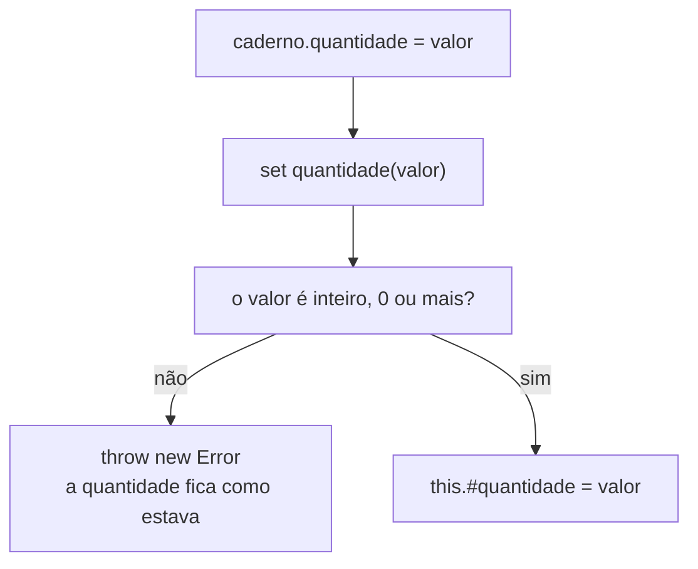
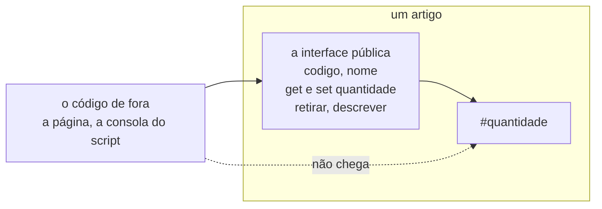
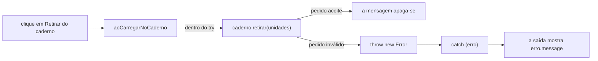

# Interface pública e campos privados

Neste guia, a classe `Artigo` passa a proteger a sua quantidade, como fizeste em Python no M10. Guardas a quantidade num campo privado, recusas os valores impossíveis com um erro e apanhas a recusa, para a página dizer porque não aceitou um pedido.

Vais usar a classe `Artigo` do tema anterior e as ideias do encapsulamento do M10. Rever: [As regras que devem continuar verdadeiras](../01-programacao-orientada-objetos/03-encapsulamento-contratos.md#as-regras-que-devem-continuar-verdadeiras), [Recusar a sério, com `raise`](../01-programacao-orientada-objetos/03-encapsulamento-contratos.md#recusar-a-sério-com-raise), [A propriedade `quantidade`](../01-programacao-orientada-objetos/03-encapsulamento-contratos.md#a-propriedade-quantidade) e [Tratar a recusa com `try` e `except`](../01-programacao-orientada-objetos/03-encapsulamento-contratos.md#tratar-a-recusa-com-try-e-except). Para praticar: [laboratório](laboratorios/03-interface-publica-e-campos-privados-laboratorio.md) e [ficha de exercícios](exercicios/03-interface-publica-e-campos-privados-exercicios.md).

## Neste guia

1. [Parte 1: A quantidade protegida](#parte-1-a-quantidade-protegida)
2. [Parte 2: O pedido com contrato](#parte-2-o-pedido-com-contrato)
3. [Exemplo guiado: a página diz porque recusou](#exemplo-guiado-a-página-diz-porque-recusou)

## Parte 1: A quantidade protegida

No fim do tema anterior, a página aceitou um pedido de `2.5`, e o caderno ficou com 3.5 unidades. Na consola, `caderno.quantidade = -5` também era aceite. No M10 viste que a quantidade tem uma invariante, "é sempre um número inteiro, 0 ou mais", e que é o próprio artigo quem a deve fazer cumprir. Esta parte faz o mesmo em JavaScript.

Os programas desta parte e da seguinte correm numa página de treino, como a da ficha do tema anterior. Cada programa vai para o script dela, e o que mostra aparece na consola.

### O campo privado guarda a quantidade

Em Python, a quantidade ficava em `_quantidade`, e o sublinhado era só um aviso: o código de fora podia mexer nela na mesma. Em JavaScript, há uma forma de guardar um valor a que o código de fora não chega de maneira nenhuma.

Um **campo privado** é um valor guardado no objeto, com um nome começado por `#`, que só o código de dentro da classe pode ler ou mudar. Não tem nada que ver com o campo de texto da página, onde se escrevem as unidades. Declara-se no início da classe, e usa-se sempre com o `this.` e o `#`. Para o resto do programa ler a quantidade, a classe dá-lhe um getter: um método com `get` antes do nome, que se lê sem parênteses, como o `@property` do M10.

```js
/**
 * Um artigo do inventário da sala, com a quantidade guardada num campo privado.
 */
class Artigo {
  // O # torna o campo privado: só o código de dentro da classe o lê ou o muda.
  #quantidade;

  /**
   * Cria um artigo com os três dados que recebe.
   * @param {string} codigo o código do artigo, como "A01"
   * @param {string} nome o nome do artigo, como "Caderno"
   * @param {number} quantidade as unidades que existem
   */
  constructor(codigo, nome, quantidade) {
    this.codigo = codigo;
    this.nome = nome;
    this.#quantidade = quantidade;
  }

  /**
   * Getter: devolve a quantidade atual, sem a mudar.
   * @returns {number} as unidades que existem
   */
  get quantidade() {
    return this.#quantidade;
  }
}

const caderno = new Artigo("A01", "Caderno", 6);
console.log(caderno.quantidade);
caderno.quantidade = -5;
console.log(caderno.quantidade);
```

A penúltima linha tenta pôr a quantidade em -5. O que mostra o segundo `console.log`?

```text
6
6
```

O `caderno.quantidade` chama o getter, que devolve o `#quantidade`. A classe não tem nenhum método para escrever na quantidade, e por isso a atribuição de fora não muda nada. Fora da classe, a atribuição é ignorada, sem mensagem. A quantidade só muda dentro da classe, onde se escreve `this.#quantidade`.

O código de fora também não consegue escrever o nome com o `#`. Uma linha como `console.log(caderno.#quantidade);`, no script, fora da classe, impede o script inteiro de correr:

```text
Uncaught SyntaxError: Private field '#quantidade' must be declared in an enclosing class
```

A mensagem quer dizer que o campo privado `#quantidade` tem de estar declarado numa classe que envolva aquela linha. É um erro de escrita: o browser recusa o script antes de correr a primeira linha. A mesma mensagem aparece dentro da classe, quando falta a linha que declara o campo, `#quantidade;`.

Sem a linha do `console.log`, o script corre, e a consola mostra o `caderno` assim: `Artigo {#quantidade: 6, codigo: 'A01', nome: 'Caderno'}`. A consola do Chrome deixa ver, e até mudar, um campo privado, porque é uma ferramenta para quem procura erros. O código da página não consegue.

### O setter recusa com um erro

Só com o getter, ninguém de fora consegue corrigir a quantidade, mesmo com um valor válido, como depois de contar o que está no armário. No M10, a propriedade tinha também um setter, que verificava o valor antes de o guardar e o recusava com o `raise`.

Em JavaScript, o setter é um método com `set` antes do nome, com o mesmo nome do getter. Corre sempre que se escreve `caderno.quantidade = valor`, e o valor chega no parâmetro. Para recusar, usa-se o **`throw`** (em inglês, atirar), que faz o papel do `raise`: lança um erro e para o método nessa linha. O erro cria-se com `new Error`, com a mensagem entre parênteses. O que o Python chamava exceção, o JavaScript chama erro: o `Error` é uma classe, e o `new` cria um objeto erro, com a mensagem guardada na propriedade `message`. Na classe de cima, o setter entra a seguir ao getter:

```js partial
  /**
   * Setter: guarda a quantidade, se for um número inteiro, 0 ou mais; senão, lança um erro.
   * @param {number} valor a nova quantidade
   */
  set quantidade(valor) {
    // O throw para o setter aqui: com um valor inválido, a linha que guarda nunca corre.
    if (!Number.isInteger(valor) || valor < 0) {
      throw new Error("A quantidade tem de ser um número inteiro, 0 ou mais.");
    }
    this.#quantidade = valor;
  }
```

Para experimentar o setter, o programa fica com a classe e a linha que cria o caderno, sem os dois `console.log` e a atribuição do fim. O `Number.isInteger(valor)` dá `true` se o valor for um número inteiro, e faz o papel do `isinstance(valor, int)` do M10. A condição lê-se "se o valor não é inteiro, ou é negativo". Com o setter, a consola dá isto, por esta ordem:

| Na consola | O que acontece | `caderno.quantidade` a seguir |
| --- | --- | ---: |
| `caderno.quantidade = 10` | Aceite | `10` |
| `caderno.quantidade = 0` | Aceite: o material esgotou | `0` |
| `caderno.quantidade = -1` | `Uncaught Error: A quantidade tem de ser um número inteiro, 0 ou mais.` | `0` |
| `caderno.quantidade = 2.5` | O mesmo erro | `0` |
| `caderno.quantidade = "6"` | O mesmo erro: com aspas, é um texto | `0` |

O 0 e o -1 são as duas fronteiras da regra: o 0 é o último valor aceite, e o -1 o primeiro recusado. Depois de cada recusa, a quantidade continua a ser a última que foi aceite.



A atribuição chama o setter, e o setter faz a pergunta antes de guardar. Se a resposta for não, o `throw` manda o erro para trás, e o campo privado não muda.

<details>
<summary>Para ires mais longe: outros tipos de erro</summary>

O `Error` é o tipo de erro mais geral. O JavaScript tem outros, mais específicos, como o `RangeError`, para um número fora dos limites, e o `TypeError`, para um valor do tipo errado. Também se lançam com `throw new RangeError("…")`. Nesta disciplina, uma recusa usa sempre o `Error`, porque a mensagem já diz o que está mal.

</details>

### Uma construção inválida não cria nenhum artigo

O setter protege as atribuições, mas o `constructor` de cima guarda o valor diretamente em `this.#quantidade`, sem verificar. Um `new Artigo("A03", "Régua", -1)` criava uma régua com -1 unidades, um objeto incoerente desde o primeiro momento.

A solução é a do M10: o `constructor` também passa pelo setter. Basta escrever `this.quantidade = quantidade;`, sem o `#`. Assim, a regra está escrita num só sítio, e serve para a criação e para as alterações. Com essa mudança, este excerto vai a seguir à linha que cria o caderno:

```js partial
const regua = new Artigo("A03", "Régua", -1);
console.log("A régua foi criada.");
```

```text
Uncaught Error: A quantidade tem de ser um número inteiro, 0 ou mais.
```

O `throw` do setter interrompe o `constructor` e o `new`. A régua nunca chega a existir, e o `console.log` de baixo nunca corre. À direita da mensagem, a consola aponta para a linha do `throw`, dentro do setter. Por baixo da mensagem, a consola lista as chamadas que levaram ao erro, como o traceback do Python. São o setter, o `new Artigo` e, no fim, a linha do `new`, onde está a causa. A linha da mensagem é uma pista, e não a resposta. Antes de continuares, tira estas duas linhas do programa.

### Um método ou um setter

A quantidade também se podia corrigir com um método normal, `alterarQuantidade(valor)`, com a mesma verificação. Este método não se acrescenta à classe: serve só para comparar. As duas formas protegem o artigo da mesma maneira, e mudam na forma de as usar:

```js partial
  /**
   * Muda a quantidade, se o valor for um número inteiro, 0 ou mais; senão, lança um erro.
   * @param {number} valor a nova quantidade
   */
  alterarQuantidade(valor) {
    if (!Number.isInteger(valor) || valor < 0) {
      throw new Error("A quantidade tem de ser um número inteiro, 0 ou mais.");
    }
    this.#quantidade = valor;
  }
```

| | Com o método | Com o setter |
| --- | --- | --- |
| Corrigir a quantidade | `caderno.alterarQuantidade(10);` | `caderno.quantidade = 10;` |
| Ler a quantidade | Precisa de outro método, ou do getter | `caderno.quantidade`, com o getter |
| O que se vê no código | Que corre um método | Uma atribuição, que corre o setter sem se ver |

Nesta disciplina, a quantidade usa o setter, como o `@property` do M10. Lê-se e escreve-se com o mesmo nome, e o `constructor` e os métodos da classe também passam por ele, com `this.quantidade = …`. O método fica para as operações que não são "pôr um valor", como retirar unidades.

### O validador `static`

O setter pergunta se um valor serve para quantidade. É uma pergunta que não precisa de nenhum artigo: o 2.5 não serve para nenhum. O próprio `Number.isInteger` é assim. Chama-se com o nome `Number`, e não num número: escreve-se `Number.isInteger(2.5)`, e não `2.5.isInteger()`.

Os métodos normais também estão escritos na classe, mas chamam-se com um artigo antes do ponto, que passa a ser o `this`. Um método **`static`** pertence só à classe: declara-se com `static` antes do nome e chama-se com o nome da classe antes do ponto. Como não há nenhum artigo antes do ponto, não há quantidade para ler: o método só trabalha com o valor que recebe. Este validador entra na classe, a seguir ao setter:

```js partial
  /**
   * Diz se um valor serve para quantidade de um artigo: um número inteiro, 0 ou mais.
   * É static: pertence à classe, e chama-se com o nome dela, como Artigo.quantidadeValida(4).
   * @param {number} valor o valor a verificar
   * @returns {boolean} true se o valor serve, false se não serve
   */
  static quantidadeValida(valor) {
    return Number.isInteger(valor) && valor >= 0;
  }
```

O setter passa a usá-lo, com `if (!Artigo.quantidadeValida(valor)) {`. Na consola:

| Na consola | O que mostra |
| --- | --- |
| `Artigo.quantidadeValida(4)` | `true` |
| `Artigo.quantidadeValida(-1)` | `false` |
| `Artigo.quantidadeValida("4")` | `false` |
| `caderno.quantidadeValida(4)` | `Uncaught TypeError: caderno.quantidadeValida is not a function` |

O último erro quer dizer que `caderno.quantidadeValida` não é uma função: um método `static` só se chama com `Artigo.` antes do ponto, e um artigo não o tem. A regra fica escrita uma vez, com um nome que diz o que verifica, e pode usar-se antes de criar um artigo.

### A interface pública do artigo

No M10, a interface pública de um objeto era o que ele deixa usar a quem está de fora. A do artigo protegido tem as propriedades `codigo` e `nome`, a quantidade, que se lê pelo getter e se escreve pelo setter, e os métodos `retirar` e `descrever`. O validador pertence à classe, e chama-se com `Artigo.`. O `#quantidade` fica de fora: só a classe lhe chega.



O código de fora só usa a interface pública, e é ela que lê e escreve o `#quantidade`, sempre pelas regras da classe. A seta tracejada é o acesso direto, que o `#` impede.

## Parte 2: O pedido com contrato

A quantidade está protegida, mas o método `retirar` ainda recusa os pedidos sem dizer nada: devolve a quantidade igual, e quem fez o pedido não sabe porquê. Esta parte dá-lhe um contrato, como o do M10, e mostra como o código que faz o pedido fica a saber da recusa.

### O pedido verifica-se no método

No M10 viste que há dois zeros diferentes. Ficar com 0 unidades é um estado válido; retirar 0 unidades é um pedido inválido. A regra do estado está no setter. As regras do pedido ficam no próprio método, porque são dele. As unidades a retirar têm de ser um número inteiro, 1 ou mais, e não podem passar do que existe. No M10, a falta de unidades ficava para o setter, e a recusa chegava com a mensagem da quantidade, que não diz a quem pede o que correu mal. Aqui, o `retirar` verifica-a antes, para dar a mensagem certa. Este `retirar` substitui o do tema anterior, na classe, a seguir ao validador:

```js partial
  /**
   * Retira unidades a este artigo e devolve a quantidade que fica.
   * Lança um erro, sem mudar nada, se o pedido não for um número inteiro de 1 ou mais,
   * ou se não houver unidades suficientes.
   * @param {number} unidades as unidades que se querem retirar
   * @returns {number} a quantidade que fica depois do pedido
   */
  retirar(unidades) {
    if (!Number.isInteger(unidades) || unidades < 1) {
      throw new Error("As unidades a retirar têm de ser um número inteiro, 1 ou mais.");
    }
    if (unidades > this.quantidade) {
      throw new Error("Não há unidades suficientes.");
    }
    // A quantidade muda pelo setter, que guarda a invariante.
    this.quantidade = this.quantidade - unidades;
    return this.quantidade;
  }
```

O método verifica as duas regras do pedido antes de mudar alguma coisa, cada uma com a sua mensagem. Com o caderno acabado de criar, escreve-se cada linha da tabela, por esta ordem, sem recarregar:

| Na consola | O que acontece |
| --- | --- |
| `caderno.retirar(2)` | Aceite: devolve `4` |
| `caderno.retirar(0)` | `Uncaught Error: As unidades a retirar têm de ser um número inteiro, 1 ou mais.` |
| `caderno.retirar(2.5)` | O mesmo erro |
| `caderno.retirar(5)` | `Uncaught Error: Não há unidades suficientes.` |
| `caderno.retirar(4)` | Aceite: devolve `0` |

O `4`, com 4 unidades no caderno, é a fronteira do "não pode passar do que existe": retirar tudo é aceite. Nenhuma recusa mexe na quantidade.

### Quem faz o pedido apanha a recusa

Na consola, cada recusa aparece como `Uncaught Error`. No tema 01 viste que o `Uncaught` quer dizer "não apanhado": ninguém tratou o erro, e o script parou. Na página, isso quer dizer que a função do clique para a meio, e a pessoa não vê mensagem nenhuma.

Para apanhar o erro, usa-se o **`try`** (tentar) e o **`catch`** (apanhar), que fazem o papel do `try` e do `except` do Python. O código que pode ser recusado vai dentro do `try`. Se correr bem, o `catch` é saltado. Se houver um `throw`, o `try` para nessa linha, e o programa continua no `catch`, com o erro no parâmetro. Este excerto vai por baixo do programa da secção anterior, com o caderno acabado de criar. O que mostra?

```js partial
try {
  caderno.retirar(9);
  console.log("Pedido aceite.");
} catch (erro) {
  console.log("Pedido recusado. " + erro.message);
}
console.log("O programa continua, com " + caderno.quantidade + " unidades.");
```

```text
Pedido recusado. Não há unidades suficientes.
O programa continua, com 6 unidades.
```

O `retirar(9)` lança o erro, e o `console.log("Pedido aceite.")` nunca corre. O `catch` recebe o erro em `erro`, e o `erro.message` é a mensagem que o `throw` escreveu. Depois do `catch`, o programa continua normalmente. Com `caderno.retirar(2)`, o excerto mostrava `Pedido aceite.` e `O programa continua, com 4 unidades.`, sem passar pelo `catch`.

| Python, no M10 | JavaScript |
| --- | --- |
| `raise ValueError("…")` | `throw new Error("…");` |
| `try:` | `try {` |
| `except ValueError as erro:` | `} catch (erro) {` |
| `print(erro)` | `console.log(erro.message);` |

Há uma diferença: o `except ValueError` só apanhava esse tipo de exceção. O `catch` apanha qualquer erro que aconteça dentro do `try`, também os enganos de escrita, como um método com o nome errado. Por isso, o `try` fica só com o pedido e com as linhas que dependem dele.

<details>
<summary>Para ires mais longe: recusar devolvendo a mensagem</summary>

As [resoluções dos temas de treino](../projeto/temas-de-treino-resolucoes.md) do projeto recusam sem erros: cada pedido devolve um texto vazio quando é aceite, ou a mensagem da recusa. Em JavaScript, o `retirar` também podia ser assim, e quem faz o pedido via se o texto vinha vazio. Só que um setter e um `constructor` não conseguem devolver uma mensagem a quem os chamou. Com essa forma, um `new Artigo("A03", "Régua", -1)` criava a régua na mesma, e por isso a classe recusa com o `throw`.

</details>

## Exemplo guiado: a página diz porque recusou

O problema: a página do tema anterior, com o caderno A01 e a pasta A02, aceitava o `2.5` e recusava os pedidos impossíveis sem dizer nada. Agora a classe protege a quantidade, e a página tem uma saída para as mensagens. Num pedido recusado, mostra `Pedido recusado.` e a razão, e as quantidades ficam iguais. Num pedido aceite, a mensagem apaga-se.

### Passo 1: a classe protegida, testada na consola

A classe junta o campo privado, o getter, o setter, o validador `static` e o `retirar` com contrato. O `descrever` fica igual ao do tema anterior, e o `this.quantidade` dele passa agora pelo getter. O script começa pela classe e pelos dois artigos:

```js
// inventario.js: o comportamento da página do inventário.
// Cada artigo é um objeto da classe Artigo, e cada botão retira unidades a um deles.

/**
 * Um artigo do inventário da sala: um material com código, nome e quantidade.
 */
class Artigo {
  // O # torna o campo privado: só o código de dentro da classe o lê ou o muda.
  #quantidade;

  /**
   * Cria um artigo com os três dados que recebe.
   * @param {string} codigo o código do artigo, como "A01"
   * @param {string} nome o nome do artigo, como "Caderno"
   * @param {number} quantidade as unidades que existem
   */
  constructor(codigo, nome, quantidade) {
    this.codigo = codigo;
    this.nome = nome;
    // Sem o #, passa pelo setter: um artigo com uma quantidade inválida nunca chega a existir.
    this.quantidade = quantidade;
  }

  /**
   * Getter: devolve a quantidade atual, sem a mudar.
   * @returns {number} as unidades que existem
   */
  get quantidade() {
    return this.#quantidade;
  }

  /**
   * Setter: guarda a quantidade, se for um número inteiro, 0 ou mais; senão, lança um erro.
   * @param {number} valor a nova quantidade
   */
  set quantidade(valor) {
    // O throw para o setter aqui: com um valor inválido, a linha que guarda nunca corre.
    if (!Artigo.quantidadeValida(valor)) {
      throw new Error("A quantidade tem de ser um número inteiro, 0 ou mais.");
    }
    this.#quantidade = valor;
  }

  /**
   * Diz se um valor serve para quantidade de um artigo: um número inteiro, 0 ou mais.
   * É static: pertence à classe, e chama-se com o nome dela, como Artigo.quantidadeValida(4).
   * @param {number} valor o valor a verificar
   * @returns {boolean} true se o valor serve, false se não serve
   */
  static quantidadeValida(valor) {
    return Number.isInteger(valor) && valor >= 0;
  }

  /**
   * Retira unidades a este artigo e devolve a quantidade que fica.
   * Lança um erro, sem mudar nada, se o pedido não for um número inteiro de 1 ou mais,
   * ou se não houver unidades suficientes.
   * @param {number} unidades as unidades que se querem retirar
   * @returns {number} a quantidade que fica depois do pedido
   */
  retirar(unidades) {
    if (!Number.isInteger(unidades) || unidades < 1) {
      throw new Error("As unidades a retirar têm de ser um número inteiro, 1 ou mais.");
    }
    if (unidades > this.quantidade) {
      throw new Error("Não há unidades suficientes.");
    }
    // A quantidade muda pelo setter, que guarda a invariante.
    this.quantidade = this.quantidade - unidades;
    return this.quantidade;
  }

  /**
   * Devolve o texto que descreve este artigo, com o código, o nome e a quantidade.
   * @returns {string} o texto do artigo, como "A01 Caderno, quantidade: 6"
   */
  descrever() {
    return this.codigo + " " + this.nome + ", quantidade: " + this.quantidade;
  }
}

// O new cria um objeto novo da classe e chama o constructor com estes três valores.
const caderno = new Artigo("A01", "Caderno", 6);
const pasta = new Artigo("A02", "Pasta", 2);
```

Com o `index.html` do tema anterior e um `inventario.js` só com este bloco, testa-se a classe na consola, pela ordem da tabela:

| Na consola | O que se espera, pelas regras | O que a consola mostra |
| --- | --- | --- |
| `pasta.retirar(1)` | Pedido possível: fica 1 | `1` |
| `pasta.retirar(2)` | Mais do que o que existe | `Uncaught Error: Não há unidades suficientes.` |
| `caderno.retirar(2.5)` | Não é um número inteiro | `Uncaught Error: As unidades a retirar têm de ser um número inteiro, 1 ou mais.` |
| `caderno.quantidade = -3` | Uma quantidade impossível | `Uncaught Error: A quantidade tem de ser um número inteiro, 0 ou mais.` |
| `caderno.descrever()` | O caderno não mudou | `'A01 Caderno, quantidade: 6'` |

As recusas aparecem como `Uncaught Error`, porque na consola ninguém as apanha. Na página, as funções dos cliques vão apanhá-las.

### Passo 2: a página

A página ganha uma saída para as mensagens, por baixo dos botões. O `index.html` completo:

```html
<!doctype html>
<html lang="pt-PT">
  <head>
    <meta charset="utf-8">
    <meta name="viewport" content="width=device-width, initial-scale=1">
    <title>Inventário da sala</title>
    <link rel="stylesheet" href="estilos.css">
    <script src="inventario.js" defer></script>
  </head>
  <body>
    <main>
      <h1>Inventário da sala</h1>
      <p>O caderno A01 começa com 6 unidades, e a pasta A02 com 2. Escreve quantas unidades queres retirar e carrega no botão do artigo.</p>
      <p>
        <label for="unidades">Unidades a retirar</label>
        <input id="unidades" type="text">
      </p>
      <p>
        <button id="botao-caderno" type="button">Retirar do caderno</button>
        <button id="botao-pasta" type="button">Retirar da pasta</button>
      </p>
      <p>
        <output id="mensagem"></output>
      </p>
      <p>
        <output id="saida-caderno"></output>
      </p>
      <p>
        <output id="saida-pasta"></output>
      </p>
    </main>
  </body>
</html>
```

A folha `estilos.css` é a mesma dos temas anteriores. A saída das mensagens começa vazia, e só tem texto depois de um pedido recusado.

### Passo 3: os elementos e o que a página mostra

Por baixo dos dois artigos, o script encontra os seis elementos da página. O sexto é a saída das mensagens:

```js partial
const campoUnidades = document.querySelector("#unidades");
const botaoCaderno = document.querySelector("#botao-caderno");
const botaoPasta = document.querySelector("#botao-pasta");
const saidaMensagem = document.querySelector("#mensagem");
const saidaCaderno = document.querySelector("#saida-caderno");
const saidaPasta = document.querySelector("#saida-pasta");
```

A função `mostrarArtigos` é a do tema anterior:

```js partial
/**
 * Mostra na página a descrição dos dois artigos, cada uma na sua saída.
 * Não devolve nada: muda o texto das duas saídas.
 */
function mostrarArtigos() {
  saidaCaderno.textContent = caderno.descrever();
  saidaPasta.textContent = pasta.descrever();
}
```

### Passo 4: os cliques apanham a recusa

Cada função de clique faz o pedido dentro de um `try`. Se o pedido for aceite, a mensagem apaga-se. Se for recusado, o `catch` escreve a razão na saída das mensagens. Nos dois casos, a página volta a mostrar os artigos.



O erro nasce no `throw` do `retirar`, dentro da classe, e volta para trás até ao `catch` da função do clique, que o mostra na página. O `inventario.js` completo:

```js
// inventario.js: o comportamento da página do inventário.
// Cada artigo é um objeto da classe Artigo, e cada botão retira unidades a um deles.

/**
 * Um artigo do inventário da sala: um material com código, nome e quantidade.
 */
class Artigo {
  // O # torna o campo privado: só o código de dentro da classe o lê ou o muda.
  #quantidade;

  /**
   * Cria um artigo com os três dados que recebe.
   * @param {string} codigo o código do artigo, como "A01"
   * @param {string} nome o nome do artigo, como "Caderno"
   * @param {number} quantidade as unidades que existem
   */
  constructor(codigo, nome, quantidade) {
    this.codigo = codigo;
    this.nome = nome;
    // Sem o #, passa pelo setter: um artigo com uma quantidade inválida nunca chega a existir.
    this.quantidade = quantidade;
  }

  /**
   * Getter: devolve a quantidade atual, sem a mudar.
   * @returns {number} as unidades que existem
   */
  get quantidade() {
    return this.#quantidade;
  }

  /**
   * Setter: guarda a quantidade, se for um número inteiro, 0 ou mais; senão, lança um erro.
   * @param {number} valor a nova quantidade
   */
  set quantidade(valor) {
    // O throw para o setter aqui: com um valor inválido, a linha que guarda nunca corre.
    if (!Artigo.quantidadeValida(valor)) {
      throw new Error("A quantidade tem de ser um número inteiro, 0 ou mais.");
    }
    this.#quantidade = valor;
  }

  /**
   * Diz se um valor serve para quantidade de um artigo: um número inteiro, 0 ou mais.
   * É static: pertence à classe, e chama-se com o nome dela, como Artigo.quantidadeValida(4).
   * @param {number} valor o valor a verificar
   * @returns {boolean} true se o valor serve, false se não serve
   */
  static quantidadeValida(valor) {
    return Number.isInteger(valor) && valor >= 0;
  }

  /**
   * Retira unidades a este artigo e devolve a quantidade que fica.
   * Lança um erro, sem mudar nada, se o pedido não for um número inteiro de 1 ou mais,
   * ou se não houver unidades suficientes.
   * @param {number} unidades as unidades que se querem retirar
   * @returns {number} a quantidade que fica depois do pedido
   */
  retirar(unidades) {
    if (!Number.isInteger(unidades) || unidades < 1) {
      throw new Error("As unidades a retirar têm de ser um número inteiro, 1 ou mais.");
    }
    if (unidades > this.quantidade) {
      throw new Error("Não há unidades suficientes.");
    }
    // A quantidade muda pelo setter, que guarda a invariante.
    this.quantidade = this.quantidade - unidades;
    return this.quantidade;
  }

  /**
   * Devolve o texto que descreve este artigo, com o código, o nome e a quantidade.
   * @returns {string} o texto do artigo, como "A01 Caderno, quantidade: 6"
   */
  descrever() {
    return this.codigo + " " + this.nome + ", quantidade: " + this.quantidade;
  }
}

// O new cria um objeto novo da classe e chama o constructor com estes três valores.
const caderno = new Artigo("A01", "Caderno", 6);
const pasta = new Artigo("A02", "Pasta", 2);

const campoUnidades = document.querySelector("#unidades");
const botaoCaderno = document.querySelector("#botao-caderno");
const botaoPasta = document.querySelector("#botao-pasta");
const saidaMensagem = document.querySelector("#mensagem");
const saidaCaderno = document.querySelector("#saida-caderno");
const saidaPasta = document.querySelector("#saida-pasta");

/**
 * Mostra na página a descrição dos dois artigos, cada uma na sua saída.
 * Não devolve nada: muda o texto das duas saídas.
 */
function mostrarArtigos() {
  saidaCaderno.textContent = caderno.descrever();
  saidaPasta.textContent = pasta.descrever();
}

/**
 * Trata o clique no botão do caderno: tenta retirar ao caderno as unidades do campo.
 * Não devolve nada: muda a quantidade do caderno, ou mostra porque o pedido foi recusado.
 */
function aoCarregarNoCaderno() {
  const unidades = Number(campoUnidades.value);
  try {
    caderno.retirar(unidades);
    saidaMensagem.textContent = "";
  } catch (erro) {
    // O retirar recusou o pedido: o erro traz a mensagem que o throw escreveu.
    saidaMensagem.textContent = "Pedido recusado. " + erro.message;
  }
  mostrarArtigos();
}

/**
 * Trata o clique no botão da pasta: tenta retirar à pasta as unidades do campo.
 * Não devolve nada: muda a quantidade da pasta, ou mostra porque o pedido foi recusado.
 */
function aoCarregarNaPasta() {
  const unidades = Number(campoUnidades.value);
  try {
    pasta.retirar(unidades);
    saidaMensagem.textContent = "";
  } catch (erro) {
    saidaMensagem.textContent = "Pedido recusado. " + erro.message;
  }
  mostrarArtigos();
}

// Cada botão recebe uma função que lê o campo e faz o pedido, e não o método: assim o this é o artigo.
botaoCaderno.addEventListener("click", aoCarregarNoCaderno);
botaoPasta.addEventListener("click", aoCarregarNaPasta);

// As saídas começam vazias no HTML; esta chamada mostra os dois artigos ao abrir.
mostrarArtigos();
```

Comparado com o do tema anterior, o ficheiro mudou em três sítios. A classe está protegida, há um `const` para a saída das mensagens, e as duas funções dos cliques têm o `try` e o `catch`. As ligações dos botões e a chamada do fim ficaram iguais.

### Passo 5: testar a página

Com a página aberta, faz-se esta sequência de pedidos, sem recarregar:

| Pedido | Escreves no campo | Carregas em | A mensagem | O caderno | A pasta |
| --- | --- | --- | --- | --- | --- |
| Ao abrir | nada | nada | vazia | `A01 Caderno, quantidade: 6` | `A02 Pasta, quantidade: 2` |
| 1 | `2.5` | Retirar do caderno | `Pedido recusado. As unidades a retirar têm de ser um número inteiro, 1 ou mais.` | `A01 Caderno, quantidade: 6` | `A02 Pasta, quantidade: 2` |
| 2 | `2` | Retirar do caderno | vazia | `A01 Caderno, quantidade: 4` | `A02 Pasta, quantidade: 2` |
| 3 | `3` | Retirar da pasta | `Pedido recusado. Não há unidades suficientes.` | `A01 Caderno, quantidade: 4` | `A02 Pasta, quantidade: 2` |
| 4 | `abc` | Retirar da pasta | `Pedido recusado. As unidades a retirar têm de ser um número inteiro, 1 ou mais.` | `A01 Caderno, quantidade: 4` | `A02 Pasta, quantidade: 2` |
| 5 | `2` | Retirar da pasta | vazia | `A01 Caderno, quantidade: 4` | `A02 Pasta, quantidade: 0` |

O pedido 1 é o `2.5` que o tema anterior aceitava, e agora é recusado com a razão. O `abc` dá `NaN` no `Number`, e o `NaN` não é um número inteiro. O pedido 5 deixa a pasta com 0, um estado válido, e a mensagem apaga-se.

## Erros frequentes

### `Uncaught RangeError: Maximum call stack size exceeded`

Aparece logo ao abrir a página, e as saídas ficam vazias. Quer dizer que se passou o tamanho máximo da pilha de chamadas: o setter chamou-se a si próprio, uma vez dentro da outra, vezes demais. Acontece quando o setter guarda o valor em `this.quantidade`, sem o `#`. Escrever em `this.quantidade` chama o setter outra vez, que volta a escrever e a chamar-se, sem fim, até o browser desistir. É o `RecursionError` do M10. Dentro do setter, guarda sempre no campo privado, com `this.#quantidade = valor;`.

### A mensagem diz `Pedido recusado. undefined`

O `catch` escreveu `erro.mensagem`, em português. A propriedade do erro com a mensagem chama-se `message`, em inglês, e uma propriedade que não existe dá `undefined`, sem aviso. Escreve `erro.message`.

### Todos os pedidos são recusados, mesmo o `2`

A página diz `Pedido recusado. As unidades a retirar têm de ser um número inteiro, 1 ou mais.` para qualquer valor. Falta o `Number` na função do clique, e o método recebe o texto `"2"`, que não é um número inteiro. No tema anterior, o `<=` convertia o texto sozinho, e o engano não se via. Converte o valor do campo com `Number(campoUnidades.value)`.

### `Uncaught TypeError: Cannot set property quantidade of #<Artigo> which has only a getter`

A mensagem aparece ao abrir a página e quer dizer que não se pode dar um valor à propriedade `quantidade`, porque ela só tem getter. Dentro da classe, uma linha escreve `this.quantidade = …` antes de existir o setter, ou o setter tem outro nome. Enquanto só houver getter, a classe escreve com o `#`, como em `this.#quantidade = quantidade;`. Com o setter, confirma que se chama `quantidade`, como o getter.

### A mensagem diz `Pedido recusado. caderno.retira is not a function`

A página trata um engano de escrita como uma recusa do artigo. O nome do método está errado, e o `catch`, que apanha qualquer erro do `try`, mostrou a mensagem dele. A consola não mostra nada, porque o erro foi apanhado. Compara o nome do método com o da classe, letra a letra.

## Palavras novas deste guia

- Campo privado: um valor guardado no objeto, com um nome começado por `#`, que só o código de dentro da classe pode ler ou mudar.
- `static`: a palavra que faz de um método um método da classe, e não de cada objeto; chama-se com o nome da classe, como `Artigo.quantidadeValida(4)`.

## O que vem a seguir

No tema seguinte, Herança e composição em JavaScript, uma classe passa a derivar de outra, com as notificações do M10, e o inventário guarda os seus artigos.

## Para saber mais

- [Campos privados, na MDN](https://developer.mozilla.org/en-US/docs/Web/JavaScript/Reference/Classes/Private_elements): os campos e os métodos com `#`, e o que dá erro fora da classe, em inglês.
- [Getters e setters, na MDN](https://developer.mozilla.org/en-US/docs/Web/JavaScript/Reference/Functions/set): o `set`, com exemplos, e a ligação para o `get`, em inglês.
- [O `try...catch`, na MDN](https://developer.mozilla.org/en-US/docs/Web/JavaScript/Reference/Statements/try...catch): como se apanha um erro e o que fica no parâmetro do `catch`, em inglês.


