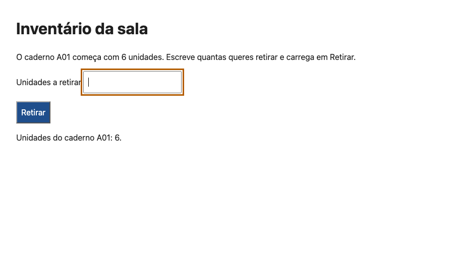

# Laboratório: A primeira página com JavaScript

## O que vais construir

Constróis, a partir de uma pasta vazia, a página do inventário da sala. Escreves quantas unidades queres retirar do caderno A01, carregas em "Retirar", e a página mostra as que ficam, pela regra da função `retirar` do M10, traduzida para JavaScript.



No fim, a pasta tem três ficheiros, que dividem o trabalho: o `index.html` diz o que a página tem, o `estilos.css` como se apresenta e o `inventario.js` o que faz.

```text
primeira-pagina/
├── index.html
├── estilos.css
└── inventario.js
```

1. [Fase 1: A estrutura da página em HTML](#fase-1-a-estrutura-da-página-em-html)
2. [Fase 2: Os controlos da página](#fase-2-os-controlos-da-página)
3. [Fase 3: A apresentação com uma folha de CSS](#fase-3-a-apresentação-com-uma-folha-de-css)
4. [Fase 4: O script e a consola do browser](#fase-4-o-script-e-a-consola-do-browser)
5. [Fase 5: Do Python ao JavaScript, a função `retirar`](#fase-5-do-python-ao-javascript-a-função-retirar)
6. [Fase 6: O script encontra os elementos da página](#fase-6-o-script-encontra-os-elementos-da-página)
7. [Fase 7: O botão chama a função](#fase-7-o-botão-chama-a-função)

## O que precisas

- O VS Code. Confirma que o tens: no menu `Help`, escolhe `About` (no macOS, no menu `Code`, `About Visual Studio Code`), e deve aparecer a versão. Os menus estão em inglês, como no VS Code acabado de instalar.
- Um browser atual, o Chrome, o Edge ou o Firefox, que confirmas abrindo-o. As mensagens de erro deste laboratório são as do Chrome e do Edge. O Firefox escreve-as com outras palavras.

## Preparar o projeto

1. Cria a pasta da página. Na pasta onde guardas os trabalhos de LP, cria uma pasta chamada `primeira-pagina`, sem espaços nem acentos.

2. Abre a pasta no VS Code, para os ficheiros novos ficarem lá dentro. No menu `File`, escolhe `Open Folder...` e seleciona a pasta `primeira-pagina`. Se o VS Code perguntar se confias nos autores dos ficheiros da pasta, escolhe `Yes, I trust the authors`, porque a pasta é tua e está vazia. O que deves ver: à esquerda, no `Explorer`, o nome da pasta em maiúsculas, sem ficheiros por baixo.

## Fase 1: A estrutura da página em HTML

Escreves em HTML a página mais pequena do inventário, com um título e um parágrafo, e abre-la no browser. Rever: [A estrutura da página em HTML](../01-primeira-pagina-com-javascript.md#a-estrutura-da-página-em-html) e [O editor escreve a página, e o browser mostra-a](../01-primeira-pagina-com-javascript.md#o-editor-escreve-a-página-e-o-browser-mostra-a).

1. Cria o ficheiro da página. No `Explorer`, passa o rato por cima do nome da pasta e carrega no ícone `New File...`. Escreve `index.html` e carrega em Enter. Por costume, a página principal de uma pasta chama-se `index`, e o `.html` diz ao computador que o ficheiro é uma página. O que deves ver: o ficheiro na barra lateral, aberto e vazio à direita.

2. Escreve no `index.html` a estrutura da página, com este conteúdo:

   ```html
   <!doctype html>
   <html lang="pt-PT">
     <head>
       <meta charset="utf-8">
       <meta name="viewport" content="width=device-width, initial-scale=1">
       <title>Inventário da sala</title>
     </head>
     <body>
       <main>
         <h1>Inventário da sala</h1>
         <p>O caderno A01 começa com 6 unidades. Escreve quantas queres retirar e carrega em Retirar.</p>
       </main>
     </body>
   </html>
   ```

   Enquanto escreves, o VS Code fecha sozinho algumas etiquetas, as marcas entre `<` e `>`: quando escreves `<h1>`, aparece logo `</h1>`. No fim, confirma que nada ficou a dobrar, como `</h1></h1>`.

3. Guarda o ficheiro, com Ctrl+S no Windows ou Cmd+S no macOS. O que deves ver: no separador do ficheiro, a bola dá lugar à cruz, sinal de que já não há alterações por guardar.

4. Abre a página no browser. Antes de a abrires, prevê: que texto aparece no separador do browser, e que texto aparece dentro da página? No `Explorer` do VS Code, carrega com o botão direito em `index.html` e escolhe `Reveal in File Explorer`, no Windows, ou `Reveal in Finder`, no macOS. Na janela de ficheiros que se abre, faz duplo clique no `index.html`. O duplo clique tem de ser nessa janela, porque dentro do VS Code abre o ficheiro para o editares.

   O que deves ver: o browser abre, com "Inventário da sala" no separador. Dentro da página aparece o mesmo texto, em letra grande e grossa, e o parágrafo por baixo. Se clicares na barra de endereço, o endereço começa por `file:///`: o browser está a mostrar um ficheiro deste computador, e a página não foi para a internet. Se aparecer o código em vez da página, vê [O duplo clique abre o código, e não a página](#o-duplo-clique-abre-o-código-e-não-a-página).

5. Experimenta o que acontece quando mudas a página. No VS Code, muda a palavra "sala" do `h1` para "escola", e não guardes. Olha para o browser. Depois guarda, e olha outra vez. Por fim, clica na janela do browser e recarrega a página, com F5 ou Ctrl+R no Windows, ou com Cmd+R no macOS.

   O que deves ver: a página só muda depois de guardares e de recarregares. O browser mostra o ficheiro tal como estava guardado quando a página carregou. Volta a pôr "sala" no `h1`, guarda e recarrega.

### Paragem 1

A página abre no browser, com "Inventário da sala" no separador e no título, e o parágrafo por baixo. Para veres uma mudança, mudas no editor, guardas e recarregas.

Pensa antes de continuares: o texto "Inventário da sala" está duas vezes no ficheiro. Qual das duas linhas dá o texto do separador, e qual dá o título dentro da página? A resposta: a do `title`, dentro do `head`, dá o separador. A do `h1`, dentro do `body`, dá o título da página. Se mudares só uma, só uma das duas coisas muda.

## Fase 2: Os controlos da página

Acrescentas à página o rótulo, o campo, o botão e a saída, e experimentas os controlos com o rato e com o teclado. Rever: [Os controlos da página](../01-primeira-pagina-com-javascript.md#os-controlos-da-página) e [A página também se usa sem rato e sem ver o ecrã](../01-primeira-pagina-com-javascript.md#a-página-também-se-usa-sem-rato-e-sem-ver-o-ecrã).

1. Acrescenta os controlos à página. No `index.html`, a seguir à linha do parágrafo `<p>O caderno A01 ...</p>` e antes de `</main>`, acrescenta estas linhas:

   ```html
         <p>
           <label for="unidades">Unidades a retirar</label>
           <input id="unidades" type="text">
         </p>
         <p>
           <button id="botao-retirar" type="button">Retirar</button>
         </p>
         <p>
           <output id="resultado"></output>
         </p>
   ```

   O `label` é o rótulo, o `input` o campo, o `button` o botão e o `output` a saída. Cada um recebe um `id`, o seu nome único na página. O atributo `for` do rótulo, que não tem nada que ver com o ciclo `for`, aponta para o elemento com `id="unidades"`, que é o campo.

2. Guarda e recarrega a página. Antes de experimentares, prevê duas coisas: o que acontece quando clicas no texto "Unidades a retirar", e o que acontece quando carregas no botão "Retirar"?

   O que deves ver: o rótulo e o campo numa linha, o botão na linha de baixo, e a saída, que não se vê porque está vazia. Ao clicares no texto do rótulo, o cursor aparece dentro do campo, pronto para escreveres: é a ligação do `for` ao `id`. Ao carregares no botão, não acontece nada, e está certo, porque ainda ninguém disse à página o que fazer com ele.

3. Experimenta a página só com o teclado, como faz quem não usa o rato. Clica numa parte vazia da página, carrega em Tab duas vezes e depois em Shift+Tab. Se carregares mais vezes no Tab e saíres da página para a barra do browser, clica outra vez numa parte vazia da página.

   O que deves ver: com o Tab, o foco passa para o campo e depois para o botão, com uma linha à volta. O foco é o elemento que recebe as teclas, e por isso, quando está no campo, as letras entram no campo. Com Shift+Tab, o foco volta para trás. O campo e o botão já funcionam assim sem nenhum trabalho teu. Se o foco saltar o botão, vê [O Tab salta o botão, num Mac](#o-tab-salta-o-botão-num-mac).

4. Provoca um erro de propósito, para veres o que o `for` faz. No rótulo, muda `for="unidades"` para `for="unidade"`, sem o "s". Guarda, recarrega e clica no texto do rótulo.

   O que deves ver: o cursor já não vai para o campo, e não aparece nenhuma mensagem de erro. O `for` aponta agora para um `id` que não existe, e o rótulo deixa de estar ligado a alguma coisa. Um leitor de ecrã, o programa que lê a página em voz alta a quem não a vê bem, também deixa de dizer o rótulo quando se chega ao campo. O HTML não avisa dos erros: a página só fica diferente. Volta a pôr `for="unidades"`, guarda e recarrega.

### Paragem 2

A página tem o título, o parágrafo, o campo com o rótulo, o botão e a saída. Clicar no rótulo põe o cursor no campo, e o Tab passa pelo campo e pelo botão. O botão ainda não faz nada.

O ficheiro `index.html` completo, como deve estar agora:

```html
<!doctype html>
<html lang="pt-PT">
  <head>
    <meta charset="utf-8">
    <meta name="viewport" content="width=device-width, initial-scale=1">
    <title>Inventário da sala</title>
  </head>
  <body>
    <main>
      <h1>Inventário da sala</h1>
      <p>O caderno A01 começa com 6 unidades. Escreve quantas queres retirar e carrega em Retirar.</p>
      <p>
        <label for="unidades">Unidades a retirar</label>
        <input id="unidades" type="text">
      </p>
      <p>
        <button id="botao-retirar" type="button">Retirar</button>
      </p>
      <p>
        <output id="resultado"></output>
      </p>
    </main>
  </body>
</html>
```

As linhas desta fase entraram no `main`, a seguir ao parágrafo. O resto ficou como na fase 1.

Pensa antes de continuares: o que acontecia com `for="Unidades"`, com maiúscula? A resposta: o rótulo também ficava sem campo. O browser compara o `for` com o `id` letra a letra, também nas maiúsculas, como o Python compara os nomes.

## Fase 3: A apresentação com uma folha de CSS

Crias a folha de estilos, o ficheiro do CSS, com cores escolhidas pelo contraste e um contorno de foco que se vê bem, e liga-la à página. Rever: [A apresentação com uma folha de CSS](../01-primeira-pagina-com-javascript.md#a-apresentação-com-uma-folha-de-css), [As cores escolhem-se pelo contraste](../01-primeira-pagina-com-javascript.md#as-cores-escolhem-se-pelo-contraste) e [O foco tem de se ver](../01-primeira-pagina-com-javascript.md#o-foco-tem-de-se-ver).

1. Cria a folha de estilos. No `Explorer`, com o rato sobre o nome da pasta, carrega em `New File...` e cria `estilos.css`. Escreve nele este conteúdo:

   ```css
   /* estilos.css: a apresentação da página do inventário. */

   body {
     font-family: system-ui, sans-serif;
     line-height: 1.5;
     color: #1f1f1f;
     background-color: #ffffff;
     margin: 2rem;
   }

   input,
   button {
     font: inherit;
     padding: 0.5rem;
   }

   button {
     color: #ffffff;
     background-color: #1f4e8c;
   }

   input:focus-visible,
   button:focus-visible {
     outline: 3px solid #b35c00;
     outline-offset: 2px;
   }
   ```

   A primeira linha, entre `/*` e `*/`, é um comentário, que o browser ignora. As três primeiras regras dão à página, ao campo e ao botão a letra, as cores e os espaços, e a última desenha o contorno do foco. As cores passam o mínimo de contraste que o texto normal pede, 4,5 para 1: o texto tem 16,5, o botão 8,3 e o contorno 4,7.

2. Liga a folha à página, porque o browser só usa uma folha de estilos se a página lhe disser onde ela está. No `index.html`, dentro do `head`, a seguir à linha do `title`, acrescenta esta linha:

   ```html
       <link rel="stylesheet" href="estilos.css">
   ```

   O `href` dá o caminho da folha. Escrito assim, sem pastas, aponta para o ficheiro com esse nome que está ao lado do `index.html`.

3. Guarda os dois ficheiros. Antes de recarregares, prevê: o que muda no texto, no campo e no botão? Depois recarrega.

   O que deves ver: a letra muda para a do sistema operativo, com mais espaço entre as linhas, e a página ganha uma margem à volta. O campo e o botão ficam com a letra do mesmo tamanho que o resto, com espaço por dentro, e o botão fica azul-escuro, com letras brancas.

4. Confirma que o foco se vê. Clica numa parte vazia da página e carrega em Tab duas vezes. O que deves ver: o campo, e depois o botão, rodeados por uma linha laranja grossa, um pouco afastada da borda.

5. Vê que regras se aplicam ao botão. Carrega com o botão direito no botão "Retirar" e escolhe `Inspecionar` (num browser em inglês, `Inspect`). Abre-se, ao lado ou por baixo da página, uma parte do browser com o HTML da página e o `button` marcado. Ao lado do HTML, no separador `Styles` (ou `Estilos`), estão as regras do botão. Rever: [O inspetor mostra as regras de cada elemento](../01-primeira-pagina-com-javascript.md#o-inspetor-mostra-as-regras-de-cada-elemento).

   O que deves ver: a regra `button`, com a cor branca, e a regra `input, button`, com o `font` e o `padding`. Por baixo, onde estão as propriedades que o botão herda do `body` (num browser em inglês, `Inherited from body`), a cor quase preta está riscada. O botão está dentro do `body`, mas a regra `button` dá-lhe o branco diretamente, e um valor dado diretamente ganha ao herdado. Fecha esta parte do browser com a cruz do canto.

6. Provoca um erro de propósito: no `link` do `index.html`, muda `href="estilos.css"` para `href="estilo.css"`, sem o "s". Guarda e recarrega.

   O que deves ver: a página volta ao aspeto da fase 2, com a margem pequena e a letra do browser, e o botão cinzento. Não aparece nenhuma mensagem na página. O browser procurou um ficheiro `estilo.css`, que não existe, e mostrou a página sem estilos. Para corrigir, compara, letra a letra, o nome no `href` com o nome do ficheiro na barra lateral do VS Code. Volta a pôr `href="estilos.css"`, guarda e recarrega. Rever: [Os nomes e os caminhos dos ficheiros](../01-primeira-pagina-com-javascript.md#os-nomes-e-os-caminhos-dos-ficheiros).

### Paragem 3

A página tem margem, a letra do sistema e o botão azul-escuro com letras brancas. O Tab mostra o contorno laranja à volta do campo e do botão.

O `index.html` completo, agora com a ligação à folha de estilos:

```html
<!doctype html>
<html lang="pt-PT">
  <head>
    <meta charset="utf-8">
    <meta name="viewport" content="width=device-width, initial-scale=1">
    <title>Inventário da sala</title>
    <link rel="stylesheet" href="estilos.css">
  </head>
  <body>
    <main>
      <h1>Inventário da sala</h1>
      <p>O caderno A01 começa com 6 unidades. Escreve quantas queres retirar e carrega em Retirar.</p>
      <p>
        <label for="unidades">Unidades a retirar</label>
        <input id="unidades" type="text">
      </p>
      <p>
        <button id="botao-retirar" type="button">Retirar</button>
      </p>
      <p>
        <output id="resultado"></output>
      </p>
    </main>
  </body>
</html>
```

A linha do `link` entrou no `head`, logo a seguir ao `title`. A folha `estilos.css` fica como a escreveste no passo 1.

Pensa antes de continuares: uma colega quer o texto do parágrafo em cinzento `#999999`, porque acha mais elegante. O que lhe dizes? A resposta: o `#999999` num fundo branco tem um contraste de 2,85 para 1, longe dos 4,5 para 1 que o texto normal pede. Muita gente ia ler mal o parágrafo, sobretudo num ecrã com pouco brilho. Uma calculadora de contraste mostra-o antes de se escolher a cor.

## Fase 4: O script e a consola do browser

Crias o `inventario.js`, o ficheiro do JavaScript, liga-lo à página e lês as mensagens dele na consola do browser. Rever: [O script e a consola do browser](../01-primeira-pagina-com-javascript.md#o-script-e-a-consola-do-browser).

1. Cria o ficheiro do script. No `Explorer`, cria `inventario.js` e escreve nele este conteúdo:

   ```js
   // inventario.js: o comportamento da página do inventário.

   console.log("O script está a correr.");
   console.log(6 - 2);
   ```

   A primeira linha é um comentário: em JavaScript, o `//` faz o que o `#` fazia em Python. As duas linhas de baixo servem para confirmares que o script corre, e o `console.log` mostra o valor que recebe, como o `print`.

2. Liga o script à página. No `index.html`, dentro do `head`, a seguir à linha do `link`, acrescenta esta linha:

   ```html
       <script src="inventario.js" defer></script>
   ```

   O `src` é o caminho do ficheiro do script, como o `href` do `link`, e o `script` leva sempre a etiqueta de fecho. Com o `defer`, o browser espera até ter lido o HTML todo para correr o script, e assim o script já encontra o campo e o botão.

3. Guarda os dois ficheiros. Antes de recarregares, prevê: onde vão aparecer as duas mensagens do script? Depois recarrega.

   O que deves ver: a página fica igual. O `console.log` não escreve na página: escreve na consola, que abres no passo seguinte.

4. Abre a consola, o sítio onde o browser mostra o que o script escreve e os erros dele. Carrega com o botão direito numa parte vazia da página e escolhe `Inspecionar`, como no passo 5 da fase 3. Nas ferramentas que se abrem, escolhe o separador `Console` (num browser em português, pode aparecer `Consola`). Se não vires as mensagens, recarrega a página com a consola aberta.

   O que deves ver:

   ```text
   O script está a correr.
   4
   ```

   A primeira linha quer dizer que o browser encontrou o ficheiro e correu o script, e o `4` é o resultado de `6 - 2`. Ao lado de cada mensagem, à direita, aparecem o ficheiro e a linha que a escreveu: `inventario.js:3` e `inventario.js:4`.

5. Escreve JavaScript diretamente na consola, na linha de baixo, onde está o cursor. Escreve `6 - 2` e carrega em Enter. Depois escreve `console.log("olá")` e carrega em Enter. Escreve sempre à mão, porque o Chrome e o Edge, por segurança, não deixam colar código na consola da primeira vez.

   O que deves ver: com `6 - 2`, aparece `4`. Com `console.log("olá")`, aparece `olá` e, por baixo, `undefined`. A consola mostra o valor de cada instrução que escreves, e o `console.log` não devolve nenhum. O `undefined` é a falta de valor, o `None` do JavaScript.

6. Provoca um erro de propósito: no `script` do `index.html`, muda `src="inventario.js"` para `src="inventaro.js"`, sem o "i" depois do "r". Guarda e recarrega, com a consola aberta.

   O que deves ver: as duas mensagens do script desaparecem, e no lugar delas aparece, a vermelho:

   ```text
   Failed to load resource: net::ERR_FILE_NOT_FOUND
   ```

   À direita aparece o ficheiro que o browser procurou, `inventaro.js`. A mensagem quer dizer "falhou o carregamento do recurso: ficheiro não encontrado". O browser procurou o ficheiro do `src`, não o encontrou, e não correu nenhum script. O aviso vem para a consola, e não para a página, como no `href` errado da fase 3. Para corrigir, compara o nome no `src` com o nome do ficheiro, letra a letra. Volta a pôr `src="inventario.js"`, guarda e recarrega: as duas mensagens voltam.

### Paragem 4

O `head` do `index.html` tem agora o `title`, o `link` da folha de estilos e o `script`, por esta ordem. O resto do ficheiro fica como na paragem 3.

```html
  <head>
    <meta charset="utf-8">
    <meta name="viewport" content="width=device-width, initial-scale=1">
    <title>Inventário da sala</title>
    <link rel="stylesheet" href="estilos.css">
    <script src="inventario.js" defer></script>
  </head>
```

A consola mostra `O script está a correr.` e `4`, e já escreveste JavaScript diretamente nela.

Pensa antes de continuares: o JavaScript desta página está num ficheiro do VS Code. Porque é que não o corres no VS Code, como fazias com os ficheiros de Python? A resposta: este JavaScript foi escrito para a página, e a página só existe no browser. É o browser que o corre, quando abre o `index.html`. Fora do browser não há página, e o script não teria campo nem botão para usar.

## Fase 5: Do Python ao JavaScript, a função `retirar`

Traduzes para JavaScript a função `retirar` do M10 e confirmas na consola que dá os mesmos resultados: a regra fica igual, e só muda a linguagem. Rever: [Do Python ao JavaScript, a função `retirar`](../01-primeira-pagina-com-javascript.md#do-python-ao-javascript-a-função-retirar), [`const` para o que não muda, `let` para o que muda](../01-primeira-pagina-com-javascript.md#const-para-o-que-não-muda-let-para-o-que-muda) e [Os ciclos `for` do JavaScript](../01-primeira-pagina-com-javascript.md#os-ciclos-for-do-javascript).

Esta é a função do M10, em Python:

```python
def retirar(quantidade, unidades):
    """Devolve a quantidade que fica depois de um pedido de retirada.

    Se o pedido for possível, devolve a quantidade menos as unidades pedidas.
    Se não for possível, devolve a quantidade que recebeu, sem mudanças.
    """
    if unidades > 0 and unidades <= quantidade:
        return quantidade - unidades
    return quantidade
```

1. Traduz a função e confirma-a com os dois casos do M10. No `inventario.js`, substitui todo o conteúdo por este:

   ```js
   // inventario.js: o comportamento da página do inventário.
   // Por agora, a função retirar e os testes que a confirmam na consola.

   /**
    * Devolve a quantidade que fica depois de um pedido de retirada.
    * Se o pedido for possível, devolve a quantidade menos as unidades pedidas.
    * Se não for possível, devolve a quantidade que recebeu, sem mudanças.
    * @param {number} quantidade as unidades que existem
    * @param {number} unidades as unidades que se querem retirar
    * @returns {number} a quantidade que fica depois do pedido
    */
   function retirar(quantidade, unidades) {
     if (unidades > 0 && unidades <= quantidade) {
       return quantidade - unidades;
     }
     return quantidade;
   }

   // Os dois casos do guia 01 do M10: em Python, davam 4 e 4.
   console.log(retirar(6, 2));
   console.log(retirar(4, 5));
   ```

   A lógica é a do Python, e só muda a escrita: as chavetas, os parênteses e o `&&` do `if`, e o JSDoc no lugar da docstring. Guarda e recarrega, com a consola aberta.

   O que deves ver: `4` e `4`, uma linha cada. São os resultados que o programa de Python dava, e por isso a tradução está certa.

2. Acrescenta uma sequência de pedidos, como os cliques que a página vai receber. No fim do `inventario.js`, a seguir às duas linhas do `console.log`, deixa uma linha em branco e acrescenta:

   ```js
   // Uma sequência de pedidos, como os cliques que a página vai receber.
   let quantidade = 6;
   const pedidos = [2, 5, 1];

   for (const pedido of pedidos) {
     quantidade = retirar(quantidade, pedido);
     console.log("Depois do pedido de " + pedido + ": ficam " + quantidade);
   }
   ```

   A `quantidade` é `let` porque muda a cada pedido. O array dos pedidos, a lista do JavaScript, é `const` porque é sempre o mesmo, e o `for...of` percorre-o como o `for pedido in pedidos:` do Python.

   Antes de recarregares, prevê as três linhas novas: segue os pedidos 2, 5 e 1 a partir de 6, pelas regras do pedido. Depois guarda e recarrega.

   O que deves ver:

   ```text
   4
   4
   Depois do pedido de 2: ficam 4
   Depois do pedido de 5: ficam 4
   Depois do pedido de 1: ficam 3
   ```

   O pedido de 2 é aceite e deixa 4. O de 5 é maior do que 4, é recusado, e a quantidade fica em 4. O de 1 é aceite e deixa 3. Em cada linha, o `+` junta o texto e os números numa só frase.

3. Testa os limites da regra na consola, que conhece as funções do script. Escreve cada uma destas chamadas e carrega em Enter:

   | Escreves na consola | Pelas regras | O que deves ver |
   | --- | --- | ---: |
   | `retirar(4, 4)` | Pede tudo o que existe: é aceite, e fica 0 | `0` |
   | `retirar(6, 0)` | Pede zero, que não é positivo: fica igual | `6` |
   | `retirar(6, -1)` | Pede um número negativo: fica igual | `6` |

   A primeira chamada mostra que o `<=` deixa retirar tudo. As outras duas mostram que o `> 0` recusa o zero e os negativos.

4. Provoca um erro de propósito, com um hábito do Python. Na linha 13, muda o `if` para a forma do Python, exatamente assim:

   ```js partial
     if unidades > 0 and unidades <= quantidade:
   ```

   Só essa linha muda. Guarda e recarrega, com a consola aberta.

   O que deves ver: nenhuma das cinco linhas aparece, e no lugar delas aparece, a vermelho:

   ```text
   Uncaught SyntaxError: Unexpected identifier 'unidades'
   ```

   À direita aparece `inventario.js:13`. A mensagem quer dizer "erro de sintaxe não apanhado: nome inesperado, `unidades`". É um erro de escrita: depois do `if`, o browser esperava um parêntese e encontrou o nome `unidades`. Com um erro de escrita, o browser não corre nenhuma linha do script, nem as que estão antes do erro, e por isso as cinco linhas desapareceram todas. Repõe a linha 13 como estava, com os parênteses, o `&&` e a chaveta, guarda e recarrega: as cinco linhas voltam. Rever: [Quando a página não faz o que devia](../01-primeira-pagina-com-javascript.md#quando-a-página-não-faz-o-que-devia).

### Paragem 5

A consola mostra `4`, `4` e a sequência que deixa 4, 4 e 3. Na consola, `retirar(4, 4)` dá `0` e `retirar(6, 0)` dá `6`.

O `inventario.js` completo, com a função e os testes:

```js
// inventario.js: o comportamento da página do inventário.
// Por agora, a função retirar e os testes que a confirmam na consola.

/**
 * Devolve a quantidade que fica depois de um pedido de retirada.
 * Se o pedido for possível, devolve a quantidade menos as unidades pedidas.
 * Se não for possível, devolve a quantidade que recebeu, sem mudanças.
 * @param {number} quantidade as unidades que existem
 * @param {number} unidades as unidades que se querem retirar
 * @returns {number} a quantidade que fica depois do pedido
 */
function retirar(quantidade, unidades) {
  if (unidades > 0 && unidades <= quantidade) {
    return quantidade - unidades;
  }
  return quantidade;
}

// Os dois casos do guia 01 do M10: em Python, davam 4 e 4.
console.log(retirar(6, 2));
console.log(retirar(4, 5));

// Uma sequência de pedidos, como os cliques que a página vai receber.
let quantidade = 6;
const pedidos = [2, 5, 1];

for (const pedido of pedidos) {
  quantidade = retirar(quantidade, pedido);
  console.log("Depois do pedido de " + pedido + ": ficam " + quantidade);
}
```

A função fica no princípio do ficheiro, e os testes por baixo dela. Primeiro vêm os dois casos do M10, e depois a sequência dos pedidos.

Pensa antes de continuares: a `quantidade` foi declarada com `let`, e os `pedidos` com `const`. O que acontecia se a `quantidade` fosse `const`? A resposta: na primeira volta do ciclo, a linha `quantidade = retirar(quantidade, pedido);` tentava dar outro valor a uma constante. O script parava com a mensagem `Uncaught TypeError: Assignment to constant variable.` (em português, atribuição a uma variável constante), e só as duas primeiras linhas, o `4` e o `4`, chegavam à consola.

## Fase 6: O script encontra os elementos da página

Trocas os testes da fase 5 pelo código que encontra o campo, o botão e a saída da página, e pões o script a escrever na saída. Rever: [O script encontra os elementos da página](../01-primeira-pagina-com-javascript.md#o-script-encontra-os-elementos-da-página) e [O que se escreve no campo entra como texto](../01-primeira-pagina-com-javascript.md#o-que-se-escreve-no-campo-entra-como-texto).

1. Troca os testes pelo estado do caderno e pelos elementos da página. No `inventario.js`, muda a segunda linha do comentário do início para esta:

   ```js
   // Guarda a quantidade do caderno A01 e retira unidades quando se carrega no botão.
   ```

   Depois apaga tudo o que está a seguir à chaveta que fecha a função `retirar`, que são os testes da fase 5. No lugar deles, deixa uma linha em branco e escreve:

   ```js
   // A quantidade muda a cada pedido aceite, por isso é let e não const.
   let quantidadeCaderno = 6;

   const campoUnidades = document.querySelector("#unidades");
   const botaoRetirar = document.querySelector("#botao-retirar");
   const saida = document.querySelector("#resultado");
   ```

   A `quantidadeCaderno` fica fora das funções, para guardar o estado do caderno de um clique para o seguinte. Cada `document.querySelector` procura na página o elemento cujo `id` vem depois do `#` e guarda-o num `const`.

   Guarda e recarrega, com a consola aberta. A página fica igual, e a consola não mostra nada. Escreve `botaoRetirar` na consola e carrega em Enter. O que deves ver: o botão, escrito como no HTML, `<button id="botao-retirar" type="button">Retirar</button>`. Isto quer dizer que o script encontrou o botão. Se aparecer `null`, o script não o encontrou: compara o `id` entre aspas com o do `index.html`, letra a letra.

2. Mostra a quantidade na página. A seguir à linha do `const saida`, deixa uma linha em branco e acrescenta a função `mostrarQuantidade` e a chamada que a corre ao abrir a página:

   ```js
   /**
    * Mostra na saída da página a quantidade atual do caderno.
    * Não devolve nada: muda o texto do elemento de saída.
    */
   function mostrarQuantidade() {
     saida.textContent = "Unidades do caderno A01: " + quantidadeCaderno + ".";
   }

   // A saída começa vazia no HTML; esta chamada mostra a quantidade inicial.
   mostrarQuantidade();
   ```

   O `textContent` é o texto que está dentro de um elemento. Dar-lhe um valor novo troca o que a página mostra nesse elemento.

   Antes de recarregares, prevê: o que aparece por baixo do botão? Depois guarda e recarrega.

   O que deves ver: por baixo do botão, `Unidades do caderno A01: 6.`, e nenhum erro na consola. Foi o JavaScript que escreveu esta frase, porque no HTML a saída está vazia. Se aparecer outra coisa, vê [Se alguma coisa falhar](#se-alguma-coisa-falhar).

3. Vê o que o `textContent` faz a um texto com etiquetas. Na consola, escreve esta instrução e carrega em Enter:

   ```js
   saida.textContent = "<b>Olá</b>";
   ```

   O que deves ver: a saída mostra `<b>Olá</b>`, com os sinais `<` e `>` à vista, e nada fica em negrito, apesar de `<b>` ser a etiqueta do negrito. O `textContent` escreve sempre texto simples, e o browser não o lê como HTML. Por isso, um texto escrito num campo nunca passa a ser HTML da página. Recarrega a página para voltares ao início.

### Paragem 6

A página abre com a frase `Unidades do caderno A01: 6.` por baixo do botão, escrita pelo script, e a consola não mostra erros. O botão ainda não faz nada.

O `inventario.js` completo, no fim desta fase:

```js
// inventario.js: o comportamento da página do inventário.
// Guarda a quantidade do caderno A01 e retira unidades quando se carrega no botão.

/**
 * Devolve a quantidade que fica depois de um pedido de retirada.
 * Se o pedido for possível, devolve a quantidade menos as unidades pedidas.
 * Se não for possível, devolve a quantidade que recebeu, sem mudanças.
 * @param {number} quantidade as unidades que existem
 * @param {number} unidades as unidades que se querem retirar
 * @returns {number} a quantidade que fica depois do pedido
 */
function retirar(quantidade, unidades) {
  if (unidades > 0 && unidades <= quantidade) {
    return quantidade - unidades;
  }
  return quantidade;
}

// A quantidade muda a cada pedido aceite, por isso é let e não const.
let quantidadeCaderno = 6;

const campoUnidades = document.querySelector("#unidades");
const botaoRetirar = document.querySelector("#botao-retirar");
const saida = document.querySelector("#resultado");

/**
 * Mostra na saída da página a quantidade atual do caderno.
 * Não devolve nada: muda o texto do elemento de saída.
 */
function mostrarQuantidade() {
  saida.textContent = "Unidades do caderno A01: " + quantidadeCaderno + ".";
}

// A saída começa vazia no HTML; esta chamada mostra a quantidade inicial.
mostrarQuantidade();
```

A função `retirar` ficou como na fase 5. Por baixo dela estão o estado do caderno, os três elementos e a função que mostra a quantidade, e no fim a chamada que a corre quando a página abre.

Pensa antes de continuares: o script já encontrou o botão. Porque é que um clique em "Retirar" ainda não faz nada? A resposta: encontrar o botão não diz ao browser o que fazer quando alguém lhe carrega. Falta pedir ao browser que chame uma função em cada clique.

## Fase 7: O botão chama a função

Ligas o botão a uma função que lê o campo, chama a `retirar` e mostra na saída o que fica. Rever: [O botão chama a função](../01-primeira-pagina-com-javascript.md#o-botão-chama-a-função).

1. Liga o botão à função que trata o clique. Entre a função `mostrarQuantidade` e o comentário `// A saída começa vazia...`, acrescenta estas linhas, com uma linha em branco antes e outra depois:

   ```js
   /**
    * Trata o clique no botão Retirar: lê o campo, faz o pedido e mostra o resultado.
    * Não devolve nada: muda a quantidade do caderno e o texto da saída.
    */
   function aoCarregarEmRetirar() {
     // O campo dá sempre texto, como "2", e a retirar espera um número: o Number converte-o no número 2.
     const unidades = Number(campoUnidades.value);
     quantidadeCaderno = retirar(quantidadeCaderno, unidades);
     mostrarQuantidade();
   }

   // Sem parênteses: o browser chama a função em cada clique, e não agora.
   botaoRetirar.addEventListener("click", aoCarregarEmRetirar);
   ```

   A última linha diz ao browser que, em cada `"click"` no botão, chame a função `aoCarregarEmRetirar`. A função lê o `value` do campo, que é o texto lá escrito.

   Guarda e recarrega. Depois faz os pedidos da tabela, pela ordem e sem recarregar a página. Em cada pedido, apaga o que está no campo, escreve o valor da tabela e carrega em "Retirar".

   | Pedido | Escreves no campo | O que deves ver na saída |
   | --- | --- | --- |
   | 1 | `2` | `Unidades do caderno A01: 4.` |
   | 2 | `5` | `Unidades do caderno A01: 4.` |
   | 3 | `4` | `Unidades do caderno A01: 0.` |
   | 4 | `1` | `Unidades do caderno A01: 0.` |

   Os pedidos 1 e 2 dão o mesmo que o programa de Python. O 3 retira tudo, e o 4 é recusado, porque já não há unidades.

2. Faz os mesmos pedidos só com o teclado. Recarrega a página, para o caderno voltar às 6 unidades. Carrega em Tab até o foco chegar ao campo e escreve `2`. Carrega outra vez em Tab, para o foco passar ao botão, e carrega em Enter.

   O que deves ver: a saída mostra `Unidades do caderno A01: 4.`, como com o rato. Num `button` do HTML, o Enter e a barra de espaço também dão um `"click"`, e por isso o botão funciona com o teclado sem nenhuma linha a mais.

3. Experimenta o que alguém pode escrever por engano. Recarrega a página e faz esta sequência, sem recarregar entre os pedidos. Em cada pedido, apaga o que está no campo antes de escreveres o valor da tabela. Antes de começares, prevê o que acontece com o `2.5`.

   | Pedido | Escreves no campo | O que o `Number` dá | O que deves ver na saída |
   | --- | --- | --- | --- |
   | 1 | `abc` | `NaN` | `Unidades do caderno A01: 6.` |
   | 2 | nada (apaga o campo) | `0` | `Unidades do caderno A01: 6.` |
   | 3 | `2,5` | `NaN` | `Unidades do caderno A01: 6.` |
   | 4 | `2.5` | `2.5` | `Unidades do caderno A01: 3.5.` |

   O `NaN`, de *Not a Number* (em inglês, não é um número), é o que o `Number` dá a um texto que não é um número. As comparações do `retirar` dão sempre `false` com o `NaN`, e por isso o pedido é recusado. O campo vazio dá 0, que também é recusado, e o `2,5` dá `NaN` porque o JavaScript escreve a parte decimal com ponto. Rever: [O `Number` converte o texto num número](../01-primeira-pagina-com-javascript.md#o-number-converte-o-texto-num-número).

   O pedido 4 mostra o que a página ainda não protege. O `2.5` é positivo e não passa de 6, e o caderno fica com 3.5 unidades, uma quantidade impossível. A função do M10, em Python, deixava passar o mesmo pedido, porque também não confirma que é inteiro.

4. Provoca um erro de propósito, num `id`. Na linha 23 do `inventario.js`, a do `const botaoRetirar`, muda `"#botao-retirar"` para `"#botao-retira"`. Guarda e recarrega, com a consola aberta.

   O que deves ver: a saída fica vazia, e a consola mostra, a vermelho:

   ```text
   Uncaught TypeError: Cannot read properties of null (reading 'addEventListener')
   ```

   À direita aparece `inventario.js:46`, a linha do `addEventListener`. A mensagem quer dizer "erro de tipo não apanhado: não é possível ler propriedades de `null`, ao ler `addEventListener`". É um erro de execução: o script parou na linha 46, e a última linha, que mostra a quantidade, já não correu. A causa está mais acima, na linha 23, que foi a que mudaste. O `querySelector` não encontrou nenhum elemento com o `id` `botao-retira` e devolveu `null`, o valor que quer dizer "nenhum objeto". O erro só aparece na linha que tenta usar esse `null`.

   Confirma esta explicação na consola: escreve `botaoRetirar` e carrega em Enter. Aparece `null`, e não o botão do passo 1 da fase 6. Repõe `"#botao-retirar"` na linha 23, guarda e recarrega.

5. Provoca outro erro de propósito, desta vez sem mensagem. Na linha 46, acrescenta parênteses ao nome da função, exatamente assim:

   ```js partial
   botaoRetirar.addEventListener("click", aoCarregarEmRetirar());
   ```

   Guarda, recarrega, escreve `2` no campo e carrega em "Retirar".

   O que deves ver: a saída mostra `Unidades do caderno A01: 6.`, mas o clique não muda nada, e a consola não mostra nenhum erro. Com os parênteses, a função correu logo ali, uma vez, quando a página abriu, com o campo vazio, e o pedido de 0 foi recusado. O browser recebeu o que a função devolveu, `undefined`, e ficou sem nenhuma função para chamar nos cliques. É um erro de lógica: o script corre sem mensagens e não faz o que devia. Tira os parênteses, guarda, recarrega e confirma que o botão volta a funcionar.

### Paragem 7

A página está completa. Abre com `Unidades do caderno A01: 6.`, e cada pedido válido retira unidades, com o rato ou com o teclado. Os pedidos impossíveis deixam a quantidade igual.

O ficheiro `inventario.js` completo, como deve estar agora:

```js
// inventario.js: o comportamento da página do inventário.
// Guarda a quantidade do caderno A01 e retira unidades quando se carrega no botão.

/**
 * Devolve a quantidade que fica depois de um pedido de retirada.
 * Se o pedido for possível, devolve a quantidade menos as unidades pedidas.
 * Se não for possível, devolve a quantidade que recebeu, sem mudanças.
 * @param {number} quantidade as unidades que existem
 * @param {number} unidades as unidades que se querem retirar
 * @returns {number} a quantidade que fica depois do pedido
 */
function retirar(quantidade, unidades) {
  if (unidades > 0 && unidades <= quantidade) {
    return quantidade - unidades;
  }
  return quantidade;
}

// A quantidade muda a cada pedido aceite, por isso é let e não const.
let quantidadeCaderno = 6;

const campoUnidades = document.querySelector("#unidades");
const botaoRetirar = document.querySelector("#botao-retirar");
const saida = document.querySelector("#resultado");

/**
 * Mostra na saída da página a quantidade atual do caderno.
 * Não devolve nada: muda o texto do elemento de saída.
 */
function mostrarQuantidade() {
  saida.textContent = "Unidades do caderno A01: " + quantidadeCaderno + ".";
}

/**
 * Trata o clique no botão Retirar: lê o campo, faz o pedido e mostra o resultado.
 * Não devolve nada: muda a quantidade do caderno e o texto da saída.
 */
function aoCarregarEmRetirar() {
  // O campo dá sempre texto, como "2", e a retirar espera um número: o Number converte-o no número 2.
  const unidades = Number(campoUnidades.value);
  quantidadeCaderno = retirar(quantidadeCaderno, unidades);
  mostrarQuantidade();
}

// Sem parênteses: o browser chama a função em cada clique, e não agora.
botaoRetirar.addEventListener("click", aoCarregarEmRetirar);

// A saída começa vazia no HTML; esta chamada mostra a quantidade inicial.
mostrarQuantidade();
```

A função `retirar` não mudou desde a fase 5. Por baixo dela vêm o estado e os elementos, as duas funções da página e a ligação do botão, e no fim a chamada que mostra a quantidade inicial.

Pensa antes de terminares: na linha `quantidadeCaderno = retirar(quantidadeCaderno, unidades);`, o que acontecia se tirasses o `quantidadeCaderno =` do princípio? A resposta: a função calculava o que fica e devolvia-o, mas ninguém guardava o valor. A variável ficava sempre com 6, e a página mostrava sempre `Unidades do caderno A01: 6.`, sem nenhuma mensagem de erro. É o mesmo erro de lógica do M10: a função não muda a variável, quem a muda é a atribuição.

## Se alguma coisa falhar

1. O VS Code tem aberta a pasta `primeira-pagina`, com os ficheiros lá dentro? A barra lateral mostra o nome da pasta, em maiúsculas, e por baixo os ficheiros, com os nomes escritos como no laboratório. Se a pasta não estiver aberta, por exemplo numa aula seguinte, abre-a como no passo 2 de [Preparar o projeto](#preparar-o-projeto).
2. Guardaste o ficheiro? O browser mostra o ficheiro tal como está guardado. Um separador do VS Code com uma bola no lugar da cruz tem alterações por guardar. Guarda com Ctrl+S no Windows ou Cmd+S no macOS.
3. Recarregaste a página? A página no browser não muda sozinha. Recarrega na janela do browser, e não no VS Code, com F5 ou Ctrl+R no Windows, ou com Cmd+R no macOS.
4. A consola mostra algum erro? Abre-a como no passo 4 da fase 4, lê a mensagem a vermelho e procura-a nos problemas desta secção.
5. Desfizeste o último erro provocado? Cada passo parte dos ficheiros como estavam antes do erro. Se te perderes, copia o último ficheiro que o laboratório mostra completo e refaz os passos que faltam.

### O duplo clique abre o código, e não a página

Se o duplo clique foi dentro do VS Code, o ficheiro abre para editar: abre a página pela janela de ficheiros do computador, como no passo 4 da fase 1. Se o nome do ficheiro acabar em `.txt`, como `index.html.txt`, o computador trata-o como texto. No VS Code, carrega com o botão direito no ficheiro, escolhe `Rename...` e muda o nome para `index.html`.

### O Tab salta o botão, num Mac

No Firefox de um Mac, o Tab só leva o foco aos botões quando está ligada a opção `Navegação através do teclado`, nas `Definições do Sistema`, em `Teclado`. A página não tem nenhum erro.

### A página aparece sem estilos, ou as mensagens do script não aparecem

A consola mostra `Failed to load resource: net::ERR_FILE_NOT_FOUND`, com o nome do ficheiro que o browser procurou. O caminho do `href` do `link`, ou do `src` do `script`, não é igual ao nome do ficheiro. Compara os dois nomes letra a letra, e confirma que o `estilos.css` e o `inventario.js` estão na mesma pasta que o `index.html`.

### A consola está vazia, sem mensagens nem erros

Abriste a consola depois de a página carregar, e alguns browsers só mostram as mensagens que aparecem com ela aberta. Recarrega a página com a consola aberta. Se continuar vazia, confirma que a caixa de filtro, no topo da consola, está vazia, e que o `script` está no `head` do `index.html`, como na paragem 4.

### A consola mostra `Uncaught SyntaxError: Unexpected identifier`

É um erro de escrita, e nenhuma linha do script corre. Vai à linha que a mensagem indica, à direita. Procura lá um hábito do Python: uma condição sem parênteses, um `and` no lugar do `&&`, ou dois pontos no fim da linha. Se a linha parecer certa, olha também para a de cima.

### A consola mostra `Uncaught SyntaxError: Unexpected end of input`

Falta fechar uma chaveta ou um parêntese, e o browser chegou ao fim do ficheiro à espera dela. A mensagem aponta para a última linha, mas a falta está mais acima. Põe o cursor ao lado de cada `{`, e o VS Code marca a `}` que fecha esse bloco.

### A consola mostra `Uncaught TypeError: Cannot read properties of null` ou `Cannot set properties of null`

O nome entre parênteses, no fim da mensagem, diz o que o script tentou usar: `addEventListener` no botão, `textContent` na saída, `value` no campo. O `querySelector` desse elemento não o encontrou e devolveu `null`. Escreve na consola o nome do `const` do elemento, como `botaoRetirar` ou `saida`. Se aparecer `null`, compara o seletor do script com o `id` do HTML, letra a letra. Se o `id` estiver certo, compara a linha do `script` do teu `index.html` com a da paragem 4.

### A consola mostra `Uncaught TypeError: Assignment to constant variable.`

O script tenta dar outro valor a uma variável declarada com `const`. Se ela tiver mesmo de mudar, declara-a com `let`.

### A consola mostra `Uncaught ReferenceError: quantidade is not defined`

Em Python, era o `NameError`. O nome da linha indicada não existe: está mal escrito, tem outra maiúscula, ou não foi declarado. Compara-o com o nome da declaração. Para o JavaScript, `quantidadeCaderno` e `quantidadecaderno` são nomes diferentes.

### O botão não faz nada, e a consola não mostra erros

Confirma primeiro que o campo tem só o número que queres e que o pedido é possível: um pedido recusado deixa a frase igual. Se o pedido devia ser aceite, a função foi dada ao `addEventListener` com parênteses. Escreve só o nome da função, sem parênteses, como no passo 5 da fase 7.

### A saída mostra números colados, como `61`

Um dos valores da conta é um texto, e o `+` com um texto junta em vez de somar. Converte o texto em número com o `Number` antes da conta. Numa frase, põe a soma entre parênteses, como em `"Total: " + (a + b)`, para o JavaScript somar antes de juntar ao texto.

### O VS Code tenta correr o ficheiro de JavaScript e mostra `ReferenceError: document is not defined`

O JavaScript desta página não se corre no editor. Sem o browser não há página, e o `document` não existe. Abre o `index.html` no browser, que carrega o script.

## Desafios

1. Avisar quando o pedido é recusado. Hoje, quem faz um pedido impossível vê a mesma frase de sempre e não fica a saber que o pedido foi recusado. Muda a página para que, num pedido recusado, a saída mostre `Pedido recusado. Unidades do caderno A01: 6.`, com a quantidade certa. Pista: guarda a quantidade antes do pedido numa variável e compara-a com a de depois.
2. Um botão para adicionar unidades. Acrescenta um segundo botão, "Adicionar", que usa o mesmo campo e soma unidades ao caderno. Escreve primeiro uma função `adicionar(quantidade, unidades)`, com JSDoc, que só aceita pedidos positivos e devolve a quantidade sem mudanças nos outros casos. Pista: testa a função na consola com 6 e 3, 6 e 0 e 6 e -2 antes de lhe ligares o botão.
3. A pasta A02. Acrescenta à página a pasta A02, que começa com 2 unidades, com o seu próprio campo, o seu botão e a sua saída. Responde, num comentário no fim do `inventario.js`: quantas variáveis, quantos `id` e quantas funções novas precisaste? Que problema do guia 01 do M10 voltou a aparecer? Pista: conta tudo o que tiveste de repetir para a pasta, e imagina o mesmo para cinquenta artigos.

## Antes de terminares

- [ ] A pasta `primeira-pagina` tem o `index.html`, o `estilos.css` e o `inventario.js`, e a página abre com um duplo clique.
- [ ] Clicar no rótulo põe o cursor no campo, e o Tab mostra o contorno laranja no campo e no botão.
- [ ] Com a página carregada, a consola não mostra erros.
- [ ] Na consola, `retirar(6, 2)` dá `4` e `retirar(4, 5)` dá `4`, como no programa de Python.
- [ ] Os pedidos 2, 5, 4 e 1, por esta ordem, deixam a saída com 4, 4, 0 e 0 unidades, com o rato e com o teclado.
- [ ] Sabes que tipo de erro é cada um dos que provocaste nas fases 5 e 7: o `if` à maneira do Python, o `id` errado e os parênteses.
- [ ] Sabes explicar o que faz cada um dos três ficheiros e o caminho de um número desde o campo até à saída da página.


